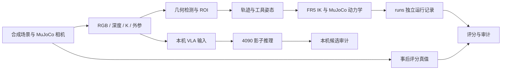

# 主工程结构

打磨主工程位于 `/home/dianrobot/daiyi_grinding/`，作为独立 Python 工程维护，使用独立的 `.venv`，与其他机器人项目相互分离。

## 模块职责

| 模块 | 职责 |
| --- | --- |
| `project.py` | 主源码、项目资源、固定结果和新运行的路径 |
| `robot_model.py`、`assets.py` | FR5 关节原点、质量和碰撞代理参数、固定版本官方网格 |
| `geometry.py`、`sim.py` | 合成工件、MuJoCo 场景、相机与 FR5 IK |
| `calibration.py` | 图像角点、PnP、手眼变换和外参加载 |
| `perception.py` | RGB-D 几何检测、正常结构分类和 ROI |
| `planning.py`、`execution.py` | 工具路径、姿态、关节命令、预检查和动力学推进 |
| `evaluation.py`、`benchmark.py` | 事后评分、固定种子协议与配对评估 |
| `run.py`、`serve.py` | CLI 主链、运行记录、网页与子进程 |
| `vla_experiment.py` | 本机 prepare/audit、服务器 infer |
| `build_delivery.py` | 独立目录中的 PDF 和可运行源码演示包 |

## 数据流

检测和规划接收观测及标定参数。生成标签只在事后评分使用。`paths.json` 使用世界坐标米和 3×3 工具旋转矩阵；CSV 转为机器人基座毫米与 XYZ 欧拉角，仅用于接口审阅。

## 文件与环境

资源由项目位置定位。主源码可从任意工作目录导入；网页子进程使用 `sys.executable`，视频编码器通过 `imageio_ffmpeg` 定位。FR5 参数和网格读取均在本包内完成。

`results/` 中的演示、标定和评估是固定证据。新运行创建 `runs/` 下的独立目录，记录真实仿真观测、下发给 MuJoCo 的关节命令、反馈和当前源码副本。网页在计算模型变化后要求重新规划，比较实际源码文件。

基础依赖在 `pyproject.toml` 声明，本机已安装的精确版本在 `requirements.lock.txt`。CPU/MuJoCo 环境与 GPU 模型环境独立。双机文件交换只同步主源码或一个明确 run ID 的输入输出，服务器完整模型工程保留原位。
