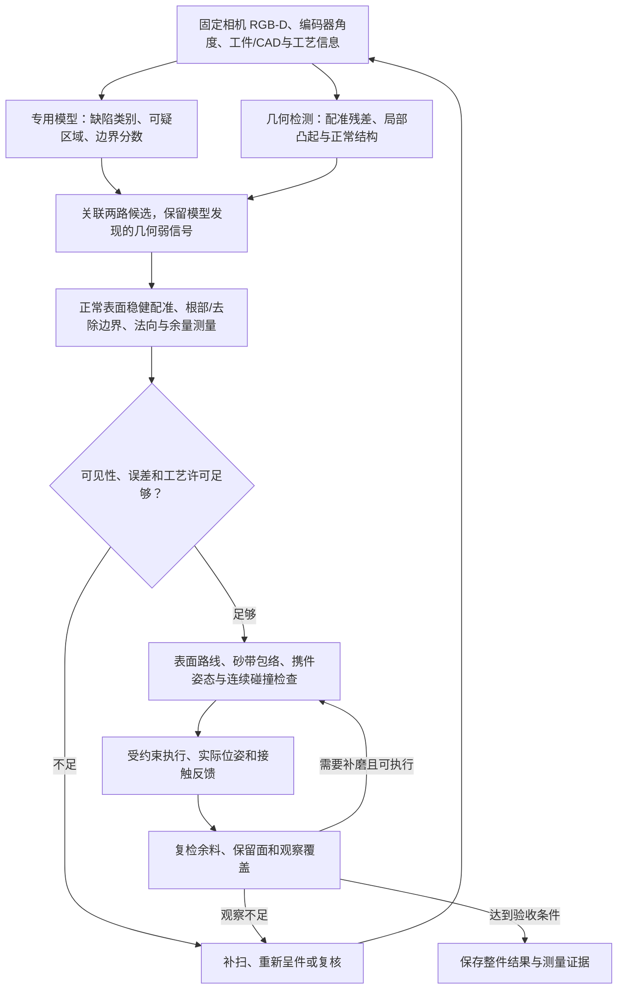

# 铸件毛刺与飞边打磨：缺陷模型接入分析

核对日期：2026-11-20。项目资料范围为 [INDEX_LOCAL.md](../INDEX_LOCAL.md)
所索引的本地飞书文档、当前 ESTUN 仿真源码和保存的实验记录。
文献通过 alphaXiv、Exa、出版社及作者仓储读取；按用户要求，
后续研究不依赖 Consensus 配额。文末分别标明全文、摘要和仓库的证据范围。

**建议引入针对公司工况训练的缺陷分割模型。第一轮升级的任务是可靠地分出
可去除材料、识别应保留结构，并把结果转成可测量的三维根部和去除边界。
现有几何检测应保留为基线及测量工具，现有安全规划和复检继续承担执行约束。**
模型的价值需要通过真实铸件和冻结的对照实验验证，不能根据公共数据集上的
高准确率推定。

本次产出为技术分析和实验方案；当前运行系统仍使用几何检测，
没有新增已训练模型或变更冻结的识别、规划、动力学结果。

**公司的目标应落实到可加工缺陷，而不仅是“异常”。**

[愿景技术指标](../feishu_docs/具身打磨项目愿景技术指标__wiki-CZfWwvWKsimxGNkRFsHcSuvjncV.md)
要求识别飞边披锋、浇铸系统残根的位置、形态及磨耗程度，
调整打磨参数，并提出视觉定位 ±0.1 mm、型面一致性 ±0.3 mm、
换型不超过 30 min、新产品导入占用设备不超过 2 h 等目标。
这些是项目方向，尚未构成已经验证的成绩或本次新增的正式验收条件。

当前新工况来自
[11.19 阶段进展](../feishu_docs/阶段进展汇报11.19__wiki-FCaxwgXVui5vZQky5CPceyAsnYg.md)：
ESTUN iER220-2700 机械臂夹持工件，到固定砂带加工。
固定相机、编码器分度和局部批缝定位来自
[相机使用记录](../feishu_docs/3D相机的使用__wiki-SNEFwM9pEitxaykEJfQcDZGnnwb.md)
及 [11.12 工作会议](../feishu_docs/20261112_具身打磨工作会议纪要__wiki-BczAw8DTqi9gEQkOtAvcmodunJg.md)。
第一轮模型试验可以围绕现有 097 铸件、明确的加工许可区域和当前砂带工位展开。
当目标扩展到浇冒口残根或新 CAD 时，应增加相应数据与工艺定义。

[工件样品概况](../feishu_docs/工件样品概况__wiki-PgR0wKBsZitEVtk7LSzchUaKn5c.md)
包含锈蚀、粗糙表面、卷曲和破裂的薄片、正常口沿与环向结构、
腔内尖突等情况。它明确指出：异常结构是否应去除、实际根部和去除边界，
需要实物数据和工艺确认。正常法兰、加强筋、设计薄边、
缺料、裂纹或锈斑具有不同处置含义，不能统一转成自动打磨目标。

**王、杨、曹的成果应按实际职责接入。**

| 成果来源 | 已记录的方法与输入 | 对本项目的用途 | 证据边界 |
|---|---|---|---|
| 王释钰：[11.12 模块说明](../feishu_docs/11.12代码结构、模块功能变化__wiki-H5fxwWJ3Yi5sHVkPRYTcYWc8nCb.md)、11.19 进展 | 指定目标点云/标签/ROI → 表面路径 → 数值 IK → 机器人与转台规划 → 修正和碰撞验收 | 表面路线、姿态搜索、进退段、转场、携件安全和失败诊断 | 模块说明明确自主缺陷识别尚未接入；11/75 是另一套实现和四种工件的历史结果 |
| 杨国翱：[几何复现](../feishu_docs/铸件飞边打磨几何方法复现实现__wiki-Nq92wWaaviCPt9kvvTLcwZEHnbf.md)、[飞边合成](../feishu_docs/飞边缺陷合成__wiki-LcFzw9XUoiiPGrkdFzTc9TT0n5e.md) | 标准件/待磨件配准、差异分割、内外边缘、局部根部线；实测正常点云及人工分型线上的缺陷合成 | 几何测量、根部提取基线、数据采集和合成先验 | 合成椭圆/S 形工件上的路径误差不能当作真实铸件定位精度；资料未证明已训练公司毛刺模型 |
| 曹正恒：[WeldGrind V1](../feishu_docs/具身打磨算法V1_NOV12：__wiki-CwPRw3ikDiw6XbkRyMYcDQqEnoD.md) | SAM 3 分割 RGB → 标定投影 → 三维 ROI；点/体素特征、Conditional DiT、流匹配生成轨迹，再做局部几何后处理 | 图像到三维的接口、合成监督组织、几何后处理；后续可比较轨迹候选生成 | 14.91M 是轨迹模型参数量；95.42% 是运动阶段预测准确率；0.4915 mm 是报告的训练轨迹 RMSE；泛化仍待验证 |
| 孔凌峰：[11.19 训练记录](../feishu_docs/基于公共数据集的PointNet++和相关点云视觉检测网络训练（2）__wiki-Ies4wZE48iq6fEkYSencvZY1nzb.md) | PointNet++、几何分数融合、PTv2/PTv3、点云分块及补点试验 | 可复用训练流程、点序/标签对应核验和细节保留经验；PTv2 为实用候选 | CPS3D-Seg 是陶瓷封装基板；PTv2 4096 点块 AP/Recall 为 46.04%/47.75%；3D-ADAM PointNet++ AP 尚低于 3%，需要诊断 |

因此，团队已有几何、采集、数据合成、图像分割、点云训练和机器人规划等
互补成果。资料不支持“他们都已经用训练好的缺陷网络完成了公司铸件打磨”
这一表述。各类 AP、F1、运动阶段准确率、轨迹 RMSE 和路径验收率
也不能互相替换或跨任务直接排名。

当前实际复用曹的部分是固定提交
`0e110bf14952cf89ef127342d6a10932d151fa62`
中的原 CPU 物理轨迹滤波，接入代码为
[workstation_reuse.py](../src/daiyi_grinding/workstation_reuse.py)。
本环境未接入其训练轨迹权重或 SAM 3 权重。

**现在的识别算法：配准 CAD 参考下的深度差分与几何规则。**

实际入口是
[workstation_inspection.py](../src/daiyi_grinding/workstation_inspection.py)
的 `InspectionSession.capture()`，
调用 [thin_reference.py](../src/daiyi_grinding/thin_reference.py)
的 `detect_thin_reference()`。

1. 固定相机在六个 60° 分度角生成 RGB 和观测深度。
   同一工件位姿下隐藏附加缺陷，渲染正常 CAD 参考深度与参考工件掩码。
   保存相机内参、相机/工件变换和积分后的转台角度。
2. 深度加入默认 σ=0.06 mm 的高斯噪声和 0.003 缺点概率；
   `noisy` 工况改为 σ=0.25 mm 和 0.025 缺点概率。
   按内外参反投影到工件坐标，限制检查范围，并保护 CAD 参考的不连续边缘。
   倾斜表面使用逆深度二阶差分，避免将整个平滑斜面判成边缘。
3. 计算 `参考深度 - 观测深度`，减去有效配对区域的中位数偏置。
   用负向残差估计噪声 σ。
4. 双阈值提取正余料：支撑阈值为 `max(0.16 mm, 2.5σ)`，
   强种子阈值为 `max(0.40 mm, 4σ)`。
   八邻域传播、闭运算、连通域处理；整站保留不少于 6 像素的区域，
   并将三维距离不超过 2 mm 的已观测片段连接。
5. 根据区域长度、宽度、长宽比和深度差分类：
   细长区域归为批缝，紧凑区域归为毛刺；
   光轴深度差超过 5 mm 的区域归为复核；
   宽范围不一致归为保留/配准复核。
   网页置信度是按深度差换算的启发式分数，没有经过概率校准。
6. 观测与参考点的位移再投影到参考表面法线。
   使用正法向余量的 80% 分位数决定是否超过当前 0.3 mm 加工阈值。
   跨视角按类型和位置关联区域，再选择质量较好的观测生成局部路径。

RGB 当前用于观测展示和叠加，未通过训练网络决定缺陷类别。
检测和路径返回后才读取缺陷真值用于评分；真值未输入检测或补磨控制。
但正常 CAD 的投影、工件位姿和相机变换非常理想，这是当前仿真的强前提。
真实接入必须面对配准误差、铸件正常尺寸公差、表面反光及缺失根部。
像素有参考深度也不保证该射线上的 CAD 点就是卷曲薄片的真实根部。

**已有结果说明需要补哪里，不能预告模型收益。**

[最终冻结验证](../runs/workstation_upgrade_20261119/holdout_final_9201_9202/report.md)
使用开发种子之外的 9201/9202，包含一种 CAD、14 次工况、
84 帧相关观测。其像素 Precision=99.02%、Recall=82.61%、
F1=90.08%、IoU=81.94%；对象命中为 34/34。
其中两个噪声工况 F1 只有 77.08% 和 73.34%。

当前对象命中只要求类别对应且预测与可见真值有一定交叠，
代码条件为至少 3 个像素且覆盖至少 20% 的可见真值像素。
因此 34/34 不等于完整分出 34 个根部或全部去除边界。
这些结果来自生成缺陷和简化传感器，也不代表真实相机上的性能。

同一观测路径上的分段规划验收为 47/63，旧本地单姿态规划为 9/63。
这一成对比较支持本地规划改进；它不支持与王的 11/75 历史结果直接比较。
冻结验证未执行动力学。

独立于上述识别/规划基准的开发闭环示例：

| 示例记录 | 结果 | 对模型路线的含义 |
|---|---|---|
| [毛刺闭环](../runs/workstation_upgrade_20261119/burr_observed_closed_loop_final/result.json)，seed 9101 | 3 条路径完成；几何余料峰值 2.732457 → 0.241981 mm；全部三处低于 0.3 mm；加工点跟踪 P95=0.759694 mm；无记录的非预期接触 | 已有执行/复检基础可用来比较新识别结果；属于开发示例和几何去除模型 |
| [混合闭环](../runs/workstation_upgrade_20261119/mixed_observed_closed_loop_final/result.json)，seed 7007 | 两轮后仍有两处侧壁余料，峰值 2.097897/1.513003 mm；顶点完成率约 74.19%；`goal_complete=false` | 需要分别诊断观察覆盖、边界完整性、工具/抓手可达性和加工轮数；提高检测分数无法自动解决携件干涉 |

当前材料更新只裁去生成余料，正常 CAD 不修改。
这验证的是几何扫掠和观测驱动复检，不是实际过磨、恒力、
材料去除速率、温升或粗糙度。MuJoCo 接触力存在并不等于已经标定
砂带磨削过程；两个记录的 `force_control_validated` 都为 false。

**论文支持“学习感知 + 几何测量 + 受约束执行”，并未给出一个即插即用的答案。**

| 已核验研究 | 真正解决的问题 | 对当前工况的借鉴 | 不能据此认定的能力 |
|---|---|---|---|
| Mohammed 等，2022 在线/2023 卷期 [P1] | 稀疏 U-Net 学习几何描述子，改善 CAD/实测点云粗配准；分型面 ROI 内用法向差和表面重建测毛刺 | 用 CAD 扰动训练稳健特征；分清粗配准与局部毫米测量；使用工艺先验 | 网络输出不是毛刺语义掩码；91% 对 56% 是在 10 mm/10° 阈值下的配准成功率；CT 高度分布 z 检验不是逐点 ±0.1 mm 验证 |
| Zhang 等，Sensors 2026 [P2] | 真实轮对注油孔毛刺点级分割；PointNet++ 加 KPConv 和几何注意力，mIoU=94.25% | 小缺陷浅层几何特征、细采样及边界关注有价值 | 1040 点云按样本随机划分，同一轮对/孔可能跨集合；论文明确不证明全新轮对泛化；没有闭环打磨验证 |
| Catalucci/Savio，CIRP JMST 2026 [P3] | 实际压铸铝壳体扫描与合格主件求差，二维偏差图上运行 YOLOv8，再做骨架尺寸测量与 CMM 对照 | 三维信息可以以有组织的二维图输入网络；学习与测量分别验证 | 骨架尺寸平均偏差约 0.294 mm，部分缺陷未检出；测的是尺寸而非根部路径；没有自动磨削结果 |
| Onstein 等，Procedia CIRP 2023/2024 [P4/P5] | CAD/扫描/铸造先验生成适应单件的工具路径；摘要报告 KUKA KR60 或气动主轴硬质合金刀的实验 | 路径应结合实测形状、工艺先验和工具 | 原文摘要不能提供当前持件到砂带工况的力、精度或整件合格率 |
| M3DM，CVPR 2023 [P6] | 正常样本的 RGB/3D 特征融合与多记忆库异常检测 | 正常数据充足时可做未知异常提示；多模态互补 | MVTec3D-AD 的同角度 224×224 基准与我们的根部计量不同，AUROC/AUPRO 不等于打磨准确率 |
| 3D-ADAM v2，2025 [P7] | 多传感器、多视角、217 个实体、14120 次扫描的基准；按实体划分防止视角泄漏 | 数据分组、正常机械特征、未知异常和局部指标 | 工件为 PLA/FDM；RGB PatchCore 的图像 F1=0.959，但像素 F1=0.069，不能把整图判断转成精确去除边界 |
| SAM 3 v2 与官方代码 [P8] | 由文本概念、示例或视觉提示检测、分割及跟踪图像对象 | 加速标注、提示候选、建立曹路线的固定提示对照 | 论文提示域外概念仍困难；未验证公司毛刺根部计量或磨削；公开权重可获得不代表已在本环境接入 |
| PTv2，NeurIPS 2022 [P9] | 分组向量注意力、网格池化、逐点分割 | 可复用孔的训练经验，比较局部三维分割 | 原论文是室内场景等任务；0.02/0.05 m 网格参数不可直接用于细薄毛刺 |
| AF3AD，2026 [P10] | 法线/PCA 局部系上的参数化几何异常合成，接入不同异常检测器 | 参数化生成器、扰动多样性和固定对照；核心 NumPy/MIT | 平滑位移不能完整生成卷曲、破裂薄片或外观异常；特征分布相近不证明铸造机理真实 |

P1 有 4 种 CAD、20 个实物、285 个可用实测视角，仅用 2 种 CAD
生成训练数据。其网络采用 1 cm 体素，承担的是粗配准描述子任务；
细毛刺高度来自后续几何测量。这一点可避免把“稀疏 CNN 的铸件论文”
误读成“1 cm 体素也能精确分割亚毫米毛刺”。

P3 的作者全文把扫描、标定后的偏差图、检测框和尺寸测量串起来，
证明二维网络可以利用三维几何信息。它也报告小缺陷的高估和点密度不足导致
的漏检。该实验使用约 90 件壳体与四侧观察；相关会议短文明确写 92 件。
读取材料没有充分建立全部侧面按实体分组的训练/测试隔离，
本项目不能照搬图像随机划分。

Tabernik 等的工业表面缺陷研究 [P11] 也说明固定窄任务可以从较少缺陷实例
起步，其结论只针对电气换向器塑料表面的裂纹。
论文主要评价整图分类，不能拿它的少样本成功率证明毛刺根部计量。
因此“15–20 种零件 × 50–80 变体”可以作为团队扩展数据的估算，
不应成为当前单一产品启动模型试验的硬门槛。

**建议的首个模型是局部 RGB-D 分割网络，PTv2 是有明确比较价值的三维候选。**

| 候选 | 第一轮角色 | 选择理由与验证重点 |
|---|---|---|
| 多通道/双支路 U-Net | 首个专用监督分割基线 | 当前数据有组织且像素可映射三维；RGB 支路学外观和语义，几何支路学深度、法线、余量及有效性；检查细边保留与正常结构误检 |
| PointNet++ / PTv2 | 使用同任务数据的三维对照；优先复用组内可运行实现 | 对不规则局部结构或侧面几何可能更合适；以根部误差和真实漏检决定是否保留；4096 点块是试验起点，不能替代毫米尺度设计 |
| SAM 3 | 固定提示的候选对照和标注辅助 | 从训练样本/CAD 工艺信息确定提示；记录人工介入；评估细小毛刺漏检和边界偏差 |
| PatchCore 或 M3DM 思路 | 正常样本上的未知异常提示，可后续增加 | 未见类别可触发补扫/复核；分数不直接发出加工许可 |
| 稀疏卷积配准描述子 | 在真实初始化失败或装夹变化需要时评估 | 固定相机与编码器已提供位姿初值，当前先验证局部精配准；无需把全局配准网络作为必选前置 |
| Cao 的轨迹生成模型 | 后续候选路径生成对照 | 待感知与根部评测稳定、权重可用后，比较覆盖与耗时；所有候选仍经当前工具、携件、连续运动验收 |

U-Net 是工程起点，不是已经证明优于其他模型的最终选型。
首次输入可以包括对齐后的 RGB、深度、局部法线、带符号参考余量
和深度有效性。采用 RGB 编码与几何编码融合时，额外通道和预训练权重
的适配要在同一评测上核验。缺失深度应显式标记；
网络可以发现 RGB 上的可疑薄片，但没有可信三维数据时应补扫。

输出宜区分缺陷类别与加工处置：
飞边/毛刺/残根是类别；允许去除、保留、需复核是工艺决定。
第一轮覆盖已经确认的飞边与毛刺，保留正常表面及设计结构。
根部线或去除边界需要单独标注和评价；有了相应监督以后再增加边界输出。
低置信或未见类别应进入复核状态，不能通过一个未经校准的分数声明
“所有未知情况都已识别”。

图像分辨率应围绕最小缺陷和实际空间采样设计。高分辨率 RGB-D 可用
重叠局部块处理并保留每块的像素/毫米变换。
将整张 1936×1464 图直接缩成 224×224 或 640×640，
会改变细薄边界的可辨性。点云也应按物理尺度分块、保留原始索引、
增加重叠和边界上下文；训练时已知的缺陷标签可以用于均衡采样，
推理时不能用标签决定保留哪些点。

比相机型号更关键的是可用信息与误差：RGB 有助于判别外观，
当前不规则铸件的根部、高度、法向和碰撞包络需要三维约束。
三维信息可来自同一 RGB-D 相机，也可来自经过标定的其他测量方式。
更细的体素或更大 RGB 像素数无法恢复传感器未采到的根部。

**建议保留两条候选来源，再做测量与工艺验证。**

不能只让模型在旧差分检测出的区域内运行，或把两路结果直接取交集：
旧阈值漏掉的薄片将始终进不了模型。
模型应在充分覆盖工件的图像/点云区域内预测，
两路产生的候选可以互相补充。最终自动执行依然需要可信测量、
允许加工区、被保护表面和完整的运动检查；
模型与深度冲突、根部不可见时保留可疑目标并补扫。

参考表面精配准应优先使用可靠正常区域和定位特征，
降低毛刺/异常点对配准的影响，同时容纳工艺允许的正常尺寸变化。
制造公差不是都应磨去的“正残差”，非刚性拟合也不应把真实毛刺
吸收到正常表面里。缺陷网络可以帮助选择正常支撑点，
参考误差必须作为测量不确定性记录。

**根部与余量测量应独立于掩码得分验收。**

飞边通常具有自由外沿、卷曲薄片和连接本体的根部。
二维掩码的中心线可能位于薄片上；掩码边界也同时包含外沿和根部。
将其反投影只得到相机可见的缺陷表面，不能自动得到去除基准。

可沿用杨的内外边缘/截面方法作为基线：
在可疑区域周围选正常支撑点，拟合局部承载表面，
识别与本体相接的边界，按局部曲率提取连续根部线，
同时保存自由边、余料高度、厚度及允许去除带。
平面假设只用于适用区域，曲面需局部处理。
当根部被薄片或夹具遮挡时，应增加观察角度或改变呈件；
水平转台绕一圈不保证底面、腔内和薄片背面的信息齐全。

沿参考表面法向的余量可写为
`h = (观测表面点 - 对应基底点) · 基底法向`。
这要求对应关系正确，也要计入配准和法线误差。
当前 80% 分位数是稳健加工判断，不能严格证明整件最高余量低于 0.3 mm。
真实复检需要观察覆盖、局部峰值/上界、测量不确定性和缺失区域的记录。

对固定砂带，表面路径需要转成“工件局部目标点与法向满足固定工具接触，
据此求机械臂持件姿态”。从另一工况获得的手持工具 XYZ 路线不能直接
作为持件运动命令。可达性受砂带宽度、抓手包络、装夹和工件姿态限制。
改进网络不应改变这些运动约束的适用范围。

真实砂带加工还需工艺试验确定磨具状态、带速、进给、力/柔顺、
单次去除量和补磨策略。Song/Song 的原论文摘要 [P12] 将路径误差补偿、
阻抗控制和过大接触力限制分开处理，说明路径跟踪与稳定加工需要不同反馈。
其实验参数不能直接移植到当前工件和砂带。

**数据应从实际产品的边界和失败例开始。**

每个实体保存 `part_id`、CAD、批次、加工前后状态、每视角原始 RGB/深度/
点云、内外参、实际分度角、工件呈现姿态和采集设置。
标注至少包含缺陷类别、可去除区域、保留结构及根部/去除边界；
确实不可见的根部标为未知。
需要尺寸监督时用可复核的测量方法建立基准，
人工圈出的颜色区域不能单独作为亚毫米计量真值。

Yang 的生成器和 AF3AD 可以扩展训练形态。公司任务还应加入沿真实分型线的
薄边、断续、厚薄变化、卷曲、破裂、残根及邻近正常结构。
外观随机化要覆盖材料、锈蚀、反光、阴影和曝光，
深度随机化要覆盖距离/角度相关噪声、成片缺失、边缘伪点、
编码器与外参扰动。当前生成余料与本体使用相同相机材质；
后续训练也不得用网页语义颜色、真值图或预测叠加图作为原始输入。

合成数据用于扩大训练覆盖，真实测试集用于判断转移。
公差和基准姿态应在生成时变化，避免模型只记住某个准确 CAD 深度模板。
可先采小批实物确认根部可见性和标注一致性，
再按不同实体数量形成学习曲线，决定下一批数据需求；
不把重复视角、重复扫描和增强图算作新的实体。

CSDD 仓库 [D1] 提供 2100 张铸件图像及分割标注的说明，
但明确为 CC BY-NC-SA 4.0，获取数据需要联系作者。
这对公司的数据选用有实际影响：它可以作为文献参考，
不能直接假定已获得公司用途的授权。当前方案以公司自采和自建监督为主；
公共数据集是否适用，取决于任务类别、测量信息和实际授权。
本文没有联系作者、下载受限数据或发布公司资料。

**实验应逐个证明新增模块的作用。**

| 阶段 | 可交付结果 | 检验的问题 |
|---|---|---|
| 任务与数据固定 | 一个产品的加工定义、实体分组清单、原始观测、根部标签和训练/验证/测试清单 | 采到了什么、允许磨什么、哪些区域确实不可见 |
| 感知对照 | G：现有几何；R：RGB 分割；D：几何通道分割；RD：融合分割；条件允许时增加 PTv2/SAM 3 固定提示对照 | 学习是否改善弱几何信号、语义区分或边界；保持相同数据和统计单位 |
| 三维定位 | 对应区域的根部线、法向、余量、有效性/误差记录 | 高分掩码是否转成可靠毫米测量，配准是否引入系统偏差 |
| 同工况闭环 | 相同工具、抓手、运动门和轮数预算下的完整运行与复检 | 新识别是否改善整件残留、误加工和耗时，而不仅增加候选段 |
| 真实转移与扩展 | 新实体/新批次实测；目标需要时加入未见 CAD | 固定产品的稳健性与跨产品能力分别成立到什么范围 |

上述是试验建议，尚未报告训练或收益。首个监督基线可以用交叉熵加 Dice
处理稀疏目标；薄边/根部的额外损失应在边界标签可靠后单独做消融。
验证集选择阈值和检查点，测试集仅在固定方案后评估。
模型复杂度、后处理、参考方式与运行耗时都记录，
避免同时改变识别、工具和规划预算而无法解释收益。

按实体、批次分组划分，某件的全部角度、局部块、增强图和加工前后状态
进入同一集合。若声称跨 CAD 快速换型，应将相应 CAD/产品族留作测试。
允许使用该产品的 CAD 和预先规定的合格参考，
但参考选择、提示、阈值或加工许可不能从测试缺陷真值获得。
孔的点云训练也需要先确认点序/标签对齐、单位、类别比例、邻域尺度、
有效点和整件分组，再解释训练无效或比较网络。

当前 9201/9202 的结果已经读取。改变算法后的新泛化结论应使用新的冻结
独立数据/种子；旧结果保留作回归验证。真实实体比纯合成种子更能回答
公司部署问题，合成与真实成绩分别报告。

**公司项目的评价应沿识别、定位、规划和去除贯通。**

| 层次 | 主指标 | 为什么需要 |
|---|---|---|
| 观察 | 全部目标/可见目标数、根部可见率、有效点覆盖、未观察区域 | 缺少观测的缺陷不能从评价中消失 |
| 识别 | 各类 Precision/Recall/F1/IoU；固定误报工作点下的召回；正常件误触发 | 正常像素占比很高，总体 Accuracy 容易掩盖漏检 |
| 边界与根部 | 对过程确认真值的三维距离、P95、最大值及完整根部覆盖 | 对象有命中不能保证路线位置与去除边界正确 |
| 测量 | 法向角误差、余量高度偏差、配准误差、有效性与不确定性 | 置信度或拟合残差不能替代空间定位精度 |
| 规划 | 固定任务上的安全可加工根部长度/全部应加工长度、拒绝原因与耗时 | 网络改变分段数量时，单看通过段比例会失真 |
| 执行 | 工件加工点跟踪、非预期接触、接触/力过程、实际时间 | 抓手原点跟踪不能替代加工点精度 |
| 复检与整件 | 剩余余料、保留面损伤/过磨、全部目标是否完成、补扫/补磨次数、合格率 | 将局部识别与公司的加工目标关联 |

规划比较可按预先确认的根部曲线长度统计已覆盖区间的并集，
重复路线不重复计分；真值只用于评价。
当前“47/63 段”适合相同路径输入的本地规划器对照，
新模型与旧模型生成不同段时应增加统一任务分母。

定位 ±0.1 mm 需要明确定义测量对象、坐标系、误差统计与参考仪器；
型面 ±0.3 mm 需要加工后实际型面检验。
相机/转轴标定、根部提取、夹持定位、机器人和工具误差、
砂带/工件柔度都影响结果。独立随机误差可以建立统计预算，
系统偏差和相关误差不能简单按平方和抵消。
当前亚毫米的伺服跟踪与几何余料阈值均不足以宣称已达到这些目标。

建议将第一次升级验收聚焦于：在当前产品与工况中，
提高真实薄边/毛刺根部的完整识别，保持正常结构的保护，
并让改善反映到相同工况的安全加工长度、复检残料与整件完成结果。
模型定型和跨产品扩展由这些证据推进。

**核验的主要外部来源**

- **P1 — 全文**：Mohammed, A., Kvam, J., Onstein, I. F., Bakken, M.,
  Schulerud, H. *Automated 3D burr detection in cast manufacturing using sparse
  convolutional neural networks*. Journal of Intelligent Manufacturing
  34:303–314，在线 2022-10-11，卷期 2023。
  [出版社全文](https://link.springer.com/article/10.1007/s10845-022-02036-6)。
  此次读取未确认其专门数据/训练权重的公共发布。
- **P2 — 全文**：Zhang, S. 等，*Burr Segmentation Method for Oil Injection Holes
  of High-Speed Train Wheelsets Based on Improved PointNet++*.
  Sensors 26(21):6735，2026-10-24。
  [出版社](https://www.mdpi.com/1424-8220/26/21/6735) /
  [PMC](https://pmc.ncbi.nlm.nih.gov/articles/PMC13765717/)。
  数据声明指向作者咨询，未确认可直接下载的官方数据/代码。
- **P3 — 作者仓储全文、出版社摘要、相关会议短文**：
  Catalucci, S., Savio, E. *Metrological validation of a deep learning pipeline
  for in-line detection and dimensional quantification of three-dimensional
  surface defects*. CIRP Journal of Manufacturing Science and Technology
  64:107–119，2026，在线 2025-12-08。
  [DOI](https://doi.org/10.1016/j.cirpj.2025.12.002) /
  [作者仓储 PDF](https://research.unipd.it/retrieve/50568a5c-8209-415f-873b-62b1c0870401/2026_Catalucci_CIRP_JMST.pdf)。
  [2026 euspen 短文](https://www.euspen.eu/knowledge-base/ICE26224.pdf)
  为同作者相关研究，不能作为另一个独立实验重复计数。
- **P4 — 摘要与出版信息**：Onstein, I. F., Bjerkeng, M., Martinsen, K.
  *Automated Tool Trajectory Generation for Robotized Deburring of Cast Parts
  Based on 3D Scans*. Procedia CIRP 118:507–512，2023。
  [出版社](https://www.sciencedirect.com/science/article/pii/S2212827123003116)，
  DOI 10.1016/j.procir.2023.06.087。本次未读到完整实验正文。
- **P5 — 摘要与出版信息**：Onstein, I. F. 等，
  *Adaptive Tool Trajectory Generation for Robotic Deburring using Structured
  Light 3D Camera sensor*. Procedia CIRP 130:885–889，2024。
  [出版社](https://www.sciencedirect.com/science/article/pii/S2212827124013374)，
  DOI 10.1016/j.procir.2024.10.180。本次未读到完整实验正文。
- **P6 — 全文 v2**：Wang, Y. 等，*Multimodal Industrial Anomaly Detection via
  Hybrid Fusion*，M3DM，CVPR 2023。
  [arXiv:2303.00601v2](https://arxiv.org/abs/2303.00601v2) /
  [代码](https://github.com/nomewang/M3DM)。
- **P7 — 全文 v2**：McHard, P. 等，*3D-ADAM: A Dataset for 3D Anomaly Detection
  in Additive Manufacturing*，2025-09-23 版本。
  [arXiv:2507.07838v2](https://arxiv.org/abs/2507.07838v2) /
  [数据](https://huggingface.co/datasets/pmchard/3D-ADAM) /
  [代码](https://github.com/PaulMcHard/3D-ADAMBench)。
- **P8 — 全文 v2、官方仓库说明和许可证**：Carion, N. 等，
  *SAM 3: Segment Anything with Concepts*，原始 2025，v2 2026-03-28。
  [arXiv:2511.16719v2](https://arxiv.org/abs/2511.16719v2) /
  [官方仓库](https://github.com/facebookresearch/sam3)。
  官方仓库提供权重访问及微调说明，采用专门 SAM License；
  本项目没有下载或运行其模型。仓库另包含 SAM 3.1 视频优化，
  本文不将不同版本速度合并引用。
- **P9 — 全文 v2**：Wu, X. 等，*Point Transformer V2: Grouped Vector Attention
  and Partition-based Pooling*，NeurIPS 2022。
  [arXiv:2210.05666v2](https://arxiv.org/abs/2210.05666v2) /
  [代码](https://github.com/Gofinge/PointTransformerV2)。
- **P10 — 全文 v1、官方仓库**：Balapour, A., Hach, F.
  *Anomaly Factory 3D: A Modular Framework for Diverse Pseudo-Anomaly Synthesis
  in Unsupervised 3D Anomaly Detection*，2026-06-28。
  [arXiv:2606.29181v1](https://arxiv.org/abs/2606.29181v1) /
  [MIT/NumPy 合成核心及检测集成](https://github.com/vpc-ccg/AF3AD)。
  当前仓库声明 ECCV 2026 接收；本文方法和限制依据读取的预印本，
  未独立核验会议接收清单。
- **P11 — 全文 arXiv v3**：Tabernik, D. 等，
  *Segmentation-Based Deep-Learning Approach for Surface-Defect Detection*，
  Journal of Intelligent Manufacturing 31:759–776，2020，
  读取 2019 预印本。
  [arXiv:1903.08536v3](https://arxiv.org/abs/1903.08536v3)。
  该研究按实体进行三折划分；其少样本和整图分类结论仅作为设计参考。
- **P12 — 出版社摘要**：Song, H.-C., Song, J.-B.
  *Precision robotic deburring based on force control for arbitrarily shaped
  workpiece using CAD model matching*. International Journal of Precision
  Engineering and Manufacturing 14(1):85–91，2013。
  [出版社](https://academic.oup.com/ijpem/article/14/1/85/8778243)，
  DOI 10.1007/s12541-013-0013-2。本次未取得完整实验正文，
  不引用其具体力或去除量作为当前工艺参数。
- **D1 — 官方仓库及出版信息**：Mao, K. 等，
  *CSDD: A Benchmark Dataset for Casting Surface Defect Detection and
  Segmentation*. IEEE/CAA Journal of Automatica Sinica 12(5):947–960，2025。
  [论文页面](https://www.ieee-jas.net/article/doi/10.1109/JAS.2025.125228) /
  [数据说明及非商业许可](https://github.com/Kerio99/CSDD)。
  本次未获取数据包，也未把仓库标注数量作为公司可用样本数。
