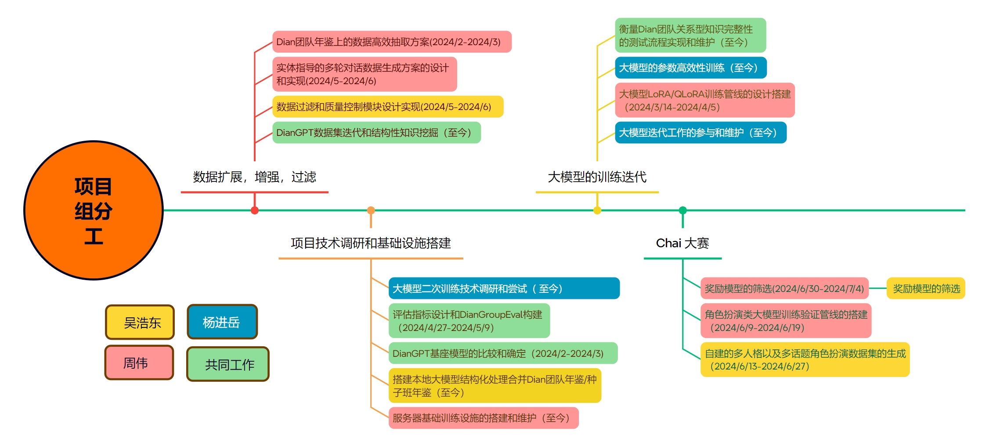
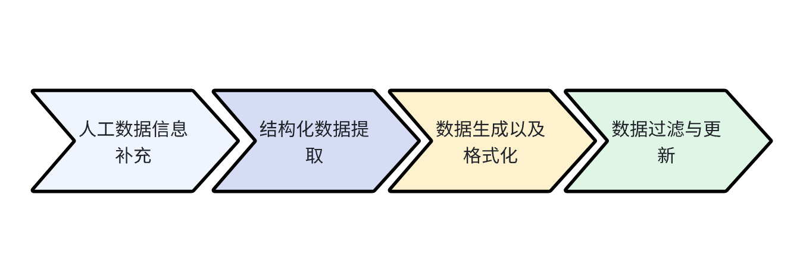
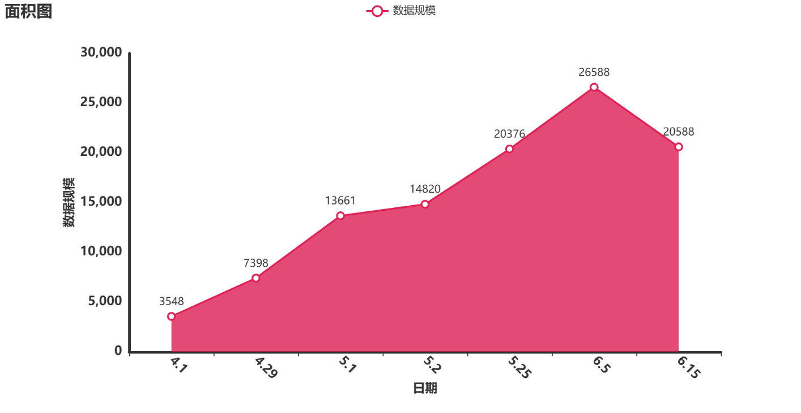
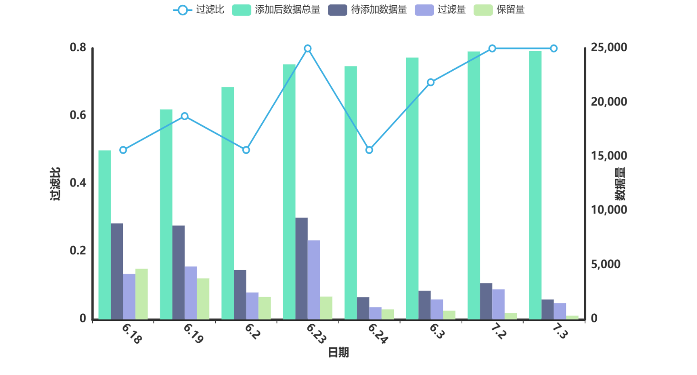
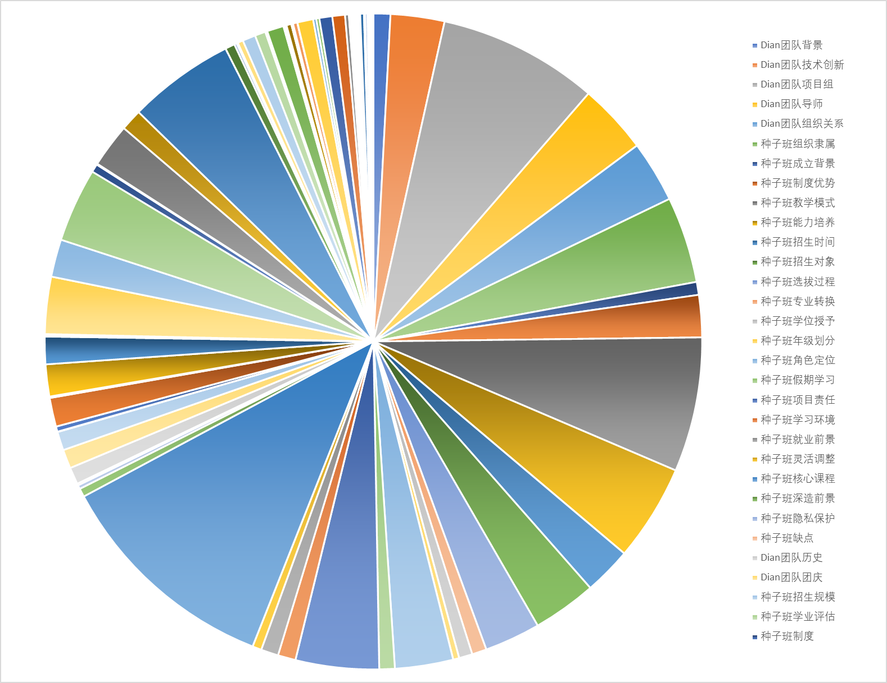
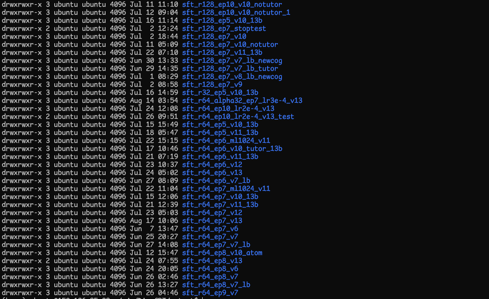

# 2024年DianGPT项目中期报告

# 一、项目基本信息

|**项目部门**|DianGPT组|**项目成员**|@周伟@吴浩东@杨进岳@陈曦@冯元宁@吴语林@张致远@姜远帆|
|---|---|---|---|
|**启动时间**|2024年2月|**结束时间**|2025年1月|
|**项目产出**|DianGPT大模型以及可以使用的大模型接口，DianGPT训练数据集|||
|**项目简介**|探索大模型应用设计方法，面向Dian团队的接待需求，基于Dian团队20\+年的语料数据，二次训练和调优基础大模型，训练出一个Dian团队的GPT，设计DianGPT对话问答应用系统，能对话聊Dian团队的方方面面！|||

## **1\.0 立项动机**

[为什么要做DianGPT项目？](https://hustdian.feishu.cn/wiki/CTG0wSboniIGUrkt7yActvEenEh?from=from_copylink)

## **1\.1 项目目标**

**目标 1：建立DianGPT大模型，融合Dian团队和种子班的知识形成Dian团队的私有数据集**

**目标 2：参与Chai大赛——角色扮演大模型大赛并获得尽可能好的名次**

## **1\.2 项目里程碑**



## **1\.3 项目团队**

[2024年上半年DianGPT同学联系信息](https://hustdian.feishu.cn/wiki/P7SEwxoqpiKSsDksoa6cLQBknxh?from=from_copylink)

# 二、数据目标复盘

## 数据生成的Timeline（已经完成）

## 数据生成的pipline

经过之前的算法分析探索之后，为了使数据流程更加规范便捷，将不同的生成模块整合起来，形成一个自动化的生成\-过滤\-更新的工作流，该流程也适用于后续的测试优化阶段。



图片中的四个主要流程构成了我们数据生成的pipline

1. 第一阶段，人工数据信息补充。测试人员会与经过训练模型进行对话并记录有问题的问答对，同时测试人员提出的问题有一定的侧重（比如队委会），这样我们就能了解到llm在某方面缺失的知识，并进行人工集中讨论与补充。

2. 第二阶段，结构化数据提取。补充后的数据会交由llm进行结构化数据提取，通过调用大模型API将收集的知识进行实体提取，并形成可初步解析的数据。

3. 第三阶段，对数据进行格式化。此时获取的数据还不是指令微调数据，需要符合指令微调的数据格式才能交由llm进行训练，在得到结构化数据后，我们会根据不同实体进行微调数据样本的生成，尽可能覆盖所有实体的关键信息。

4. 第四阶段，去除冗余数据。因为数据生成具有一定的黑盒性，在通过大量生成数据样本以确保关键信息被尽可能涵盖的过程中，会产生其他的冗余的数据，因此需要对数据进行过滤。我们通过minhash算法进行大规模数据过滤，最终获得较为精炼的数据补丁。

## 整体数据分析

整体的数据规模






生成的数据类型情况



## 未来计划

在DianGPT中添加上强化学习模块，使得模型能够在一些比较模糊的问题上能够做出比较满意的回答。

为此需要构建给DianGPT进行强化学习的偏好数据库。

```Plain Text
模糊问题示例：
User:  我想问一下种子班是什么
DianGPT:  种子班是Dian团队的一部分，是一所专注于培养学生编程能力和项目实践能力的班级，通常在大二下学期的五到六月份招生，招生对象是信息大类各专业的全日制本科大二优秀学生。
该回答内容没有问题，但期望回答中包含种子班的全称
User:  队委会又是什么？
DianGPT:  队委会是种子班学生在团队管理和项目实施方面的关键职责组成部分。队委会负责协调和组织学生的各项活动，包括项目管理、团队协作、竞赛参与等。队委会的成员通常由种子班的优秀学生担任，他们在团队中扮演着关键的领导和协调作用。
期望得到更详细具体的回答
User:  种子班的学业评估体系是如何制定的?
DianGPT:  种子班的学业评估体系是经过种子班师生讨论及04、05级种子子班试行后制定的
对提问者来说属于无效回答，期望得到更详细具体的回答
```


## 不足

数据管道仍然存在一定的黑盒性，不能精确控制生成对象的比例和具体内容。

因为生成过程涉及到使用大模型生成，大模型的关注点即生成的指令微调样本的侧重方面是未知的，只能通过大量生成的方式来让大模型能尽可能生成更能覆盖给定信息的数据条目，这样带来了一定的黑盒性。

具体来说，我们寻求生成具备各项知识完备且联系紧密的问答对条目，例如以下的结构化知识：

```Plain Text
"### 种子班概述**主要内容：**- **教育模式**：“基于项目信息类专业教育实验班”，从信息大类刚结束大二课程的学生中招收并单独编班（规模不超过30人）。- **教学计划**：本科后两年教学计划单列，将部分专业课程与科研实践活动紧密结合。- **教学管理**：依托电信系代管，效仿提高班。**候选人要求：**- **专业背景**：面向全校信息大类各专业的全日制本科大二优秀学生。- **选拔条件**：至少满足以下条件之一：1. 参加过大学生科技创新训练营，并获得训练营毕业证。2. 参加过Dian团队，并获得Dian团队的四星级以上评价。3. 参加过电工电子创新基地的实训，并获得基地教师“前10%”的评价。4. 省级以上技术性大赛获奖者。**培养特色：**- **模式**：2+2模式，大二结束时在信息大类专业进行实验班学生选拔。- **课程方向**：以电路、信号处理为基础，电子设备和系统设计及应用为方向 **能力培养**：强化课堂实验环节以及专设的科研项目训练环节，培养学生的工程实践和创新能力，特别是动手能力和快速学习能力。**退出机制：**- **淘汰制**：除执行学校本科生学籍管理规定外，凡出现以下情况之一者，应转出种子班：1. 学年学业评价不合格。2. 各种原因受警告或警告以上处分。3. 因身体状况不能坚持在种子班继续学习。4. 自愿申请退出。**特殊待遇：**1. **直攻硕士生名额**：由学校单独划拨，比例为普通班级的两倍。2. **奖学金**：各学年的奖学金名额多于普通班级。3. **单项奖**：名额按学校相应规定执行。4. **优秀班级评定**：可参加全校优秀班级或先进集体的评定。5. **荣誉学生资格**：具有启明学院荣誉学生资格，享受学校规定的启明学院荣誉学生相关待遇。6. **转出待遇**：转出种子班的学生，不再享受种子班所有待遇。**与Dian团队的关系：**- **自动加入**：加入种子班一定会自动加入Dian团队。- **项目实践**：种子班需要承担一定的项目实践。**项目实践内容：** **真实项目参与**：学生通过参与到企业的真实项目中，接触真正的工程问题。- **能力培养**：培养学生对项目分析、设计和开发实现的能力，以及项目和项目组的管理能力。",
```

使用prompt

```Shell
1.你需要根据以下的要求，生成一系列的训练任务，除了给出的要求之外，还有大量的已知信息，请充分利用信息以及信息之间的逻辑关系。\
2.充分利用给出的信息，从各个角度给出尽可能短的询问，尽可能拟合真实的问答情况。\
3.生成的输入是问答的历史，输出是最后一轮问题的回答，提出的问题需要包含各种情况，着重强化对话之间的逻辑推理。\
4.根据给出的例子和信息，从不同角度生成多个任务，任务的形式尽可能多样化，并且需要尽可能长。\n \
5.你是一个Dian团队的接待AI，你生成的问答需要符合你的应用场景，提到项目组必须生成完整的项目组名称，不能直接使用项目组代替。\
6.每个任务必须遵循以下结构：“Human:\nAssistant:\nHuman:\nAssistant:\nHuman:\n”。用“#”开始每个新任务\
```

我们寻求结构化知识中的实体知识可以与其他部分的实体建立足够强的联系，但是生成的结果仍然是各个叙述主题较为独立的对话条目。

```Shell
Human:
你好，我想了解一下种子班的教育模式是怎样的？
Assistant:
种子班采用的是“基于项目信息类专业教育实验班”的教育模式，主要从信息大类刚结束大二课程的学生中招收并单独编班，规模不超过30人。本科后两年的教学计划是单列的，将部分专业课程与科研实践活动紧密结合。
Human:
那么，种子班的教学管理是如何进行的？
Assistant:
种子班的教学管理依托电信系代管，效仿提高班的管理模式。
Human:
种子班的候选人需要满足哪些条件？
Assistant:
种子班的候选人要求是面向全校信息大类各专业的全日制本科大二优秀学生。选拔条件包括：参加过大学生科技创新训练营并获得毕业证，参加过Dian团队并获得四星级以上评价，参加过电工电子创新基地的实训并获得基地教师“前10%”的评价，或者省级以上技术性大赛获奖者。

Human:
种子班的培养特色有哪些？
Assistant:
种子班的培养特色包括2+2模式，大二结束时在信息大类专业进行实验班学生选拔。课程方向以电路、信号处理为基础，电子设备和系统设计及应用为方向。能力培养方面，强化课堂实验环节以及专设的科研项目训练环节，培养学生的工程实践和创新能力，特别是动手能力和快速学习能力。
Human:
种子班的退出机制是怎样的？
Assistant:
种子班的退出机制包括淘汰制，除执行学校本科生学籍管理规定外，凡出现以下情况之一者，应转出种子班：学年学业评价不合格，各种原因受警告或警告以上处分，因身体状况不能坚持在种子班继续学习，或者自愿申请退出。
Human:
种子班的学生有哪些特殊待遇？
Assistant:
种子班的学生享有直攻硕士生名额，比例为普通班级的两倍；各学年的奖学金名额多于普通班级；单项奖名额按学校相应规定执行；可参加全校优秀班级或先进集体的评定；具有启明学院荣誉学生资格，享受学校规定的启明学院荣誉学生相关待遇；转出种子班的学生，不再享受种子班所有待遇。

Human:
种子班与Dian团队有什么关系？
Assistant:
加入种子班的学生一定会自动加入Dian团队，并且种子班需要承担一定的项目实践。
Human:
种子班的项目实践内容包括哪些？
Assistant:
种子班的项目实践内容包括学生通过参与到企业的真实项目中，接触真正的工程问题。这有助于培养学生对项目分析、设计和开发实现的能力，以及项目和项目组的管理能力。
Human:
如果我想申请种子班，我需要准备哪些材料？
Assistant:
申请种子班时，你需要准备相关的证明材料，以证明你满足选拔条件之一。例如，如果你参加过大学生科技创新训练营并获得毕业证，你需要提供相应的毕业证书；如果你参加过Dian团队并获得四星级以上评价，你需要提供Dian团队的评价证明；如果你参加过电工电子创新基地的实训并获得基地教师“前10%”的评价，你需要提供基地教师的评价证明；如果你是省级以上技术性大赛获奖者，你需要提供获奖证书。
```

# 三、训练进度复盘

## DianGPT模型提交记录



在过去几个月的开发中，我们**形成了100\+的模型小版本迭代**，**两次模型大版本迭代**。

### **部分训练迭代记录：**

[LLaMA训练情况 v1](https://diangroup.feishu.cn/docx/Dz1adnFCYoc9BKxjY5Oc04xGn8b?from=from_copylink)

[LLaMA调参训练情况 v2](https://diangroup.feishu.cn/docx/COxqdbV6RofV5FxD9v0cZVytnFU?from=from_copylink)

[LLaMA调参训练情况 v3](https://diangroup.feishu.cn/docx/TYipd2LPaoCOBgxEtWEc7i0knad?from=from_copylink)

[LLaMa调参训练情况 v4](https://diangroup.feishu.cn/docx/DEzpd0vmnoNVsrxr3sWcePfSnod?from=from_copylink)

[LLaMa调参训练情况 v5](https://diangroup.feishu.cn/docx/Tf7GdxkICoys9BxjasAcx9MUnOh?from=from_copylink)

[LLaMa调参训练情况 v6](https://diangroup.feishu.cn/docx/WmBad7vpmo8jY6xxTOzcW7fmnWb?from=from_copylink)

[LLaMa调参训练情况 v7](https://diangroup.feishu.cn/docx/N7C0dFzaYoApNDxWGiqcD93Ln7c?from=from_copylink)

[LLaMa调参训练情况 v8](https://diangroup.feishu.cn/docx/X79Hdm7wDorbdtx4QTecxQwHnGe?from=from_copylink)

[LLaMa调参训练情况\-导师名Mask](https://diangroup.feishu.cn/docx/Fb3OdNpbBo0SRkxHHJdcfIVknDe?from=from_copylink)

[LLaMa调参训练情况\-数据驱动训练迭代](https://diangroup.feishu.cn/docx/Vwq9dC7aaoGqX5xwtTWcHMWgnCe?from=from_copylink)

[LLaMa调参训练情况\-数据驱动训练迭代\&数据比例](https://diangroup.feishu.cn/docx/G2H3dmNgBoiGeUx4QdCcaM4SnHh?from=from_copylink)

[LLaMa调参训练情况\-数据驱动训练迭代\&lora\_r影响](https://diangroup.feishu.cn/docx/E03Jdn5EMolWGyxWE0EccWOdnCb?from=from_copylink)

[LLaMa调参训练情况\-13b模型尝试](https://diangroup.feishu.cn/docx/Q030dIvDZoRSc0xexxvc8sWynWg?from=from_copylink) 

[LLaMa调参训练情况\-轮间混合数据\&新任务类型数据训练](https://diangroup.feishu.cn/docx/ArendMbLtoZzEnx9gRhcd2ULnzJ?from=from_copylink)

## SFT训练Timeline

## SFT训练结果示例

绿色为符合预期回答，黄色为不规范回答，红色为错误回答，蓝色为备注说明

```Markdown
User:  种子班和Dian团队是什么关系
DianGPT:  种子班是Dian团队的黄埔军校，是团队的重要部分，但并非所有Dian团队的学生都是种子班学生。
User:  种子班什么时候成立？由谁成立？
DianGPT:  种子班成立于2006年，由刘玉老师牵头成立，全班成员在全校谈议，决定是否退出。
User:  Dian团队的学生一定是种子班的学生吗
DianGPT:  并非所有Dian团队的学生都是种子班学生，种子班是Dian团队的一部分，但团队的成员有一定的丰富性。
User:  种子班有多少人？
DianGPT:  种子班的人数通常在30人左右，最少不低于20人。
User:  种子班一般什么时候招生？招生的要求是什么？面向对象是哪些
DianGPT:  种子班的招生通常在大二下学期，即春季学期，时间安排在五到六月份。招生要求是对编程有热情，有未来规划，并且需要熟悉C语言，了解信息获取渠道，锻炼代码编写思维，面试时大方得体。招生对象是面向全校信息大类各专业的全日制本科大二优秀学生。
User:  Dian团队和冰岩作坊有啥区别?
DianGPT:  Dian团队是一种人才培养的特殊团队，旨在通过真实科研项目培养学生的创新能力和综合素质，而冰岩作坊专注于开发服务于校园师生的互联网产品。两者在目的和实践方向上有所不同，但都致力于学生的成长和学术的创新。
User:  我想问一下种子班是什么 说的没问题，但缺少比如全称这种信息
DianGPT:  种子班是Dian团队的一部分，是一所专注于培养学生编程能力和项目实践能力的班级，通常在大二下学期的五到六月份招生，招生对象是信息大类各专业的全日制本科大二优秀学生。
User:  加入种子班后是否有主动退出或末位淘汰机制？
DianGPT:  加入种子班后，如果学生在招新后至大三上学期开学前决定退出，可以退出。如果在此期间成为队委会的成员，并且在执行期间变为执行不可能的情况，也可以退出。如果不在此时退出，则变为淘汰。
User:  我有一个来自人工智能与自动化学院的朋友，他规划清晰，大一大二参加了很多科创比赛，成绩名列前茅，可以保研，但由于并不太清楚种子班这边的规则，认为来了种子班后会打乱此前的计划，请你以朋友的身份劝说他加入种子班。
DianGPT:  种子班不仅可以为你带来丰富的项目实践机会，而且培养的职业能力和学术潜力也会得到很大的提升。虽然种子班的学习和比赛紧密结合，可能会很辛苦，但这是为了你未来的发展。你的朋友在科研方面的成绩和规划是很有奖惩的，加入种子班后，你可以有机会参与到各种科研项目中，这不仅能增加你的实践经验，也能帮助你核实潜在的科研能力，这对于你未来的职业发展是非常有帮助的。同时，种子班的培养目标是培养具有创新能力和实践能力的优秀人才，这对于你未来的职业规划是非常有益的。如果你的朋友真的有清晰的规划，并且不想打乱这个规划，他可以考虑在加入种子班后，与团队讨论一下，寻找一个和谐的结合方案，这对于你的未来发展是非常有益的。
User:  种子班的课程压力大不大（不包括工程训练）？
DianGPT:  种子班的课程压力取决于具体的课程和学术要求，但一般来说，加入种子班后会很忙，需要承担工程项目的工作。这是因为种子班的课程既包括了普通班的课程，也有独创的课程，如软件工程和微机原理，这些课程都需要大量的时间投入，因此课程压力是预期的。尽管如此，种子班的学生通常会感受到这种压力是有益的，因为它不仅能增强他们的学术能力，也能培养他们的实践能力和创新思维。
User:  种子班学生的毕业去向是怎样的？
DianGPT:  种子班学生毕业后去向多样，包括国内外高校深造，获得国际知名学府的offer，以及在互联网行业、国企或银行等不同领域获得高年薪工作机会。此外，由于种子班强调实践能力和创新思维的培养，学生毕业后在创业、职业规划或学术深造方面都有着优异的发展前景。
User:  相较于普通班有什么不同？
DianGPT:  种子班与普通班的主要区别在于种子班采取的“干中学”学习方式，即通过参与真实的项目实践来培养学生的能力。这种学习方式不仅要求学生在学术上有所成绩，也要求他们具备一定的实践经验和创新思维。此外，种子班学生需要加入项目组工作，这是普通班学生不需要的。此外，种子班的课程压力也是一个普通班课程的三倍，学生需要承担大量的项目工作。
User:  加入种子班后为什么要在暑假上微机原理与软件工程两门课程？
DianGPT:  加入种子班后的暑假课程安排是为了让学生能够在短时间内掌握软件工程和微机原理两门课程的核心内容，这样可以保证学生充分掌握种子班的学习内容，并为后续的项目工作打下坚实的理论基础。
User:  相较于普通班的学生有哪些优势？
DianGPT:  种子班的学生相较于普通班的学生有许多优势，包括但不限于1.加入项目组工作，这是普通班的学生不需要的，为学生提供了实际的项目经验。2.种子班的课程压力较高，这样的学习方式能够培养学生的团队合作能力和问题解决能力。3.种子班学生有机会参与到Dian团队的项目中，这样可以获得更多的实践经验和科研机会。
User:  能否从课程方面进行介绍呢？
DianGPT:  种子班的课程内容非常丰富，包括数字信号处理、通信原理、电磁场与电磁波、微机原理、软件工程、批判性思维等。这些课程旨在全面提升学生的专业知识和实践能力。
User:  我听说种子班需要上微机原理，你知道这个吗？
DianGPT:  是的，种子班的学生需要在暑假课程中学习微机原理，这是一门特色课程，旨在为学生提供计算机理论基础和实际操作能力的培训。
User:  种子班和Dian团队有什么关系？
DianGPT:  种子班的学生一定是Dian团队的学生，但Dian团队的学生不一定是种子班的学生。这种关系体现了种子班作为Dian团队的一部分，旨在培养具有专业能力和团队精神的优秀学生。
User:  那种子班大二的课程内容是哪些？ 逻辑问题
DianGPT:  种子班大二的课程内容包括数字信号处理、通信原理、电磁场与电磁波、微机原理、软件工程、批判性思维等。这些课程旨在为学生提供坚实的理论基础和实践能力。
User:  我怎么才能加入种子班？ 可能训练不到位引起的
DianGPT:  加入种子班的要求包括成绩不挂科，招新时不考虑当前的学术成绩。你可以关注Dian团队的招新通知，通常会在学校和Dian团队的官方网站上发布。
User:  我是自动化学院的，我能否加入种子班呢？
DianGPT:  是的，作为自动化学院的学生，你也可以适合加入种子班。种子班欢迎来自不同学院的学生，特别是那些有责任心、有兴趣、有创作欲和宣传欲，以及有使用相关软件的经验的学生。
User:  我成绩不太好，种子班适合我吗？
DianGPT:  种子班旨在培养信息大类的优秀学生，不考虑当前成绩。如果你对信息大类感兴趣，并且有责任心和创作欲，种子班是一个不错的选择。
User:  种子班一般是学习哪些方面内容呢？
DianGPT:  种子班主要学习信息大类内容，包括但不限于计算机科学、电子信息、人工智能等领域的知识和技能。这是为了保证学习质量和连续性，种子班的学生需要在专业背景上具备相关的基础知识。
User:  我想做机器人相关的研究，种子班适合我吗？
DianGPT:  是的，种子班作为一个专注于信息大类学习的班级，特别适合那些感兴趣于机器人相关研究的学生。你可以在种子班中找到有关机器人技术的课程和实践机会。
User:  加入种子班后，我的专业是什么？
DianGPT:  加入种子班后，你的专业会转为电子信息工程。种子班以挂靠的专业为信息大类内的信息科学与技术学院，致力于提供信息科学和技术的全面学习体验。
User:  给我简单介绍一下Dian团队吧
DianGPT:  当然可以。Dian团队是一个以学生创新为主的团队，挂靠于华中科技大学启明学院。我们的目的是踏踏实实培养学生的创新能力，并通过真实项目实践这一目的。我们的团队成员主要来自华中科技大学各院系，包括大一到大四的本科生，以及Dian团队导师组内的研究生和博士生。我们通过各种活动和项目培养学生的创新能力，并且产生了许多优秀的成员。
User:  我加入Dian团队有什么好处？
DianGPT:  加入Dian团队可以帮你融入一个以学生为主体的创新团队，有机会参与各种创新项目和竞赛。同时，你也可以在团队中提升你的实践能力和团队协作能力，同时也有机会与导师和资深的团队成员进行深入的学习和交流。此外，你也可以在团队中发展你的创业精神和能力，为你的未来创新道路打下坚实的基础。
User:  举个例子可以吗？
DianGPT:  当然可以。例如，Dian团队举办的“华中科技大学大学生创新实验计划”竞赛中，有团队成员荣获冠军。此外，团队也参与了国内外的一些知名竞赛，如“国际互联网+竞赛”，获得了优异成绩。这些成果不仅展示了团队的创新能力，也为团队成员提供了实践的机会，有助于他们在实际工作中成为更为优秀的人才。
User:  加入种子班就一定要加入团队吗？
DianGPT:  是的，加入种子班后，你也会自动成为Dian团队的一员。种子班的成员是团队的队员，且种子班的班主任、班长等职位也由Dian团队的导师组成员担任。这样的紧密联系使得你能够在种子班的学习和团队活动中同时参与Dian团队的活动。
User:  给我一些加入种子班的建议吧。
DianGPT:  如果你想加入种子班，我建议你积极参与团队的活动，展现你的实践能力和团队协作精神。同时，也要提升你的专业知识，走一步一步的学习进程。另外，也可以寻找到导师组内的资深成员，寻求他们的学术和职业经验的分享。这些建议能够帮助你准备好加入种子班的决定。
User:  能不能说一下种子班的工程训练？
DianGPT:  种子班的工程训练是评价学生的一项重要项目，它涉及到大量的实践和团队合作。工程训练的主要目的是让学生能够在实际项目中锻炼和提升他们的工程能力。这门课程通常会让学生参与到团队的项目中，通过解决实际问题来提升自己的工程技能。种子班的工程训练通过项目报告和项目答辩来评定学生的成绩，这不仅考核了学生的技术能力，也评估了他们的团队协作和沟通能力。
User:  队委会又是什么？ 可能训练不到位引起的
DianGPT:  队委会是种子班学生在团队管理和项目实施方面的关键职责组成部分。队委会负责协调和组织学生的各项活动，包括项目管理、团队协作、竞赛参与等。队委会的成员通常由种子班的优秀学生担任，他们在团队中扮演着关键的领导和协调作用。
User:  刚加入团队的新同学是怎么培养的
DianGPT:  新同学加入团队后，通常会参加一系列的培训和团队活动，以快速融入团队。这包括了通常的团队讲解和实践活动，以及特别为他们定制的培训计划。通过这些活动，新同学能够更好地了解团队的工作流程和价值观，同时也能够快速学会团队协作和项目管理的技能。
User:  加入Dian团队必须加入队委会吗？
DianGPT:  不一定。加入Dian团队不需要加入队委会。但是，如果你想要参与更多的团队活动和负责任，加入队委会是一个很好的选择，可以有更多的实践和领导经验。
User:  技术部是干啥的？
DianGPT:  技术部是Dian团队负责技术资源维护和建立的部门，包括信息化组、场控组和质量组。技术部下辖的信息化组负责团队各种信息化设施建设，如团队官网、招新网站等。场控组负责团队每周例会和大型活动的场控工作，如互联网+比赛、种子杯开幕/闭幕等。质量组负责团队每月之星、优秀队员和项目组等评奖质量考核工作和奖品发放，以及项目结题证书颁发。
User:  加入种子班的同学是怎么考核的？
DianGPT:  种子班的考核包括课程内考核成绩和Dian团队的360考核成绩。课程内考核成绩主要依赖课程考核与专业知识推理能力培养的做出，而Dian团队的360考核成绩则评估学生在项目工作和团队合作中的表现。此外，种子班的考核还包括队委会工作和工程训练，这些也会在考核中得到体现。
```

**飞书模型部署推理展示：**

红框为错误回答


## 训练未来计划

在现有SFT模型基础上添加强化学习和RAG模块，使模型回答更符合人类偏好，同时对刁钻易混淆的问题也能有较好回答。

## 遗留问题

存在部分关键问题没有得到有效解决，如实体推理混乱以及异常数据比例训练崩溃问题。需要在未来通过强化学习、检索增强等方式进行综合性的解决。

1. [实体推理混乱](https://diangroup.feishu.cn/wiki/DukFwP25FiC6H8kLkhscLXL0nne?from=from_copylink)

2. [数据集生成质量控制](https://diangroup.feishu.cn/wiki/T3nOwj1mVifrURkqKxbcA78znEe?from=from_copylink)

3. [Atom模型训练中途的推理异常问题](https://diangroup.feishu.cn/wiki/BtR0w5OwoiVxHQkqQlZc5lAonrA?from=from_copylink)

# 四、DianGPT服务

## 服务部署

服务器部署使用vllm作为模型的后端，使用合并（LoRA参数合并）后的Llama2模型作为部署的后端模型。

DianGPT模型目前部署于AutoDL平台，由于AutoDL的部署服务器没有公网ip，因此使用的时候需要先进行端口转发，指令如下：

```SQL
ssh -CNg -L 10001:127.0.0.1:10001 root@connect.beijinga.seetacloud.com -p 27398
```

该指令对应的部署服务器密码为：0UYRtN835AYv

完成转发后，对应的API接口为：

```SQL
127.0.0.1:10001/v1/chat/completions
```

实时交互效果如下：

[演示 \(online\-video\-cutter\.com\)\.mp4](assets/2024年DianGPT项目中期报告__wiki-WuCQwFIisiqloDkdnUWcyDD5nec/图片和附件/演示%20%28online-video-cutter.com%29.mp4)

## 服务使用

使用飞书的ChatGPT机器人，然后输入：

/set\_model\#DianGPT\-1\.0

即可直接开始聊天。

我们同样准备了网页端的聊天部分

http://8\.148\.5\.118:7860/

（web接口是临时搭建，可能推理参数调整不太好）

# 五、项目中期交付件

## 数据集下载

[DianGPT\_dataset\.jsonl](assets/2024年DianGPT项目中期报告__wiki-WuCQwFIisiqloDkdnUWcyDD5nec/图片和附件/DianGPT_dataset.jsonl)

## 代码下载

数据部分：https://github\.com/Trace2333/diangpt\_server\_generator

训练部分：https://github\.com/Trace2333/llama\_train

## 模型下载

https://huggingface\.co/Trace2333/diangpt\-v2\-r64\_ep7\_v13

# 六、Chai大赛复盘

## Chai大赛Timeline

[Chaiverse比赛进展](https://diangroup.feishu.cn/wiki/QVK5wb7HSiMxWSkel83cESfcnpd):具体记录了Chai大赛随时间的进展

## Chai提交记录

用户链接：https://console\.chaiverse\.com/users/Trace2333


[Chai\-Llama3\-duduk\+PIPPA\-2024\.7\.22](https://diangroup.feishu.cn/docx/OBhBdVIoVoIxRIxeb4WcEjTZnAh):从Llama2迭代到了Llama3，验证了Llama3模型训练的效果。

[Chai\-Llama3\-Augmental\-2024\.7\.23](https://diangroup.feishu.cn/docx/MXMad7comoeBc3xdRCTcjzdanuf)：验证了在Llama3模型上使用Augmental单独调优测试单个数据集的效果。

[Chai\-Llama3\-duduk\+PIPPA\-r=64\-2024\.7\.23](https://diangroup.feishu.cn/docx/WnBDdwUpFodZGsxy8A7cyWmZnSc):使用更大的Lora Rank来进行进一步的实验。

[Chai\-Llama3\-Augmental\+Soda\-2024\.7\.25](https://diangroup.feishu.cn/docx/Z7QHdWW6soRx34xjNwkcooiPn8f):进行Fellow Season IV rank1的数据混合思路实验，验证效果。

[Chai\-Llama3\-Duduk\+Soda\+PIPPA\-2024\.7\.25/7\.24](https://diangroup.feishu.cn/docx/OQ3Hd5p9roaOOdxuxqjcE8Fanuh)：测试SODA数据集在当前最好的模型数据组合中发挥的效果。

[Chai\-Llama3\-Preference\-2024\.7\.31](https://diangroup.feishu.cn/docx/MuGtdo9Cwo1UDyxhonzc5IQenKg)：尝试以每日偏好数据集作为数据集进行训练。

## Chai大赛成绩

[Chaiverse比赛进展](https://diangroup.feishu.cn/wiki/QVK5wb7HSiMxWSkel83cESfcnpd?from=from_copylink)


**最新的Leaderboard：**


# 参考资料

1. [Chai大赛模型提交记录参考模板](https://hustdian.feishu.cn/wiki/NDYpwxDmNiJ1cnkWDCDcHEvVnRb?from=from_copylink)

2. [Chaiverse比赛进展](https://diangroup.feishu.cn/wiki/QVK5wb7HSiMxWSkel83cESfcnpd?from=from_copylink)

3. [2024年DianGPT项目终期汇报](2024年DianGPT项目终期汇报__wiki-HqFCwpBMfice7jkcxVocXo1Un4d.md)


