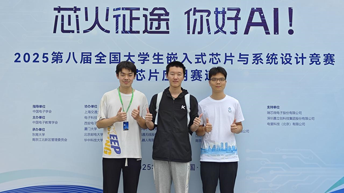

# 2025年全国大学生嵌入式芯片与系统设计竞赛：基于Hi3516DV300的智能停车规范性识别系统

原文引用：[2025嵌入式竞赛：基于Hi3516DV300的智能停车规范性识别系统](https://hustdian.feishu.cn/wiki/WYPvw3nTEil1xxkjKsjc0T6fndh?from=from_copylink)

# 参赛报名

@徐柯帅@白洛琦@支任熠，[基于Hi3516DV300的智能停车规范性识别系统](2025年全国大学生嵌入式芯片与系统设计竞赛：基于Hi3516DV300的智能停车规范性识别系统__wiki-A8afwUFo7i1kfsk9oEdc1QWDnIf.md)，2025年全国大学生嵌入式芯片与系统设计竞赛，芯片应用赛道，国赛三等奖，2025\.7, 指导老师：黑晓军

[基于Hi3516DV300的智能停车规范性识别系统\_参赛作品授权书\.21\.pdf](../attachments/基于Hi3516DV300的智能停车规范性识别系统_参赛作品授权书.21__file-Br20bMyhGoS21Qxp5fTctMNGnrh.pdf)

# 团队信息

队名：宜一试勿遗思
队员：@徐柯帅@白洛琦@支任熠

队伍编号：15761

# 参赛文档

1. [基于Hi3516DV300的智能停车规范性识别系统技术文档 ](https://hustdian.feishu.cn/docx/UU4VdjJJzoMScDxGcSEcRVw5nBB?from=from_copylink)

2. [基于Hi3516DV300的智能停车规范性识别系统\.mp4](../attachments/基于Hi3516DV300的智能停车规范性识别系统__file-Cad3bNLt1ojRvAxxNqSc3Z3mnQh.mp4)

# 参考资料

1. [全国大学生嵌入式芯片与系统设计竞赛](https://hustdian.feishu.cn/wiki/TnMfw7mM5i3yrQk28lXc3k4qnSg?from=from_copylink)

2. [2025芯片应用赛道复赛晋级全国总决赛名单公示（中部赛区）](http://www.socchina.net/details?id=b4383bfc175b4e60a9a8b6145545d21e&value=2)

3. [20250721\_团队同学通过全国大学生嵌入式芯片与系统设计竞赛中部复赛晋级全国总决赛](https://hustdian.feishu.cn/wiki/FjztwZfawin5thkL9oJcjIAVn5s?from=from_copylink)

4. [2025嵌入式大赛芯片应用赛道全国总决赛成绩公示](https://mp.weixin.qq.com/s/WLloDd6qcyrc11WaHYGkQQ)

5. [1项国一，2项国三！Dian团队队员在全国大学生嵌入式芯片与系统设计竞赛斩获佳绩！](https://hustdian.feishu.cn/wiki/DgfBw6VJ6iG4OAk1acLc2SGTnXd?from=from_copylink)

