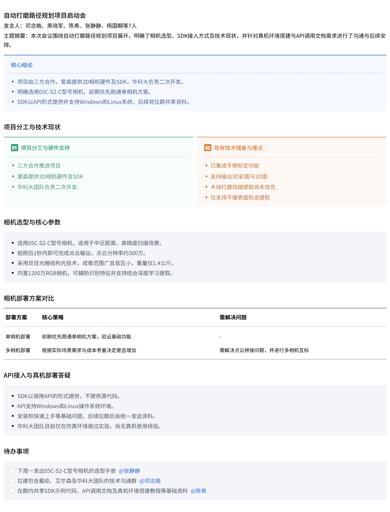

# 20261023\_具身打磨项目组会纪要

> 会议主题：3D相机技术应用交流（自动打磨路径规划项目启动交流：相机选型、技术现状与协作安排）｜
> 
> 会议时间：2026\-10\-23 13:32（时长约 30 分钟）｜
> 
> 妙记标题：3D相机技术应用交流会议
> 
> 

|参会方|参会人|
|---|---|
|华中科技大学 Dian 团队|黑晓军、宋建建、杨国翱（学生，做过仿真实验）等|
|戴屹科技（甲方对接）|邓念皓|
|埃尔森智能科技（3D 相机厂商）|陈希（技术专家）、张静静（产品对接）等 |

# 一、会议概况

本次会议由戴屹方（邓念皓）牵头组织，目的是让 Dian 团队与埃尔森智能科技围绕自动打磨路径规划项目进行启动交流，深入了解埃尔森智能科技 3D 相机、点云识别、轨迹生成的现状，为项目相机选型与落地做准备。会上明确了项目三方分工（埃尔森智能科技提供 3D 相机硬件与 SDK、华科大团队负责二次开发）、所选相机（05C\-S2\-C）的选型依据与技术特色、SDK 接入方式、相机部署策略，以及后续资料共享与沟通协作安排。

# 二、核心结论

1. **项目三方合作**：埃尔森智能科技提供 3D 相机硬件及 SDK，华科大团队负责二次开发，戴屹负责项目整体对接。

2. **相机选型确定**：选用 05C\-S2\-C 型号（光栅结构光、1 秒内出点云、点云分辨率约 300 万、内置 1200 万 RGB 相机、重 1\.4 公斤适配机械臂安装），下周一发出。

3. **部署策略**：前期优先跑通单相机方案，后续按场景、客户需求与成本决定是否增加相机；多相机需额外解决点云拼接与互标。

4. **SDK 接入**：以 API 形式提供，支持 Linux/Windows，附注释示例代码与线上操作文档。

5. **协作机制**：建立戴屹\-埃尔森智能科技\-Dian 团队技术沟通群，资料共享与技术问题直接在群内同步。

# 三、讨论议题

## 3\.1 埃尔森智能科技 3D 相机与打磨技术现状交流

- **已实现能力**：可提供 3D 相机硬件与手眼标定软件，支持输出点云和 2D 图。

- **未实现能力**：**磨线找缝打磨暂未实现**，核心难题是该方向精力投入不足，尚未针对焊缝提取做专项深耕。

- **自动打磨轨迹生成现状**：目前仅能实现**较平缓表面**的轮廓打磨轨迹自动提取；邓念皓确认该场景末端加了力控，可包容一定精度误差。

## 3\.2 工业 3D 相机上手使用支持沟通

- **我方诉求**：黑晓军表示团队对工业 3D 相机很感兴趣，希望获得案例程序或完整样例项目（含配置环境与操作代码），帮助先把相机真正用起来；目前组内同学**仅在仿真环境做过实验，未在真机环境用过**该相机。

- **埃尔森智能科技****支持方式**：提供带注释的示例代码、详细线上指导链接与操作索引（含双眼标定操作），按操作即可调取点云、彩图等。

- **SDK 形式**：以 API 形式提供，支持 Linux 与 Windows 操作系统，不提供源代码。

- **沟通安排**：邓念皓提出由陈总共享相关资料链接，后续建立小群，方便同学直接与埃尔森智能科技沟通。

## 3\.3 扫描场景软硬件搭建与入群答疑

- 黑晓军点名杨国翱（做过仿真实验）结合实操经验提问。

- **杨国翱提问**：现实里扫描场景如何搭建？硬件如何摆放？有没有教程或示意？SDK 属于软件使用范畴吗？

- **埃尔森智能科技****回复**：基础问题都能解决，安装、简易操作、快速上手指南等资料后续在群里统一发送。

- 邓念皓提出由他来拉群，有问题随时在群里沟通。

## 3\.4 3D 相机选型依据与技术特色（05C\-S2\-C）

- **型号与交付**：张静静确认所选型号为 **05C\-S2\-C**，**下周一可发出**，并投屏选型手册。

- **选型依据**：邓念皓说明选型是与埃尔森智能科技专家共同讨论的结果，综合考量四个维度——视野范围（根据工件大小选尽可能覆盖的范围）、拍照距离（聚焦在应用场景最合适的距离）、中近距离高精度、拍照后快速输出点云。

- **技术特色**（陈希介绍）：

    - 采用**光栅结构光成像**技术，1 秒以内完成点云输出；

    - 点云分辨率 **1936×1464（约 300 万）**；

    - 内置 **1200 万 RGB 2D 相机**：3D 点云上特征不明显时，可通过 2D 图像结合深度学习提取特征；

    - **双目光栅结构光**：相比市面常见相机（如梅卡曼德、海康威视），成像范围更广、盲区更小；

    - 重量 **1\.4 公斤**、体积小巧，适合安装在机械臂上；

    - 补充说明：视野太小实战意义不行（需要多次拍摄且标定误差难以解决），必须兼顾视野覆盖、精度与速度。

## 3\.5 相机部署数量与后续协作安排

- **部署数量**：黑晓军询问初步设想（机械臂上至少一台？工作台 1～2 台或 3 台？）。邓念皓回应：相机数量需结合客户需求与成本确定（3D 相机成本较高），能用一台就尽可能用一台；**前期先把单相机方案跑通，再根据实际场景确定最终数量**。

- **多相机注意事项**：多相机部署会涉及点云拼接、多相机互标等额外工作，增加方案复杂度。

- **协作机制**：邓念皓提出把黑老师拉进戴屹与埃尔森智能科技的技术群，老师与同学入群后，技术问题、资料交接直接在群里共享，必要时可随时发起专项会议或一对一沟通。

- **我方最急需**：黑晓军小结——目前最需要一份**完整的样例项目文档**（API 如何调用的完整样例）。

# 四、核心待办清单

|序号|待办事项|负责人|说明|
|---|---|---|---|
|1|共享 3D 相机相关资料链接（SDK 调用示例工程、操作指引、API 说明文档、产品选型手册等）|陈希（埃尔森智能科技）|会上明确由陈总共享给黑晓军团队|
|2|将 3D 相机硬件场景搭建教程、安装与简易操作指引等基础资料发到技术群|陈希（埃尔森智能科技）|回应杨国翱关于场景搭建的提问|
|3|创建技术沟通群（戴屹\-埃尔森智能科技\-Dian 团队）并拉相关人员入群|邓念皓（戴屹）|邓念皓提出由自己建群拉人|
|4|将团队老师与同学（含杨国翱等）拉入技术群|黑晓军（Dian 团队）|邓念皓建议黑老师拉人入群，已经完成|
|5|发出 05C\-S2\-C 型号 3D 相机（设备交付）|张静静（埃尔森智能科技）|张静静会上确认下周一发出|
|6|获取并消化完整样例项目文档，梳理 API 调用相关问题|Dian团队|会上明确为我方最急需的资料。微信交流群|

> （注：部分内容由豆包工作 AI 生成）
