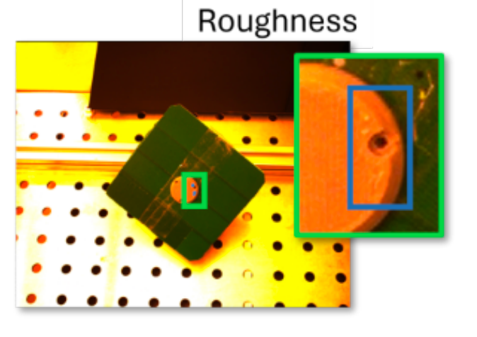

# 3D\-ADAM论文阅读

# 论文信息

论文信息：

论文名称: 3D\-ADAM: A Dataset for 3D Anomaly Detection in Additive Manufacturing

发表会议: ICRA 2026

论文链接: [arXiv:2507\.07838](https://arxiv.org/abs/2507.07838?utm_source=chatgpt.com)

# 研究问题与研究动机

研究问题： 现有三维异常检测数据集缺乏足够丰富的工业缺陷类型、机械结构及真实采集条件，导致检测模型难以满足实际工业应用需求。

研究动机： 三维异常检测仍缺少具有充分工业代表性的数据集。现有数据集通常只覆盖有限的物体与缺陷类别，难以反映真实制造环境中复杂的机械结构、光照变化、工件姿态和遮挡问题。

本文希望构建一个更加接近真实工业环境的大规模三维异常检测数据集，为后续算法研究提供可靠的评价基准。

# 其他人已经做了什么工作？作者的想法与其他人的工作有什么不同？作者的想法是什么？

本文通过 FDM 3D 打印技术制造正常及缺陷零件，利用四种工业深度传感器进行多视角 RGB 图像与三维点云采集，并对 12 类缺陷和 16 类机械结构特征进行标注，构建更贴近真实制造环境的工业三维异常检测数据集。并进行现有先进模型的基准测试及工业专家标注验证，评估数据集的挑战性与可靠性。

# 创新点及技术难点

本文的创新在于构建了覆盖12类缺陷、16类机械结构特征的大规模工业三维异常检测数据集。针对缺陷多样、采集环境复杂及标注困难等问题，采用多传感器多视角采集，并通过模型基准测试和工业专家调查验证了数据集的挑战性与可靠性。

# 本文设计了什么实验验证想法？评价指标怎样定义？对标什么方法？

本实验验证 3D\-ADAM 数据集对现有异常检测算法的挑战性，以及缺陷标注的可靠性。

实验设计： 采用无监督异常检测方案，仅使用正常样本训练，将异常样本按 6:4 划分为测试集和验证集，开展两类测试和验证：

1. 模型基准测试： 使用 PatchCore、PaDiM、CFA、3DSR、TransFusion、GLFM 等模型，评价 RGB、3D 和 RGB\+3D 异常检测与分割性能。

2. 工业专家验证： 邀请 5 位工业专家重新标注部分缺陷样本，与原始标注进行比较。

评价指标：

# 本文有什么主要实验结果？实验结果有什么重要性、意义和可扩展性？

（1）现有模型在缺陷精确分割方面表现不足

例如，PatchCore 的 Image AUROC 达到 0\.976，但 Pixel F1 仅为 0\.061，说明模型能够较好地判断工件是否存在异常，却难以精确确定缺陷区域。

三种代表性三维及多模态异常检测模型的结果如下：

- Pixel AUROC（判断是否异常）：区分正常像素与异常像素的能力

- AUPRO（缺陷定位）：评价不同异常区域的分割覆盖效果

GLFM 在这三种模型中表现最好，但异常区域分割仍存在明显提升空间。

（2）工业专家验证了数据集标注的可靠性

5 位专家的重新标注结果与原始标注相比，平均 IoU 为 0\.60、PRO 为 0\.76，两者具有一定的一致性

# 本文对具身打磨的启发

3D\-ADAM 中的毛刺、粗糙与铸件飞边、毛刺及浇口残根具有一定的几何相似性，可作为算法研究的参考数据。其多传感器、多视角采集及缺陷与机械结构联合标注的方法，也为真实铸件数据集的构建提供了借鉴。针对具身打磨中百万级点云处理与微小缺陷识别的需求，后续可利用该数据集研究不同降采样方法对毛刺几何细节和检测精度的影响。

此外，由于该数据集具备一定的工业特征，可追溯使用了该数据集的论文，学习其中的检测方法。

