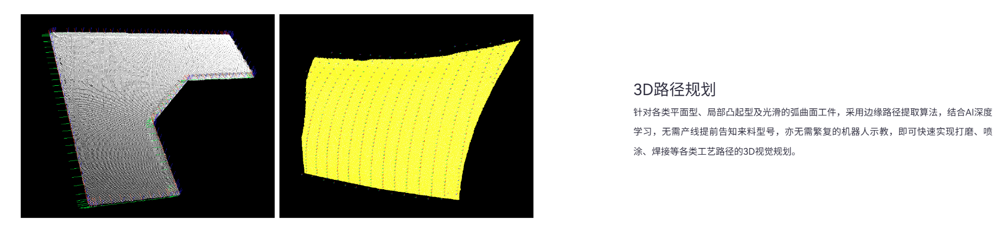

# 3D相机安装及使用

## 一、[嵌入式3D相机的安装过程](https://www.bilibili.com/video/BV1XxWJecEfF/?spm_id_from=333.1387.collection.video_card.click&vd_source=315394c6245021dfa03ed40799d66027)

## 二、ALSON 视觉软件

### 1、ALSON Viewer

ALSON Viewer是埃尔森3D相机的查看器，可使用ALSON Viewer**设置参数、扫描点云、采集图像**。同时ALSON Viewer提供了一些重要的辅助功能，比如可对设备进行**精度校验、相机标定、手眼标定**等。针对嵌入式设备，用户仅需确保本地网络IP设置与连接设备的网络IP在同一网段即可。Viewer 适用于相机到位后进行设备连通和扫描点云功能的验证，并设置参数组用于VizMaster算法平台。

#### 标定

标定：标定模式下有三种功能，分别为**标准标定、快速标定、手眼标定**。其中标准和快速标定是供用户标定设备双目相机参数使用，埃尔森出厂前进行标定，不建议用户自行标定。手眼标定又分为**眼在手上标定、眼在手外标定、TCP针尖指点式标定**。结合标定板可快速完成标定，标定成功后会产生标定文件。

#### 精度校验

精度校验：可通过标定板来进行快速简单的精度校验。精度校验值为图像提取的编码点中心值和标定板上编码点实际值之间的偏差，偏差越小精度越高。

#### 参数组

参数组影响点云的采集质量：

#### 3D点云数据质量提升方法

1. 调节3D参数分组中的单次曝光时间和增益

● 如果物体颜色较深或不易反光，用户可增加曝光时间和增益，但增加增益会放大噪声；

● 如果物体颜色较浅或反光，用户可降低曝光时间和增益；

● 若设置多组曝光时间，则用户扫描点云时获得的是多曝光融合点云；

● 如果单次曝光时间采集点云质量无法满足需求，用户可设置多组曝光生成融合点云的方式提升点云效果。

2. 调整光机亮度

在采集高亮反光物体的数据时可适当降低光机亮度，采集黑色不反光物体时的数据可适当提升光机亮度。

3. 选择开启/关闭增强模式和滤波模式

滤波模式可以消除离群噪声点

4. 整解码阈值大小

降低解码阈值，会提升对黑色物体的点云重建效果；提升解码阈值，会使重建点云产生少量异常点，降低黑色工件点云的采集精度。

5. 调整深度测量范围

6. 重新扫描点云，确认点云质量

### 2、ALSON VizMaster

ALSON VizMaster 是一个3D视觉应用算法平台，采用直观的图形化界面设计，用户无需编程基础，仅需拖放算法模块、设定参数、连接输入输出端口，即可轻松构建视觉工程项目。内置各种**3D点云处理算子**，仅需一步配置或少许参数微调，即可完成复杂调试难题。内置丰富的行业案例库，涵盖上下料等多种典型应用场景模板，可实现应用的快速部署与定制，但并没有飞边打磨场景。

**视觉处理流程：**整体流程为：机械手发出运行工程指令\-\-视觉接收运行工程指令\-\-工程运行\-\-获取点云\-\-处理点云\-\-匹配等定位操作\-\-坐标转换（视觉转机械手）\-\-发送坐标。

其内置的算子库功能丰富，相机类算子集合可从相机获取点云数据；对于3D处理算法其内置的算子库已有很多功能，其中我们需要重点完成的就是**飞边分割算法**的实现，其他的点云处理算法比如**降采样、滤波和配准**可直接使用内置算子库的算法或者ALSON提供的官方sdk，其算法已经再工业领域验证和应用，我们可以尽量减少重复造轮子的工作。

> 视觉平台内置点云处理算子有：
> 
> 过滤：范围过滤、平面过滤、点云采样、半径去噪、统计去噪、侧壁过滤、平滑处理、点数过滤、点云投影、获取ROI点云、移除背景点云、更新深度图、保留背景点云、几何体过滤
> 
> 分割：距离分割、区域分割、通用边界提取、有序点边界提取、点云合并、点云合并（标签）、平面分割、直线分割
> 
> 筛选：尺寸筛选、体积筛选、角度筛选、平整度筛选、点云块排序
> 
> 坐标系转换：点云转换、抓取位转换、点云转换\_依据机械手坐标、坐标纠正
> 
> 

ALSON 官网上提到 VizMaster 具有适用于**打磨场景的3D路径规划算法**，但就其开源的文档资料来看并未有对该算法的提及，可能存在于其内部文档资料中，希望可以能尽快提供。

### 3、ALSON LightBinPick

ALSON LightBinPick 是一款可规划机器人路径并控制机器人移动的软件，与视觉系统无缝配合，根据视觉结果快速规划机器人抓取路径，支持路径优化与碰撞检测，兼容多品牌机器人。其主要算法是根据起始点、过渡点、抓取点和离开点这几个点进行路径规划，不是很适用于打磨场景，只适用于抓取场景。

## 三、关于采集策略

针对小型铸件一次可以扫描的完整的连续的飞边的时候我们可以不用点云拼接；但是对于大型铸件，飞边无法被一次扫描所覆盖就得需要先进行**视点规划**然后进行**配准、拼接、融合**等一系列操作

根据拼接原理不同，我们可以将它分为:

配准方法

1\.特征拼接:对点云检测类似SIFT这类特征点，依据特征点进行ICP配准。但是，此算法的速度和稳健性依赖于拼接点云数据的**相对位姿关系的初值**，还要求待测物体具有比较明显的特征\.

2\.转台拼接:标定旋转轴中心，利用旋转台旋转，获得被测物体不同角度的面形信息,通过构建转台坐标系和转台转角的关系进行拼接配准。

3\.标志点拼接:通过贴圆环标志点来确定物体不同角度之间的位姿关系，依据圆环标志点进行ICP配准。

4\.机械臂辅助的多视角点云拼接：将各视角的点云根据其对应机械臂位姿和获得的手眼矩阵转换到基坐标系以实现初配准，然后再进行ICP精配准。

但是它们的本质，其实还是ICP拼接算法，上述方法无非是提供了:较好的初值，或者更好的特征点，使得ICP的速度更快、更准确。相机到位后可以先使用手持相机的方式对工件进行多角度拍摄，然后采用特征拼接方法进行拼接。

> SIFT（Scale\-Invariant Feature Transform，尺度不变特征变换） 是一种在图像上找出"稳定特征点"并为其生成描述子的算法：它先把图像在多组不同尺度下做差分，找出在尺度空间里同时是局部极值的位置，从而得到对图像缩放不敏感的关键点；再为每个关键点统计其邻域内梯度的主方向，把坐标轴旋转到这个主方向上，得到对旋转不敏感的关键点；最后在该关键点周围取 16 个 4×4 的小区域，每个小区域统计 8 个方向的梯度直方图，拼成一个 128 维向量作为描述子。这样一来，同一个物体在不同距离、不同角度、不同光照下拍到的两张图，都能找到若干"描述子相近"的对应点，进而算出两张图之间的几何关系。
> 
> 

## 四、近期需求

1. 服务器的布置情况

2. 点云数据集情况

根据搜集到的论文推测需要 15\~20 种零件 × 50\~80 变体 来进行网络训练

公司可以尽量多地提供不同种类零件的点云，飞边零件点云可以提供一些参考样本后由我们自己通过合成飞边缺陷的方式扩充变体，或者有充足的真实点云数据更好。后续可以开始对点云分割网络进行训练。

