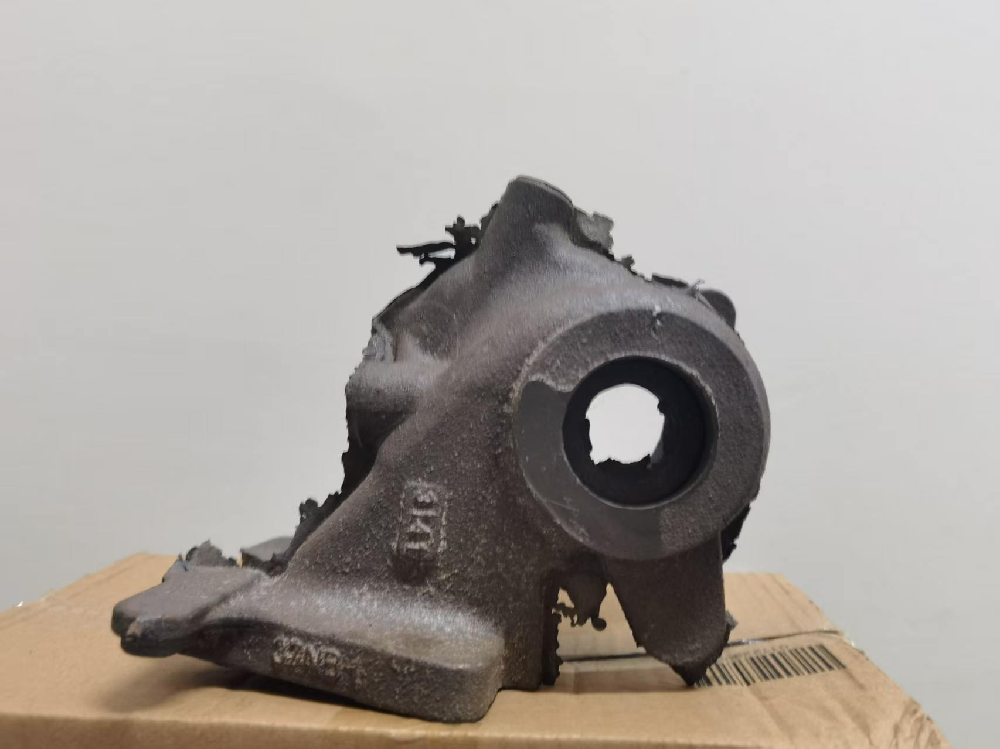
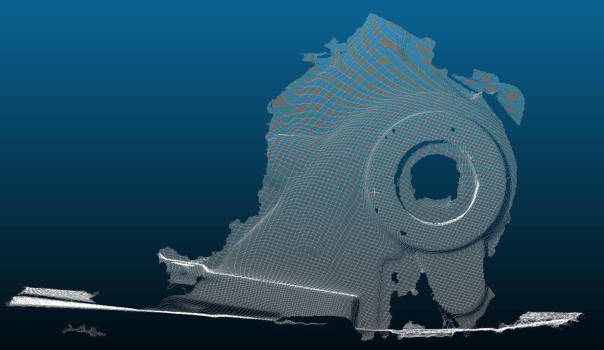

# 3D相机的使用

## 一、相机参数影响采集质量

如果物体颜色较浅或反光，曝光时间过长会导致采集效果不佳；

增强模式开启后可减少黑色工件表面的点云缺失，但可能会导致噪声增加。

降低阈值可提升对深色工件的成像效果

## 二、相机SDK的使用

ALSON SDK 采用 CS \(即客户端服务端\) 架构，API 均在客户端实现。可以通过调用 API 实现扫描点云、采集图像、修改参数等主要操作。ALSON Viewer 中的大部分功能（不包括标定、精度校验）都是通过调用 API 接口实现的。

**工件采集过程：**

相机固定在支架上不动，工件放在转台上，由于尚不明确转台如何使用，所以靠手动挪动改变朝向，每转动 60° 拍一张，一共拍了 6 张。通过相机 SDK 使用如下参数进行数据采集：10ms曝光、开增强模式、解码阈值调到 4、开点云去噪，其余保持默认。因为是手工摆位、没有角度读数，每片的位置和朝向都没有记录。采集完的文件先经过一次去背景平面处理：通过 RANSAC 删掉点数最多的平面，再做统计滤波去掉飞点，得到 6 片只含工件的点云。之后把这 6 片按顺序送进配准与融合流程\(仅依据特征点进行ICP配准，但是，此算法的速度和稳健性依赖于拼接点云数据的**相对位姿关系的初值**，还要求待测物体具有比较明显的特征\)。目前算法最终的融合效果不佳。

如果可以使用转台，利用旋转台旋转，获得被测物体不同角度的面形信息,通过构建转台坐标系和转台转角的关系可进行拼接配准。也可以配合相机sdk提升工件采集效率。

## 三、待确认问题

需要转台电源和其使用说明

