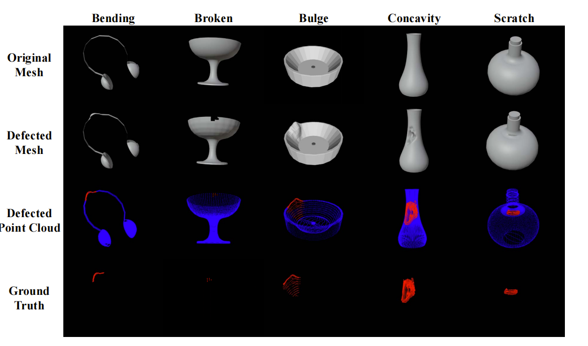

# Anomaly\-ShapeNet论文泛读

# 当前进度

目前工业相机可以使用，能够采集工件的点云数据，但尚未实现多视角点云融合。后续需要完成机械臂与转台的部署，并进行手眼标定、转台标定及融合精度验证，可获取完整、准确的工件点云。

在数据集构建方面，目前每一类仅有一个带飞边缺陷的工件，真实缺陷样本不足，还缺少理想工件的 CAD 模型及更多真实缺陷样例。后续计划基于 CAD 模型生成理想点云，通过参数化缺陷生成与真实扫描特征模拟构建合成数据集，并结合真实缺陷样本进行校准和验证。

上述条件补齐后，预计能够建立较完整的工件点云采集与融合流程，并初步构建包含正常与飞边缺陷的点云数据集，为后续缺陷检测模型的训练和验证提供数据基础。

# 本周工作

阅读 CVPR 2024 论文 Anomaly\-ShapeNet，梳理其研究动机、缺陷合成流程及 IMRNet 检测方法，重点分析 Mesh 网格细分、Blender 缺陷生成和点云标注流程。

通过论文调研与初步实验，认识到飞边合成的关键在于几何形态的真实性。目前基于法向偏移的方法能够生成飞边点云，但对连续薄片结构和真实分型线的表达仍有限。下周计划进一步研究参数化飞边生成，并尝试结合真实铸件 CAD 模型改进合成方法。

# Anomaly\-ShapeNet 

> 修订历史\(Revision History\)
> 
> 

**论文名称：** *Towards Scalable 3D Anomaly Detection and Localization: A Benchmark via 3D Anomaly Synthesis and A Self\-Supervised Learning Network*

**发表：** CVPR 2024

**作者：** Wenqiao Li、Xiaohao Xu、Yao Gu 等

**论文链接：** [https://openaccess\.thecvf\.com/content/CVPR2024/papers/Li\_Towards\_Scalable\_3D\_Anomaly\_Detection\_and\_Localization\_A\_Benchmark\_via\_CVPR\_2024\_paper\.pdf](https://openaccess.thecvf.com/content/CVPR2024/papers/Li_Towards_Scalable_3D_Anomaly_Detection_and_Localization_A_Benchmark_via_CVPR_2024_paper.pdf)

### 1\. 阅读动机

- 当前铸件飞边检测项目面临真实缺陷样本不足、缺少正常工件 CAD 模型的问题，需要研究三维缺陷数据集的合成方法。

- 本文提出 Anomaly\-ShapeNet，通过正常三维模型生成几何异常，为飞边合成数据集的构建提供参考。

### 2\. 研究问题 Problem

**在真实三维缺陷数据稀缺的情况下，如何构建具有丰富异常类型的数据集，并实现有效的三维异常检测与定位**

- 数据层面：如何利用正常三维模型生成多样化、带精确标注的异常点云

- 算法层面：如何充分利用三维几何信息，保留细小异常并实现准确定位

### 3\. 研究动机 Motivation

- **数据不足：** 现有真实三维异常数据集类别和缺陷类型有限，且点云规模差异较大。例如 Real3D\-AD 主要包含两种异常类型

- **方法受限：** 现有方法较多依赖传统几何特征、预训练网络或二维转换，存在特征域不匹配、细小缺陷信息丢失等问题

### 4\. 研究方法 Solution

**（1）Anomaly\-ShapeNet：三维异常数据集合成**

基于 ShapeNetCoreV2 正常模型，采用三个步骤：

1. Mesh Subdivision： 细分原始网格，提高几何表达能力

2. Defects Carving： 利用 Blender 编辑正常 Mesh，生成凸起、凹陷、破损等异常

3. Ground Truth Generation： 利用 CloudCompare 获取异常区域标注

最终构建包含 **40 类物体、1600 个样本** 的合成点云数据集

**（2）IMRNet：自监督异常检测**

- GPS：根据法向量和曲率变化进行几何感知采样

- PMR：通过 Transformer 进行点云掩码重建

- DFC：比较原始点云与重建点云的几何和特征差异，定位异常

### 5\. 性能评估 Evaluation

在 Anomaly\-ShapeNet 数据集上，检测两种算法对 I\-AUROC 指标的影响。IMRNet方法的 I\-AUROC = 66\.1%，RegAD方法的 I\-AUROC = 57\.2%，同比提升8\.9 个百分点（I\-AUROC是图像级异常检测的评价指标，用于衡量模型区分正常样本和异常样本的能力）

本文在合成数据集和 Real3D\-AD 上开展了方法对比，并通过消融实验验证几何感知采样的有效性。测试阶段采用 3 次迭代重建

### 6\. 论文讨论 Discussion

**对项目的启发**

- 数据集构建可借鉴正常 Mesh（没有缺陷的三维网格模型）→ 缺陷生成 → 点云采样与标注的流程

- 根据铸件分型线、飞边高度、厚度和长度等特征，设计参数化飞边生成方法。

- 加入工业相机的噪声、遮挡和采样密度模拟，利用真实缺陷样本验证合成数据的有效性。

