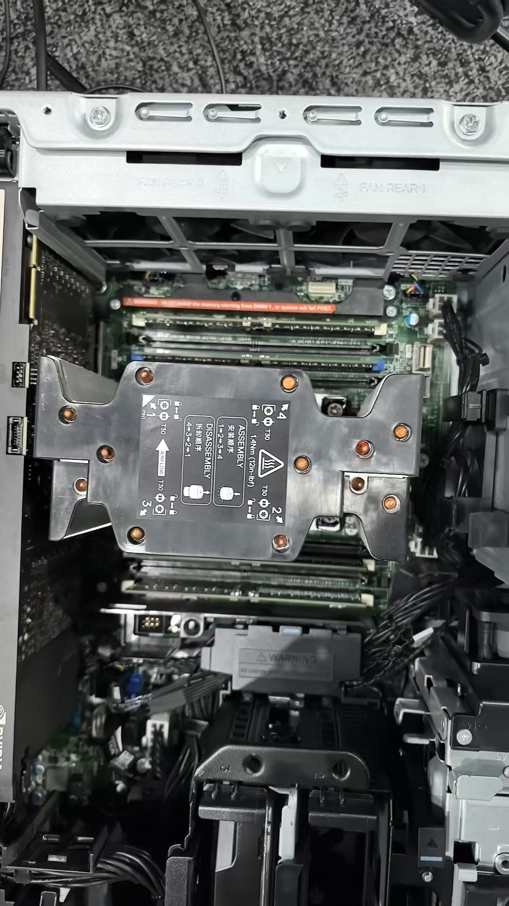

# Dell Precision 5860 塔式工作站

> 戴屹提供算力工作站：Dell Precision 5860 塔式工作站（配 NVIDIA RTX A5000 24GB 专业显卡），供具身打磨项目组免费使用｜页面更新：2026\-10\-27
> 
> 

# 一、设备概况

|项目|说明|
|---|---|
|设备名称|Dell Precision 5860 塔式工作站（型号 T5860，Intel Xeon W\-2495X 处理器）|
|提供方|上海戴屹科技（项目甲方），由易昌协调调拨|
|提供形式|借用／免费提供项目组使用（产权归戴屹），项目结束后可整体带走|
|用途|具身打磨项目的算法评测实验与机械臂控制实验：点云处理、视觉检测算法验证、打磨轨迹规划与仿真等|
|部署规划|军山侧与本校侧（主校区）各搭建一套运行环境|

# 二、硬件配置

|部件|配置|
|---|---|
|机器本体|Dell Precision T5860 塔式工作站 / Intel Xeon W\-2495X|
|内存|128 GB（32 GB × 4）|
|显卡|NVIDIA RTX A5000（24 GB 显存，专业显卡，非游戏卡）|
|硬盘|1 TB \+ 8 TB|

说明：以上配置来自戴屹（易昌）2026\-10\-14 在项目群提供的服务器配置表，与页面上方实拍图（正面／背部接口／内部硬件）一致；实际交付配置以戴屹最终确认为准。

# 三、提供背景与协作安排

1. **10 月 13 日组会**：明确算力设备由戴屹购买（或调拨）、借用给项目组使用，产权清晰、手续简便；易昌反馈戴屹现有一台 24G 显存 GPU 服务器可协调给项目组使用。

2. **10 月 14 日**：易昌在项目群发送本工作站配置表，询问是否满足项目算力需求，表示"可以的话，我可以协调尽快调过来使用"；黑晓军随即请薛力源组织组内同学评估。

3. **10 月 15 日机器人组会**：确认军山场地可以申请；戴屹（宜昌侧技术主管）将工作站与测试设备准备好发过来；该工作站带 **A5000 显卡（24 G 显存）**，可协商增配至 **48 G 显存**；计划**军山、本校各搭建一套运行环境**，供项目组免费使用。

4. A5000 为 NVIDIA 专业显卡（面向图形渲染、专业计算，非消费级游戏卡），适合工作站场景。

# 四、组内算力评估结论

薛力源组织组内同学评估后反馈（2026\-10\-14）：

- **内存有富余**，可满足常规训练与仿真需求；

- **显存（24G）略小**，训练时可能会有困难；不同训练网络所需显存与计算量不同，技术方向一旦确定且无网络结构大调整，显存占用基本不会有太大变化；

- **尚未拿到用于训练的点云数据**，暂无法确定 24G 显存是否够用；

- **建议方案**：先由公司提供工作站远程连接方式，用甲方数据进行试训练验证；如训练失败，可增加一张 24G A5000 显卡，**48G 显存基本足够**。

# 五、后续所需资源与待办

|序号|事项|负责人|说明|
|---|---|---|---|
|1|协调工作站尽快调拨到位（含测试设备），提供远程连接方式|易昌（戴屹）|先远程试训练验证 24G 显存是否够用|
|2|提供点云数据（单工件样本点云数量、样本数）|戴屹（甲方）|用于试训练与算法验证|
|3|提供机械臂相关参数（最好有 URDF）|戴屹（甲方）|供轨迹规划组开展仿真工作|
|4|根据试训练结果决定是否增配一张 24G A5000（至 48G）|薛力源组织评估|48G 显存基本可满足训练需求|
|5|军山、本校各搭建一套运行环境|项目组|设备到位后部署|

# 六、信息来源

- 戴屹（易昌）2026\-10\-14 项目群服务器配置表与沟通记录（Master26 项目群）

- 20261013\_具身打磨项目组会纪要：https://hustdian\.feishu\.cn/wiki/N7EAwjnL4iXWDSkgyG7cyFYOnAh

- 20261015\_机器人组会纪要：https://hustdian\.feishu\.cn/wiki/RYvvw2RcPiLp4VkhtJDcTcF2n5c

- 10\-15 机器人组组会妙记：https://meetings\.feishu\.cn/minutes/obcnmw9xsr3lz98ya3g5p29d

> （注：部分内容由豆包工作 AI 生成）
