# PCL初步上手\-点云场景处理模拟

**实验目的**：模拟企业打磨项目的完整感知流水线：相机拍到工位 → 找到工件 → 求出工件位姿 → 找到待磨缝 → 生成带姿态的打磨轨迹。完成一个模拟实验流程，初步体验点云处理的思想和方法：pcd文件读取、预处理（滤波去噪）、分割场景、定位、特征提取、可视化等等。

点云数据源：PCL点云官方点云数据/correspondence\_grouping

> 此PCD数据集有官方教程，可参考
> 
> [3D Object Recognition based on Correspondence Grouping（基于对应关系分组的3D物体识别）](https://pcl.readthedocs.io/projects/tutorials/en/master/correspondence_grouping.html#correspondence-grouping)
> 
> （关键点提取，描述子计算与匹配，对应点分组）下文为另一种点云处理方法
> 
> 

**0\. 使用pcl\_viewer打开点云图（终端运行 pcl\_viewer pcd文件路径 注意路径不要有中文）**

milk\_cartoon\_all\_small\_clorox\.pcd \(原始深度图点云，两个瓶一个牛奶盒\)

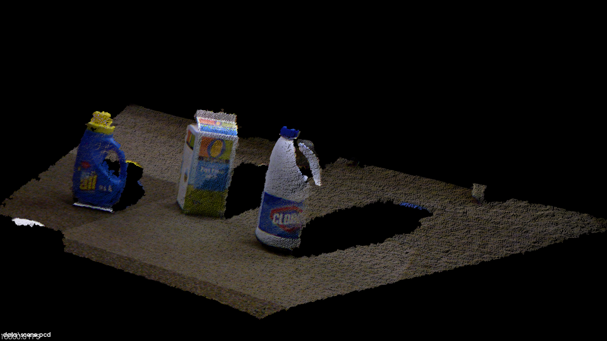

milk\.pcd （牛奶盒的“CAD模型”）

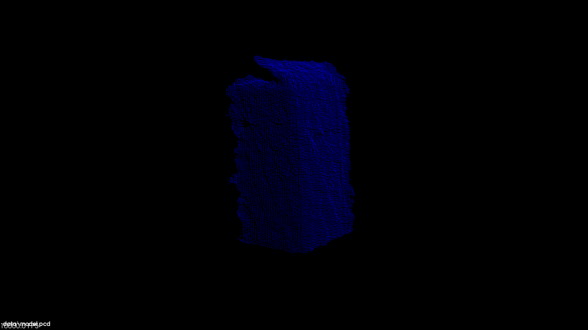

1. **第一步：预处理**

目的：把相机原始数据变成"干净、稀疏、够用"的点云。

1. 直通滤波PassThrough：按深度z裁掉工作空间外的东西；

2. 体素降采样VoxelGrid：取5mm一个格子取重心，640×480 深度图从 30 万点抽到几千\~几万点，减少后续计算量；

3. 统计滤波StatisticalOutlierRemoval：对每个点统计其 50 个近邻的平均距离；若该点偏离全局平均超过1\.0 倍标准差，判定为噪点删除。

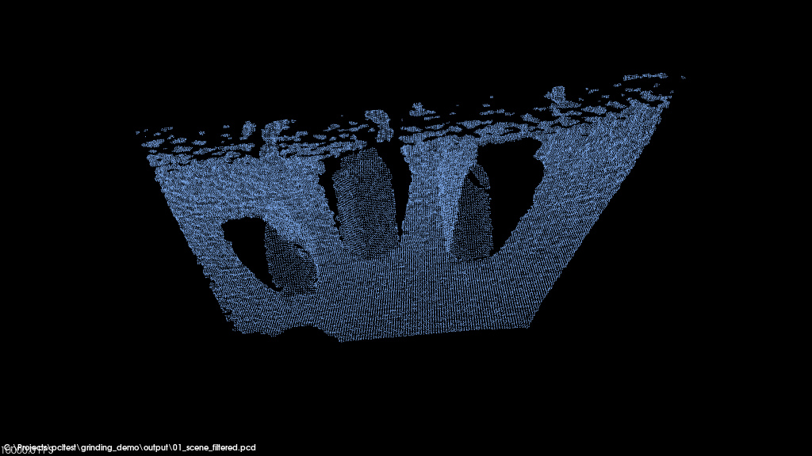

2. **第二步：分割**

目的：从场景中找出工件候选

1. RANSAC 平面 SACSegmentation：随机采样找内点最多的平面=桌面，工业上找基准面/定位面的标准手段

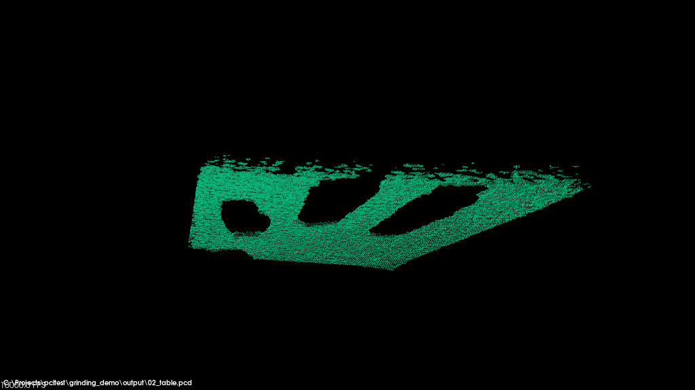

2. 去掉桌面，剩下的是物体；

3. 欧式聚类EuclideanClusterExtraction：按空间连通性把散点分成独立物体；

4. 保留最大三个簇作为候选

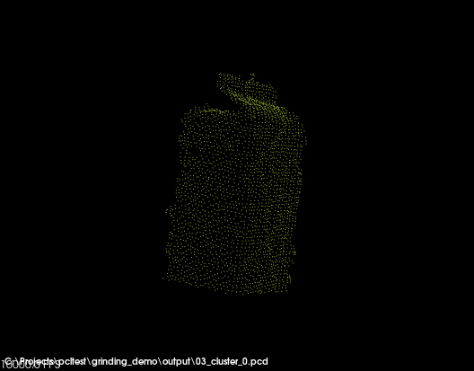

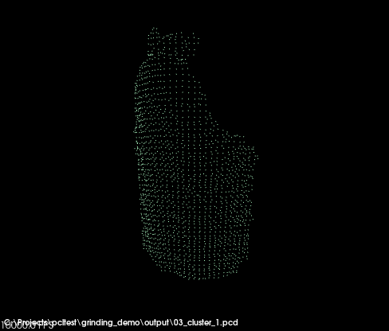

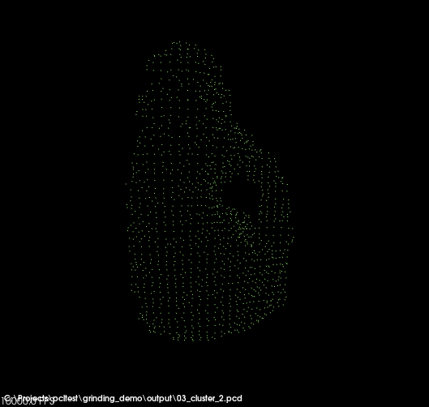

3. **第三步：工件定位**

目的：求出工件的 4×4 位姿矩阵 T（模型坐标系→相机坐标系，刚体变换）。

T 的含义：模型\(工件\)坐标系中的一个点 p\_model，在相机坐标系下位于 T\*p\_model

$p_{场景}=R\cdot p_{模型}+t$  \(R 是 3×3 旋转矩阵, t 是 3×1 平移\)

未知量 6 个自由度（3 个转角 \+ 3 个平移），称为 6DOF 位姿。写成 4×4 齐次矩阵即为变换T。

算法链简述：

→ 法向量：对每个点的邻域做 PCA，最小特征值的特征向量（最扁方向）就是法向 ；

→ 计算快速点特征直方图FPFH：计算一个点与其邻域点之间的三个角度特征来刻画该点周围的表面形状信息，33 维"几何指纹"；

→ SampleConsensusInitialAlignment **SAC\-IA 粗配准**：源点云中随机选择n个点，在目标点云中寻找其 FPFH 特征最相似的一个或多个点。然后从这些相似的候选点中随机选择一个作为该采样点的对应点，构建了一组“假定的”对应点对。通过这组点对可以算出一个刚体变换，并计算变换后的误差值。重复多轮，最后选择距离误差值最小的变换矩阵。

→ IterativeClosestPoint **ICP 精配准**：经过粗匹配后两片点云的初始位置已经接近。为源点云中的每个点，在目标点云中找最近的点作为对应点。根据这些对应点对，计算一个刚体变换，使对应点之间的距离总和最小。然后应用这个变换，更新源点云，再重新找对应点，迭代直到收敛。

对每个候选簇都跑一遍完整配准，得分最低者（距离误差最小）为真正的工件。

变换后，最优模型应贴合工件

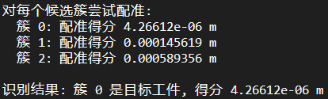

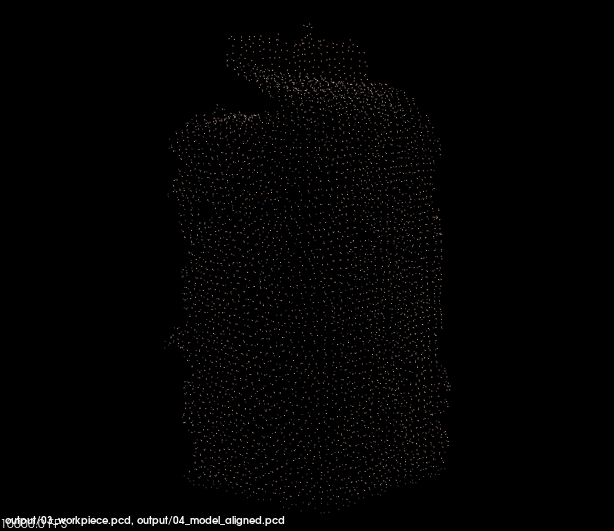

4. **第四步：特征提取**（边界）

本实验简化为找出点云边界点（邻域方向张角超阈值的点），对边界点再聚类，取最长一段为需要打磨的一条缝。

边界点估计BoundaryEstimation：对每个点，把邻域点投影到局部平面，若邻域的方向张角超过阈值，说明该点一侧有点、一侧没点，即位于边缘上。

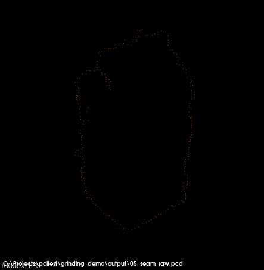

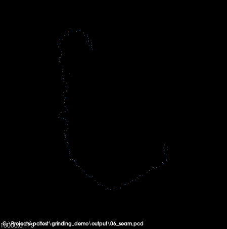

5. **第五步：路径生成**

目的：把缝点变成机器人可执行的轨迹

这一步要结合机器人和工具的实际情况处理。（暂未展开）

6. 可视化

灰=场景，绿=识别的工件，蓝=配准后的 CAD，红=缝，黄=路径点，白色短线=工具轴

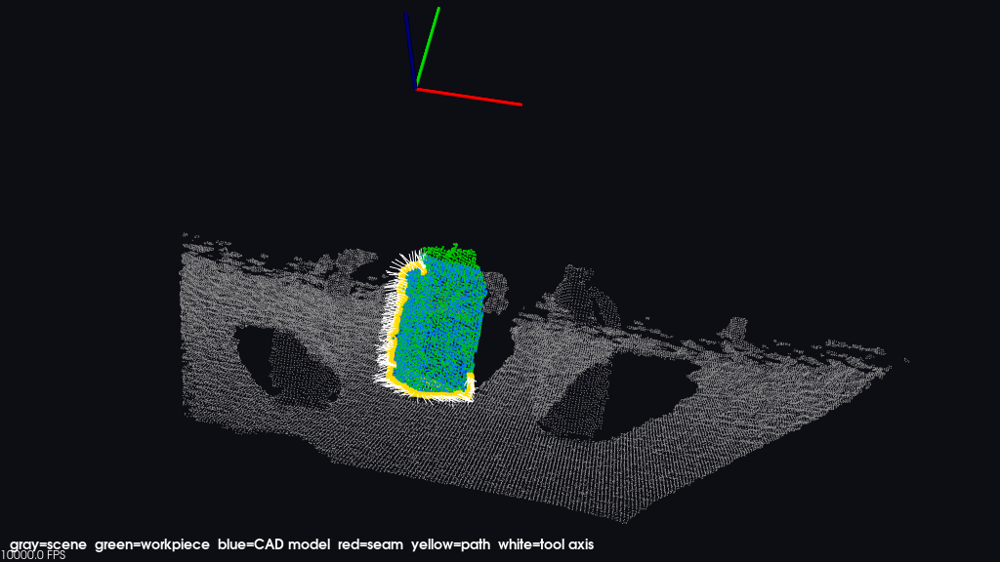

[src\.zip](assets/PCL初步上手-点云场景处理模拟__wiki-Bvtww2R3GiJAVZk5kmtcdFAXn2e/图片和附件/src.zip)

