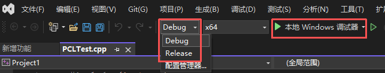
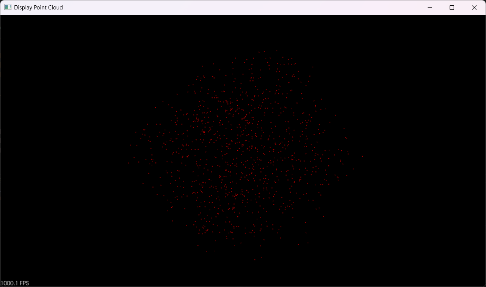
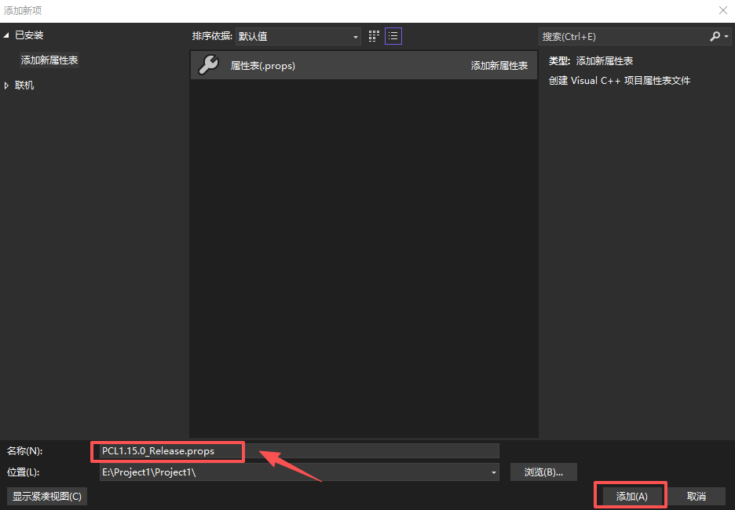
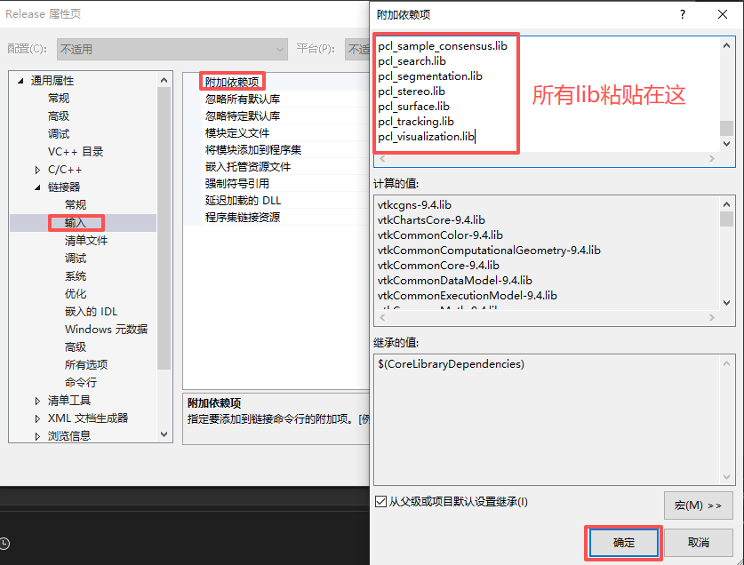
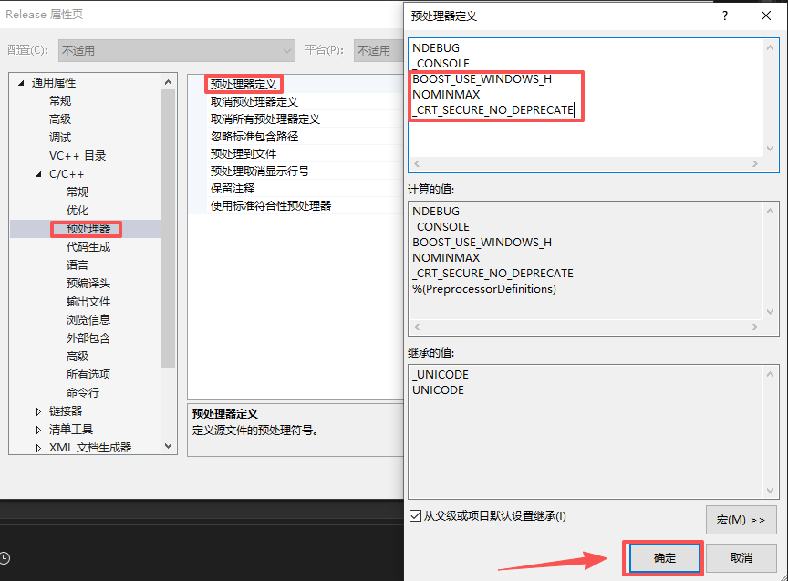
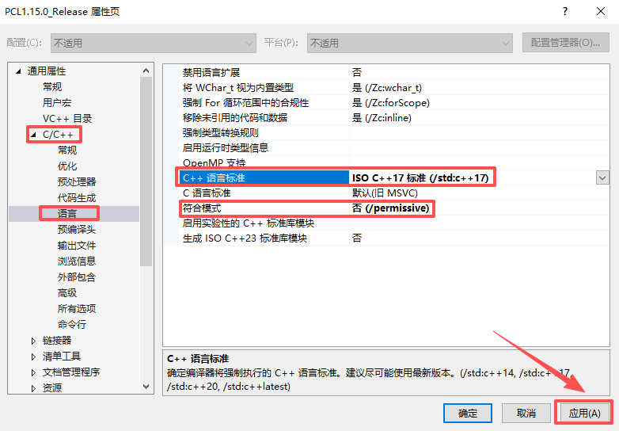
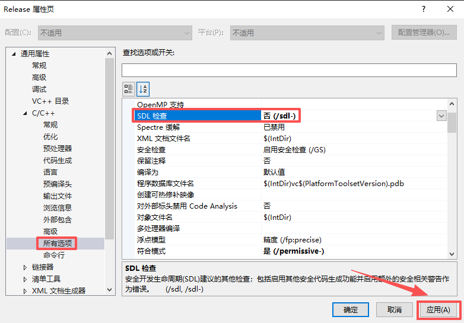
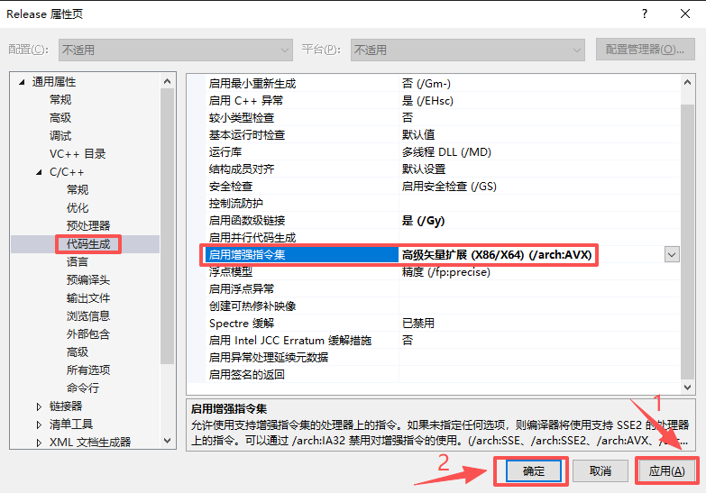
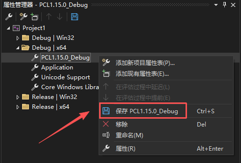

# PCL开发环境配置\-Windows

编写日期：2026\.9\.25

开发环境：Windows 11；Visual Studio 2022；PCL 1\.15\.0

# 下载软件

**PCL 1\.15\.0** Release页 https://github\.com/PointCloudLibrary/pcl/releases/

下载以下两个文件

https://github\.com/PointCloudLibrary/pcl/releases/download/pcl\-1\.15\.0/PCL\-1\.15\.0\-AllInOne\-win64\.exe

https://github\.com/PointCloudLibrary/pcl/releases/download/pcl\-1\.15\.0/pcl\-1\.15\.0\-pdb\-msvc2022\-win64\.zip

**安装 Visual Studio Community 2022** https://aka\.ms/vs/17/release/vs\_community\.exe

勾选 使用C\+\+的桌面开发

> 注意：小组件中 Windows 11 SDK 需要勾选上
> 
> 

# 安装配置PCL

1. 打开安装程序 PCL\-1\.15\.0\-AllInOne\-win64\.exe

选择将PCL添加到系统环境变量


保持默认一路点击“下一步”安装即可。

> 建议保持默认安装路径C:\\Program Files\\PCL 1\.15\.0，配置更简单
> 
> 

> 如出现警告：path too long installer unable to modify path 无需理会，下面会手动配置环境变量
> 
> 

2. 安装OpenNI2

打开PCL安装路径下的 OpenNI\-Windows\-x64\-2\.2\.msi

（如果有）移除掉原有的OpenNI2


移除完毕后再次打开OpenNI\-Windows\-x64\-2\.2\.msi，安装路径选择

**%你的PCL安装目录%\\3rdParty\\OpenNI2**

3. 导入pdb文件

解压pcl\-1\.15\.0\-pdb\-msvc2022\-win64\.zip，并将所有文件粘贴到PCL安装目录下的bin文件夹中。

4. 配置环境变量

开始菜单中搜索“环境变量”，进入“编辑系统环境变量”


双击用户变量中的 Path，新建以下值：

```Plain Text
C:\Program Files\PCL 1.15.0\bin
C:\Program Files\PCL 1.15.0\3rdParty\FLANN\bin
C:\Program Files\PCL 1.15.0\3rdParty\Qhull\bin
C:\Program Files\PCL 1.15.0\3rdParty\VTK\bin
C:\Program Files\PCL 1.15.0\3rdParty\OpenNI2\Include
C:\Program Files\PCL 1.15.0\3rdParty\OpenNI2\Lib
C:\Program Files\PCL 1.15.0\3rdParty\OpenNI2\Redist
C:\Program Files\PCL 1.15.0\3rdParty\OpenNI2\Tools
```

> 注意：将C:\\Program Files\\PCL 1\.15\.0替换为你的实际PCL安装目录，后续配置同样处理。
> 
> 

# 配置Visual Studio

创建一个C\+\+空项目，进入项目并打开属性管理器


1. **简易配置**

下载下面两个项目属性表文件

[PCL1\.15\.0\_Debug\.props](assets/PCL开发环境配置-Windows__wiki-JDyTwPvQ5ikou9kJDmlcj6CSnmb/图片和附件/PCL1.15.0_Debug.props)

[PCL1\.15\.0\_Release\.props](assets/PCL开发环境配置-Windows__wiki-JDyTwPvQ5ikou9kJDmlcj6CSnmb/图片和附件/PCL1.15.0_Release.props)

右键 Debug \| x64，点击“添加现有属性表”，选择 PCL1\.15\.0\_Debug\.props 文件并添加。

同样的，右键 Release \| x64，点击“添加现有属性表”，选择 PCL1\.15\.0\_Release\.props 文件并添加。

新建 test\.cpp 文件，粘贴测试代码：

```C++
#include <iostream>
#include <vector>
#include <ctime>
#include <pcl/point_cloud.h>
#include <pcl/octree/octree.h>
#include <boost/thread/thread.hpp>
#include <pcl/visualization/pcl_visualizer.h>
using namespace std;
int main(int argc, char** argv)
{
        srand((unsigned int)time(NULL));
        pcl::PointCloud<pcl::PointXYZ>::Ptr cloud(new pcl::PointCloud<pcl::PointXYZ>);
        // 创建点云数据
        cloud->width = 1000;
        cloud->height = 1;
        cloud->points.resize(cloud->width * cloud->height);
        for (size_t i = 0; i < cloud->points.size(); ++i)
        {
                cloud->points[i].x = 1024.0f * rand() / (RAND_MAX + 1.0f);
                cloud->points[i].y = 1024.0f * rand() / (RAND_MAX + 1.0f);
                cloud->points[i].z = 1024.0f * rand() / (RAND_MAX + 1.0f);
        }
        pcl::octree::OctreePointCloudSearch<pcl::PointXYZ> octree(0.1);
        octree.setInputCloud(cloud);
        octree.addPointsFromInputCloud();
        pcl::PointXYZ searchPoint;
        searchPoint.x = 1024.0f * rand() / (RAND_MAX + 1.0f);
        searchPoint.y = 1024.0f * rand() / (RAND_MAX + 1.0f);
        searchPoint.z = 1024.0f * rand() / (RAND_MAX + 1.0f);
        //半径内近邻搜索
        vector<int>pointIdxRadiusSearch;
        vector<float>pointRadiusSquaredDistance;
        float radius = 256.0f * rand() / (RAND_MAX + 1.0f);
        cout << "Neighbors within radius search at (" << searchPoint.x
                << " " << searchPoint.y
                << " " << searchPoint.z
                << ") with radius=" << radius << endl;
        if (octree.radiusSearch(searchPoint, radius, pointIdxRadiusSearch, pointRadiusSquaredDistance) > 0)
        {
                for (size_t i = 0; i < pointIdxRadiusSearch.size(); ++i)
                        cout << "    " << cloud->points[pointIdxRadiusSearch[i]].x
                        << " " << cloud->points[pointIdxRadiusSearch[i]].y
                        << " " << cloud->points[pointIdxRadiusSearch[i]].z
                        << " (squared distance: " << pointRadiusSquaredDistance[i] << ")" << endl;
        }
        // 初始化点云可视化对象
        boost::shared_ptr<pcl::visualization::PCLVisualizer>viewer(new pcl::visualization::PCLVisualizer("Display Point Cloud"));
        viewer->setBackgroundColor(0, 0, 0);  //设置背景颜色为黑色
        // 对点云着色可视化 (red).
        pcl::visualization::PointCloudColorHandlerCustom<pcl::PointXYZ>target_color(cloud, 255, 0, 0);
        viewer->addPointCloud<pcl::PointXYZ>(cloud, target_color, "target cloud");
        viewer->setPointCloudRenderingProperties(pcl::visualization::PCL_VISUALIZER_POINT_SIZE, 1, "target cloud");
        // 等待直到可视化窗口关闭
        while (!viewer->wasStopped())
        {
                viewer->spinOnce(100);
                boost::this_thread::sleep(boost::posix_time::microseconds(1000));
        }
        return (0);
}
```

分别选择Debug/Release模式并点击本地Windows调试器运行。



成功运行结果如下：一个红色正方体点云（可拖动观察）



> 若简易配置失败，按照下面进行完整手动配置。
> 
> 

2. **手动配置**

打开属性管理器（如果有之前简易配置添加的属性表请移除）

右键 Release \| x64，选择“添加新项目属性表”

名称命名为 PCL1\.15\.0\_Release\.props，点击添加



回到属性管理器，点击 Release \| x64，右键 PCL1\.15\.0\_Release，点击属性

点击属性页左侧的**VC\+\+目录**，点击**包含目录**右侧小箭头，点击编辑


在上方填入以下目录，点击确定

```Plain Text
C:\Program Files\PCL 1.15.0\include\pcl-1.15
C:\Program Files\PCL 1.15.0\3rdParty\Boost\include\boost-1_87
C:\Program Files\PCL 1.15.0\3rdParty\Eigen3\include\eigen3
C:\Program Files\PCL 1.15.0\3rdParty\FLANN\include
C:\Program Files\PCL 1.15.0\3rdParty\OpenNI2\Include
C:\Program Files\PCL 1.15.0\3rdParty\Qhull\include
C:\Program Files\PCL 1.15.0\3rdParty\VTK\include\vtk-9.4
```

点击**库目录**右侧小箭头，点击编辑，在上方填入以下目录，点击确定

```Plain Text
C:\Program Files\PCL 1.15.0\lib
C:\Program Files\PCL 1.15.0\3rdParty\Boost\lib
C:\Program Files\PCL 1.15.0\3rdParty\FLANN\lib
C:\Program Files\PCL 1.15.0\3rdParty\OpenNI2\Lib
C:\Program Files\PCL 1.15.0\3rdParty\Qhull\lib
C:\Program Files\PCL 1.15.0\3rdParty\VTK\lib
```

点击属性页左侧的**链接器**\-\>**输入**\-\>**附加依赖项**右侧箭头\-\>**编辑**，填入以下库文件：

```Plain Text
vtkcgns-9.4.lib
vtkChartsCore-9.4.lib
vtkCommonColor-9.4.lib
vtkCommonComputationalGeometry-9.4.lib
vtkCommonCore-9.4.lib
vtkCommonDataModel-9.4.lib
vtkCommonExecutionModel-9.4.lib
vtkCommonMath-9.4.lib
vtkCommonMisc-9.4.lib
vtkCommonSystem-9.4.lib
vtkCommonTransforms-9.4.lib
vtkDICOMParser-9.4.lib
vtkDomainsChemistry-9.4.lib
vtkDomainsChemistryOpenGL2-9.4.lib
vtkdoubleconversion-9.4.lib
vtkexodusII-9.4.lib
vtkexpat-9.4.lib
vtkFiltersAMR-9.4.lib
vtkFiltersCellGrid-9.4.lib
vtkFiltersCore-9.4.lib
vtkFiltersExtraction-9.4.lib
vtkFiltersFlowPaths-9.4.lib
vtkFiltersGeneral-9.4.lib
vtkFiltersGeneric-9.4.lib
vtkFiltersGeometry-9.4.lib
vtkFiltersGeometryPreview-9.4.lib
vtkFiltersHybrid-9.4.lib
vtkFiltersHyperTree-9.4.lib
vtkFiltersImaging-9.4.lib
vtkFiltersModeling-9.4.lib
vtkFiltersParallel-9.4.lib
vtkFiltersParallelImaging-9.4.lib
vtkFiltersPoints-9.4.lib
vtkFiltersProgrammable-9.4.lib
vtkFiltersReduction-9.4.lib
vtkFiltersSelection-9.4.lib
vtkFiltersSMP-9.4.lib
vtkFiltersSources-9.4.lib
vtkFiltersStatistics-9.4.lib
vtkFiltersTemporal-9.4.lib
vtkFiltersTensor-9.4.lib
vtkFiltersTexture-9.4.lib
vtkFiltersTopology-9.4.lib
vtkFiltersVerdict-9.4.lib
vtkfmt-9.4.lib
vtkfreetype-9.4.lib
vtkGeovisCore-9.4.lib
vtkgl2ps-9.4.lib
vtkglad-9.4.lib
vtkhdf5-9.4.lib
vtkhdf5_hl-9.4.lib
vtkImagingColor-9.4.lib
vtkImagingCore-9.4.lib
vtkImagingFourier-9.4.lib
vtkImagingGeneral-9.4.lib
vtkImagingHybrid-9.4.lib
vtkImagingMath-9.4.lib
vtkImagingMorphological-9.4.lib
vtkImagingSources-9.4.lib
vtkImagingStatistics-9.4.lib
vtkImagingStencil-9.4.lib
vtkInfovisCore-9.4.lib
vtkInfovisLayout-9.4.lib
vtkInteractionImage-9.4.lib
vtkInteractionStyle-9.4.lib
vtkInteractionWidgets-9.4.lib
vtkIOAMR-9.4.lib
vtkIOAsynchronous-9.4.lib
vtkIOCellGrid-9.4.lib
vtkIOCesium3DTiles-9.4.lib
vtkIOCGNSReader-9.4.lib
vtkIOChemistry-9.4.lib
vtkIOCityGML-9.4.lib
vtkIOCONVERGECFD-9.4.lib
vtkIOCore-9.4.lib
vtkIOEngys-9.4.lib
vtkIOEnSight-9.4.lib
vtkIOERF-9.4.lib
vtkIOExodus-9.4.lib
vtkIOExport-9.4.lib
vtkIOExportGL2PS-9.4.lib
vtkIOExportPDF-9.4.lib
vtkIOFDS-9.4.lib
vtkIOFLUENTCFF-9.4.lib
vtkIOGeometry-9.4.lib
vtkIOHDF-9.4.lib
vtkIOImage-9.4.lib
vtkIOImport-9.4.lib
vtkIOInfovis-9.4.lib
vtkIOIOSS-9.4.lib
vtkIOLegacy-9.4.lib
vtkIOLSDyna-9.4.lib
vtkIOMINC-9.4.lib
vtkIOMotionFX-9.4.lib
vtkIOMovie-9.4.lib
vtkIONetCDF-9.4.lib
vtkIOOggTheora-9.4.lib
vtkIOParallel-9.4.lib
vtkIOParallelXML-9.4.lib
vtkIOPLY-9.4.lib
vtkIOSegY-9.4.lib
vtkIOSQL-9.4.lib
vtkioss-9.4.lib
vtkIOTecplotTable-9.4.lib
vtkIOVeraOut-9.4.lib
vtkIOVideo-9.4.lib
vtkIOXML-9.4.lib
vtkIOXMLParser-9.4.lib
vtkjpeg-9.4.lib
vtkjsoncpp-9.4.lib
vtkkissfft-9.4.lib
vtklibharu-9.4.lib
vtklibproj-9.4.lib
vtklibxml2-9.4.lib
vtkloguru-9.4.lib
vtklz4-9.4.lib
vtklzma-9.4.lib
vtkmetaio-9.4.lib
vtknetcdf-9.4.lib
vtkogg-9.4.lib
vtkParallelCore-9.4.lib
vtkParallelDIY-9.4.lib
vtkpng-9.4.lib
vtkpugixml-9.4.lib
vtkRenderingAnnotation-9.4.lib
vtkRenderingCellGrid-9.4.lib
vtkRenderingContext2D-9.4.lib
vtkRenderingContextOpenGL2-9.4.lib
vtkRenderingCore-9.4.lib
vtkRenderingFreeType-9.4.lib
vtkRenderingGL2PSOpenGL2-9.4.lib
vtkRenderingHyperTreeGrid-9.4.lib
vtkRenderingImage-9.4.lib
vtkRenderingLabel-9.4.lib
vtkRenderingLICOpenGL2-9.4.lib
vtkRenderingLOD-9.4.lib
vtkRenderingOpenGL2-9.4.lib
vtkRenderingSceneGraph-9.4.lib
vtkRenderingUI-9.4.lib
vtkRenderingVolume-9.4.lib
vtkRenderingVolumeOpenGL2-9.4.lib
vtkRenderingVtkJS-9.4.lib
vtksqlite-9.4.lib
vtksys-9.4.lib
vtkTestingCore-9.4.lib
vtkTestingRendering-9.4.lib
vtktheora-9.4.lib
vtktiff-9.4.lib
vtktoken-9.4.lib
vtkverdict-9.4.lib
vtkViewsContext2D-9.4.lib
vtkViewsCore-9.4.lib
vtkViewsInfovis-9.4.lib
vtkWrappingTools-9.4.lib
vtkzlib-9.4.lib
pcl_common.lib
pcl_features.lib
pcl_filters.lib
pcl_io.lib
pcl_io_ply.lib
pcl_kdtree.lib
pcl_keypoints.lib
pcl_ml.lib
pcl_octree.lib
pcl_outofcore.lib
pcl_people.lib
pcl_recognition.lib
pcl_registration.lib
pcl_sample_consensus.lib
pcl_search.lib
pcl_segmentation.lib
pcl_stereo.lib
pcl_surface.lib
pcl_tracking.lib
pcl_visualization.lib
```



其他配置：添加预处理器定义

```Plain Text
BOOST_USE_WINDOWS_H
NOMINMAX
_CRT_SECURE_NO_DEPRECATE
```









最后点击应用，确定。右键属性管理器中的PCL1\.15\.0\_Release，点击保存。

然后配置Debug属性表，打开项目目录，复制粘贴PCL1\.15\.0\_Release\.props，重命名为PCL1\.15\.0\_Debug\.props


右键属性管理器中的 Debug \| x64，点击添加现有属性表，选择PCL1\.15\.0\_Debug\.props

单独修改附加依赖项，确定并应用，然后保存。

```C++
vtkcgns-9.4-gd.lib
vtkChartsCore-9.4-gd.lib
vtkCommonColor-9.4-gd.lib
vtkCommonComputationalGeometry-9.4-gd.lib
vtkCommonCore-9.4-gd.lib
vtkCommonDataModel-9.4-gd.lib
vtkCommonExecutionModel-9.4-gd.lib
vtkCommonMath-9.4-gd.lib
vtkCommonMisc-9.4-gd.lib
vtkCommonSystem-9.4-gd.lib
vtkCommonTransforms-9.4-gd.lib
vtkDICOMParser-9.4-gd.lib
vtkDomainsChemistry-9.4-gd.lib
vtkDomainsChemistryOpenGL2-9.4-gd.lib
vtkdoubleconversion-9.4-gd.lib
vtkexodusII-9.4-gd.lib
vtkexpat-9.4-gd.lib
vtkFiltersAMR-9.4-gd.lib
vtkFiltersCellGrid-9.4-gd.lib
vtkFiltersCore-9.4-gd.lib
vtkFiltersExtraction-9.4-gd.lib
vtkFiltersFlowPaths-9.4-gd.lib
vtkFiltersGeneral-9.4-gd.lib
vtkFiltersGeneric-9.4-gd.lib
vtkFiltersGeometry-9.4-gd.lib
vtkFiltersGeometryPreview-9.4-gd.lib
vtkFiltersHybrid-9.4-gd.lib
vtkFiltersHyperTree-9.4-gd.lib
vtkFiltersImaging-9.4-gd.lib
vtkFiltersModeling-9.4-gd.lib
vtkFiltersParallel-9.4-gd.lib
vtkFiltersParallelImaging-9.4-gd.lib
vtkFiltersPoints-9.4-gd.lib
vtkFiltersProgrammable-9.4-gd.lib
vtkFiltersReduction-9.4-gd.lib
vtkFiltersSelection-9.4-gd.lib
vtkFiltersSMP-9.4-gd.lib
vtkFiltersSources-9.4-gd.lib
vtkFiltersStatistics-9.4-gd.lib
vtkFiltersTemporal-9.4-gd.lib
vtkFiltersTensor-9.4-gd.lib
vtkFiltersTexture-9.4-gd.lib
vtkFiltersTopology-9.4-gd.lib
vtkFiltersVerdict-9.4-gd.lib
vtkfmt-9.4-gd.lib
vtkfreetype-9.4-gd.lib
vtkGeovisCore-9.4-gd.lib
vtkgl2ps-9.4-gd.lib
vtkglad-9.4-gd.lib
vtkhdf5-9.4-gd.lib
vtkhdf5_hl-9.4-gd.lib
vtkImagingColor-9.4-gd.lib
vtkImagingCore-9.4-gd.lib
vtkImagingFourier-9.4-gd.lib
vtkImagingGeneral-9.4-gd.lib
vtkImagingHybrid-9.4-gd.lib
vtkImagingMath-9.4-gd.lib
vtkImagingMorphological-9.4-gd.lib
vtkImagingSources-9.4-gd.lib
vtkImagingStatistics-9.4-gd.lib
vtkImagingStencil-9.4-gd.lib
vtkInfovisCore-9.4-gd.lib
vtkInfovisLayout-9.4-gd.lib
vtkInteractionImage-9.4-gd.lib
vtkInteractionStyle-9.4-gd.lib
vtkInteractionWidgets-9.4-gd.lib
vtkIOAMR-9.4-gd.lib
vtkIOAsynchronous-9.4-gd.lib
vtkIOCellGrid-9.4-gd.lib
vtkIOCesium3DTiles-9.4-gd.lib
vtkIOCGNSReader-9.4-gd.lib
vtkIOChemistry-9.4-gd.lib
vtkIOCityGML-9.4-gd.lib
vtkIOCONVERGECFD-9.4-gd.lib
vtkIOCore-9.4-gd.lib
vtkIOEngys-9.4-gd.lib
vtkIOEnSight-9.4-gd.lib
vtkIOERF-9.4-gd.lib
vtkIOExodus-9.4-gd.lib
vtkIOExport-9.4-gd.lib
vtkIOExportGL2PS-9.4-gd.lib
vtkIOExportPDF-9.4-gd.lib
vtkIOFDS-9.4-gd.lib
vtkIOFLUENTCFF-9.4-gd.lib
vtkIOGeometry-9.4-gd.lib
vtkIOHDF-9.4-gd.lib
vtkIOImage-9.4-gd.lib
vtkIOImport-9.4-gd.lib
vtkIOInfovis-9.4-gd.lib
vtkIOIOSS-9.4-gd.lib
vtkIOLegacy-9.4-gd.lib
vtkIOLSDyna-9.4-gd.lib
vtkIOMINC-9.4-gd.lib
vtkIOMotionFX-9.4-gd.lib
vtkIOMovie-9.4-gd.lib
vtkIONetCDF-9.4-gd.lib
vtkIOOggTheora-9.4-gd.lib
vtkIOParallel-9.4-gd.lib
vtkIOParallelXML-9.4-gd.lib
vtkIOPLY-9.4-gd.lib
vtkIOSegY-9.4-gd.lib
vtkIOSQL-9.4-gd.lib
vtkioss-9.4-gd.lib
vtkIOTecplotTable-9.4-gd.lib
vtkIOVeraOut-9.4-gd.lib
vtkIOVideo-9.4-gd.lib
vtkIOXML-9.4-gd.lib
vtkIOXMLParser-9.4-gd.lib
vtkjpeg-9.4-gd.lib
vtkjsoncpp-9.4-gd.lib
vtkkissfft-9.4-gd.lib
vtklibharu-9.4-gd.lib
vtklibproj-9.4-gd.lib
vtklibxml2-9.4-gd.lib
vtkloguru-9.4-gd.lib
vtklz4-9.4-gd.lib
vtklzma-9.4-gd.lib
vtkmetaio-9.4-gd.lib
vtknetcdf-9.4-gd.lib
vtkogg-9.4-gd.lib
vtkParallelCore-9.4-gd.lib
vtkParallelDIY-9.4-gd.lib
vtkpng-9.4-gd.lib
vtkpugixml-9.4-gd.lib
vtkRenderingAnnotation-9.4-gd.lib
vtkRenderingCellGrid-9.4-gd.lib
vtkRenderingContext2D-9.4-gd.lib
vtkRenderingContextOpenGL2-9.4-gd.lib
vtkRenderingCore-9.4-gd.lib
vtkRenderingFreeType-9.4-gd.lib
vtkRenderingGL2PSOpenGL2-9.4-gd.lib
vtkRenderingHyperTreeGrid-9.4-gd.lib
vtkRenderingImage-9.4-gd.lib
vtkRenderingLabel-9.4-gd.lib
vtkRenderingLICOpenGL2-9.4-gd.lib
vtkRenderingLOD-9.4-gd.lib
vtkRenderingOpenGL2-9.4-gd.lib
vtkRenderingSceneGraph-9.4-gd.lib
vtkRenderingUI-9.4-gd.lib
vtkRenderingVolume-9.4-gd.lib
vtkRenderingVolumeOpenGL2-9.4-gd.lib
vtkRenderingVtkJS-9.4-gd.lib
vtksqlite-9.4-gd.lib
vtksys-9.4-gd.lib
vtkTestingCore-9.4-gd.lib
vtkTestingRendering-9.4-gd.lib
vtktheora-9.4-gd.lib
vtktiff-9.4-gd.lib
vtktoken-9.4-gd.lib
vtkverdict-9.4-gd.lib
vtkViewsContext2D-9.4-gd.lib
vtkViewsCore-9.4-gd.lib
vtkViewsInfovis-9.4-gd.lib
vtkWrappingTools-9.4-gd.lib
vtkzlib-9.4-gd.lib
pcl_commond.lib
pcl_featuresd.lib
pcl_filtersd.lib
pcl_iod.lib
pcl_io_plyd.lib
pcl_kdtreed.lib
pcl_keypointsd.lib
pcl_mld.lib
pcl_octreed.lib
pcl_outofcored.lib
pcl_peopled.lib
pcl_recognitiond.lib
pcl_registrationd.lib
pcl_sample_consensusd.lib
pcl_searchd.lib
pcl_segmentationd.lib
pcl_stereod.lib
pcl_surfaced.lib
pcl_trackingd.lib
pcl_visualizationd.lib
```



最后分别选择Debug/Release模式并点击本地Windows调试器运行测试代码。

> 如遇见其他疑难问题，建议先把错误信息和日志交给你的Coding Agent分析并尝试解决。
> 
> 


**参考资料**

[Windows系统下vs2022\+PCL1\.15\.0安装配置超详细教程](https://blog.csdn.net/mazheng11111111/article/details/151647210)

[Windows安装PCL及踩过的坑](https://blog.csdn.net/weixin_45348389/article/details/115493095?ops_request_misc=elastic_search_misc&request_id=d2890653b6b1c7ce9dcc0ab40942583a&biz_id=0&utm_medium=distribute.pc_search_result.none-task-blog-2~all~ElasticSearch~search_v2-2-115493095-null-null.142^v102^pc_search_result_base1&utm_term=windows%E5%AE%89%E8%A3%85pcl%E8%B8%A9%E8%BF%87&spm=1018.2226.3001.4187)

[PCL官网](https://pointclouds.org/)


