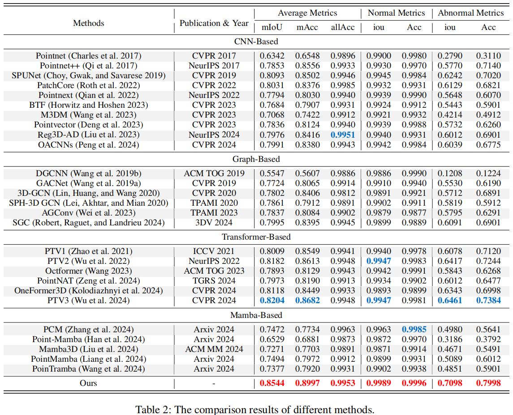

# Point Cloud Segmentation of Integrated Circuits Package Substrates Surface Defects Using Causal Inference: Dataset Construction and Methodology

论文来源：https://ojs\.aaai\.org/index\.php/AAAI/article/view/42436\)

作者仓库：[https://github\.com/Bingyang0410/CPS3D\-Seg](https://github.com/Bingyang0410/CPS3D-Seg)

读这篇论文的原因和目的：论文同样研究工件缺陷的三维监督分割，虽然具体的场景不同，但是他提供可借鉴的数据、实验方法和研究思路。

**总结：可以参考论文的数据采集、人工标注和多网络对比方法，建立自己的飞边毛刺检测系统。**

数据集构建：需要准备2\~5种代表性工件，包括正常件、不同严重程度的飞边毛刺件，累计约15\~30个独立实物，明确标出必须去除、保留和禁止打磨的部位，明确最小关注缺陷尺寸，再使用3d相机采集50\~200份点云，建立逐点标签，按实物及批次划分训练，作为数据集启动规模。

检测网络技术选型：采用 “AI 分割候选区域＋PCL 几何分析”：AI 判断哪些点属于飞边毛刺，几何方法进一步提取区域、边界和根部，并在具备参考表面的情况下估计高度。首选选用pointnet\+\+作为基线，其所需的计算成本较低，先建立可以比较的起点，然后考虑升级到pointnext和ptv3等方法作为更强的网络对照，第二阶段再考虑自行优化检测网络，其需要的计算量和时间成本明显会高于pointnet\+\+等基线方法，但是效果会更好（论文 CINet 的缺陷 IoU 为 70\.98%，PointNet\+\+ 为 57\.70%）。

# 研究问题

论文研究集成电路陶瓷封装基板的表面缺陷分割。该问题的核心难点是正常结构复杂、缺陷很小、扫描存在缺失和密度差异，点云结构化处理可能把异常与正常区域混合。

论文主要进行了以下工作：

1. 构建自己的数据集 CPS3D\-Seg 数据集，包含大量真实生产线产品的三维点云和逐点标签；

2. 提出自己的异常检测网络 CINet；

3. 进行了大量已有三维分割网络的统一数据集对照试验

# 主要工作

## 构建数据集 CPS3D\-Seg

论文构建的 CPS3D\-Seg 数据集是一个面向**集成电路陶瓷封装基板表面缺陷的真实三维点云分割数据集**。采用工业扫描设备采集实物，再进行逐点缺陷标注。

针对实际生产线中的 20 种产品，包含正常样品和缺陷样品，作者采用4台 Keyence LJ\-X8020 线激光扫描仪与运动机构扫描，扫描头随运动机构按之字形路径移动，覆盖样品表面，利用FRICP配准和外参融合，再通过三维网格减少冗余。用显微镜辅助确认异常，并在CloudCompare上标注，共计20种产品、1300个样本，点间分辨率0\.0025 mm、精度0\.0003 mm；

数据集构建流程：生产线实物 → 多扫描头采集 → 配准融合 → 点云降采样 → 显微镜确认缺陷 → 人工逐点标注

## 因果干预网络 CINet

CINet（Causal Intervention Network，因果干预网络）是论文提出的三维点云监督分割网络，用于逐点判断正常区域和缺陷区域。 核心思路是：在提取几何特征的同时，考虑点云采集质量，减少密度不均、数据缺失等因素对缺陷判断的干扰。

同一个正常表面，在不同扫描条件下可能表现为稀疏、断裂或局部缺点。网络如果只学习这些表面特征，就容易把扫描问题当成真实缺陷。作者将点云质量视为影响检测的潜在干扰因素，通过三个模块联合处理：

1. 质量评估 QA：计算点云密度、均匀性和完整性，用高斯混合模型建模，描述点云的采集质量；

2. 结构细化 SR：通过FPS 采样、KNN 分组、Transformer 编码，提取局部几何结构特征；

3. 映射注意力检测 MAD：特征投影、注意力加权、全局平均池化及残差结构，融合质量信息与几何特征，完成分割

其中“因果干预”指的是，网络建立了点云、潜在干扰因素、结构表示和分割标签之间的因果模型，并用后门调整推导分类目标，是一种由因果建模指导的、融合点云质量信息的分割网络。这套方法依赖结构表示包含足够的标签相关信息。

论文提出的网络与前人工作的关系：论文没有直接复用已有的骨干网络例如PointNet\+\+、PTv3等，而是借鉴了PointNet\+\+ 的局部处理思路，使用 Transformer 提取点组特征，再加入作者设计的质量评估和映射注意力模块，实现质量感知的点云缺陷分割。

## 实验设计与结果

作者汇总了约30种已有方法，包含基于CNN（PointNet\+\+、M3DM等），基于图网络（DGCNN等），基于Transformer网络（PTv3等），以及基于Mamba的方法，在 CPS3D\-Seg 上进行正常／缺陷点分割，使用相同计算环境和数据划分比例，比较 CINet 与不同技术路线的效果。指标包含整体指标 mIoU、mAP、OA，以及正常类、缺陷类各自的 IoU 和 Precision。

最后进行了消融实验和其他公开数据集验证，通过逐步加入质量评估、结构细化、映射注意力模块，检查各模块的贡献；同时在 Real3D\-AD、Anomaly\-ShapeNet 上开展实验，考察方法在其他对象上的适用性。

