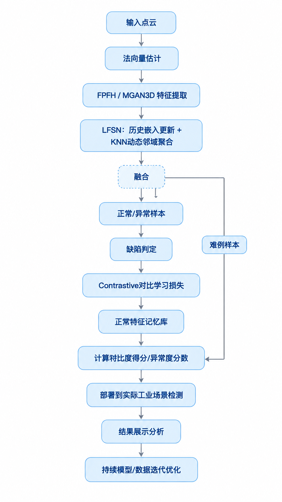
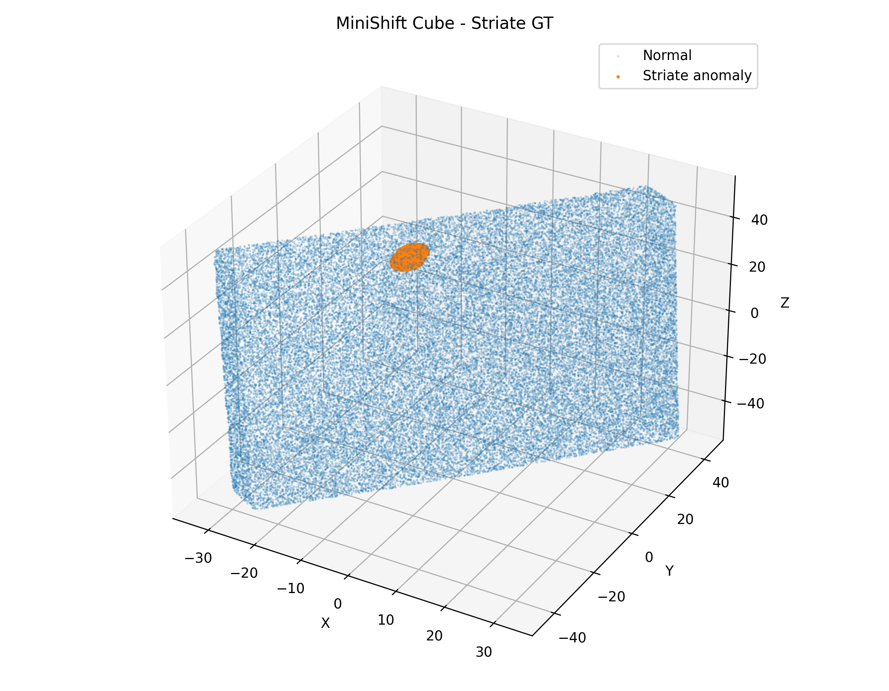

# Simple3D

Paper：https://arxiv\.org/abs/2507\.07435

Dataset：https://huggingface\.co/datasets/ChengYuQi99/MiniShift


现有三维异常检测方法通常先从原始点云中选取一个稀疏的点集（一般约为 1k 个点），这些方法编码局部邻域特征，构成点组，并为各点组赋予异常分数。基于重建的方法，例如 IMRNet 和 R3D\-AD ，将每个点组转换为具有代表性的 token，再通过 Point Transformer 架构重建这些 token。异常分数由原始 token 与重建 token 之间的特征差异计算得到。

为了生成稠密异常图，稀疏的点组级分数会被插值到整个点云上。但这种插值不可避免地损失了检测细粒度缺陷所需的空间细节。例如在一个 20 mm × 20 mm 的表面上有一个仅有 1 mm × 1 mm 的缺陷，在点云被缩减到 1k 个点后，就会变得几乎无法察觉（下采样后缺陷特征几乎完全消失）

Simple3D 的工作在于：

1. 提出高分辨率三维异常检测数据集 MiniShift。数据集包含 2,577 份点云，每份有 500k 个点，并配套三级难度框架，以全面评估检测方法。

2. 提出高分辨率异常检测方法 Simple3D，其核心组件在保持计算效率的同时，显著增强了识别细微几何异常的能力。



## 主要技术

### MSND（Multi\-scale Neighborhood Descriptors，多尺度邻域描述子）

- 核心思路：从不同范围观察同一个点。 对每个点分别选择小、中、大不同尺度的邻域提取几何特征，再把这些特征拼接起来，让模型既能看到局部细节，也能了解周围整体形状。

- 尺度由邻居数量控制。 例如 `max_nn=40` 时，会分别使用最多 40、80、120 个邻居，对应不同大小的空间范围。

- 不同尺度关注的信息不同。 每个尺度都会生成 33 维 FPFH 特征，描述该点与周围点之间的位置和法向关系。小尺度更容易发现毛刺、微小凸起等细节，大尺度则可以判断这些变化是否偏离周围正常曲面。

- 最后将多个尺度的特征拼接。 这样可以同时保留不同范围的几何信息，比只观察单一尺度更加全面。

对于具身打磨任务，MSND 的价值在于：它可以同时关注毛刺本身的细小几何变化和毛刺周围的正常表面结构，从而帮助判断哪些位置可能需要加工，也可以用于打磨后的复检。相比单尺度特征，它对不同大小的缺陷适应性更好，而且目前不需要额外训练特征网络，部署成本较低。但 Simple3D 输出的只是“这里和正常表面有多不一样”，还不能直接判断是否需要打磨，因此后续最好结合 CAD 或目标表面，进一步判断异常是凸起还是凹陷、需要去除多少材料。

### LFSA（Local Feature Spatial Aggregation，局部特征空间聚合）

- 核心思路：不只看一个点，而是用周围一片区域共同描述它。 LFSA 会把邻近点的 MSND／FPFH 特征进行聚合，得到一个更稳定的局部区域特征。

- 首先选择一批中心点。 通过 `num_group` 控制中心点数量，使这些中心尽可能均匀覆盖整个点云。

- 再根据空间位置寻找邻居。 对每个中心点，按照 XYZ 坐标距离寻找 `group_size` 个最近邻，将这些邻居的特征进行平均聚合。

- 让一个特征包含更大的局部范围。 这样中心点不仅包含自身信息，还融合了周围点的几何特征，同时平均操作也能减弱扫描噪声或单点波动带来的影响。

- 同时减少后续匹配的计算量。 原本需要对大量点逐一比较，LFSA 聚合后只需要处理这些中心点，可以减小正常特征库和最近邻匹配的规模。

- 但聚合范围不能过大。 如果 `group_size` 太大，微小毛刺可能被周围正常点“平均掉”；如果 `num_group` 太少，又可能漏掉很小的缺陷，因此需要在速度和定位精度之间进行权衡。

对于具身打磨任务，LFSA 可以把零散的点级异常信息进一步组织成局部缺陷区域，更适合为后续打磨区域提取、轨迹规划以及“扫描—加工—复检”闭环提供状态信息。相比只关注轨迹覆盖或力控的传统打磨流程，它能够补充缺陷感知能力，使机器人更有针对性地处理异常区域。不过目前 Simple3D 的实验只能证明 LFSA 有助于提高异常检测效果，还不能直接说明它能够提高实际打磨质量；真正落地时仍需结合材料和相应指标进一步验证。


## 测试结果（以cube类、Striate缺陷为例）

**Image AUROC**：用于衡量模型对“整个零件是否异常”的判断能力。模型会给每个完整点云一个异常分数，再比较正常样本和异常样本的分数分布；AUROC 越接近 1，说明模型越能区分异常零件和正常零件。

**Pixel AUROC**：用于衡量模型对“异常具体位于哪些点”的定位能力。比较每个点的异常分数与 GT 点级标签。数值越高，说明模型越能把真实异常点和正常点区分开。


**Cube\_Striate** 混合异常测试集 （Simple3D 能不能识别 Cube 上各种各样的异常）

```Plain Text

Running on class cube

Finished running on class cube
| Method   |   Cube |   Mean |
|:---------|-------:|-------:|
| Simple3D |  0.695 |  0.695 |
| Method   |   Cube |   Mean |
|:---------|-------:|-------:|
| Simple3D |  0.653 |  0.653 |
| Method   |   Cube |   Mean |
|:---------|-------:|-------:|

```

**Cube\_Striate\_Only**（Simple3D 能不能专门识别 Cube 上的 Striate）

```Plain Text

Running on class cube

Finished running on class cube
| Method   |   Cube |   Mean |
|:---------|-------:|-------:|
| Simple3D |   0.81 |   0.81 |
| Method   |   Cube |   Mean |
|:---------|-------:|-------:|
| Simple3D |  0.839 |  0.839 |
| Method   |   Cube |   Mean |
|:---------|-------:|-------:|

```

在仅包含 Striate 的测试子集上，Simple3D 的 Pixel AUROC 为 0\.839，高于混合异常测试集上的 0\.653，表明模型对 Striate 类型异常具有更好的识别和定位能力。   


**可视化**




