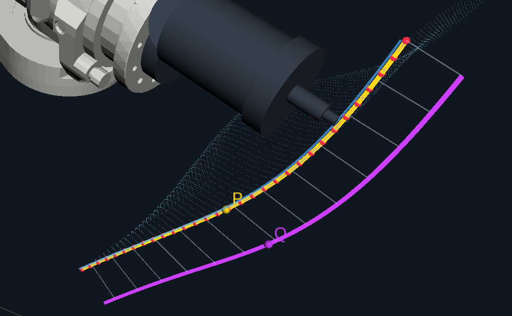

# Trajectory Planning and Optimization for Robotic Machining Based On Measured Point Cloud论文研读

论文信息： WANG G, LI W, JIANG C, et al\. Trajectory planning and optimization for robotic machining based on measured point cloud\[J\]\. IEEE Transactions on Robotics, 2022, 38\(3\): 1621\-1637\. DOI: 10\.1109/TRO\.2021\.3108506\.

## 01 简述


对装夹后实测点云产生的位置和工具轴方向，先用双NURBS及薄板能量约束消减局部抖动，再利用工具轴旋转冗余选择机器人姿态，最后用仿真、蒙皮边铣和叶片打磨实验检验加工均匀性与表面质量。

该方法适合放在“局部加工轨迹生成后、机器人执行前”的优化层：给定局部区域的几何点和法向，改善位置/工具轴平滑性，再在符合真实砂轮接触几何的前提下优化机器人姿态。不替代多缺陷访问排序、碰撞场景构建、控制器执行或执行回执

## 02 研究问题


工业机器人加工大型薄壁零件时，有两个难题同时存在：

第一，工件装夹后发生变形，设计CAD不再完全等于真实表面。薄壁航空蒙皮、风电叶片是作者给出的典型对象。因此需要扫描装夹后的实际形状，按实测数据生成加工轨迹。

第二，扫描数据有噪声或局部异常。直接跟随原始点和法向，会让位置和刀轴局部摆动；工业机器人刚度又随姿态改变，轨迹可达并不意味着受力后加工误差小。


## 03 背景路线


|路线|本文指出的不足|本文的切入点|
|---|---|---|
|CAD生成加工路径|难反映装夹后的实际变形|使用装夹后实测点云|
|直接点云/截面生成路径|噪声会进入位置与工具轴|双曲线联合平滑|
|拟合曲线、双四元数等姿态平滑|作者认为部分局部波动仍存在|以工具轴扫出的直纹面能量优化|
|机器人逆解与姿态优化|仅“可达”没有兼顾任务方向与刚度|联合考虑MVR与受力变形|


## 04 核心痛点


|痛点|具体表现|原因或作者解释|
|---|---|---|
|设计与现实几何不一致|按CAD加工可能偏离装夹后工件|大尺度、低刚度工件易变形|
|刀位和刀轴存在局部突变|工具局部摆动、腕关节抖动|点云噪声通过路径和法向传入运动|
|只把路径拟合准会追随噪声|增加控制点能减小拟合误差，却可能降低平滑性|几何保真与平滑程度存在取舍|
|可达姿态仍可能软或不灵活|同样接触轨迹产生不同加工误差|关节姿态影响Jacobian与笛卡尔柔度|


## 05 核心思想


**第一层：用“刀尖位置＋刀轴端点”联合表示加工运动。** 每个位置点配一个沿工具轴偏移的点。两组点各自拟合成曲线，二者的连线给出工具轴。随路径移动，这些连线形成直纹面。

**第二层：把运动抖动转成几何能量问题。**可以想象把刀位曲线和轴点曲线看作一条薄带的两条边。工具轴忽然转动，薄带便出现折皱；优化希望薄带少弯曲，但又不能过度拉直而离开工件。这里的薄板是数学模型，不是实际工件的弹性仿真。

**第三层：加工接触不变时，改变机器人“怎么站”。** 围绕工具轴旋转的自由度，在相应工具/加工模式下不影响理论加工结果，却改变机器人关节配置。利用这一自由度联合优化灵巧性与刚度。


## 06 方法总览


```Plain Text
装夹后实测点云
  → 提取已排序的加工边界点或截面点、估计法向
  → 生成位置点P和工具轴点Q
  → 分别拟合三次NURBS，建立参数同步
  → 薄板能量＋几何偏差约束：优化双曲线
  → 按刀具半径、加工方式、余量计算工具偏置
  → 离散为TCP位置和工具轴
  → 对整条路径搜索一个旋转角γ
  → 检查关节范围、MVR、受力变形
  → 逆解并生成机器人加工路径
  → 实物执行、测量去除量或粗糙度
```


## 07 核心贡献

1. 提出基于能量的轨迹平滑优化方法 EBTSO

使用双 NURBS 曲线分别表示工具位置和工具轴点，通过参数同步建立对应关系，并构造 P–Q 直纹面。在此基础上，联合优化直纹面薄板能量与测量数据偏差，在保持加工几何的同时抑制点云噪声引起的位置和工具轴方向抖动

EBTSO 的核心公式：

目标函数：

$F=E_S+\mu D$

薄板平滑能量：

$E_S=\iint\left(\|S_{uu}\|^2+\|S_{vv}\|^2+2\|S_{uv}\|^2\right)\,du\,dv$

数据偏差项：

$D=\sum_i\|P(u_i)-p_i\|^2+\sum_i\|Q(s_i)-q_i\|^2$

直纹面：

$S(u,v)=(1-v)P(u)+vQ(\phi(u))$

工具轴方向：

$a(u)=\frac{Q(\phi(u))-P(u)}{\|Q(\phi(u))-P(u)\|}$

Q 点生成：

$Q_i=P_i+b n_i$


2. 提出面向机器人执行性能的绕工具轴姿态优化方法

在工具位置和工具轴方向保持不变的条件下，利用轴对称工具的姿态冗余，对整条加工路径搜索统一的绕轴角 

𝛾，综合考虑机器人任务方向运动能力和预测柔顺变形，并加入关节范围等可行性约束，从而选择更适合机器人执行的姿态。

3. 通过轨迹指标与实际加工实验验证方法效果。

将 EBTSO 与 DBFPS、DQPS 等方法进行对比，比较工具轴角度变化、加工去除均匀性和表面粗糙度；同时比较优化姿态角与参考姿态角下的加工结果，验证轨迹平滑和姿态优化的实际影响。

相关介绍

- **DBFPS（双 B 样条曲线拟合平滑）**：分别用两条 B 样条曲线拟合工具位置和工具轴方向，再组合成加工轨迹。方法简单直观，但位置与姿态的联合平滑能力有限。

- **DQPS（双四元数路径平滑）**：用双四元数统一表示工具的位置和旋转姿态，再对整体位姿轨迹进行平滑。位置和姿态处理更统一，但对点云加工几何的约束不如 EBTSO 直接。

- **B 样条曲线（B\-Spline）**：一种用少量控制点生成平滑曲线的数学方法。

论文数据对比

## 08 实验复现




• 红色点是原始输入路径点

• 黄色曲线是 P 曲线：输出，表示工具参考点（通常对应 TCP 或加工路径位置）。

• 紫色曲线是 Q 曲线：表示工具轴辅助点。

• 灰色连线是 P–Q 对应连线：从每个 P 点指向对应的 Q 点，用来确定工具轴方向。

• 蓝色点云：原始工件扫描数据


**实验不足**

由于论文并没有公开代码和器件的数据，只能根据公式和技术方案编写代码。当前仿真主要复现了双 NURBS、EBTSO 轨迹平滑和机器人姿态搜索流程，但使用的是合成点云及 ABB IRB6700 模型，与论文原始数据和 IRB6660 实验条件不同；算法实现也属于依据公开公式重建的变体，不能保证与作者实现逐数值一致。**现阶段属于方法级复现，不能据此证明论文中的实物加工精度、表面粗糙度或真机安全性。**


## 参考文档

[双 NURBS 与 EBTSO 仿真文件结构及代码作用](双_NURBS_与_EBTSO_仿真文件结构及代码作用__wiki-PHXzwPoDgiG3Lnk9gFwcJfAwnPT.md)

