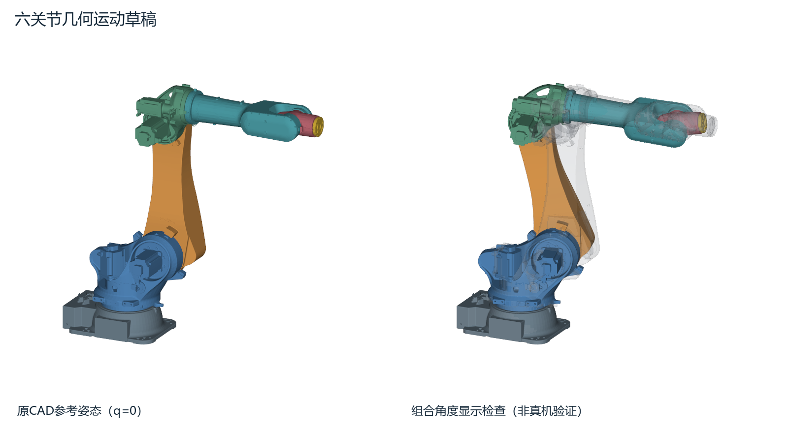
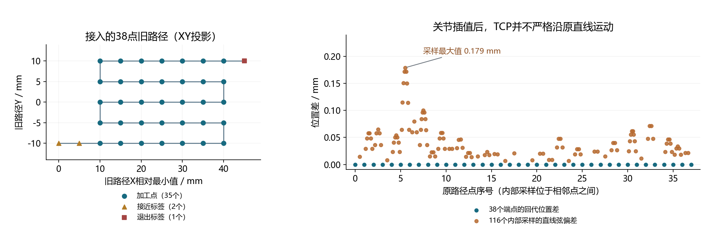

# iER220\-2700机械臂模型接入与路径验证

吴玥｜2026年11月5日组会汇报

## 一 、本周总结

本周根据戴屹提供的iER220\-2700装配资料，建立了六关节运动模型，检查关节转动和本体碰撞，并尝试接入以前保存的一条38点路径。路径点及补充采样已在ROS2和MoveIt中核对。现在能够根据目标位置和朝向计算模型关节角，再检查对应姿态；实际设备参数、工具安装和整段运动还要继续验证。

|事项|本周做了什么|完成情况与后续|
|---|---|---|
|将公司数字模型导入仿真 |从STEP恢复装配、生成可用网格，区分机械臂本体与运动空间包络，建立六关节运动链|几何模型已在ROS2运行；模型角度与控制器角度尚未对应|
|检查运动关系与碰撞外形|检查单轴带动哪些连杆，补充辅助机构随动；定位并处理两处碰撞外形误报|原16组工况中的两处误报消除，故意碰撞及虚拟障碍仍能检出|
|将末端目标转换为关节角|实现几何逆解，用独立正解回代检查，再把部分候选送入MoveIt复核|151个目标、1,079组候选通过几何回代；实际限位仍待正确映射|
|用已有路径做一次小范围接入|接入38点旧路径，并补查116个关节插值样点|154个姿态的ROS2／MoveIt复测通过，完整连续轨迹留待下一步|
|真实点云接入与稀疏化复测|保留已有算法、指标和输入接口|等实际点云及独立测量参照到位后开展|

## 二 、从装配外形到可运动、可检查的模型

模型来源是公司提供的“047393B 1\-iER220\-2700 Model”中的STEP文件。先恢复各零件的装配位置，将尺寸单位统一为米，再根据相邻零件上共轴的圆柱面，找出六个关节可能的转轴。装配里还有一个表示机械臂活动范围的包络体，它并不是实际零件，因此单独保留，不参加本体碰撞检查。

模型建好后，逐个转动关节，检查转轴前面的连杆是否保持不动、后面的连杆是否跟着转动，再把独立计算的位置和朝向与ROS2实际发布的数据对照。辅助伸缩机构则根据两端铰点的位置计算转动和伸缩，实际允许行程还未确认。下图展示原CAD姿态与一组组合角度下的模型外形。

*图1：由同一运动模型离线渲染，左为原CAD姿态，右为组合角度，浅灰为原姿态参照。用于说明连杆运动关系；原生ROS2验证另有实际变换和日志记录。图中角度不等于已确认的控制器角度。*

接着检查逆解，也就是根据末端要到的位置和朝向，计算各关节的角度。同一个目标可能有几种不同的关节组合，需要继续检查各自的碰撞情况。先把算出的关节角代回模型，确认末端的位置和朝向是否与目标一致，再对选出的姿态做碰撞检查。目前这一步已在模型中验证，模型角度与实机角度的对应关系还要进一步核对。

## 三 、将已有38点路径接入机械臂模型

接下来，选用以前保存的一条38点局部路径，尝试转换为这台机械臂模型的关节角。路径中的法向用于确定工具接近表面的方向。由于实际工具安装参数还未确认，本次先在仿真中固定工件位置，并把工具工作点（TCP）暂定在法兰参考帧的X方向150 mm处。这个位置是试验假设，后续还要按实际砂轮的安装和标定结果核对位置与朝向。

对每个路径点求逆解，优先选择接近上一点的关节构型；随后在相邻关节角之间插值，增加116个内部样点。38个端点与116个样点分别核对，结果如下。

|检查内容|结果|结果含义|
|---|---|---|
|38个路径点的逆解与正解回代|全部通过|在上述仿真假设下，端点位置和朝向可由模型关节角表达|
|相邻路径点的最大单轴角度变化|约4\.914°|当前选解没有出现明显的大幅分支跳转；不是速度或实际限位判定|
|154个姿态的原生碰撞查询|154×35＝5,390次，与独立计算一致，均未报非排除对碰撞盒重叠|沿用既有连接处排除规则，只检查这些有限姿态的本体与辅助机构外形|
|ROS2实际发布的数据|154组连杆变换及辅助机构／碰撞显示数据均与独立预期一致|检查了实际运行结果，不仅是读取模型文件|
|关节插值时TCP偏离目标直线弦|已检查样点中的最大值约0\.179 mm|端点正确，不代表工具在两点之间严格沿原路径运动|

下图左侧说明本次接入的旧路径，右侧对应上表最后一项：端点回代位置差接近零，但部分内部样点已经偏离相邻目标点之间的直线。

*图2：左图为固定摆放前的旧路径XY投影，接近／退出仅保留原标签，没有新增安全进出路径。右图蓝点为38个端点的回代位置差，橙点为116个内部采样相对目标直线弦的位置偏差；两者比较对象不同。0\.179 mm是有限采样观测值，不是连续误差上界或真实跟踪精度。*

这次接入说明，已有路径可以转换成当前模型的关节姿态，并完成原生正解、显示数据和有限采样碰撞核对。同时也发现，关节插值会使工具偏离原直线，所以上周名义表面路径的高度误差和覆盖结果，不能直接当作本次机械臂执行结果。

## 四 、目前的结论与下一步

本周已完成从厂商装配模型到六关节几何模型，再到一条旧路径有限采样验证的衔接。 目前采用仿真摆放和虚拟TCP，碰撞检查尚未包含实际工具、工件、线缆和周围设备，也没有通过轨迹控制器执行完整运动。

下周优先推进三件事：

1. **把路径段检查完整。** 在已有样例上研究如何保持工具沿目标路径运动，补进出路径，再检查构型连续性和运动过程中的碰撞。先解决本次已发现的插值偏差。

2. **核对模型与实机的对应关系。** 已有各轴范围和速度资料，但还需确认零位、正方向、耦合、法兰坐标和实际工具TCP，之后才能正确应用限位。需协调的重点是型号专用参数与工具安装关系。

3. **实际点云到位后接回原实验。** 对同一区域比较完整与稀疏点云生成的路径，并用独立测量确定表面及根部参照；机械臂模型不替代真实扫描和加工结果验证。

