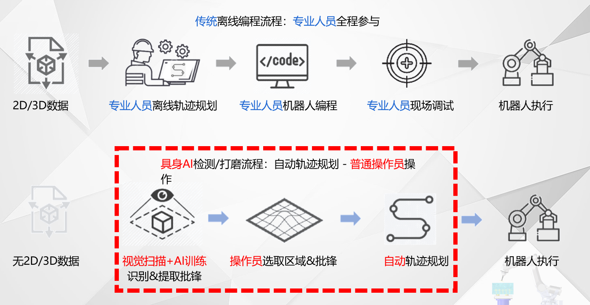

# 上海戴屹具身AI检测打磨项目需求说明

**文档状态**：草稿（基于项目需求交流会议及前期资料整理，待双方确认后更新）

**整理日期**：2026年9月10日

# 一、项目背景

在工业生产中，大量工件存在批缝、毛刺等需要打磨处理的部位。目前这类打磨作业主要依靠工业机械臂完成，但机械臂的运行轨迹需要工程师提前调试好才能使用。

过去几年，上海戴屹科技有限公司已经在打磨领域完成了一批相对典型的项目案例，积累了机械臂打磨的实际工程经验。疫情前制作的打磨综合视频记录了这些项目的实际效果。

应用场景演示

[具身AI检测打磨\.mp4](../attachments/上海戴屹-批缝打磨演示01__file-PmdvbaE9poOXVWxtkcacSim4nob.mp4)

[上海戴屹\-批缝打磨演示02\.mp4](../attachments/上海戴屹-批缝打磨演示02__file-VbFGbuPdNo8gQXx43btccrbDnJg.mp4)

[上海戴屹\-批缝打磨演示03\.mp4](../attachments/上海戴屹-批缝打磨演示03__file-FP0zbCAjBoHUZNxcdP5coBS3n4c.mp4)

[上海戴屹\_涡轮壳\-14\_铸件自动化打磨非标单元\.mp4](../attachments/上海戴屹_涡轮壳-14_铸件自动化打磨非标单元__file-UNebbaQg1oDYSrxfON0c1FlMnnf.mp4)

随着业务量增加，现有调试方式的人工成本越来越突出。项目方希望引入视觉检测和自动轨迹规划技术，把原来需要工程师手动完成的调试工作用自动化手段替代掉。

# 二、现状与问题

## 2\.1 当前处理方式

目前机械臂打磨轨迹的生成有两种方式，都需要人工参与：

|**方式**|**操作流程**|**特点**|
|---|---|---|
|**手工示教**|工程师手持机械臂或通过示教器，逐点走一遍打磨路径，记录轨迹后直接运行|直观但耗时，换一个工件就要重新示教 |
|**离线导入\+精调**|先在离线软件中根据三维模型生成大致轨迹，导入机械臂后再由工程师手工精调修正|比纯示教快，但精调环节仍然依赖工程师经验|

## 2\.2 存在的问题

- **人工依赖重**：每换一种工件或批次，都需要工程师重新调试轨迹，调试时间长。

- **效率低**：调试期间机械臂无法投入生产，设备利用率受影响。

- **成本高**：需要有经验的工程师持续参与，人力成本随业务量增长而上升。

- **一致性差**：调试质量依赖工程师个人经验，不同人调出来的轨迹效果有差异。

# 三、项目目标

项目的核心目标是：用视觉检测加自动轨迹规划的方式，替代现有人工调试流程，让机械臂能够根据工件实际情况自动生成打磨路径。

具体要实现以下三步：

1. **视觉定位**：通过相机拍照，自动识别工件上批缝、毛刺的位置和形状。

2. **轨迹规划**：根据视觉检测到的位置信息，自动计算出机械臂的打磨运动轨迹。

3. **自动执行**：将规划好的轨迹直接下发给工业机械臂执行打磨，无需工程师手工调试。

预期效果：新工件上线时，不需要工程师逐点示教或精调，系统拍照后自动生成轨迹，缩短调试时间，降低对人工经验的依赖。

# 四、功能需求

## 4\.1 视觉检测模块

- 能够对工件进行拍照采集，获取打磨区域的图像。

- 能够从图像中识别出批缝、毛刺的具体位置、范围和形态。

- 能够将图像中的像素坐标转换为机械臂运动坐标系下的实际坐标。

## 4\.2 轨迹规划模块

- 根据视觉检测输出的位置信息，自动生成机械臂的打磨路径点序列。

- 路径规划需要考虑打磨工具的姿态、进给方向和重叠率等工艺参数。

- 生成的轨迹能够直接被机械臂控制系统读取和执行。

## 4\.3 系统集成

- 视觉检测、轨迹规划和机械臂执行三个环节能够串联运行，形成完整工作流。

- 系统支持工件切换，换型时不需要修改程序代码，只需重新拍照即可。

- 保留人工干预接口，必要时工程师可以对自动生成的轨迹进行微调。

# 五、执行载体与技术路线

## 5\.1 为什么用工业机械臂

打磨作业的执行载体确定为**工业机械臂**，而不是具身机器人（人形机器人），原因如下：

- **防护等级**：工业打磨现场有金属粉尘、切削液等，对设备防护要求高，具身机器人的防护等级达不到工业现场要求。

- **负载能力**：打磨工具和接触力需要机械臂有足够的负载和刚性，具身机器人的负载能力不足。

- **精度和稳定性**：工业机械臂在重复定位精度和连续运行稳定性上更适合生产环境。

## 5\.2 技术融合思路

项目采用"具身大脑 \+ 工业机械臂"的组合方式：

- **具身大脑**：借鉴具身智能中的视觉感知和决策能力，负责"看"工件、"想"路径。

- **工业机械臂**：负责"干"活，按照规划好的轨迹执行实际打磨动作。

简单来说，就是把具身智能的感知和决策能力嫁接到工业机械臂上，用机械臂的身体执行具身大脑的决策。

## 5\.3 核心技术

- **计算机视觉（CV）**：工件图像采集、批缝和毛刺的检测与分割、坐标转换。

- **运动规划**：根据检测结果生成机械臂可达的打磨轨迹，包含路径点和姿态。

- **手眼标定**：建立相机坐标系与机械臂坐标系之间的转换关系。

# 六、合作基础

华中科技大学电信学院Dian团队前期已有机械臂相关项目经验，在计算机视觉和机器人控制方面有技术积累，与本项目的技术方向匹配。

双方约定在后续会面中，由团队介绍前期相关工作成果，进一步讨论具体的技术方案、分工和合作模式。

# 七、参考资料

1. [上海戴屹科技有限公司简介](上海戴屹科技有限公司简介__wiki-OhHywZgzUiAebBku6MAcWNBanyg.md)

2. 《具身AI检测打磨项目》前期资料文档（含现状与目标流程图）

3. 项目需求交流会议纪要（2026年9月5日电话沟通）

4. 《具身AI检测打磨》项目演示视频 [具身AI检测打磨\.mp4](../attachments/上海戴屹-批缝打磨演示01__file-PmdvbaE9poOXVWxtkcacSim4nob.mp4)

5. 法奥机械臂应用视频展示

---

*本文档基于项目需求交流会议及前期资料整理，如有遗漏或偏差，请相关人员指正后更新。*

