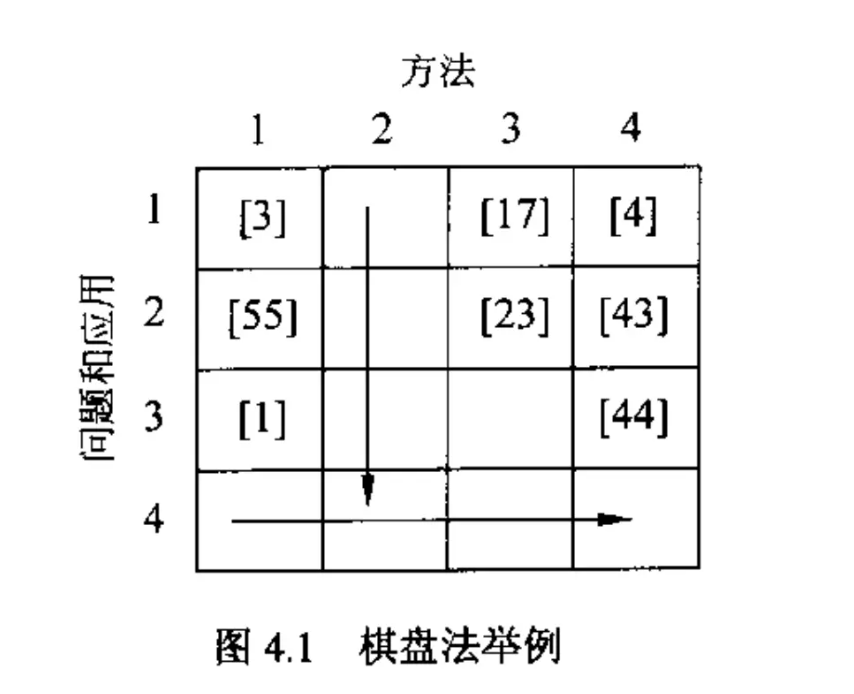

# 什么是研究棋盘法

参考第四章4\.3节棋盘法（Research Matrix Method）。

凌晓峰 / 杨强，学术研究，你的成功之道，清华大学出版社，2012

[Crafting Your Research Future\.pdf](../attachments/Crafting_Your_Research_Future__file-GzI3bzGTVooLP3xQ3nbcWr2QnMd.pdf)

[学术研究，你的成功之道\.pdf](../attachments/学术研究，你的成功之道__file-X36LbVrY6o9WwixZokfcx8HmnQc.pdf)

