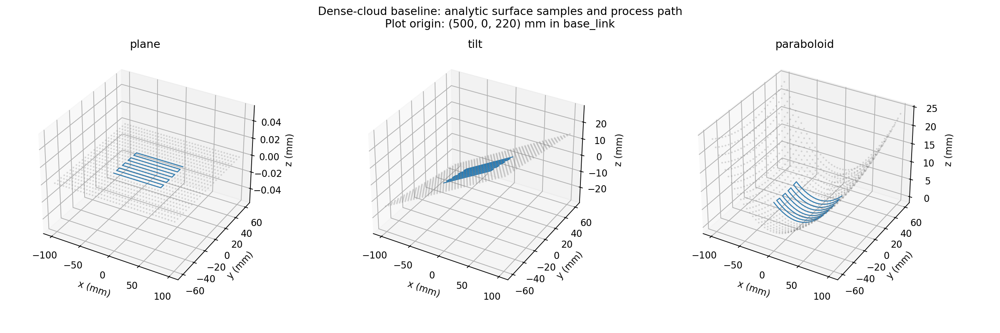
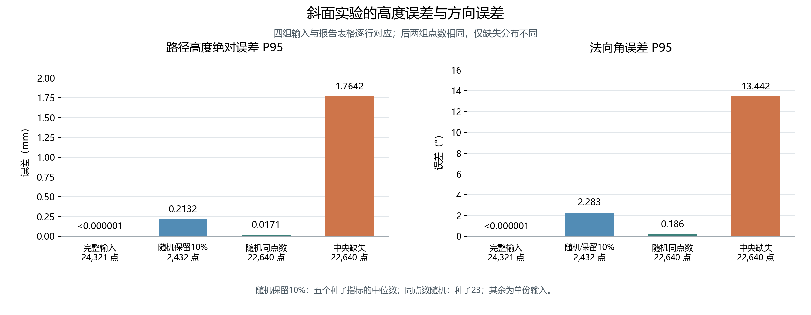

# 仿真打磨路径的定量评价与点云稀疏化验证

吴玥｜轨迹规划｜2026 年 10 月 27 日组会汇报

## 一 、上周待办与本周完成情况

上次组会建议我参考一些论文的定量评价方法，为仿真打磨实验定义指标，并说明来源或定义理由。这周主要围绕这件事，整理了四类指标：路径高度误差、法向角误差、目标覆盖比例和计算耗时，再用点云稀疏化实验检查它们能否反映问题。

|事项|本周做了什么|完成情况与后续|
|---|---|---|
|个人任务 4：定义仿真评价指标，补充文献依据或定义理由|明确输入、输出和独立参照，整理四类指标的公式、单位、统计方式及定义理由，完成评价程序检查|当前解析仿真范围已完成，；正式工艺要求到位后再对齐验收指标|
|点云稀疏化：减点后算法是否仍适用|完成随机、体素、局部缺失、扰动及最高约 154 万点的对照，比较几何误差和计算耗时|合成点云验证已完成；真实薄飞边、根部经过减点后是否保留，仍需实际扫描验证|
|组内任务 9：A 侧文献结果梳理|完成已有六项来源的结果与可比性整理；本次精读 Guo2024论文，重点核对评价参照、误差统计和分阶段计时|A 侧整理已完成；不同论文的任务、参照和测量对象不同，不直接做精度排名|
|闭环衔接：本周补充修复|修正新复扫点云被误拒绝的问题，检查工件、计划回执与采集时序；112 项本地回归检查及 3 个命令行案例通过|本地程序检查通过；与 B 最新版本及真实扫描的联测尚待开展|

下面主要汇报个人任务 4：文献提供了什么参考，我们据此怎样确定指标，以及已有实验反映了什么问题。

## 二 、参考论文与所定指标

这次重点精读了 Guo 等的点云机器人焊缝打磨论文 \[1\] ，发表在Advanced Engineering Informatics 。它用各坐标轴的最大偏差和 RMSE，评价生成路径相对人工接触修正示教路径的偏差；还把采集、区域提取、路径生成和姿态优化分别计时。

对我们最有用的是：先明确评价对象和参照，再选择统计量；并分别统计各处理环节的耗时。 当前 A 输出的是工具补偿前的表面路径和外法向，因此先评价这两项输出。实验采用水平面、斜面和抛物面的解析点云，可以独立计算正确高度和法向。

*图 1：从左到右为水平面、斜面和抛物面，灰点是解析点云，蓝线是名义加工路径。坐标相对 \(500, 0, 220\) mm 显示。这些场景用于检查路径与已知表面的偏差。*

|指标|如何计算|文献依据或定义理由|
|---|---|---|
|路径高度误差，mm|比较加工路径与参考表面在相同 XY 位置的高度，得到高度误差，再计算 RMSE、绝对误差 P95 和采样最大绝对误差|参考 \[1\] 的路径误差统计。高度差、解析参照及 P95 是结合当前仿真定义的，不是原文直接给出的指标|
|法向角误差，°|比较路径点输出的法向与参考表面的外法向，以两者夹角作为误差，计算 P95 和最大值；两者方向相反时，误差为 180° |A 的法向用于后续工具朝向，因此需要单独检查方向偏差。\[1\]\[2\] 提供姿态／法向处理背景，具体角误差口径由项目定义|
|目标覆盖比例，%|在固定目标区域内布置检查点，计算其中距离加工路径不超过 3 mm 的点所占比例|项目定义，用来发现漏行或只返回部分区域。目标范围保持不变，避免输出少了、评价范围也跟着缩小|
|分阶段计算耗时，ms|对同一输入先预热 1 次，再计时 5 次；分别记录采样、表面构建和路径规划的耗时，计算中位数、最小值和最大值|参考 \[1\] 的分阶段计时及 \[2\] 的点数／耗时对照；具体计时范围与重复次数由项目规定|

计算高度误差时，只检查加工阶段的路径段，不计入接近、抬刀和段间空隙。为检查相邻路径点之间是否存在偏差，沿加工折线以不超过 0\.5 mm 的间隔增加检查点。统计结果中，RMSE（均方根误差）反映整体误差水平，采样最大值反映检查点中最严重的局部偏差。

P95 指第 95 百分位数。 把误差样本从小到大排列，取约 95% 位置对应的数。高度误差先取绝对值再统计，法向角误差直接按角度统计。P95 不是最大误差，可以理解为约 95% 的误差样本不超过它。

覆盖检查用于判断路径是否覆盖了预定区域。在固定的 80×40 mm 区域内，按 1 mm 网格布置 3,200 个检查点，统计其中距离加工路径不超过 3 mm 的点所占比例。当前路径间距为 5 mm，3 mm 是本次几何检查采用的距离标准，尚未结合工具实际接触宽度进行验证。

本次评价参考了文献中的路径误差统计和分阶段计时方法。在此基础上，结合 A 侧输出的路径与法向，确定了高度差、法向角误差、P95 和目标覆盖的具体计算方式。

## 三 、点云稀疏化实验检查指标

下面列出斜面结果。其余表面、更多采样比例及体素对照保留在实验记录中。

|斜面输入|点数|路径高度绝对误差 P95 ，mm|法向角误差 P95，°|
|---|---|---|---|
|完整输入|24,321|\<0\.000001|\<0\.000001|
|随机保留 10%|2,432|0\.2132|2\.283|
|随机保留相同点数|22,640|0\.0171|0\.186 |
|中央 40×40 mm 没有输入点|22,640|1\.7642|13\.442|

这组结果说明，只看“能不能生成路径”不够：随机减点后仍能生成路径，但高度和方向误差增加；总点数相同时，中央成片缺失造成的偏差明显更大。孔洞输入的覆盖比例仍有 99\.375%，也说明覆盖必须与几何误差一起看。

下图把上表后两列画出来，左右分别对应路径高度误差和法向角误差。尤其看后两组：同样是 22,640 点，中央成片缺失时，两项误差都明显更大。

评价程序还用已知错误检查过：路径抬高 1 mm 应检出 1 mm，法向翻转应检出 180°，删除加工行后覆盖应下降。这部分是检查评价方法本身，不作为算法效果实验计数。

## 四 、目前的结论和下一步

目前已明确各项指标的用途、计算方法和参考依据，并用于比较点云减点前后的路径误差、覆盖比例和计算耗时。这些实验检查的是规划结果，尚未验证机械臂实际执行和材料去除效果。

真实点云到位后，先用同一区域的完整点云和减点后点云分别生成路径，比较路径位置、方向和计算耗时的变化。同时，需要通过独立测量确认工件本体表面和毛刺根部的位置，作为判断路径是否准确的依据。

## 参考文献

\[1\] GUO W, HUANG X, QI B, et al\. Vision\-guided path planning and joint configuration optimization for robot grinding of spatial surface weld beads via point cloud\[J\]\. Advanced Engineering Informatics, 2024, 61: 102465\. DOI: 10\.1016/j\.aei\.2024\.102465\.

\[2\] 凌振舫\. 视觉引导的打磨机器人轨迹规划及运动控制研究\[D\]\. 广州: 广州大学, 2025\.

