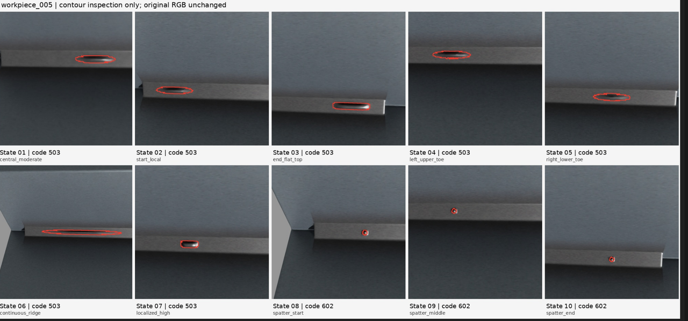
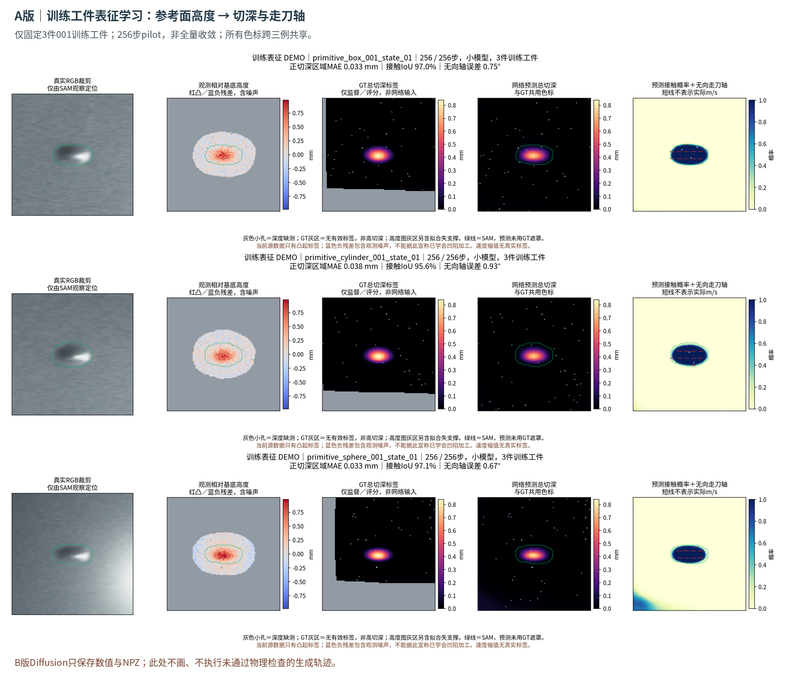
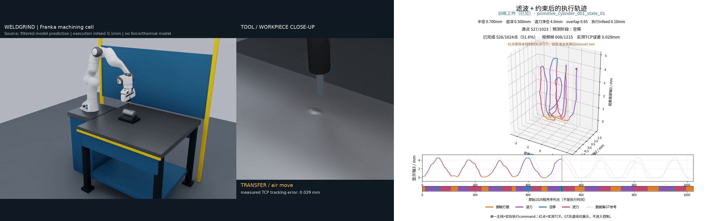
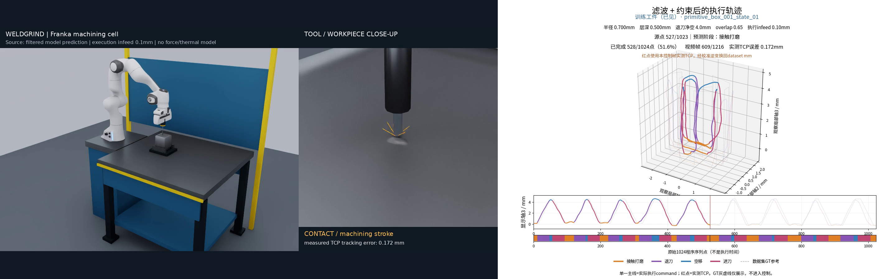
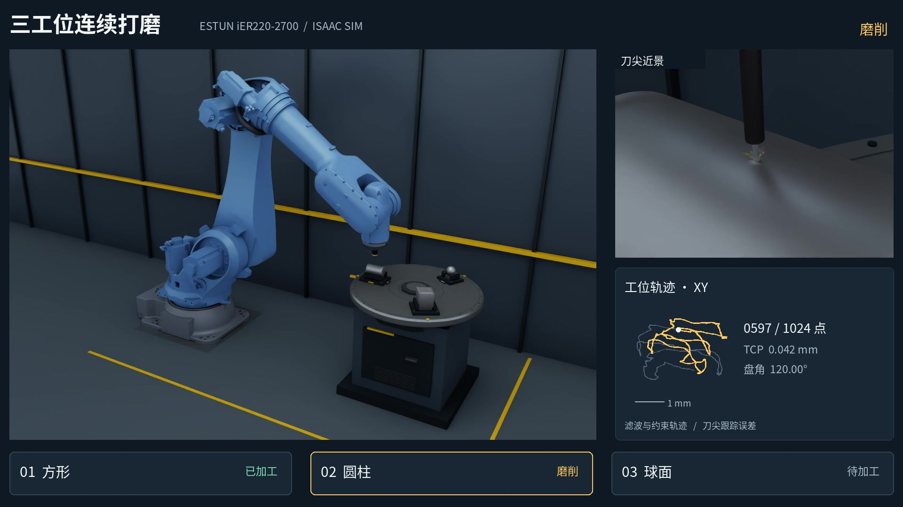

# 具身打磨算法V1 NOV12：

@曹正恒

|**版本**|**时间**|**作者**|**修订内容**|**状态**|
|---|---|---|---|---|
|1\.0|2026\-11\-10|曹正恒|初版|已发布|
|1\.1|2026\-11\-12|王释钰|按照"黑箱模式”修改|已修改|

实验环境：**NVIDIA Isaac Sim**

## 一、实验进展

### 1\.实验结果：

**1\.构建合成数据集**:建立 WeldGrind\-Dataset，包含 190 个基础工件模型、2800 个渲染样本，提供 RGB、深度图、相机标定、点云、打磨轨迹及相关监督信息

**2\.实现缺陷三维定位:**利用 SAM 3 分割 RGB 图像中的缺陷，通过相机标定将二维掩膜映射到点云，得到三维缺陷 ROI。

**3\.实现轨迹生成模型:**参考 PV\-Ground 的点—体素交互思路，结合多尺度几何编码、可学习种子选择、Conditional DiT 和流匹配，融合几何信息与工艺条件，输出 **1024 个有序三维轨迹点及四类运动阶段**

**4\.完成初步训练与评估:**Base 模型参数量为 14\.91M，训练 57088 步，报告的训练轨迹 RMSE 为 **0\.4915 mm**，运动阶段预测准确率为 **95\.42%**。

**5\.轨迹后处理:**实现平面／二次曲面基底拟合、局部位置约束、阶段去抖和轨迹平滑，改善路径连续性与局部几何合理性；目前对定位误差的改善有限。

**6\.仿真demo:**方形、圆柱和球形工件的最大 TCP 跟踪误差分别为 **0\.448、0\.443 和 0\.654 mm**，均满足当前小于 1 mm 的跟踪要求。

### 2\.实验演示：




[workpiece\_002\_state\_01\_trajectory\_replay\.mp4](assets/具身打磨算法V1_NOV12：__wiki-CwPRw3ikDiw6XbkRyMYcDQqEnoD/图片和附件/workpiece_002_state_01_trajectory_replay.mp4)

[三工件\_机械臂与同步轨迹\.mp4](assets/具身打磨算法V1_NOV12：__wiki-CwPRw3ikDiw6XbkRyMYcDQqEnoD/图片和附件/三工件_机械臂与同步轨迹.mp4)


[三工位连续打磨\.mp4](assets/具身打磨算法V1_NOV12：__wiki-CwPRw3ikDiw6XbkRyMYcDQqEnoD/图片和附件/三工位连续打磨.mp4)

## 二、实验方法

点云采样主要参考论文：cvpr2026 pvground ：

https://openaccess\.thecvf\.com/content/CVPR2026/papers/Shang\_PV\-Ground\_Text\-Guided\_Point\-Voxel\_Interaction\_for\_3D\_Visual\_Grounding\_CVPR\_2026\_paper\.pdf?utm\_source=chatgpt\.com（降采样）


整条链路可以分为三个阶段：

1. **感知定位**：RGB         → SAM 3 → 二维掩膜         → 标定投影，与三维点云共同得到 ROI。

2. **几何条件提取**：完整采样点云与         ROI 标记         → 多尺度稀疏体素主干 → PVI → 1024 个候选特征         → 64 个表面种子及特征。

3. **有序路径生成**：噪声轨迹、种子条件和生成时间         t → Conditional DiT → 流速度         → ODE 积分         → 128 点         XYZ，再恢复毫米坐标。

这里的图像信息主要通过“区域定位”进入主链路。当前没有把 SAM 3 的内部视觉特征送入 DiT；几何编码器读取的是点云 XYZ、点云 RGB 和 ROI 标记。SAM 3 的文本提示也只作用于分割阶段，没有独立的文本 token 直接输入轨迹模型。

```Plain Text
输入
              ┌────────┴────────┐
              │                 │
              ▼                 ▼
          RGB Image         XYZRGB Point Cloud
              │                 │
              ▼                 │
            SAM 3               │
              │                 │
              ▼                 │
        2D Damage Mask          │
              │                 │
              ▼                 │
        2D → 3D Projection      │
              │                 │
              ▼                 ▼
           3D Damage ROI + Point Cloud
                       │
                       ▼
        ┌───────────────────────────┐
        │    Geometry Encoder       │
        │                           │
        │   Sparse Voxel Backbone   │
        │       Multi-scale         │
        │           ↓               │
        │   Point-Voxel Interaction │
        │           (PVI)           │
        └─────────────┬─────────────┘
                      │
                      ▼
             Candidate Features
                  [1024,256]
                      │
                      ▼
        ┌───────────────────────────┐
        │  Learnable Set Selector   │
        │                           │
        │    64 Learnable Queries   │
        │             ↓             │
        │      Cross-Attention      │
        │             ↓             │
        │       Self-Attention      │
        │             ↓             │
        │    Differentiable         │
        │     Point Selection       │
        └─────────────┬─────────────┘
                      │
                      ▼
              Surface Seed Set
                   [64,3]
                      │
                      +
              Seed Features
                  [64,256]
                      │
                      ▼
        ┌───────────────────────────┐
        │      Conditional DiT      │
        │                           │
        │      Noisy Trajectory     │
        │         [128,3]           │
        │             +             │
        │       Seed Tokens         │
        │             +             │
        │       Flow Time t         │
        │                           │
        │   Self/Cross Attention    │
        └─────────────┬─────────────┘
                      │
                      ▼
                Flow Matching
                      │
                      ▼
            XYZ Trajectory [128,3]
                      │
                      ▼
               完整打磨轨迹
```

## **三、****实验流程：**

### **3\.1缺陷三维定位**

**我们的 WeldGrind\-Dataset 是一个用于工件表面缺陷自动打磨轨迹生成的合成数据集，目前包含 190 个基础工件模型、2800 个渲染样本，提供 RGB、Depth、相机标定、点云相关输入、打磨轨迹以及相应的监督信息。**

为了在DEMO中服用ISSACSIM 已经有资产使用了FRANKA机械臂，后续如果使用其他型号机械臂可以随时修改

目前的轨迹监督包含：

其中包含了1000个L形以及平板工件，同时包含1800条物体：

数据集地址：https://huggingface\.co/datasets/charlesH777/WeldGrind\-Dataset 




### **3\.2****打磨轨迹生成：**

#### **sam3拟合效果**


##### **模型代码：****https://github\.com/CharlesH777/WeldGrind\-V1**




### **3\.3****滤波与后期处理**

#### 3\.3\.1后处理的作用

神经网络输出的三维轨迹通常不能直接作为机械臂加工指令。

由于点云测量噪声、模型预测误差及轨迹离散采样等因素，生成的轨迹可能出现局部抖动、轨迹高度偏移以及运动阶段频繁切换等问题。

因此，WeldGrind 在神经网络轨迹预测之后加入了基于局部几何约束的轨迹后处理模块。

该模块主要实现**局部基底拟合、物理位置约束、运动阶段去抖以及轨迹连续性平滑**。

#### 3\.3\.2局部基底拟合与物理约束

系统首先从观测点云中提取缺陷 ROI 周围的非缺陷区域，并利用这些点稳健拟合工件局部基底表面。

目前支持两类局部几何模型：

- **平面拟合（Plane Fitting）**：适用于近似平面的工件表面。

- **二次曲面拟合（Quadratic Surface Fitting）**：适用于具有一定曲率的工件表面。

通过局部基底拟合，系统能够估计缺陷周围的正常工件表面，为后续轨迹修正提供几何参考。

随后对预测轨迹施加局部物理约束：

接触阶段的轨迹点需要满足观测表面与局部基底所定义的位置边界，避免出现不合理的穿透或高度偏移。

非接触阶段则保留必要的安全净空，避免在抬刀和转移过程中发生不必要的工件接触。

为避免后处理过度改变模型预测结果，系统将每个轨迹点的修正范围限制在原预测点周围 2 mm 的球形区域内，并精确保留轨迹端点。

对于非接触阶段的法向位置修正，还额外施加 ±0\.15 mm 的限制。

#### 3\.3\.3 轨迹连续性滤波

完成局部物理约束后，系统进一步对轨迹进行连续性优化。

考论文：cvpr2026 pvground ：主要处理包括：

**阶段去抖：** 减少模型预测中不合理的阶段频繁切换，使接触、抬刀和转移过程更加稳定。

**轨迹平滑：** 减少相邻轨迹点之间的局部抖动，同时尽量保留路径转折点和加工轨迹的几何特征。

**高阶差分约束：** 使用轨迹点序列的二阶和三阶差分，衡量加工路径的局部变化程度。

优化过程中通过连续性保护机制，保证处理后的全局二阶与三阶差分指标不超过原始预测轨迹。

需要说明的是，这里的二阶、三阶差分是轨迹序列的几何变化指标，并不等同于真实时间域中的加速度和 jerk。

#### 3\.3\.4 后处理效果

在固定的 12 条训练样本和 12 条验证样本上，后处理取得以下结果：



实验表明，轨迹后处理能够有效降低预测轨迹的局部变化幅度，改善路径连续性。

但模型轨迹定位误差几乎没有变化，说明目前的后处理主要解决的是**轨迹几何连续性与局部物理合理性问题**，不能替代神经网络本身的轨迹预测精度优化。

在三个训练工件的 Demo 中，局部几何资格检查分别选择了平面或二次曲面模型，经过相应物理约束后，全部 1024 个轨迹点通过了所设定的几何检查。

### **3\.4 ****IK与TCP解算**

#### TCP 位姿计算

TCP（Tool Center Point）是机械臂末端工具的加工参考点，用于描述打磨工具在空间中的实际位置与姿态。

在 WeldGrind 项目中，TCP 位姿计算主要采用**基于机器人正运动学与工具坐标系变换的方法**。

首先，根据机械臂各关节的实际位置，通过正运动学计算末端执行器在机器人基坐标系下的位姿。随后结合工具安装位置和 TCP 相对于末端执行器的固定偏移，完成工具坐标系转换，得到 TCP 的实际位置与姿态。

在轨迹执行过程中，系统持续记录实际关节状态，并计算对应的 TCP 运动轨迹，用于评估机械臂对目标加工路径的跟踪精度。

由于神经网络输出的是 XYZ 三维位置及加工阶段，而非完整的六自由度位姿，因此还需要在执行层为轨迹配置工具姿态。现有报告未明确说明具体采用的姿态规划策略。

#### 逆运动学求解

逆运动学（Inverse Kinematics，IK）用于将模型生成的三维加工轨迹转换为机械臂各关节的运动目标。

在 WeldGrind 项目中，机械臂执行环节按照以下流程组织：

1. **轨迹输入：** 接收模型预测并经过物理约束和平滑处理的 1024 点三维加工轨迹。

2. **目标位姿构建：** 将轨迹中的 XYZ 坐标与执行所需的工具姿态结合，生成机械臂末端的目标 TCP 位姿序列。

3. **逆运动学求解：** 根据目标 TCP 位姿计算对应的机械臂关节位置，使末端工具能够沿目标加工路径运动。

4. **关节运动执行：** 将关节运动目标送入 Isaac Sim，通过 PhysX 物理仿真驱动机械臂运动。

5. **轨迹反馈与验证：** 记录实际关节位置、关节速度及 TCP 轨迹，并比较实际 TCP 与目标 TCP 之间的位置误差，评估执行精度。


# **本实验在DEMO中已基本跑通，但是泛化性能力尚需验证**




## 参考文献

https://openaccess\.thecvf\.com/content/CVPR2026/papers/Shang\_PV\-Ground\_Text\-Guided\_Point\-Voxel\_Interaction\_for\_3D\_Visual\_Grounding\_CVPR\_2026\_paper\.pdf?utm\_source=chatgpt\.com

