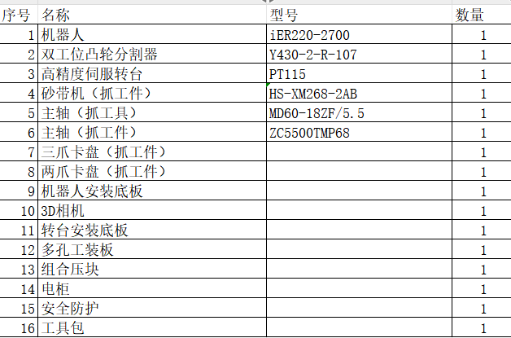

# 军山校区具身打磨实验场地设计

**文档状态**：设计稿（待场地落实与相关条件确认后更新）

**编制日期**：2026年10月13日

**信息来源**：具身打磨项目历次会议纪要、设备选型资料

# 一、场地定位与设计目标

## 1\.1 场地定位

军山校区具身打磨实验场地是"具身打磨视觉检测与自动轨迹规划"项目（以下简称"具身打磨项目"）的核心实验环境，用于替代真实打磨现场开展无法在现场完成的实验工作。军山校区与东风建有联合实验室（已有备案），项目客户也涵盖东风体系，场地故事完整、合作基础扎实。

## 1\.2 设计目标

- 搭建可真实运行的**工业机械臂打磨实验平台**，支撑视觉检测、轨迹规划、力控打磨等核心技术的实验验证；

- 支持**精度实验**与**数据采集**（点云、图像、力数据），为工艺大模型训练积累数据；

- 产出项目**第一个demo**（目标2026年底前），用于向客户与学院展示；

- 与华科总部（喻家山校区）形成**双平台分工**：总部跑算法/视觉等轻量工作，军山跑真实设备实验。

## 1\.3 非目标

- 本场地不承担客户量产打磨任务，仅用于研发实验与演示；

- 不建设完整自动化产线，聚焦单工位/双工位打磨单元。

# 二、设备配置清单

|**类别**|**设备**|**说明**|
|---|---|---|
|**打磨机械臂**|艾斯顿220kg负载机器人（普通版）；备选：家中ABB 20kg机器人|220kg/270kg两款安装要求接近；艾斯顿普通版已确认可提供，双边高精度版未测试完成；ABB品牌精度好、可最快到位。机械臂本体防护等级IP67，适配打磨粉尘环境|
|**视觉系统**|3D相机/点云采集设备|用于工件批缝/飞边识别与空间坐标提取，横向精度约0\.1mm、深度约1mm；配套手眼标定|
|**打磨执行端**|电主轴、砂轮/磨片、力控单元（易昌配全）|支持自由边打磨与随形打磨；力控响应速度≤6ms、力控精度≤1N（对标项目指标）|
|**算力设备**|GPU算力服务器（配置选型中）|用于算法评测实验与机械臂控制实验；由戴屹采购、产权归戴屹，借用形式部署|
|**防护设施**|防护围栏（形式与客户现场一致）|按工业现场标准配置，含安全门与联锁|
|**辅助设备**|工装夹具、工件架、双工位旋转交换台（可选）|支撑抓工件/抓工具两种打磨形态实验|

# 三、空间需求与布局设计

## 3\.1 空间尺寸需求

实验平台布局如下：

该平台所含物料如下：

|**方案**|**尺寸与说明**|
|---|---|
|**基础方案**|设备本体占用约 **3m × 4m**（邓念皓建议），满足单打磨单元运行|
|**扩展方案（推荐）**|约 **4m × 6m**（易昌建议配全设备），在设备区外预留**人员工作空间与维护位置空间**，便于日常实验操作和设备检修|

## 3\.2 功能分区

|**分区**|**用途**|**配置要点**|
|---|---|---|
|**设备作业区**|机械臂打磨作业、视觉采集|机械臂\+打磨工具\+视觉系统，围栏隔离；参考"单机器人\+双工位旋转交换台"布局，外面上下料、里面作业|
|**视觉采集区**|工件拍照/点云扫描|相机固定位与工件定位工装，保证视场与光照稳定|
|**人员操作区**|实验操作、上下料、人工干预|位于围栏外安全区域，配置控制台/示教器接口|
|**算力与设备区**|服务器、控制柜存放|GPU服务器、机器人控制柜、工业PC（视觉处理），注意散热与防尘|
|**维护通道**|设备检修、维护空间|围栏与墙体间预留检修通道，满足220kg级机械臂维保操作|

## 3\.3 打磨形态适配

- **抓工具形态**：大工件（几十到上百公斤）固定，机械臂抓取打磨工具作业——对应本场地主实验形态；

- **抓工件形态**：小工件由机械臂抓取，在固定工具上打磨——作为扩展实验形态预留。

# 四、安装条件要求

|**条件项**|**要求**|**确认状态**|
|---|---|---|
|**净空高度**|满足220kg级机械臂最大伸展高度与吊装需求，建议不低于3\.5m|\[待实测确认\]|
|**门尺寸**|满足设备（机械臂本体、控制柜、围栏）进场运输，建议门宽≥1\.2m、门高≥2\.2m|\[待实测确认\]|
|**地面承重**|满足220kg级机械臂\+工件\+工装总重，建议地面承重≥500kg/㎡，需地面找平，混凝土厚度≥300mm。|\[待现场评估\]|
|**动力电源**|380V三相动力电，机械臂与控制柜、电主轴供电，预留余量，装机容量≥30KW。|\[待现场评估\]|
|**网络**|以太网通讯（Profinet/Ethernet），控制柜—工业PC—服务器互联|\[待现场评估\]|
|**通风与除尘**|打磨粉尘抽排，保证人员健康|\[待现场评估\]|
|**照明**|满足视觉采集与人工操作的双重照明要求，避免强反光干扰视觉识别|\[待现场评估\]|

# 五、安全防护设计

- **防护围栏**：采用与客户现场一致的工业防护围栏形式，形成封闭作业区，防止人员进入机械臂工作范围。（安全围栏高度2m）

- **安全联锁**：安全门配置联锁装置，开门即停（急停），符合工业设备安全规范。

- **急停系统**：围栏内外均设置急停按钮，覆盖设备与控制台。

- **AI防错机制**：自动生成轨迹可能存在错误，实验阶段保留人工干预接口（框选修正、轨迹微调），并设置首次运行人工监控流程。

- **粉尘与噪音**：按打磨现场标准配置除尘与隔音措施，兼顾实验数据真实性与人员健康。

- **安全**：配备应急药品医疗箱一个。

# 六、场地落实与实施计划

|**阶段**|**工作内容**|**责任方**|**时间**|
|---|---|---|---|
|1|向学院提交场地申请报告，落实军山场地空间|黑晓军|2026年10月（国庆后）|
|2|确定设备方案：机械臂来源（艾斯顿220普通版/ABB 20kg）、防护围栏形式、占地尺寸（3×4m或4×6m）|邓念皓、易昌|近期|
|3|完成现场条件核验：净空、门尺寸、承重、电源、网络|黑晓军、邓念皓|场地确认后|
|4|设备入场、安装与安全围栏部署|邓念皓团队|设备到位后|
|5|平台联调：手眼标定、视觉采集、基础打磨轨迹验证|双方团队|安装完成后|
|6|产出第一个demo（视觉检测\+轨迹规划演示）|双方团队|2026年底前|

# 七、待确认事项清单

- 军山场地房间的**净空高度**与**门尺寸**实测数据；

- 防护围栏的**具体形式与规格**（与客户现场一致的标准）；

- 场地最终**占地面积**（基础3m×4m / 扩展4m×6m）与学院可提供空间匹配情况；

- 机械臂**最终选型**（艾斯顿220kg普通版 或 ABB 20kg）；

- 算力服务器**配置选型**与采购安排；

- 现场**动力电源、网络、除尘**等基础设施条件；

- 捐赠/借用设备**手续流程**与学院审批进度。

---

*本设计稿基于双方微信交流记录与项目会议纪要整理，设备与技术参数以最终确认版本为准。*

> （注：部分内容由豆包工作 AI 生成）
