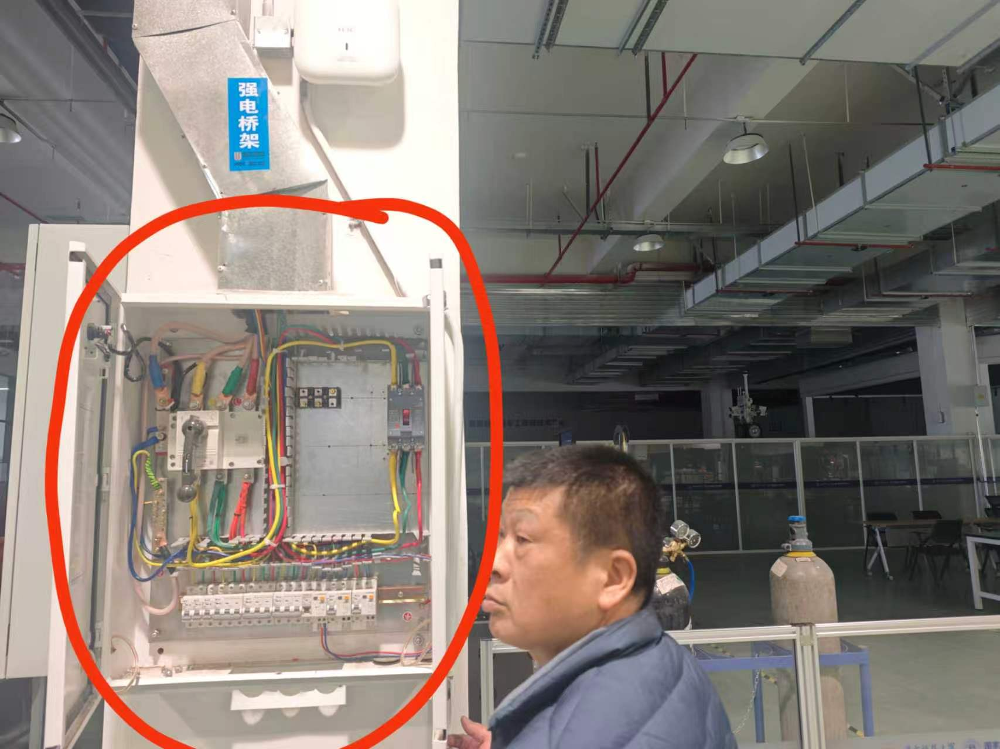

# 军山校区工业具身智能实验平台：配电环境进展（2026\-11\-12）

[军山校区\-电子信息工程技术中心增加配电箱及电缆事项](https://hustdian.feishu.cn/sheets/PPjAswjIhhdH8VtU4Tdcb1WSnXd?from=from_copylink)

**一句话结论**：平台配电已进入现场实施准备阶段。11 月 12 日已带电工师傅到军山校区现场踏勘，**完成接电点定位并拍照留存**；初步方案为「从现有强电配电箱就近取电 → 依托既有强电桥架走线至玻璃隔断处 → 新增一台独立立式电箱」。

**对配电环境的基本判断**：现场已具备主干供电条件（在用强电配电箱 \+ 强电桥架 \+ 消防与照明配套），本次改造属**面向实验设备的末端局部增补**，不需重新敷设主干线路。

**当前阶段**：踏勘完成、方案初定（口头）、**主干段报价清单已收到，合计 12,551\.60 元**——含 45 m 电缆穿管、8 回路动力配电箱及支架、综合措施费；末端段（配电箱到设备与插板）按企业需求后加、费用不会很多。对接人已表示**先向学院葛书记汇报、再行反馈**，施工启动宜以汇报结果为前置节点。图纸与末端段报价尚未确认；报价清单归属与名称口径已确认与本平台为同一事项。

# 一、进展概览

|项目|内容|
|---|---|
|平台 / 场地|**军山校区 工业具身智能实验平台**（报价清单抬头「电子信息工程技术中心」为同一事项的场地／中心名称，已确认，见 4\.4）|
|记录时间|2026 年 11 月 12 日 14:25 起（同日后续补充现场照片、报价清单与汇报进展）|
|本次进展|现场踏勘、基础需求沟通、初步方案确定、接电起点定位与拍照、师傅报价与逐项清单已到（主干段 12,551\.60 元）、报价清单名称口径已确认、学院汇报待反馈|
|参与方|项目对接人（带电工师傅到场）、电工师傅；黑晓军为汇报接收方|
|资料来源|即时通讯消息 8 条（原文粘贴）＋ 现场照片 1 张 ＋ 报价清单 1 份（xlsx，7 项明细）＋ 用户名称口径确认 1 条|
|文档定位|配电环境专项进展留档；方案为口头初步结论；主干段报价清单已收到（12,551\.60 元）且名称口径已确认，图纸与末端段报价待出|
|关联记录|同事项的[场地电力改造现场沟通记录](场地电力改造现场沟通记录：初步方案与报价状态（2026-11-12）__docx-KcwWdJmoRotHpxxm4oYc2zHSnFc.md)（过程与报价依赖）；平台建设背景见[灵巧手实验平台校企合作沟通纪要](20261110_灵巧手实验平台校企合作沟通纪要__docx-JsModZBRNobX1vxrfnAcnhKanUe.md)|

# 二、现场配电环境现状

## 2\.1 接电起点现场照片

照片拍摄于平台现场，红圈标出本次方案的接电位置。以下均为图中可直接确认的内容，未作电气参数推断：

|观察项|现场可见情况|对配电的意义|
|---|---|---|
|现有配电箱|白色立式强电箱，柜门敞开；箱内可见左侧一只带黑色手柄的总开关（塑壳断路器）、中部一排微型断路器、右侧一只带操作手柄的保护/开关器件，中下部两排白色接线端子排；黄、绿、红、蓝等多色导线分层敷设；柜门内侧设有资料盒|接电点明确，箱体在用、内部尚有可辨识的分路结构|
|强电桥架|配电箱所在立柱贴蓝色竖排「强电桥架」标签；灰色金属线槽自顶部沿立柱下行，顶部另有横向桥架与线管|现场具备强电桥架条件；实际走线采用 45 m 穿管，见 4\.4|
|顶面机电配套|红色消防管道与喷淋头、灰色风管、多盏吊线工矿灯、黑色线管，层高较高（报价清单标注层高 6 m）|空间已按工业／实验用房标准配套，具备增设末端回路的条件|
|空间分区|画面右侧为黑色框玻璃隔断，隔断后可见桌椅、设备与气瓶；接电点与隔断处于同一开放空间|对应方案中「走到隔断那边」，末端立箱点位即在隔断一侧|
|现场人员|电工师傅在场（画面前景），可就箱内条件与走线路由现场核对|方案为现场共同踏勘后形成，非纸面推断|

## 2\.2 由现状得出的判断

**改造性质：末端增补，而非主干新建。**现场已有在用强电配电箱、成体系的强电桥架以及消防照明配套，因此新增独立立式电箱更可能是在现有配电点上引出一个相对独立的回路，走线原推断可依托既有桥架；但报价清单列出 45 m JDG40 电管，实际为全长穿管，是否开槽以清单与现场核对为准（见 4\.4）。就近从既有配电点取电、不涉及楼宇新增干线的判断不变，对工期与造价仍属有利。

**但照片无法判断三件事**：箱内是否还有剩余回路容量与备用开关位、桥架至隔断段是否还有敷设余量、以及该配电箱是否为平台专用（涉及接入审批与权属）。这三项需要现场开箱核实，也是第四节「总负载与回路容量」必须先行确认的原因。

## 2\.3 现状与需求之间的缺口

|已经具备|尚待补齐|
|---|---|
|主干强电桥架与在用配电箱（接电源）|面向实验设备的独立立式电箱（末端）|
|玻璃隔断形成的实验区分区|设备定位（清单、摆放、功率）|
|消防、照明等基础机电配套|末端插座／插板数量与规格|
|电工师傅到场并完成初步踏勘|负载核算、回路容量与保护配置|
|接电起点已拍照留存|走线路由详图、隔断侧立箱点位照片|

# 三、已初步确定的改造方案

> 从这边接电，走到隔断那边接一个独立的立式电箱
> 
> 

|环节|内容|状态|
|---|---|---|
|① 接电来源|现场现有强电配电箱（即 2\.1 照片红圈处）就近取电|已现场定位|
|② 走线路径|由接电点走线至玻璃隔断一侧；清单明确采用 YJV\-5×25 铜芯电缆 45 m，穿 JDG40 电管 45 m，配电缆头 2 个|清单已明确管线规格与长度|
|③ 末端配置|隔断处新增一台独立立式电箱（8 条回路，另配支撑固定架），为实验设备提供相对独立的供电|清单已明确（8 回路）|
|④ 插板／插座|数量、规格与是否需独立开关／漏保尚未确定|待定|

「独立立式电箱」这一表述值得留意：它意味着新增一路相对独立、不依赖原有工位插座的供电，通常对应新增实验设备或实验台位的用电需求。原文未说明负载设备、功率与回路容量，**这些正是后续设备定位与准确报价的关键输入**。

# 四、报价状态与前置条件

> 黑老师，这个是师傅给的报价，包含牵线到新配电箱和配电箱本体的费用，后续根据企业需求从配电箱牵线到设备以及插板等会增加一定费用，但是这部分费用不会很多
> 
> 

## 4\.1 已收到的报价及其覆盖范围

师傅已给出报价，并把费用明确划成两段。这也是本事项第一次出现**可确认的造价信息**：

|分段|覆盖范围|是否含在本次报价|金额判断|
|---|---|---|---|
|**主干段**|从现有配电点牵线到新立式配电箱，以及配电箱本体|已包含|12,551\.60 元（明细见 4\.3）|
|**末端段**|从新配电箱牵线到设备，以及插板／插座等|未包含，按企业需求后续追加|会增加一定费用，但「不会很多」|

## 4\.2 报价边界对进度的影响

**这段报价实际划出了一条工程界面**：施工方负责到新配电箱为止（一次配电／立箱与主线），企业或使用方负责箱内出线到设备与插板（末端配电）。原先记录里「设备定位、走线方案、插板需求」三项前置条件，现在主要影响的是**末端段的小额追加费用**，而**主干段造价已确认为 12,551\.60 元**。

**对进度是利好**：立箱与主线施工不必等设备清单全部敲定，可以先推进；企业需求明确后再补末端，整体造价波动有限。

**清单已到，口径部分明确**（整理时补充，非原文）：主干段清单按「工程量 × 单价」列明六项、另计综合措施费，计价方式已清晰；但人工与辅材是否含在综合措施费内、是否含墙面开槽修复，仍宜确认。「不会很多」仍是定性判断，**末端段的计价方式（按点位数／按米／按插板数）与上限估算待师傅明确**，便于预算留口。

**前置条件现在只约束末端段。**最初原文是「具体报价还得等设备定位，确定走线以及插板等需求才能确定」；师傅把主干段报价单独给出后，这三项主要决定末端追加部分的金额与施工内容，不再阻塞主干段造价确认。下表按新的理解更新状态。

|次序|节点|需明确什么|状态|
|---|---|---|---|
|0|大概报价|主干段逐项清单已出，合计 12,551\.60 元，见 4\.3|已收到|
|1|设备定位|设备清单、摆放位置、功率；决定负载与回路容量|待定|
|2|确定走线|路由与线长已由清单给出（45 m 电缆 \+ 45 m 电管）；桥架与穿管的衔接、是否开槽待现场核对|待定|
|3|插板等需求|插座数量、规格、是否需独立开关／漏保、是否含网口|待定|
|4|准确报价|主干段 12,551\.60 元已出（见 4\.3）；末端段按企业需求追加|主干段 12,551\.60 元已出|

## 4\.3 报价清单明细（合计 12,551\.60 元）

随消息发来一份 Excel 报价清单，原件名为《军山校区\-电子信息工程技术中心增加配电箱及电缆事项\.xlsx》，清单标题为「军山校区\-电子信息工程技术中心增加配电箱及电缆清单」。**该清单经确认即为军山校区工业具身智能实验平台配电改造所准备**，抬头中的「电子信息工程技术中心」为场地／中心名称口径，与本文档所用平台名称指向同一事项（详见 4\.4）。以下为逐项转录，金额单位元：

[军山校区\-电子信息工程技术中心增加配电箱及电缆清单\.xlsx](assets/军山校区工业具身智能实验平台：配电环境进展（2026-11-12）__docx-QCRUdUAYfoQ9HYxzT12cgGsPn2d/图片和附件/军山校区-电子信息工程技术中心增加配电箱及电缆清单.xlsx)

|序号|项目名称|单位|工程量|单价（元）|合价（元）|备注|
|---|---|---|---|---|---|---|
|1|电力电缆 YJV\-5×25|m|45|145\.69|6,556\.05|铜芯电缆|
|2|电缆头 YJV\-5×25|个|2|173\.20|346\.40|—|
|3|电管 JDG40|m|45|28\.87|1,299\.15|—|
|4|动力配电箱|套|1|2,200\.00|2,200\.00|8 条回路|
|5|配电箱支撑固定架|套|1|650\.00|650\.00|—|
|6|综合措施费|项|1|1,500\.00|1,500\.00|层高 6 m|
|7|**汇总（元）**|—|—|—|**12,551\.60**|层高 6 m|

**主干段报价已落实为 12,551\.60 元**（六项合计，清单内以工程量 × 单价计算并汇总）。清单只列到「新配电箱」为止，**没有出现从配电箱到设备、插板的任何条目**，与 4\.1 的主干段／末端段划分完全吻合，也印证了「后续会增加一定费用，但不会很多」这句判断。

## 4\.4 清单透露的技术信息

|条目|清单给出的事实|对前文的补正|
|---|---|---|
|走线方式|YJV\-5×25 铜芯电缆 45 m，配 JDG40 电管 45 m，两者等长；电缆头 2 个（两端各一）|**是全长穿管敷设**，不只是沿桥架走线，见下方提示|
|新配电箱规格|动力配电箱 1 套，**8 条回路**；另配支撑固定架 1 套|印证「独立立式电箱」为落地安装；8 回路意味着新箱自带充足分路，2\.2 节「备用开关位」的顾虑在新箱侧基本消解|
|现场条件|综合措施费单列 1,500 元，备注「层高 6 m」|首次给出量化层高，与 2\.1 照片中的高空间一致；说明高空／大空间作业已单独计取措施费|
|计价方式|六项均按工程量 × 单价列明，措施费按项计|主干段计价口径已清晰；人工与辅材是否含在单价或措施费内，仍建议确认|

**需要修正 2\.2 节的一处推断**：此前据照片判断「走线大概率可依托既有强电桥架、不必大面积开槽」。清单列出 45 m JDG40 电管且与电缆等长，说明实际方案**包含全长穿管**。因此桥架是否只用于局部、穿管是沿桥架还是另走明配／暗敷、以及是否涉及开槽，都应以清单和与师傅现场核对为准。**「就近从现场既有配电点取电、不涉及楼宇配电室新增供电干线」的判断不变**，2\.2 节「不需重新敷设主干线路」的表述已据此在正文收敛为：本次实际需新引 45 m 电缆至新箱；「是否依托桥架、是否开槽」也不再按原推断表述。

**名称口径已确认（A10 关闭）**：用户已明确，此次配电箱及电缆清单**是为军山校区工业具身智能实验平台准备的**，与本文档为同一事项。清单抬头「电子信息工程技术中心」是场地／中心（立项）口径的名称，「军山校区工业具身智能实验平台」是平台口径的名称，二者并非两个项目；归档统一归到本平台名下，无需再作区分，此前「名称差异待确认」的提示已消解。

## 4\.5 后续汇报流程

报价清单已由对接人发出、黑晓军已确认收到；对接人表示**将先向学院葛书记汇报情况，之后再向黑晓军反馈**。这为 4\.2 节「主干段可先推进」的判断补上了一个实际前置：在学院层面汇报并反馈之前，施工启动与末端段需求大概率处于待命状态。建议把「葛书记汇报结果」视作启动主干段施工的节点。

## 4\.6 本次补充的状态项

|编号|事项|状态|说明|
|---|---|---|---|
|P9|报价清单归档与金额核对（12,551\.60 元）|已完成|见 4\.3；7 行明细已转录|
|P10|学院层面汇报（葛书记）|待反馈|对接人已表示汇报后再反馈|
|A8|等待葛书记汇报结果，据此确认是否启动主干段施工|待反馈|对接人 → 黑晓军|
|A9|核对 45 m 穿管与既有桥架的关系，确认是否含开槽修复|待办|对接人 \+ 电工师傅；见 4\.4|
|A10|确认报价清单归属：清单即为本平台配电改造准备|已确认|同一事项，名称口径已确认；A10 关闭，见 4\.4|

# 五、进展状态一览

|编号|工作项|状态|说明|
|---|---|---|---|
|P1|项目／场地归属明确|已完成|本次明确为军山校区工业具身智能实验平台|
|P2|现场踏勘与基础需求沟通|已完成|11\-12 带电工师傅到场|
|P3|接电点定位与现场照片留存|已完成|见 2\.1；隔断侧点位仍待补图|
|P4|初步方案确定|口头初定|待固化为简要方案或示意图|
|P5|既有配电条件核实（容量、备用位、权属）|待现场开箱核实|照片无法判断，影响方案可行性|
|P6|大概报价|已完成|主干段清单已到，12,551\.60 元，明细见 4\.3|
|P7|设备定位、走线方案、插板需求|待定|准确报价的三项前置|
|P8|末端段追加报价与施工窗口|依赖 P5–P7|末端段待企业需求；主干段施工启动待 A8 汇报结果|

# 六、建议一并确认的事项

1. **总负载与回路容量**：新增设备功率合计、是否需单独回路与漏电保护，避免电箱装好后带不动。

2. **现有配电箱权属与接入许可**：该箱是否为平台专用、引出新回路是否需报后勤或供电管理部门，属于配电改造的前置合规项。

3. **立箱位置与隔断关系**：立式电箱占地、是否影响通道与消防设施，以及隔断是否为后续固定布局。

4. **施工窗口**：是否需要断电施工、能否安排在非上课／非实验时段，避免影响场地正常使用。

5. **报价口径**：主干段清单已按工程量 × 单价列明（见 4\.3），需确认人工、辅材与墙面开槽修复是否含在综合措施费内；末端段计价口径（按点位／按米／按插板数）与上限估算仍待明确。

# 七、行动项

|编号|事项|状态|责任 / 说明|
|---|---|---|---|
|A1|补拍隔断一侧与立箱点位照片，补齐现场方位|待补|对接人；另存 jpg/png 或直接粘贴|
|A2|现场开箱核实剩余回路容量、备用开关位、桥架余量及箱体权属|待办|对接人 \+ 电工师傅；方案可行性前置|
|A3|取回师傅报价并确认覆盖范围|已完成|已收到清单，合计 12,551\.60 元（见 4\.3）|
|A4|完成设备定位（清单、摆放位置、功率）|待定|设备使用方；准确报价前置|
|A5|确定走线方案与插板／插座需求，形成简要示意图|待定|对接人 \+ 电工师傅|
|A6|取得末端段追加报价并确认施工窗口|依赖 A4、A5|依赖 A4、A5、A8；主干段不受此限|
|A7|确认本平台与《智能信息与通信系统》课程实验平台是否为同一场地，决定是否并入项目主档|待确认|项目组；例会上确认一句即可|

---

说明：本文依据 2026\-11\-12 的即时通讯消息、1 张现场照片与 1 份报价清单（xlsx）整理，聚焦**配电环境现状与整体进展**；同事项的沟通原文与报价依赖链详见[场地电力改造现场沟通记录](场地电力改造现场沟通记录：初步方案与报价状态（2026-11-12）__docx-KcwWdJmoRotHpxxm4oYc2zHSnFc.md)。2\.1 节照片描述仅限图像可见内容；第四、五、六节中的状态归纳与确认建议为整理时补充，非原文内容；4\.3 清单为 Excel 原件逐项转录，金额与原文一致。方案目前为口头初步结论，待葛书记汇报反馈、现场照片、容量核实与末端段报价到位后可继续增量更新；报价清单抬头「电子信息工程技术中心」已由用户确认与「军山校区工业具身智能实验平台」为同一事项，A10 已关闭。

