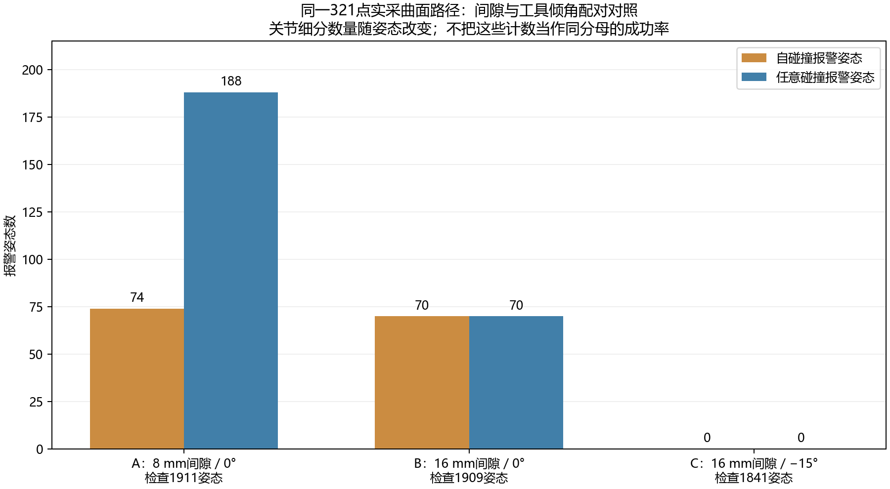

# 单侧实采样件01完整路径复查：间隙与工具倾角的影响

吴玥｜2026\-11\-16｜版本1\.0

# 实验概述

使用同组同学提供的单侧实采点云，在同一条321点曲面路径上对照非接触间隙与工具倾角。16 mm间隙、向切向负方向倾斜15°时，完整路径及进退段的1841个原生检查姿态均未报警；921个关节节点已按顺序发送到ROS，并逐点核对坐标。原8 mm、零倾角的失败结果保留。

本次工件独立编号为“单侧实采样件01”，型号未知；该结果用于实采数据的仿真链路验证，不作为394\.076 CAD同件对照或实际打磨验收。

# 实验目的

初始完整蛇形路径能够求出逆解，但出现工具与观测表面干涉，以及机械臂代理几何自碰撞。本实验检查：保持表面路径和碰撞规则不变，增加非接触间隙后是否足够；如果仍不足，调整工具倾角能否使整段路径通过当前模型的检查。

# 实验原理

以实采点云重建的曲面点及法向构造工作点目标。工作点沿法向抬离表面，工具轴线按给定倾角偏转；逆解后对关节插值细分，检查节点和中点的碰撞，并另取段内位置复核插值误差。

观测表面用包含测量点的2 mm占据格表示。它只代表采到的表面附近；不可见背面、内部实体及未建模工装不在本轮检查范围内。

# 实验环境

|项目|本次配置|
|---|---|
|输入工件|单侧实采样件01；原文件originPointCloud\.pcd与实物照片，单位mm；不与旧CAD强配|
|点云与路径|工件候选135,096点，1 mm网格取样后32,074点；16×16 mm曲面区域，2 mm线距，沿折线每0\.5 mm检查，共321点|
|机械臂|047393B 1\-iER220\-2700 Model对应的既有CAD相对六关节模型及辅助机构代理几何|
|工具与转换器|虚拟盒体130×20×20 mm，沿法兰X方向20—150 mm，工作点为X=150 mm；未配置实际转换器|
|仿真场景|固定仿真摆放；观测表面9,793个2 mm占据格；首尾额外30 mm进退|
|软件|Windows：Python 3\.9\.25、NumPy 2\.0\.2、SciPy 1\.13\.1；Ubuntu：ROS2 Jazzy、MoveIt、FCL 0\.7\.0|

# 实验内容

保留相同原始点云、321个表面点及法向、点云摆放、机械臂和工具碰撞外形、既有连接接触排除项。先检查8 mm与16 mm间隙下的零倾角，再在16 mm间隙下筛选工具倾角；选中的−15°候选重新做整段原生复查。

−15°表示工具外向轴朝曲面切向负V方向偏转15°。B、C两组的工作点位置完全一致，仅工具姿态不同。关节插值细分随姿态改变，各组检查姿态数量不同，不据此计算同分母的成功率。

# 实验结果

|条件|间隙mm／倾角|检查姿态|自碰撞报警|任意碰撞报警|
|---|---|---|---|---|
|A：初始基线|8／0°|1,911|74|188|
|B：仅增间隙|16／0°|1,909|70|70|
|C：再调倾角|16／−15°|1,841|0|0|

增加间隙后仍有自碰撞。保持16 mm间隙、改变工具倾角后，本次完整路径及进退段未再检出碰撞。通过的是整个321点路径，不是用前一阶段的单条扫描线代替。

候选C生成921个关节节点。另复核3,680个段内位置，最大位置回代差0\.00630 mm，姿态回代差0\.000945°；这些数值表示插值与目标的一致性。占据格内／远处探针、名义工具／延长工具共4项正反对照均符合预期。

ROS读回原始有效点167,865、工件候选点135,096、1 mm点32,074。全部921个关节节点按顺序发送，并等待各节点的新鲜坐标变换后逐点核对；最后停止本轮自建节点。

# 思考问题

16 mm是本次非接触仿真间隙，不是去毛刺深度；15°也是本次虚拟工具配置，不直接下发实机。实际工具、安装、控制器关节映射及真实待磨位置仍需核实。

新样件尚无对应CAD，因此“与所发CAD同件的完整输入／下采样对照”仍不能关闭。旧的“整段路径验证与首份点云接入”实验与留痕要求已完成，报告链接已补入11月5日纪要；任务状态由本人勾选。

# 经验分享

端点可达和一条扫描线通过，不能替代完整路径检查。此次保留原失败案例，按“间隙对照—倾角筛选—整段原生复查—全部节点顺序回放”核对结果。点云和碰撞规则保持一致，使改善可以追溯到本次配置调整。

# 参考资料

1. 同组同学提供的originPointCloud\.pcd及实物照片，2026年11月16日收到；样件01，XYZ毫米坐标。原始文件哈希、处理后点数见结果附件。

2. 企业提供的047393B 1\-iER220\-2700 Model；项目既有CAD相对运动链、辅助机构与细化碰撞配置，原模型哈希保持一致。

3. 本轮三组对照汇总、候选C原生结果及全部节点ROS读回记录，见文末附件。

4. [项目既有报告：工件CAD路径接入与点云下采样验证](工件CAD路径接入与点云下采样验证__docx-CuaPdIowZoeiZxxQuencm05Xnac.md)

5. [PCL：PCD文件格式说明](https://pointclouds.org/documentation/tutorials/pcd_file_format.html)

[results\_summary\.json](assets/单侧实采样件01完整路径复查：间隙与工具倾角的影响__wiki-GVaTwa8WEisdBZkQJPRc2UuFnwc/图片和附件/results_summary.json)

[native\_scan\_results\_20261116\.json](assets/单侧实采样件01完整路径复查：间隙与工具倾角的影响__wiki-GVaTwa8WEisdBZkQJPRc2UuFnwc/图片和附件/native_scan_results_20261116.json)

[ROS\_full\_sequence\_results\_20261116\.json](assets/单侧实采样件01完整路径复查：间隙与工具倾角的影响__wiki-GVaTwa8WEisdBZkQJPRc2UuFnwc/图片和附件/ROS_full_sequence_results_20261116.json)

