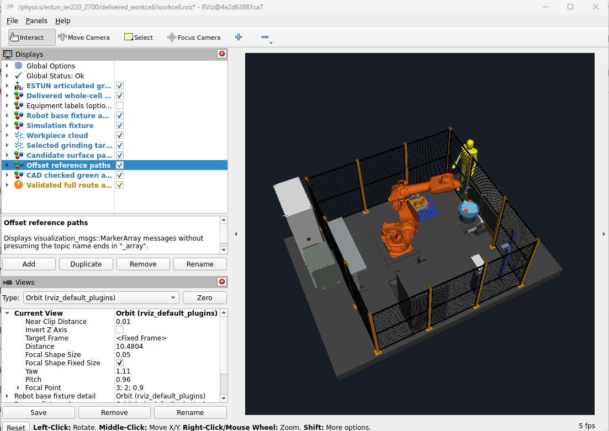

# 周报汇报

# 本周工作与产出

> 1\.环境调整
> 
> 根据公司提供的CAD进行调整
> 
> 
> 
> 
> 
> 2\.测试结果
> 
> 对415等四种器件进行测试
> 
> 
> 
> 
> 
> 总结：
> 
> 本次测试4种工件、共75个路径段，11段完整通过仿真验收，完整通过率为14\.7%，另有19段实现部分覆盖。轨迹生成时间也增加了（以415型工件为例，时间增长238s），自动修正帮助4段完整通过，但整体通过率仍偏低。主要原因为仿真环境调整以及新工件的加入，限制机械臂的展开。
> 
> 
> 
> 3\.新工件的加入
> 
> 出现碰撞等安全问题会有明显的提示，目前碰撞的次数比较多
> 
> [20261118\-1558\-19\.2075716\.mp4](assets/周报汇报__wiki-PISnwYjviiju23kYfnXcKPZhnwf/图片和附件/20261118-1558-19.2075716.mp4)
> 
> 
> 
> 

# 自我反思与能力变化

> 测试4种工件、共75个路径段，11段完整通过仿真验收，完整通过率为14\.7%，另有19段实现部分覆盖。自动修正帮助4段完整通过，但整体通过率仍偏低，受碰撞干涉和搜索超时限制。
> 
> 

# 问题、意见与请求

> 1\.新发来的工件CAD是用机械臂抓住工件在固定砂带加工的，与原有的是用机械臂接入打磨工具，如铣刀等，打磨方式不同。是采用原有的方式打磨，还是新的打磨方式，或者两种方法均采用（该情况可能会有场地不够大的情况）。
> 
> 
> 
> 

# 下周目标与承诺

1\.把原有仿真的成果向新的仿真环境进一步适配，自我修正模块的准确率达到上周的完整通过率38\.79%和通过率81\.03%（通过率指完整通过和部分通过的概率）。

2\.打磨方式调整，在仿真中计算出合适的工件的具体布置位置。

3\.部分打磨的区域打磨程度区别比较大，下周内建立统一的打磨覆盖率统计口径的标准。

