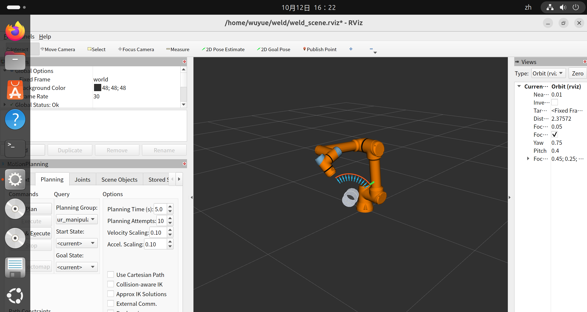
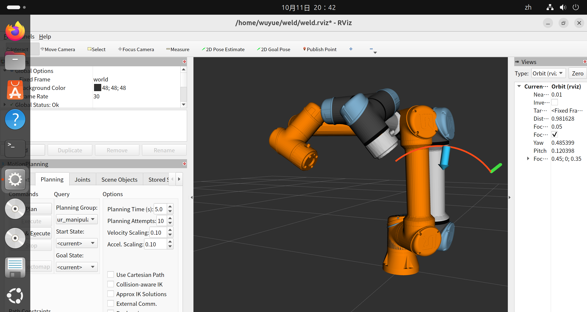

# 圆管焊缝打磨轨迹仿真复现与验证

# **吴玥 · 轨迹规划方向 · 组会汇报（2026\-10\-13）**

> 对标王释钰 10/8 Demo，在本地虚拟机独立搭建 ROS 2 仿真环境，
「点云 → 中心线 → 砂轮路径 → MoveIt 规划 → RViz 回放」全链路已跑通。

## **一、****实验背景**


直接上真机风险高、试错成本大，所以第一步先在仿真里把软件流程走通：
暂用合成点云代替相机扫描，用 UR5e 模型代替真机，把"从点云算出打磨轨迹并执行"这条主链路验证清楚。等真实样件到位后，只需替换点云输入、补上工件坐标标定，其余模块可直接复用。

## **二、系统架构与数据流**

整条链路共五个模块，全部落在 `ROS2仿真环境/src/` 下，前后只用 npy/npz/txt 传数据：

```Plaintext
合成点云生成（weld_cloud_gen）
  → 中心线提取（weld_centerline_extract：点云 → 360 点中心线）
  → 砂轮路径生成（weld_grind_path：中心线 → 接近/进给/抬刀 TCP 路径）
  → 笛卡尔规划与回放（weld_cartesian_plan：MoveIt 规划 24 段 → 机械臂执行）
  → 质量分析（traj_quality：读规划存档，出量化报告）
```

**1\.合成点云生成**：先用程序做一个模拟工件——一根半径 45mm、长 120mm 的圆管，上面凸起 4mm 的焊缝，撒 28000 个点。每个点带一个标签：是管体还是焊缝。这一步的输出就是"模拟的相机数据"。

**2\.中心线提取**：28000 个点里，把属于焊缝的那 11947 个点挑出来，拟合出焊缝正中间那条圈（360 个点）。方法是 PCA 定轴 \+ 圆拟合——后面细讲。

**3\.砂轮路径生成**：知道了焊缝在哪，还要算砂轮（打磨用的轮子）应该走什么路线：先从 30mm 外靠近（接近段 4 个点）→ 沿着焊缝走 91° 弧（进给段 16 个点）→ 再抬起来离开（抬刀段 4 个点）。每个点还带一个"法向"（垂直于表面的方向），告诉砂轮该以什么姿态贴上去。

**4\.笛卡尔规划与回放**：把上面 24 个点喂给 MoveIt，它算出六个关节怎么转才能让手走到每个点，然后在 RViz 里把机器人实际动一遍给你看。"笛卡尔"就是我们通常说的x/y/z 坐标，跟它相对的是"关节空间"（每个关节转几度）。

**5\.质量分析**：用程序自动检查：每个点到底走到了没有（误差）、段与段之间有没有跳变、关节转速超没超标。输出一份量化报告。

位姿仿真（weld\_pose\_sim）与 IK 弧段扫描（ik\_scan）是两条辅助链：
前者把点云整体刚体变换、模拟工件任意摆放；后者在中心线上找机器人真正够得着的弧段。
规划与回放跑在虚拟机（ROS 2 Jazzy \+ MoveIt 2 \+ UR5e mock hardware），
质量分析是纯 numpy 脚本，在宿主机直接跑。

## **三、方法要点**

1. **利用****数据驱动提取****焊缝****中心线，不假设坐标轴和半径**。

焊缝在点云里是一个又扁又薄的圆环：沿着环的周长方向点铺得很开，沿管子轴向只有几毫米厚。

用 PCA 分析这一堆点，点云分布最"窄"的那个方向，就是管子自身的轴向。确定了管子朝哪之后，

沿轴线切下顶部最薄的一条带，做圆拟合，得到圆心和半径，再按角度等距取 360 个点作为中心线。

好处是算法里没有"管子一定沿 X 轴""半径一定多少"这类人为假设，真实工件摆歪一点也能算。

2. **弧段上必须用圆拟合求圆心，不能用均值**。

完整圆环的重心恰好就是圆心，所以整环算平均没问题。但打磨只取 91° 的一小段弧（机器人够得着的范围），

一小段弧的重心会明显偏向弧的中间，偏离真圆心几十毫米；拿错圆心去算法向，砂轮会整体歪掉。

所以路径生成时用 Kasa 圆拟合重新解一遍圆心，最终 TCP 半径与设计值 125mm 完全吻合。

3. **规划拆成 24 段串联，而不是一条长轨迹**。

完整打磨动作分三段：靠近（4 点）→ 沿焊缝打磨（16 点）→ 抬起离开（4 点）。

每一小段都在上一段结束的关节状态下接着规划，段与段之间没有跳变（实测接缝为 0）。

任何一段成功率低于 0\.95 就立刻中止，宁可停下重来，也不带着错误轨迹往下执行。

4. **用位姿仿真验证"坐标系无关性"**。

真实铸件摆在机器人面前是什么位姿，事先不知道。

把合成云整体旋转平移后重跑全链路：提取精度、规划成功率与原坐标系完全一致，

说明算法里没有隐藏的坐标系假设，接真机时只需补一个 TF 标定。

## **四、本周进展与实验结果**

1. **本地仿真环境独立跑通**：VMware \+ Ubuntu 24\.04 \+ ROS 2 Jazzy \+ MoveIt 2 \+ UR5e。

取 IK 全可解的 91° 弧（360 点中 351 可解），24 段笛卡尔规划全部成功，

RViz 回放 24\.6s，关节采样 47303 条、6/6 关节真实运动、干净退出。

2. **数据驱动中心线提取**：与解析解差 **0\.039mm**；焊缝 11947 点，拟合残差 0\.11mm。

3. **工件位姿仿真验证**：Rz30°\+平移后全链路重跑通过（轴 0\.17°、圆心 19μm、半径同 \-0\.039mm）。

4. **轨迹质量量化**：规划 0\.43s；端点位置误差 ≤0\.001mm；段间接缝 0；

最大关节速度 2\.57 rad/s（UR5e 额定 3\.15）。

|步骤|内容|验证结果|
|---|---|---|
|点云|合成圆管焊缝云（半径45mm、长120mm、凸起4mm）|28000 点|
|中心线|数据驱动提取（PCA\+圆拟合）|与解析解差 **0\.039mm**|
|砂轮路径|接近—进给—抬刀（砂轮55mm、偏置70mm）|TCP 到焊缝线 124\.96mm（设计125）|
|规划回放|笛卡尔规划 \+ RViz 执行|24 段全过，回放 24\.6s|
|位姿仿真|Rz30°\+平移后重跑|轴 0\.17°、圆心 19μm、半径同 \-0\.039mm|
|质量分析|端点误差/接缝/速度|≤0\.001mm、0 接缝、2\.57 rad/s（额定3\.15）|






## **五****、当前边界**

1. 目前使用合成点云 Demo，未接真实铸件点云（等样件）；

2. 本程序链路还未实现工件坐标手眼标定；

3. 王释钰同学使用的是ROS2 Humble版本，联调前需一次 Humble 容器适配测试 ；

4. 砂轮偏置是多少，需要等实际装配尺寸确认。

## **六****、下一步**

1. 将程序链路接入真实铸件点云；

2. 研究并实现工件手眼标定；

3. 进行Humble 版本适配测试。

---


