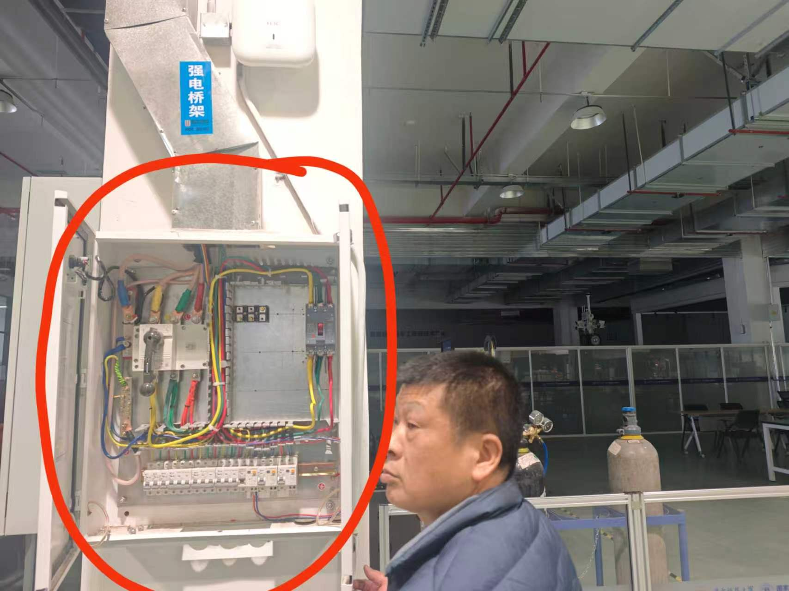

# 场地电力改造现场沟通记录：初步方案与报价状态（2026\-11\-12）

**一句话结论**：已带电工师傅到现场沟通基础需求，**初步方案定为「从现有配电点接电 → 走线至隔断处 → 新增一个独立立式电箱」**。师傅将先给一个大概报价；**准确报价需等设备定位、走线方案、插板需求确定后才能出**。

当前状态：方案为口头初步结论，**主干段报价已到、接电起点现场照已补、项目归属已明确**。本文为过程留档，后续信息到位后可增量补充。

# 一、记录信息

|项目|内容|
|---|---|
|时间|2026 年 11 月 12 日 14:25|
|事项|场地电力改造：接电与独立立式电箱|
|参与方|项目对接人（带电工师傅到场）、电工师傅；黑晓军为接收汇报方|
|来源|即时通讯消息三条（原文粘贴）|
|项目归属|已明确：军山校区工业具身智能实验平台|
|整理方式|引用块内为原文，其余为归纳；导出文本将发送人统一标为「黑晓军」，但首句以「黑老师」相称，故按语境判断为对接人向黑晓军汇报，不逐条臆断归属|

# 二、沟通原文

> 黑老师，我带电工师傅去现场沟通了基础的需求，初步定了方案
> 
> 

> 从这边接电，走到隔断那边接一个独立的立式电箱
> 
> 

> 我让师傅先给我一个大概的报价，不过具体报价还得等设备定位，确定走线以及插板等需求才能确定
> 
> 

随第一条消息附有一张现场图片（微信图片\_20261112142506\_109\.dat）。该文件原为微信加密缓存，后已补发为可读图片，见 3\.1 节接电起点现场照片；隔断位置与末端立箱点位仍待补图。

# 三、初步方案要点

|要素|内容|状态|
|---|---|---|
|接电来源|从现场现有配电点接电（原文「从这边」，具体点位待现场图确认）|初步|
|走线路径|由接电点走线至隔断一侧|初步，具体走线待定|
|末端配置|隔断处新增**一个独立的立式电箱**|初步|
|插板 / 插座|需求尚未确定，是报价前置条件之一|待定|
|方案图纸 / 照片|现场图片已补：红圈为接电起点配电箱，见 3\.1 节|已补|

「独立立式电箱」这一表述值得留意：意味着新增一路相对独立、不依赖原有工位插座的供电，通常对应新增设备或实验台位的用电需求。但原文未说明负载设备、功率与回路容量，**这些是后续设备定位和报价的关键输入**。

## 3\.1 接电起点现场照片

照片中可确认的信息：

- **接电点**：红圈圈出的是一个已打开的强电配电箱，箱内可见总开关、多路断路器、彩色进出线与下方接线端子排。

- **走线条件**：配电箱所在立柱上方贴有蓝色「强电桥架」标签，顶部可见灰色桥架（线槽）沿天花板敷设，另有红色消防管道——这意味着走线大概率可依托现有强电桥架，不必大面积开槽。

- **隔断位置**：画面右侧是玻璃隔断，与方案中「走到隔断那边」的描述对应，接电点与隔断在同一开放空间内。

**与文字方案的印证**：照片说明了为什么师傅说「从这边接电」——现场已有强电桥架和可用配电箱，属于就近取电。但**箱内剩余回路容量、是否已有备用开关位、桥架到隔断段是否还有余量**，照片看不出来，仍需现场核实，这也是第五节「总负载与回路容量」要确认的原因。

# 四、报价状态与依赖链

**准确报价不是等一个数字，而是等三项前置条件落地**：设备定位 → 走线方案 → 插板（插座）需求。原文明确「具体报价还得等设备定位，确定走线以及插板等需求才能确定」。

|次序|前置条件|需明确什么|状态|
|---|---|---|---|
|0|大概报价|师傅先给一个量级估算|待师傅回复|
|1|设备定位|设备清单、摆放位置、功率；决定负载与回路容量|待定|
|2|确定走线|接电点到隔断的路由、线长、是否穿管/走桥架、是否需开槽|待定|
|3|插板等需求|插座数量、规格、是否需独立开关/漏保、是否含网口|待定|
|4|准确报价|在前三项确定后出具|未出|

# 五、建议一并确认的事项

1. **总负载与回路容量**：新增设备功率合计、是否需单独回路与漏电保护，避免电箱装好后带不动。

2. **立箱位置与隔断关系**：立式电箱占地、是否影响通道与消防，以及隔断是否为后续固定布局。

3. **施工窗口**：是否需要断电施工、能否安排在非上课/非实验时段，避免影响场地正常使用。

4. **报价口径**：大概报价与最终报价是否含材料、人工、辅材及可能的墙面开槽修复。

# 六、行动项

|编号|事项|状态|责任 / 说明|
|---|---|---|---|
|A1|补发现场图片：接电起点照片已收；隔断处与立箱点位仍待补图|部分完成|对接人；起点图已收，继续补隔断与立箱点位|
|A2|确认本事项归属（报价清单抬头与本平台名称口径）|已完成|用户已确认清单即为该平台配电改造准备，同一事项；详见配电环境进展 4\.4|
|A3|取回师傅的大概报价|待回复|对接人|
|A4|完成设备定位（清单、位置、功率）|待定|设备使用方；准确报价前置|
|A5|确定走线方案与插板/插座需求|待定|对接人 \+ 电工师傅|
|A6|取得准确报价并确认施工窗口|依赖 A4、A5|对接人|

---

说明：本文依据 2026\-11\-12 三条即时通讯消息整理，属过程留档，方案为口头初步结论，尚未形成图纸或正式报价。第五节的确认事项为整理时补充的建议，非原文内容。接电起点现场照片已于当日补入 3\.1 节；同日师傅报价已到、项目归属明确为军山校区工业具身智能实验平台，后续进展统一见《军山校区工业具身智能实验平台：配电环境进展》（https://hustdian\.feishu\.cn/docx/QCRUdUAYfoQ9HYxzT12cgGsPn2d）；本记录保留为沟通原文与报价依赖链的过程留档，状态以新篇为准。

