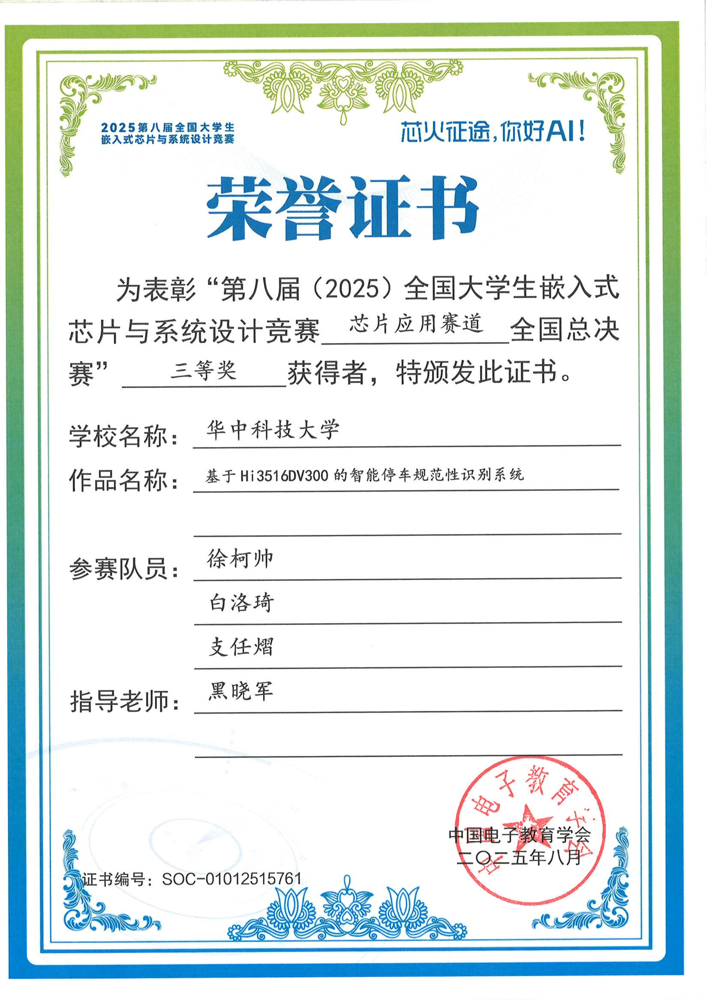

# 基于Hi3516DV300的智能停车规范性识别系统

徐柯帅、白洛琦、支任熠，[基于Hi3516DV300的智能停车规范性识别系统](基于Hi3516DV300的智能停车规范性识别系统__wiki-KTHuwdb1zix9P3kZtXxcJ7ohndd.md)，2025年全国大学生嵌入式芯片与系统设计竞赛，芯片应用赛道，国赛三等奖。

# 参赛文档

1. [基于Hi3516DV300的智能停车规范性识别系统](https://hustdian.feishu.cn/docx/UU4VdjJJzoMScDxGcSEcRVw5nBB?from=from_copylink)

2. [基于Hi3516DV300的智能停车规范性识别系统\.mp4](../attachments/基于Hi3516DV300的智能停车规范性识别系统__file-Cad3bNLt1ojRvAxxNqSc3Z3mnQh.mp4)

