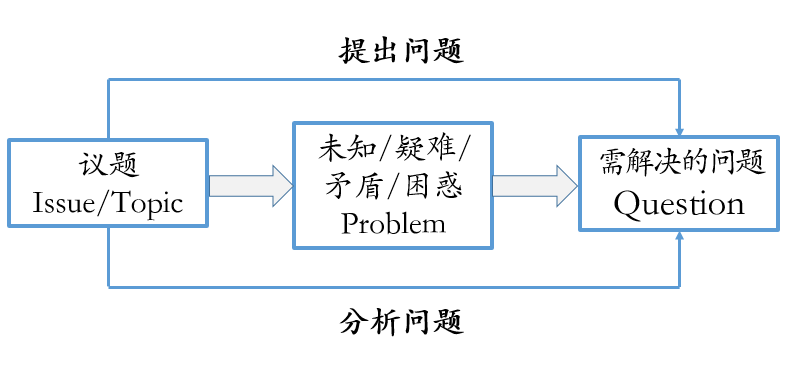
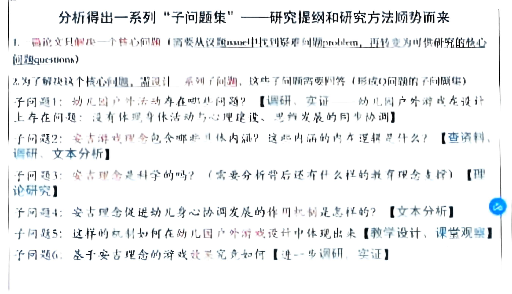

# 如何在“问题分析”中产生创新思考——基于批判性思维的问题分析路径机制

# **论文引用**

吴妍，[如何在“问题分析”中产生创新思考——基于批判性思维的问题分析路径机制](如何在“问题分析”中产生创新思考——基于批判性思维的问题分析路径机制__wiki-SFYZwI8FviM4jLkU8r3cqHAhn5J.md)\[J\]\.批判性思维教育研究，2024\.

[如何在“问题分析”中产生创新思考——基于批判性思维的问题分析路径机制](https://hustdian.feishu.cn/wiki/AwsowwMuRiMD92kmeDPc9WQHn5f?from=from_copylink)

[如何在“问题分析”中产生创新思考\_\_吴妍\.pdf](../attachments/如何在“问题分析”中产生创新思考_吴妍__file-BzmabiuiFoXLRuxTTEgcK5Jvndc.pdf)

[如果在“问题分析”中产生创新思考——基于批判性思维的问题分析路径机制0614（吴妍）\.docx](../attachments/如何在“问题分析”中产生创新思考——基于批判性思维的问题分析路径机制__file-D3xjb5Jyhog1lNxSblscC5rmndc.docx)

案例

# **讨论交流**

@黑晓军这篇文章值得精读，有助于提炼科学问题，支持论文写作。

@杨美子[论文小结\_如何在“问题分析”中产生创新思考——5G定位](https://hustdian.feishu.cn/wiki/QsqywceomijN4RkHfHccHogGnqh)

@任哲峰[论文小结\_如何在“问题分析”中产生创新思考](https://hustdian.feishu.cn/wiki/Ttgzw4XSzifq20kdRtvcFIcZnFd?from=from_copylink)

@刘力扬[论文小结\_如何在“问题分析”中产生创新思考——项目思考](https://hustdian.feishu.cn/wiki/GWERwBI5oiUdZokq49vcniOEnVh?from=from_copylink)

# **参考资料**

1. [什么是好问题：好的研究问题的标准、原理和构成](什么是好问题：好的研究问题的标准、原理和构成__wiki-NZVFwwvLmiU34UkmM3CcprOAnZf.md)

2. [远离误区：如何理解批判性思维二元问题分析法](远离误区：如何理解批判性思维二元问题分析法__wiki-ZgT3w4r3aiEVQakCwtncb4ZZn4d.md)

