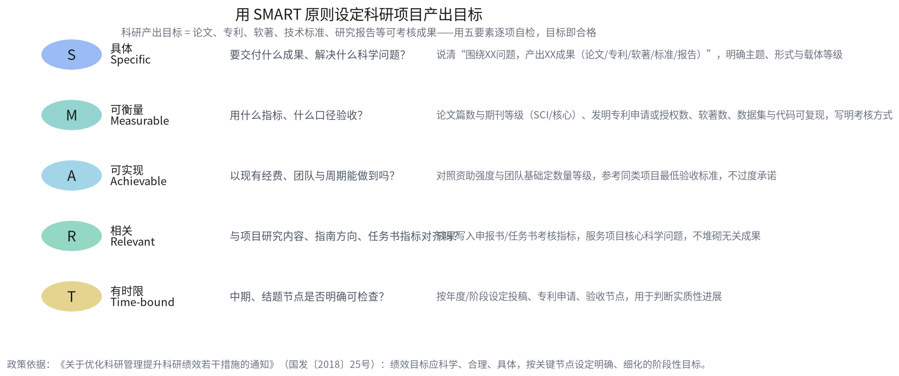

# 如何应用SMART原则设定科研项目产出目标

**本文用途**：面向科研项目负责人、研究生与课题组成员，说明 SMART 原则是什么、为什么科研项目产出目标必须满足 SMART，并给出"七步设定法 \+ 对照示例 \+ 自检清单"，帮助把模糊的科研产出设想改写成可考核、可验收的产出目标。文中涉及的政策要求与量化口径均注明来源，文末附参考资料。

# 简介

**科研项目产出目标**指项目要产出的可考核成果——研究论文、专利、软件著作权、技术标准、研究报告、数据集/代码、人才培养、成果转化等。**SMART 原则**是把一句模糊愿望转化成"可以理解、可以行动、可以检查"的目标的五要素方法：目标要**具体、可衡量、可实现、相关、有时限**。国务院〔2018〕25号文明确要求，目标导向类项目申报书和任务书要具备"科学、合理、具体的项目绩效目标和适用于考核的结果指标"，并按关键节点设定阶段性目标——这正与 SMART 原则一脉相承。

# 什么是 SMART 原则

SMART 由五个英文单词的首字母组成，其科研语境含义如下。国家自然科学基金委的相关研究将其表述为：绩效评价目标必须是**具体的（Specific）、可以衡量的（Measurable）、可以达到的（Attainable）、与其他目标具有一定的相关性的（Relevant）、具有明确的截止期限的（Time\-bound）**。

|要素|英文|核心设问|科研产出语境中的含义|
|---|---|---|---|
|S|Specific 具体|要交付什么成果、解决什么科学问题？|说清"围绕 XX 问题，产出 XX 成果（论文/专利/软著/标准/报告）"，明确主题、形式与载体等级|
|M|Measurable 可衡量|用什么指标、什么口径验收？|论文篇数与期刊等级（SCI/核心）、发明专利申请或授权数、软著数、数据集与代码可复现，写明考核方式|
|A|Achievable 可实现|以现有经费、团队与周期能做到吗？|对照资助强度与团队基础定数量等级，参考同类项目最低验收标准，不过度承诺|
|R|Relevant 相关|与项目研究内容、指南方向、任务书指标对齐吗？|成果写入申报书/任务书考核指标，服务项目核心科学问题，不堆砌无关成果|
|T|Time\-bound 有时限|中期、结题节点是否明确可检查？|按年度/阶段设定投稿、专利申请、验收节点，用于判断实质性进展|

# 为什么科研项目产出目标要符合 SMART

- **政策与评审的硬要求**：国务院〔2018〕25号文要求，目标导向类项目申报书和任务书要有科学、合理、具体的绩效目标和适用于考核的结果指标，并按关键节点设定明确、细化的阶段性目标用于判断实质性进展；立项评审要审核绩效目标、结果指标与指南要求的相符性，以及创新性、可行性、可考核性。

- **验收以考核指标为准**：国家重点研发计划等项目的验收按"项目目标—成果名称—成果类型—考核指标—考核方式及评价手段"逐项评价；指标不明确，结题时无从验收。

- **对研究者本人**：SMART 目标把数月乃至数年的成果承诺拆成可检查的动作与节点，避免临近结题才发现目标完不成、或产出无法与经费投入匹配。

# 科研产出目标的常见类型与量化口径

设定目标前先了解科研项目常用的成果类型与考核口径（综合国家自然科学基金委、深圳市自然科学基金申请书成果统计、科技部项目验收办法及多省市科技计划项目要求整理）：

|成果类型|常见量化指标|考核方式与评价手段|
|---|---|---|
|研究论文|篇数；期刊等级（SCI/EI/中文核心/CN）；会议论文|以发表/录用为准，附收录证明或检索页|
|专利|申请件数 vs 授权件数；发明专利占比|以受理通知书/授权证书为准，两者口径不同需写明|
|软件著作权|登记数量|以登记证书为准|
|技术标准|参与制定/发布的标准级别（国家/行业/团体）|以正式发布文件为准|
|研究报告/方案|报告份数、研究内容、被采纳情况|以评审意见/采纳证明为准|
|数据集/代码|数据规模、代码仓库、可复现性|以公开链接/评测记录为准|
|人才培养|培养研究生/本科生人数|以培养名单与完成成果为准|
|成果转化/效益|技术合同额、新增经济效益、产业化数量|以合同、审计或企业盖章证明为准|

# 如何设定符合 SMART 的科研产出目标：七步法

1. **写一句问题陈述**：项目要解决什么科学问题、最终交付什么。例："面向 XX 场景，研究 XX 方法，产出可复现的算法与验证数据"。

2. **列出候选产出清单**：按论文/专利/软著/标准/报告/数据/人才等类别枚举可能成果，并标注哪些是核心产出、哪些是支撑产出。

3. **用 S 收紧**：每个产出写明"主题 \+ 形式 \+ 载体/等级 \+ 数量"，一句话讲清，删掉"深入研究、全面提升"等空词。

4. **用 M 量化**：给每个产出定数量、等级、状态（如"申请"还是"授权"）和考核方式——验收时拿什么材料证明。

5. **用 A 校准**：对照资助强度、团队基础与项目周期调整数量与等级；可参考同类项目的最低验收标准，确保承诺可实现。

6. **用 R 对齐**：将成果逐条与指南方向、申报书研究内容、任务书考核指标对齐，删除与核心问题无关的成果或将其降级为"力争"。

7. **用 T 定节点**：把总目标拆解到年度/中期/结题节点，写进任务书考核节点，保证任何时点都能判断实质性进展。

# 对照示例：模糊目标 vs SMART 目标

|模糊表述|问题|SMART 改写|
|---|---|---|
|发表论文|只有成果形式，没有主题、等级与时间|围绕"XX 算法"在 SCI（Q1/Q2）期刊发表 1 篇研究论文：2026\-12 投稿，2027\-06 前录用|
|申请专利|未说明类型、数量与时间节点|围绕"XX 装置"申请发明专利 2 项：2026\-12 前提交申请，力争 2027\-12 前 1 项获得授权|
|完成研究|不可衡量、无法验收|完成 XX 系统原型开发并完成 100 例真实场景测试：2027\-03 前输出测试报告 1 份|
|培养人才|无数量、无与课题的关联|依托本课题培养研究生 2 名、本科生 3 名，结题前完成学位论文/结课报告|

# SMART 自检清单（设定后逐项核对）

|要素|自检问题|通过标准|
|---|---|---|
|S|能否一句话说清"交付什么、给谁、解决什么"？|30 秒能讲清，无"提高/加强/深入研究"等空词|
|M|有没有数字、等级、状态可查？考核方式是什么？|每项目标都有指标值与验收口径（以什么材料证明）|
|A|以现有经费、人员、周期能做到吗？依据是什么？|能对照资助强度与团队基础给出可行理由|
|R|是否直接服务项目核心问题/指南/任务书？|无关或边缘成果已删除，或降级为"力争"|
|T|截止日期与阶段节点明确吗？|每个目标都有年度/中期/结题节点，能判断实质性进展|

# 常见误区与提醒

- **只堆数量、不设重点**：产出清单罗列十多项，反而分散资源；核心成果 2\-3 项即可，其余写"力争"。

- **等级承诺过高**：团队基础有限却承诺多篇顶级期刊论文；先按同类项目最低可验收标准承诺，再争取超额。

- **混淆"申请"与"授权"**：专利指标务必写明是申请件数还是授权件数，两者考核口径不同。

- **忽略考核口径**：论文以"发表/录用 \+ 收录证明"计，报告以"评审/采纳"计，数据集以"公开可复现"计，提前明确以何为准。

- **只有总目标、没有节点**：中期无法判断实质性进展，也违背国发〔2018〕25号文对阶段性目标的要求。

- **目标与经费/周期不匹配**：参考同类别、同强度项目的验收指标设定本项目的数量等级。

# 参考资料

1. [国务院印发《关于优化科研管理提升科研绩效若干措施的通知》（国发〔2018〕25号，国家自然科学基金委转载）](https://www.nsfc.gov.cn/csc/20340/20289/29106/index.html)

2. [《青年科学基金项目绩效评价指标体系研究与探讨》（国家自然科学基金委，2016，SMART 原则用于绩效目标分解）](https://www.nsfc.gov.cn/csc/20345/20348/pdf/2016/201604336.pdf)

3. [UC Davis Proposal Development Services：Grant Writing Tip—Think SMART when writing objectives](https://proposaldev.ucdavis.edu/news/grant-writing-tip-think-smart-when-writing-objectives)

4. [深圳市自然科学基金（基础研究）面上项目申请书（科研成果统计口径）](http://stic.sz.gov.cn/attachment/1/1316/1316090/10697097.pdf)

5. [科技部《农业科技成果转化资金项目监理和验收办法》（专利、论文统计口径）](https://most.gov.cn/xxgk/xinxifenlei/fdzdgknr/fgzc/gfxwj/gfxwj2010before/201712/t20171227_137224.html)

6. [厦门医学院《关于进一步加强和规范科研项目验收指标编写要求的通知》（按经费档次设定最低产出）](https://www.xmmc.edu.cn/hlx/info/1065/3219.htm)

7. [科技部资源配置与管理司《国家重点研发计划项目验收工作规范（试行）》（考核指标与评价手段）](https://www.htrdc.com/gjszx/cg/2462.shtml)

> （注：部分内容由豆包工作 AI 生成）
