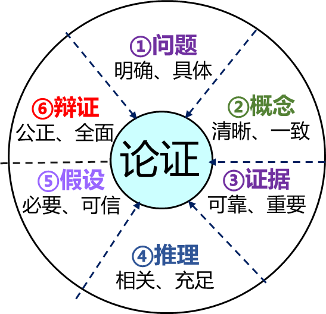

# 如何泛读论文

建议参考[论文泛读参考模板](论文泛读参考模板__wiki-YZ7GwGcLiiWpoYkYi6XcCLm2nHb.md)

# 理解的读：分析论证

1. 分析文本的论证：问题、论断、证据和推理

2. 如果可能，概括和表达论证结构。

# 批判的读：评估论证

1. 问题清楚、明确？

2. 概念清晰、一致？

3. 证据具体、可信？

4. 推理相关、合理？

5. 假设可辨、可靠？

6. 辩证公正、完整？

# 参考文献

1. [DeepSeek建议如何泛读学术论文？](https://hustdian.feishu.cn/wiki/MQYjwSFuMi1Wl5keuQ2c4XfAnZf?from=from_copylink)

2. [纳米混合AI建议如何泛读基于视觉算法智能检测共享单车按照要求停车应用问题的学术论文？](https://hustdian.feishu.cn/wiki/VkZDwmYuqiNjmHk66j3cXMc5n8c?from=from_copylink)

