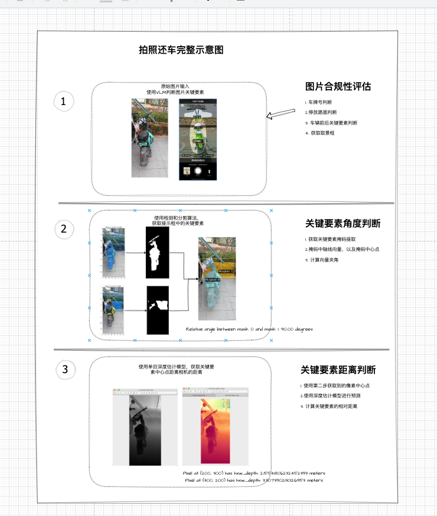
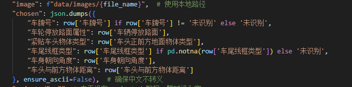
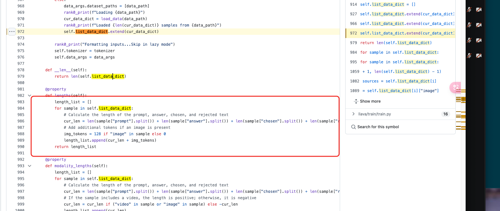
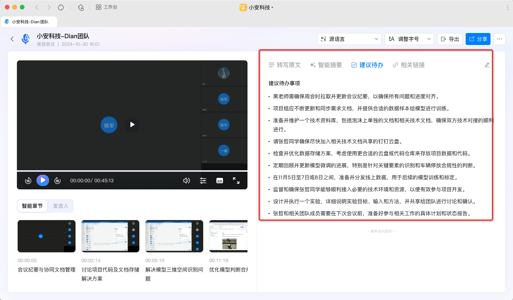
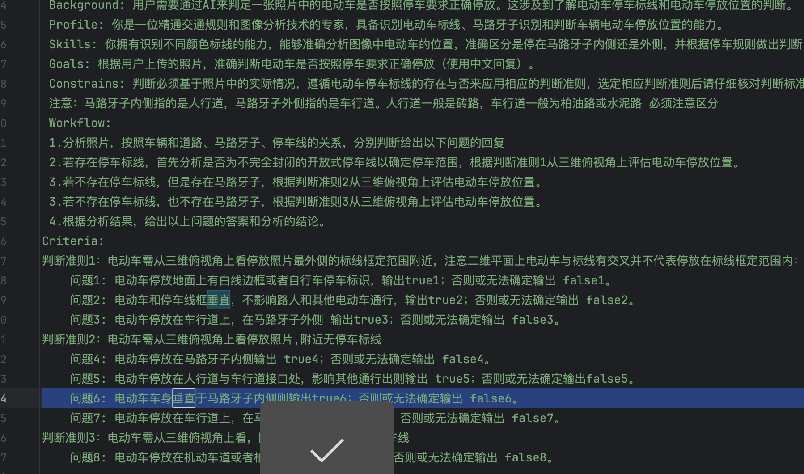
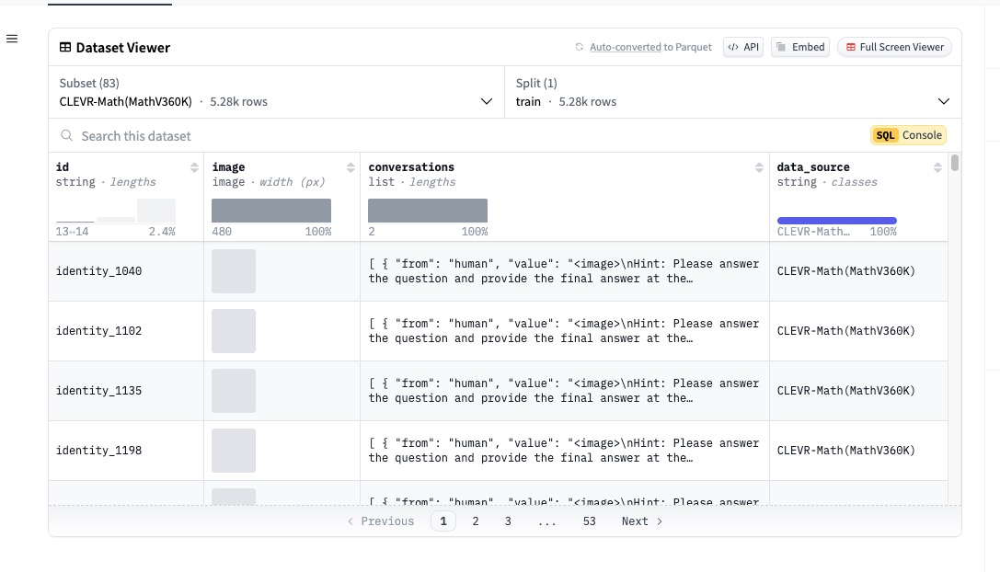
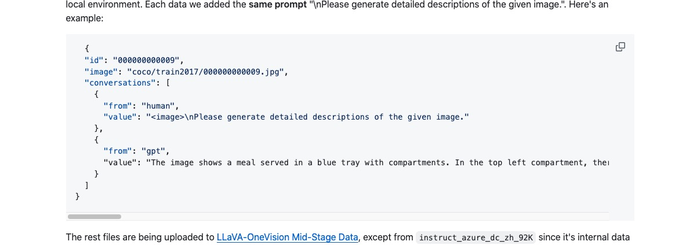
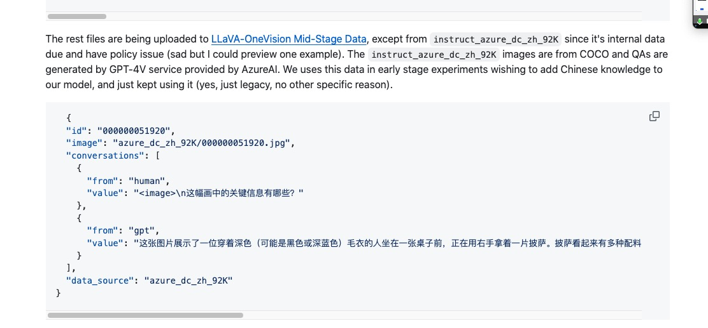

# 小安大模型项目会议纪要

> 一个人可能走得更快，但一群人走，才能走得更远！
> 
> 

交流时间：每周三上午9:00 \- 10:00 启明学院7楼会议室线下

[小安大模型项目会议纪要@钉钉](https://alidocs.dingtalk.com/i/nodes/pGBa2Lm8aGpOG94AiLjjRy72VgN7R35y?utm_scene=team_space)

# 2026/10/14

## 参会人

华科：@岳康@王睿秋@洪天阳@吴添一@黑晓军

## **议题**

1. 汇报学习进度[AI 学习文档](https://hustdian.feishu.cn/wiki/Fjg2wd1hniStuykJRlCcGl2An2g)

2. 开题选择讨论

3. 具身打磨项目后续具体任务

# 2026/3/12

## 参会人

华科：@岳康@徐柯帅@黑晓军

## **议题**

1. @徐柯帅[2025年全国大学生嵌入式芯片与系统设计竞赛：基于Hi3516DV300的智能停车规范性识别系统](2025年全国大学生嵌入式芯片与系统设计竞赛：基于Hi3516DV300的智能停车规范性识别系统__wiki-A8afwUFo7i1kfsk9oEdc1QWDnIf.md)

2. @岳康[3\.12组会](https://hustdian.feishu.cn/wiki/KTnUwsQvQiMXpFkzOlycvPOznXd?from=from_copylink)

3. @岳康[岳康\_工程训练一课程报告](https://hustdian.feishu.cn/wiki/LXtkwzQyziFwntkkVs7cOIc4nIb?from=from_copylink)

# 2025/1/21

## 参会人

小安：江涛

华科：@岳康@徐柯帅@陈泽恺@黑晓军

## **议题**

1. @徐柯帅[2025年嵌入式竞赛：基于Hi3516DV300的智能停车规范性识别系统](2025年全国大学生嵌入式芯片与系统设计竞赛：基于Hi3516DV300的智能停车规范性识别系统__wiki-A8afwUFo7i1kfsk9oEdc1QWDnIf.md)

2. @岳康[岳康\_《工程训练（一）》课程终期答辩\.pptx](https://hustdian.feishu.cn/wiki/UMpRwPMsbikYXqkzQ0lcCzGQnvf?from=from_copylink)

[20260121\_小安大模型组会纪要 ](https://hustdian.feishu.cn/wiki/P0TKww26ii4kREkVFfncrSTbn1f?from=from_copylink)

## **参考资料**

1. [论文研读](https://hustdian.feishu.cn/wiki/VuIGwaRWjiBZ4ZkoWIwcpanYntf?from=from_copylink)

2. [实验报告参考模板](实验报告参考模板__wiki-AtS4wukSmiiluAkNLy6cotudnof.md)

3. [个人小结参考模板](https://hustdian.feishu.cn/wiki/LGBYwBo2jirdLbkF8YCcePWbn3g?from=from_copylink)

4. [问题分析与解决参考模板](问题分析与解决参考模板__wiki-RwoNwgHYqiAZIkkcjvucAB9dnUh.md)

5. 论文泛读参考模板[论文泛读参考模板](论文泛读参考模板__wiki-YZ7GwGcLiiWpoYkYi6XcCLm2nHb.md)

6. 论文精读参考模板[论文精读参考模板](论文精读参考模板__wiki-FfMYwavyXiExfGkBGeVcr19RnIh.md)

# 2025/1/14

## 参会人

@岳康@徐柯帅@王一赫@黑晓军

## **议题**

1. @岳康[Prompt调优](https://hustdian.feishu.cn/wiki/O7OXwY4L0ixZazkVo7acViX7nzC?from=from_copylink)

2. @徐柯帅[实验1\.14](https://hustdian.feishu.cn/wiki/T3EFwslXFicoewkjtq6cv6RLnSb?from=from_copylink)

3. @黑晓军[20260113\_AI辅助大学教学工作的策略与实践\.pdf](../attachments/20260113_AI辅助大学教学工作的策略与实践__file-O60ZbSX8Go2xoBxDxaHcm1crnPc.pdf)

[20260114\_小安大模型项目组会纪要 ](https://hustdian.feishu.cn/wiki/QyRLwfPhqi6qzYkNGancvrTdnEg?from=from_copylink)

## **参考资料**

1. [99%\+停车识别准确率，助力运营商降本增效！](https://mp.weixin.qq.com/s/AQR-LJknsGmtALX0G1s2Nw?scene=1&click_id=26)

2. [武汉小安科技入选2025年武汉市上市后备“金种子”企业](https://mp.weixin.qq.com/s/ZJqTgWEc_00-T4KRczjSmw)

# 2025/12/31

## 参会人

@岳康@陈泽恺@黑晓军

## **议题**

1. [2025年小安大模型组年终工作总结](https://hustdian.feishu.cn/wiki/DOBlwzS77iHsJjk69GUcUze6nGf?from=from_copylink)

2. [2025年小安大模型项目总结](https://hustdian.feishu.cn/wiki/Om3uwwqSDits5VkWhOxcAoEVn5d?from=from_copylink)

3. @岳康[中期验收智能检测系统app使用说明](https://hustdian.feishu.cn/wiki/VtCzwWE0hiJ0KHkoWRXc5Tx9ngf?from=from_copylink)

4. @陈泽恺基于大模型智能检测规范停车实验测试

5. @黑晓军[案例分析\_你每天的营养合适吗\.pptx](../attachments/案例分析_你每天的营养合适吗__file-BMj7bacr3o9iZbxa2dLcK9fpnve.pptx)

6. @黑晓军[如何提出创新的想法？](https://hustdian.feishu.cn/wiki/FxbiwsWckioG9WkUl99coByknhb?from=from_copylink)

7. @岳康[2025岳康个人小结](https://hustdian.feishu.cn/wiki/AtMGw3x26iwuy1kixOPcOYOBnJh?from=from_copylink)

8. @陈泽恺[2025年陈泽恺个人小结](https://hustdian.feishu.cn/wiki/Lw39wkluTilZpVki815c3XQ3nxd?from=from_copylink)

[20251231\_小安大模型组会纪要 ](https://hustdian.feishu.cn/wiki/PIGowSr3PiNElxkPNlMcqM1xnDc?from=from_copylink)

## **参考资料**

1. [2024年DianGPT项目终期汇报](2024年DianGPT项目终期汇报__wiki-HqFCwpBMfice7jkcxVocXo1Un4d.md)

# 2025/12/24

## 参会人

@岳康@王一赫@徐柯帅@陈泽恺@黑晓军

## **议题**

1. [2025年小安大模型组年终工作总结](https://hustdian.feishu.cn/wiki/DOBlwzS77iHsJjk69GUcUze6nGf?from=from_copylink)

2. [关于菏泽市互联网租赁电单车项目审查及测试安排的通知](https://hustdian.feishu.cn/wiki/TMTWw1X1BiASWBkpiuwcnawvnEh?from=from_copylink)

3. [泰比特申请基于图像识别的辅助还车相关专利，克服现有基于GPS定位还车方式定位易不准，且无法监督用户规范还车的技术问题](https://www.163.com/dy/article/K1PIIHQE0519QIKK.html?spss=dy_author)

4. [CN119206621A\_请求处理的方法、装置、设备、存储介质和程序产品在审](https://m.tianyancha.com/zhuanli/97e5584cd80f7254dc04fd4ea0681efe)

[智能纪要：小安大模型组会 2025年12月24日](https://hustdian.feishu.cn/wiki/PZAGw5RgHia4Vnk7Kkdcfk4OnId?from=from_copylink)

# 2025/11/20

## 参会人

- 小安：张湘国

- Dian团队：@岳康@黑晓军

## **议题**

[20251120\_小安项目会议纪要](https://hustdian.feishu.cn/wiki/KMGpw2G0timvXpki0nCcAXQ0nWe?from=from_copylink)

# 2025/11/12

## 参会人

- 小安：张湘国

- Dian团队：@岳康@王一赫@陈泽恺@黑晓军

## **议题**

1. @岳康[小安项目组的前期工作汇总](https://hustdian.feishu.cn/wiki/X2cUwcV5oiqVrWkb5bQcwzPEnme?from=from_copylink)

# 2025/11/12

## 参会人

- @王一赫@张喆@岳康@陈泽恺@黑晓军

## **议题**

1. @岳康前期代码bug的调试工作和目前的测试结果[当前效果](https://hustdian.feishu.cn/wiki/WKKEwrjT4izhWHkCJQmcFJ6tn1f?from=from_copylink)

2. @岳康[小安后续工作路线](https://hustdian.feishu.cn/wiki/O2S6wumm3iqCxukIaSvcBJs7n1d)

3. @卢锐勇[小安大模型中期报告初稿](https://hustdian.feishu.cn/wiki/IbInwZS0NiBgQhkVZfjcE4i2nBh)

## **参考资料**

1. [2025年LightAI项目中期报告](https://hustdian.feishu.cn/wiki/OLdOw81YeiRTmokWhs6chE5angb?from=from_copylink)

2. [2024年DianGPT项目终期汇报](2024年DianGPT项目终期汇报__wiki-HqFCwpBMfice7jkcxVocXo1Un4d.md)

# 2025/7/3

## 参会人

- @王一赫@张喆@岳康@徐柯帅@易楠茜@黑晓军

## **议题**

1. [2025上半年小安大模型组工作总结](https://hustdian.feishu.cn/wiki/KEknwiwptikLmikJNpAcAxADnNb?from=from_copylink)

2. @岳康[岳康 个人小结](https://hustdian.feishu.cn/wiki/Yl2SwPl8miUvYikarofcwWCNnoe?from=from_copylink)

3. @王一赫[王一赫 个人小结](https://hustdian.feishu.cn/wiki/AhnqwpnYDirsRLkO2Usc8s09nnd?from=from_copylink)

4. @徐柯帅[徐柯帅 个人小结](https://hustdian.feishu.cn/wiki/DCQFwjFAbiaURJk6rFJcBldNnwe?from=from_copylink)

5. @易楠茜[易楠茜 个人小结](https://hustdian.feishu.cn/wiki/S9XqwR82IibxuykY7W6cyBmBnTZ?from=from_copylink)

6. @王一然[王一然 个人小结](https://hustdian.feishu.cn/wiki/TUvYwXph7iuXK1kinficsE5YnTc?from=from_copylink)

7. @卢锐勇[小安大模型组2025年年中总结](https://hustdian.feishu.cn/wiki/QaBpwBeChinjJxkrGomcnxw9ndb)

[智能纪要：小安大模型组会 2025年7月3日](https://hustdian.feishu.cn/docx/JfHhdERj7osY8sx9B2Rcdd83nHh?from=from_copylink)

[小安大模型组会录屏20250703](https://hustdian.feishu.cn/minutes/obcnf8aaik9pdf3739vqxmp9?from=from_copylink)

## 参考资料

# 2025/6/18

## 参会人

- Dian团队：@王一赫@张喆@岳康@徐柯帅@黑晓军

## **议题**

1. @岳康[角度误差分析与后续处理工作](https://hustdian.feishu.cn/wiki/WtZPwQ5XniXLg4kDNCZc1iBPnXv?from=from_copylink)

2. @王一赫

## 参考资料

# 2025/6/12

## 参会人

- Dian团队：@王一赫@张喆@岳康@徐柯帅@王一然@卢锐勇@黑晓军

## **议题**

1. @张喆[6/11\_标准辅助系统项目架构讨论](https://hustdian.feishu.cn/docx/SBJUdCjeZor0WJxlwkOcL7e3nCA?from=from_copylink)

2. @张喆@王一赫[误差分析以及后续解决方案](https://hustdian.feishu.cn/docx/QQQwdgSqYozDpMx3JiHczJIwnwO?from=from_copylink)

3. @王一然数据集

4. @卢锐勇[小安大模型中期报告初稿](https://hustdian.feishu.cn/wiki/IbInwZS0NiBgQhkVZfjcE4i2nBh)

## 参考资料

1. [问题分析与解决参考模板](问题分析与解决参考模板__wiki-RwoNwgHYqiAZIkkcjvucAB9dnUh.md)

2. [强化学习做咖啡项目结题报告](https://hustdian.feishu.cn/wiki/XfkgwYSx4iZaYfkAjS3cMnypn7c?from=from_copylink)

# 2025/6/5

## 参会人

- Dian团队：@王一赫@张喆@岳康@徐柯帅@王一然@卢锐勇@黑晓军

## **议题**

1. @徐柯帅[云端大模型测试](https://hustdian.feishu.cn/wiki/OZrAwkd3RiyCcZkir4vcvhUgn6c?from=from_copylink)

2. @岳康算法问题讨论：检测不到电动车

3. @王一然数据集

4. @黑晓军[2025年国家级省级大创推荐](https://hustdian.feishu.cn/wiki/Ee5hwPM9yiMfKdkr6oqcw99unqb?from=from_copylink)

5. @黑晓军[基于大模型的智能还车应用设计](基于驾驭工程的共享电动车智能体还车系统设计__wiki-Bgq4wJxDwi7zvWkbDAYcmScQnlh.md)

6. @黑晓军[如何泛读论文？](如何泛读论文__wiki-FCz7wYm8Wi5r7lkIZ8scl4eenLb.md)

## 参考资料

1. [2024年DianGPT项目终期汇报](2024年DianGPT项目终期汇报__wiki-HqFCwpBMfice7jkcxVocXo1Un4d.md)

## 下一步计划

1. 完善算法实验设计和结果分析

2. 积累项目成果（项目报告、系统视频展示、软件著作权、专利申请、论文等），准备6月下旬项目阶段性报告

# 2025/5/29

## 参会人

- Dian团队：@张喆@岳康@卢锐勇@黑晓军

## **议题**

1. @张喆[研究背景与动机 \- 小安组文档库](https://xiaoanmodel.github.io/docs/0_project_overview/background/#_5)

2. @卢锐勇[项目交付要求](https://hustdian.feishu.cn/wiki/YHFWwOftLipWlQkr7NlcuylPnRc)

3. @黑晓军复盘参赛情况[2025年\(第 18 届\)中国大学生计算机设计大赛中南地区赛作品评审结果](https://hustdian.feishu.cn/wiki/QVxXwpKFAi0g3IkwkeicPOdJnrf?from=from_copylink)

4. @黑晓军机器人组产学合作情况[机器人组\_真实项目干中学，做有组织的创新\.pdf](../attachments.md#att-M8xabIEjyoY9OzxNcsjcpKJ6nSG)

# 2025/5/22

## 参会人

- 小安：张湘国

- Dian团队：@王一赫@张喆@岳康@王一然@黑晓军@张振宇

## **议题**

1. @岳康[测试集数据测试结果](https://hustdian.feishu.cn/wiki/TXO1wYLTOigU2qkHgChc78kpnAc?from=from_copylink)

2. @王一然[探索基于视觉编码器的停车规范检测问题解决方案——以YOLO为例](https://hustdian.feishu.cn/wiki/Kbfvwjipfi21EJke6fPcXNVtnWg)

3. @王一赫@张喆[小安鸿蒙端轮询接受角度失败debug](https://hustdian.feishu.cn/docx/LfMudT81Mo1gctx3LAhceCq1nmu?from=from_copylink)

## 下一步计划

1. 数据集补充弱光场景

2. 补充测试代码（包括吞吐量等）

3. 实践下新的@王一然@徐柯帅

# 2025/5/16

## 参会人

- 小安：张湘国

- Dian团队：@王一赫@张喆@岳康@王一然@卢锐勇@黑晓军

## **议题**

1. @岳康[采样安排与计划](https://hustdian.feishu.cn/wiki/Z7aNw0R7sintS8k8A1UcrTRjnNc) 

2. @徐柯帅[大模型应用调研](https://hustdian.feishu.cn/wiki/CWNNwlqNHiZ3Z1kXyA2ctfQ4nud?from=from_copylink)

3. @卢锐勇[3D Bounding Box Estimation Using Deep Learning and Geometry](https://hustdian.feishu.cn/wiki/JNDIwM5DgiwZuukD0YWcGGUhnOf)

# 2025/5/8

## 参会人

- 小安：张湘国

- Dian团队：@王一赫@张喆@岳康@王一然@黑晓军@张振宇

## **议题**

1. @王一赫

2. @张喆[小安演示视频](https://hustdian.feishu.cn/docx/G4gTdlclvoc6P6x1PIvcnIKknhh?from=from_copylink)

3. 张湘国 https://github\.com/jeinlee1991/chinese\-llm\-benchmark

## 下一步计划

* [x] ~~采样，构建测试数据集，给出采样安排（形式和人手安排）@张喆@岳康⏰2025-05-15 18:00~~

* [x] ~~录像展示demo功能 下周@王一赫⏰2025-05-15 18:00~~

* [ ] 小程序增加陀螺仪数据 @湘国

* [x] ~~场景识别（大模型），给出起步方案构思@徐柯帅⏰2025-05-15 19:00~~

# 2025/4/30

## 参会人

- 小安：张湘国

- Dian团队：@王一赫@张喆@岳康@王一然

## **议题**

1. @王一赫[小安组文档库](https://xiaoanmodel.github.io/docs) 整理与编写

2. @王一赫github 同步机器人实现与分享[GitHub \- sanchuanhehe/chatbot\-webhook\-client: Webhook calls of custom BOT that support DingTalk, Lar](https://github.com/sanchuanhehe/chatbot-webhook-client)

3. @张喆[小安\-计算机设计大赛内容分工](https://hustdian.feishu.cn/docx/MahCdBBUrowg5Qx9iDzcpGNjnZf?from=from_copylink)

## 参考资料

1. 

## 下一步计划

# 2025/4/23

## 参会人

- 小安：张湘国

- Dian团队：@卢锐勇@王一赫@张喆@岳康@王一然@黑晓军

## **议题**

1. @王一赫@岳康[Mask R\-CNN 服务 API 文档](https://hustdian.feishu.cn/docx/XJ9adktaYoxWvvx7iEhclfZlnuI)

2. 张湘国[小安项目文档展示](https://hustdian.feishu.cn/wiki/YWVwwAfpCiNnqYkHf8EcVuZUnCb?from=from_copylink)

3. @卢锐勇[《使用深度学习与几何进行3D边界框估计》](https://hustdian.feishu.cn/wiki/Q7JjwEq5ViQQZ3kjZz0cXQbJnyc)

4. @黑晓军[论文研读](https://hustdian.feishu.cn/wiki/VuIGwaRWjiBZ4ZkoWIwcpanYntf?from=from_copylink)

5. @岳康[Docker封装与Docker\-Compose构建](https://hustdian.feishu.cn/wiki/XUXmwvXNPi3srMk7sbvc4jLRn7g?from=from_copylink)

6. @王一然[基于Orient\-Anything识别车辆方向](https://hustdian.feishu.cn/wiki/XNQNwEQBOiudA3kuho0cWrFAn4b)

[小安大模型项目会议录屏2025\.4\.23](https://shanji.dingtalk.com/app/transcribes/76327569643133323834373333395f3437343537323533385f30)

## 参考资料

1. [性能指标\-qps、tps、tp99、并发用户数、响应时间理解\_tps tp99\-CSDN博客](https://blog.csdn.net/lzxlfly/article/details/119012703)

2. [论文泛读参考模板](论文泛读参考模板__wiki-YZ7GwGcLiiWpoYkYi6XcCLm2nHb.md)

3. [论文精读参考模板](论文精读参考模板__wiki-FfMYwavyXiExfGkBGeVcr19RnIh.md)

## 下一步计划

* [ ] 智能还车Demo系统交付@岳康

* [ ] 定义Qps rt tp99 评价指标，开展性能评测实验@王一赫

* [x] ~~时序图绘制@王一赫~~

* [ ] 试用[https://github\.com/unslothai/unsloth](https://github.com/unslothai/unsloth) @徐柯帅

* [ ] 根据会议纪要，整理项目交付要求[项目交付要求](https://hustdian.feishu.cn/wiki/OMBgwWK3DiaNiWksx46cpOKynph?from=from_copylink)@岳康

* [x] ~~参考泛读模板，整理论文小结[3D Bounding Box Estimation Using Deep Learning and Geometry](https://hustdian.feishu.cn/wiki/ELPCwOQrGiA8i1kSvmSc6VBJnoc?from=from_copylink)@卢锐勇⏰2025-04-29 18:00~~

# 2025/4/16

## 参会人

- 小安：张湘国

- Dian团队：@卢锐勇@王一赫@张喆@徐柯帅@岳康@王一然@黑晓军

## **议题**

1. @王一赫[Mask R\-CNN 服务 API 文档](https://hustdian.feishu.cn/docx/XJ9adktaYoxWvvx7iEhclfZlnuI)

2. @徐柯帅[将mask\_rcnn模型集成到服务器上](https://hustdian.feishu.cn/wiki/HO9pwwT1biROZWk4EfYccyo1n4O?from=from_copylink)[在惠州电动车数据集测试目前的模型性能](https://hustdian.feishu.cn/wiki/ZmvfwV1Dri4AHCkrhZXcsHhPneg?from=from_copylink)

3. @岳康[Docker封装](https://hustdian.feishu.cn/wiki/XUXmwvXNPi3srMk7sbvc4jLRn7g?from=from_copylink)

4. @王一然[基于Orient\-Anything识别车辆方向](https://hustdian.feishu.cn/wiki/XNQNwEQBOiudA3kuho0cWrFAn4b)

5. @金凌云[使用基于ArkTS的声明式开发范式的UI设计](https://hustdian.feishu.cn/docx/KC1idtFtzoMzcbxKtwmcQNFKndd?from=from_copylink)

6. @卢锐勇[Segment Anything Model \(SAM\)](https://hustdian.feishu.cn/wiki/DgAvwIfNziyd3jkJrD0cRWutneG)

## 参考资料

1. [实验报告参考模板](https://hustdian.feishu.cn/wiki/X8TJwaHJ0is9APkZxC5cOxgcnhh?from=from_copylink)

2. [Unsloth Fine\-tuning Guide](https://docs.unsloth.ai/get-started/fine-tuning-guide)

[小安大模型项目会议录屏2025\.4\.16](https://shanji.dingtalk.com/app/transcribes/76327569643133313239383639375f3437343537323533385f30)

## 下一步计划

1. Qps rt tp99 评价指标，时序图绘制

2. server代码修改

3. 试用
https://github\.com/unslothai/unsloth

# 2025/4/9

## 参会人

- 小安：张湘国

- Dian团队：@卢锐勇@王一赫@张喆@徐柯帅@岳康@王一然@黑晓军

## **议题**

1. @王一赫@张喆[本周迭代报告 ](https://hustdian.feishu.cn/wiki/BaqVwtH90iIQXPksa7dcK9odnrd?from=from_copylink)

2. @徐柯帅[使用共享电单车数据集训练mask\_rcnn网络](https://hustdian.feishu.cn/wiki/StuhwRc1xiOnSmksbFqcpWlbn2g?from=from_copylink)

3. @卢锐勇[共享电动车停放文档](https://hustdian.feishu.cn/wiki/Lcm8wKeXAiDKGtk3Aijc4PXunjd)

4. @王一赫[王一赫\_工程训练二开题自问自答](https://hustdian.feishu.cn/wiki/IBmcwjLA3iXkLYkQFxyczTRsnjc?from=from_copylink)

## 参考资料

1. 【金山文档 \| WPS云文档】 惠州还车审核图片
[https://kdocs\.cn/l/cvXKtCgSVTBh](https://kdocs.cn/l/cvXKtCgSVTBh)
这是小安那边新的数据集

[小安大模型项目会议录屏2025\.4\.9](https://shanji.dingtalk.com/app/transcribes/76327569643133313239383639375f3437343537323533385f30)

## 下一步计划

# 2025/4/2

## 参会人

- 小安：张湘国

- Dian团队：@卢锐勇@王一赫@张喆@徐柯帅@岳康@王一然@黑晓军

## **议题**

1. @王一赫

2. @张喆 

3. @卢锐勇

4. @徐柯帅[尝试使用mask\_rcnn完成提取电动车掩膜](https://hustdian.feishu.cn/wiki/JQxJwbk9qizK9akGaZtcLv5Snuc?from=from_copylink)

[小安大模型项目会议录屏2025\.4\.2](https://shanji.dingtalk.com/app/transcribes/76327569643133303635303837315f3437343537323533385f30)

## 下一步计划

* [x] ~~下周之前完成当前徐柯帅同学新的掩膜分割方式的集成@徐柯帅⏰2025-04-10 18:00~~

# 2025/3/26

## 参会人

- 小安：张湘国

- Dian团队：@卢锐勇@王一赫@张喆@徐柯帅@岳康@王一然@黑晓军

## **议题**

1. @王一赫

2. @张喆 [未命名文档](https://hustdian.feishu.cn/docx/Oyn6doX6so6bELxecepcmB6qnmh?from=from_copylink)

3. @卢锐勇[Visual\-RFT 在智能还车场景的应用可能性分析](https://hustdian.feishu.cn/wiki/PPXOw0mxuiYGlNkLQc6cnGpKnlL)

# 2025/3/20

## 参会人

- 小安：张湘国

- Dian团队：@卢锐勇@王一赫@张喆@徐柯帅@岳康@王一然@黑晓军

## **议题**

1. @王一赫 演示

2. @徐柯帅[视觉模型调研](https://hustdian.feishu.cn/wiki/MfzSwKT77iMxNYkrrescNuh0nCf?from=from_copylink)

3. @岳康[基于 EXIF 信息解析相机方向的有向物体计算](https://hustdian.feishu.cn/wiki/B7cKw4AxVi0gIUk78e4cJLlNns1?from=from_copylink)

## TODO

* [x] 1\. 封装代码到独立docker（从图片到角度）（加接口进行完整跑）

* [x] 2\. 视觉多目标掩膜提取模型尝试运行

* [x] 3\. 完整角度输出的全链路展示

    * [x] 图片（带信息）发出来

    * [ ] 

# 2025/3/13

## 参会人

- 小安：张湘国

- Dian团队：@卢锐勇@王一赫@张喆@徐柯帅@岳康@王一然@黑晓军

## **议题**

1. @卢锐勇[电动车关键部位掩膜计算与停靠角度计算开发文档](https://hustdian.feishu.cn/wiki/JjnAwI1tCiuxPFkWWovcuvpdnYi)

2. @王一赫[进一步需要完成的工作：参考方向的获取与架构设计](https://hustdian.feishu.cn/docx/Lf8AdLFwJoHoFPxrk5AclCnsncd)

3. @徐柯帅@王一然学习进展分享

## 下一步计划

* [x] ~~整理代码重构的复盘文档@岳康~~

* [x] ~~考虑算力资源限制调整算法[电动车关键部位掩膜计算与停靠角度计算开发文档](https://hustdian.feishu.cn/wiki/JjnAwI1tCiuxPFkWWovcuvpdnYi)@卢锐勇~~

* [x] ~~原型系统的交付对接@王一赫~~

* [x] 前端/后端工程师成长路径[Backend Developer](https://roadmap.sh/backend)@张湘国

- 图片（png），陀螺仪信息（），GPS（）

- 识别后的图片，识别到的车辆方向（0\-360）

# 2025/3/6

## 参会人

- Dian团队：@卢锐勇@王一赫@张喆@徐柯帅@岳康@王一然@黑晓军

## **议题**

1. @卢锐勇[掩膜检测存在的问题](https://hustdian.feishu.cn/wiki/GhF1whLZOiiLhCkqxG1cfn9wnQd)

2. @徐柯帅[构想：基于陀螺仪和GPS实现单车角度估计](https://hustdian.feishu.cn/wiki/PrpswQO8oi5MlIkcrGhc1aa1nhb?from=from_copylink)

3. @王一赫[进一步需要完成的工作：参考方向的获取与架构设计](https://hustdian.feishu.cn/docx/Lf8AdLFwJoHoFPxrk5AclCnsncd?from=from_copylink)

4. @张喆[小安大模型角度估计阶段性性能评估实验设计](https://hustdian.feishu.cn/docx/WeBidLA3so7fvGxMd1lcxxfDnde?from=from_copylink)

[智能纪要：小安大模型组会 2025年3月6日](https://hustdian.feishu.cn/docx/MVSJdxyrXoAQPhxe4eucqkOwnib?from=from_copylink)

[小安大模型项目会议录屏2025\.3\.6](https://hustdian.feishu.cn/minutes/obcn4ok45y739f5yrnkxyfup?from=from_copylink)

# **2025/2/27**

## 参会人

- 小安：张湘国

- Dian团队：@卢锐勇@王一赫@张喆@徐柯帅@岳康@王一然@黑晓军

## **议题**

1. @卢锐勇[DeepSeek VLM\-R1 应用于智能还车项目的可能性](https://hustdian.feishu.cn/wiki/HF1Qwd1HxiKpnZkuMCncUyrdnzf)

2. @张喆   [测量真实方向参数和坐标系转换](https://hustdian.feishu.cn/docx/MEAOdE2AForuiLxrT1ecTOfKn2e?from=from_copylink)

3. @王一赫[小安大模型角度估计阶段性性能评估实验设计](https://hustdian.feishu.cn/docx/WeBidLA3so7fvGxMd1lcxxfDnde)

4. @张鲁嘉[OpenVLA:  An Open\-Source Vision\-Language\-Action Model](https://hustdian.feishu.cn/docx/MoIudahvSoHzkhxmcTccetEWnnh?from=from_copylink)

## 参考资料

1. 更高效的微调框架 https://github\.com/unslothai/unsloth

# **2025/2/21**

## 参会人

- 小安：张湘国

- Dian团队：@卢锐勇@王一赫@张喆@徐柯帅@岳康@王一然@黑晓军

## **议题**

1. 团队新成员介绍：@徐柯帅@岳康@王一然

2. @卢锐勇[小安大模型智能还车项目开题报告](小安大模型智能还车项目开题报告__wiki-LBUcwqvz1iLIvnktI8CcuhJGnnZ.md)

3. @张喆

    - [安卓获取拍照时陀螺仪参数](https://hustdian.feishu.cn/docx/RmqedO4eHoUwBSxiyRJcLPMfnCg?from=from_copylink)

    - [jpeg格式照片中的Exif信息](https://hustdian.feishu.cn/docx/CfnmdTScZoSSAbxy7ILcQUKjnac?from=from_copylink)

4. @王一赫

    - [小安大模型项目总览](https://hustdian.feishu.cn/docx/Sqw7dgmoXoWciUxlbghcAvgMnnh?from=from_copylink)

    - [欧拉角Pitch、Roll、Yaw，计算重力在相机坐标系中的方向向量](https://hustdian.feishu.cn/docx/LvMSdNh1to10uGxLkOQcbLtRn1c?from=from_copylink)

    - [github\.com](https://github.com/xiaoanmodel/readexif)

5. 张湘国：商业版的VPN也不贵，16块1个月，可以同时5个人用
[https://ikuuu\.one/user](https://ikuuu.one/user)

6. 讨论组会时间：每周四16:00\-17:00

## 下一步计划

* [x] ~~补充夹角计算实验结果[基于图像处理和几何计算的车辆与道路夹角计算方法评测方法](https://hustdian.feishu.cn/wiki/EPmtwXMFXiL6wGkAXbicDyY3nMf?from=from_copylink)@卢锐勇⏰2025-02-27 18:00~~

* [x] ~~补充目标形状实验结果[基于点云的目标形状计算实验报告](https://hustdian.feishu.cn/wiki/K2u1wSIhpixS6Fkr2DJcDUWTngf?from=from_copylink)@王一赫⏰2025-02-27 18:00~~

* [x] ~~设计学习路径，指导组里同学上手项目任务[学习园地](https://hustdian.feishu.cn/wiki/LISgwlLweivjuykz0P4ci48OnJ0?from=from_copylink)@王一赫~~

* [x] ~~补充实验结果[错误焦距对车辆和道路夹角计算影响的数学建模](https://hustdian.feishu.cn/wiki/LTRGwK5qNiksitkVIprciNSnnkb?from=from_copylink)@张喆⏰2025-03-06 18:00~~

* [x] ~~调研DeepSeek VLM\-R1应用于智能还车项目的可能性@卢锐勇~~

* [x] ~~设计夹角计算评测实验测试环境@张喆~~

* [x] ~~牵头申请大创项目[基于大模型的智能还车应用设计](基于驾驭工程的共享电动车智能体还车系统设计__wiki-Bgq4wJxDwi7zvWkbDAYcmScQnlh.md)@张喆⏰2025-03-02 18:00~~

## 参考资料

1. [Github 2FA绑定中国\+86手机号码实现两步验证](https://blog.csdn.net/freewzx2005/article/details/133956893)

2. [DeepSeek R1方法成功迁移到视觉领域，多模态AI迎来新突破！](https://mp.weixin.qq.com/s/q1A_8rvEoIXzI4VB5ccbww)

# **2025/1/15**

## 参会人

- 小安：张湘国

- Dian团队：@卢锐勇@王一赫@张喆@张振宇@黑晓军

## **议题**

- @王一赫[方案设计流程：基于先验知识的地面平面检测](https://hustdian.feishu.cn/docx/JvmLdCt1UoSUPCx1KMmciPbvnyh?from=from_copylink)

- @卢锐勇[小规模测试数据集](https://hustdian.feishu.cn/wiki/PvlewZ20Qif50pk3jPMcbmh1n1c)

- @张喆[错误焦距对两物体夹角的影响的数学建模和解决方案](https://hustdian.feishu.cn/wiki/MhDnwUk3ji0LLQkY4f5cxfHPnnf?from=from_copylink)

## 参考资料

1. [国奖菁英人物志 \| 何其锴：保持热爱，奔赴山海](https://mp.weixin.qq.com/s/R2yFR4UlRDcICQTITV_ICA)

2. [在线量角器，角度测量工具12306](https://www.ginifab.com/feeds/angle_measurement/online_protractor.zh-cn.php)

3. [LBS AR开发实录\(1\)：手机位姿数据的实时获取](https://blog.csdn.net/AndrExpert/article/details/80253875?sharetype=blog&shareId=80253875&sharerefer=APP&sharesource=sanchuan211&sharefrom=link)

[小安大模型项目会议录屏2025\.1\.15](https://shanji.dingtalk.com/app/transcribes/76327569643132333337393334335f3437343537323533385f30)

## 下一步计划

# **2025/1/8**

## 参会人

- 小安：张湘国

- Dian团队：@卢锐勇@王一赫@张喆@张振宇@黑晓军

## **议题**

- @王一赫[基于Orient\-Anything识别车辆方向](https://hustdian.feishu.cn/wiki/XNQNwEQBOiudA3kuho0cWrFAn4b?from=from_copylink)

- @卢锐勇夹角方案的改善[车辆与道路夹角计算方法设计](https://hustdian.feishu.cn/wiki/PooXwajKDiTCpnkU6BpcyjOGnYc?from=from_copylink)

- @张喆[错误焦距对车辆和道路夹角计算影响的数学建模](https://hustdian.feishu.cn/wiki/LTRGwK5qNiksitkVIprciNSnnkb?from=from_copylink)

[小安大模型项目会议录屏2025\.1\.8](https://shanji.dingtalk.com/app/transcribes/76327569643132333337393334335f3437343537323533385f30)

## 参考资料

1. https://huggingface\.co/spaces/Viglong/Orient\-Anything

## 下一步计划

* [x] 提供项目需求的定量评测结果@张湘国[小安大模型项目需求](小安大模型项目需求__wiki-Kjj9w8U4zivostky6wTc72Rynee.md)

* [x] ~~完善初步测试计算夹角计算方法设计[计算夹角解决方案](https://hustdian.feishu.cn/wiki/X337wVKHUieTCZkopFqcJm1Lnjh)@卢锐勇~~

* [x] ~~完善计算夹角算法实验评测页面[车辆与道路夹角计算方法评测](https://hustdian.feishu.cn/wiki/EPmtwXMFXiL6wGkAXbicDyY3nMf?from=from_copylink)@卢锐勇~~

* [x] ~~完善基于点云的目标形状算法设计文档[基于点云的目标形状检测算法设计](https://hustdian.feishu.cn/wiki/QchJw0pTwiDV16kDc4mcOavPnAh?from=from_copylink)@王一赫~~

* [x] ~~开始实验评测[MLS点云处理](https://hustdian.feishu.cn/docx/IHV8dETjtoEJ3DxNQyxcQehsnAc?from=from_copylink)@王一赫~~

* [x] ~~增加数学建模过程，完善模型设计文档[错误焦距对车辆和道路夹角计算影响的数学建模](https://hustdian.feishu.cn/wiki/LTRGwK5qNiksitkVIprciNSnnkb?from=from_copylink)@张喆~~

* [x] ~~创建小规模测试数据集（10张典型停车照片），手动测量夹角，上传到飞书共享区@卢锐勇~~

* [x] ~~说明创意想法[基于Orient\-Anything识别车辆方向](https://hustdian.feishu.cn/wiki/XNQNwEQBOiudA3kuho0cWrFAn4b?from=from_copylink)@王一赫~~

# **2024/12/31**

## 参会人

- 小安：张湘国

- Dian团队：@卢锐勇@王一赫@张喆@黑晓军

## **议题**

- @王一赫[基于点云的目标形状计算实验报告](https://hustdian.feishu.cn/docx/PrBEd7ObFodMw5xQ6NkcaRLYnLc)

- @卢锐勇[小安大模型项目需求](小安大模型项目需求__wiki-Kjj9w8U4zivostky6wTc72Rynee.md)[计算夹角解决方案](https://hustdian.feishu.cn/wiki/X337wVKHUieTCZkopFqcJm1Lnjh)

- @张喆[如何获取基于小程序摄像头焦距？](https://hustdian.feishu.cn/wiki/T7DiwqGLxinerZkXTDmcgzqdnqd?from=from_copylink)

- 张湘国：配置小安科技的gitlab项目账号（黑晓军heixj@hust\.edu\.cn，王一赫wyihe5220@gmail\.com，卢锐勇674700275@qq\.com，张喆 3085636119@qq\.com，张振宇2212932739@qq\.com）
[服务器@小安科技](https://hustdian.feishu.cn/wiki/RV5PwbCBiiqq3hk3jOBc1P3NnNe?from=from_copylink)

[小安大模型项目会议录屏2024\.12\.31](https://shanji.dingtalk.com/app/transcribes/76327569643132323834393131315f3437343537323533385f30)

## 下一步计划

* [x] 提供项目需求的定量评测结果@张湘国

* [x] ~~完善初步测试计算夹角计算方法设计[计算夹角解决方案](https://hustdian.feishu.cn/wiki/X337wVKHUieTCZkopFqcJm1Lnjh)@卢锐勇~~

* [x] ~~完善基于点云的目标形状算法设计文档[基于点云的目标形状检测算法设计](https://hustdian.feishu.cn/wiki/QchJw0pTwiDV16kDc4mcOavPnAh?from=from_copylink)@王一赫~~

* [x] ~~增加数学建模过程，完善模型设计文档[错误焦距对车辆和道路夹角计算影响的数学建模](https://hustdian.feishu.cn/wiki/LTRGwK5qNiksitkVIprciNSnnkb?from=from_copylink)@张喆~~

## 参考资料

1. [程序员的README](https://hustdian.feishu.cn/wiki/RkPKw5pD7ifN1ckj6SLc6flOnnc?from=from_copylink)

# **2024/12/27**

## 参会人

- 小安：张湘国

- Dian团队：@卢锐勇@王一赫@张喆@张振宇@黑晓军

## **议题**

- @张喆[错误焦距对两物体夹角的计算影响](https://hustdian.feishu.cn/wiki/MhDnwUk3ji0LLQkY4f5cxfHPnnf?from=from_copylink)

- @卢锐勇计算夹角解决方案

- @王一赫[未命名文档](https://hustdian.feishu.cn/docx/IHV8dETjtoEJ3DxNQyxcQehsnAc?from=from_copylink)

**话题：** 小安项目线上会议**进展：** 会议已召开，讨论了方案可行性**详细内容：** 黑晓军提醒大家参加下午17:00\-17:40的小安项目线上会议。湘国邀请卢锐勇一起论证几个方案的可行性。会议过程中遇到了一些技术问题，如声音和共享屏幕的问题。王一赫提到钉钉兼容性有问题，在本地可以运行但远程无法渲染。最后湘国提议用手机通话继续讨论，并决定先结束会议。**行动建议：**@湘国 与王一赫电话沟通

**话题：** 代码提交与测试**进展：** 准备提交代码并进行测试**详细内容：** 湘国要求将可视化和渲染部分的代码注释掉，以便在机器上运行测试。王一赫提到钉钉存在兼容性问题，导致远程无法渲染。湘国建议通过电话进一步讨论。**行动建议：**@王一赫 提交代码给湘国

[小安大模型项目会议录屏2024\.12\.27](https://shanji.dingtalk.com/app/transcribes/76327569643131383830343936325f3437343537323533385f30/118804962/0?from=4)

## 下一步计划

* [x] ~~增加数学建模过程，完善模型设计文档[错误焦距对车辆和道路夹角计算影响的数学建模](https://hustdian.feishu.cn/wiki/LTRGwK5qNiksitkVIprciNSnnkb?from=from_copylink)@张喆~~

# **2024/12/18**

## 参会人

- 小安：张湘国

- Dian团队：@卢锐勇@王一赫@张喆@张振宇@黑晓军

## **议题**

- @张喆[通过二维坐标和深度得到电动车停放夹角](https://hustdian.feishu.cn/docx/GIHRdMfBCoxj5WxGYxocFYpCn7c?from=from_copylink)

- @卢锐勇[视觉模型调研](https://hustdian.feishu.cn/wiki/TzZWwZt67imc6kkUYAkcPEcnnQg)

## 下一步计划

* [x] ~~撰写项目需求页面@卢锐勇~~

* [x] ~~评测基于LLM检测马路牙子的准确度@王一赫~~

* [x] ~~咨询王子渊，调研DINO项目[https://github\.com/facebookresearch/dinov2](https://github.com/facebookresearch/dinov2)@张喆~~

* [x] ~~撰写算法设计页面@卢锐勇~~

# **2024/12/11**

## 参会人

- 小安：张湘国

- Dian团队：@卢锐勇@王一赫@张喆@张振宇@黑晓军

## **议题**

- @张湘国 项目研发需求介绍：文明城市管理需求，有序放置电动车

- @张湘国 项目难点：1）大模型识别图片中关键元素；2）关键要素中角度推理计算，方向向量夹角；3）关键要素中距离推理计算；

- @卢锐勇

- @王一赫

# **2024/12/04**

## 参会人

- 小安：张湘国

- Dian团队：@卢锐勇@王一赫@张喆@张振宇@黑晓军

## **议题**

- @卢锐勇[卢锐勇\_小安大模型项目研发工作汇报20241203\.pptx](../attachments/卢锐勇_小安大模型项目研发工作汇报20241203__file-HT8ab0hxTo2hZ4x5ENLcQJREnLh.pptx)

- @卢锐勇[SptialGPT调研纪要](https://hustdian.feishu.cn/wiki/TFeWwh1eXieka8kPFcHc8SIhnKb?from=from_copylink)

- @王一赫[完善从训练到测试的一体化流程](https://hustdian.feishu.cn/wiki/SLYKwowo8iCp5GkEFmlcG4SHn7g?from=from_copylink)

- 湘国：采用cv等方式（需求较为严格，测试要求角度30度以外就不行）

- 不止客服导向，还要面对政府市容需求，要求摆放姿态合规

- @张湘国 [千问大模型](https://hustdian.feishu.cn/wiki/A1oGw6jdkisEpykra9scuOuonRh?from=from_copylink)https://huggingface\.co/Qwen/Qwen2\-VL\-7B\-Instruct

- @张湘国 [武汉大学电单车停放规则](https://hustdian.feishu.cn/wiki/IpezwcW45iuuBlk2PaTcPGbdnye?from=from_copylink)

## 下一步计划

* [x] 具体地对接一下合规的界限

* [x] 集成测试

* [x] 跑通对面的代码

    * [x] 完成文档

    * [ ] 

* [x] 联系体验产品

* [x] 预估我们需要的数据集

* [x] 看一下qwen的效果

* [x] ~~完善[SptialGPT调研纪要](https://hustdian.feishu.cn/wiki/TFeWwh1eXieka8kPFcHc8SIhnKb?from=from_copylink)@卢锐勇⏰2024-12-11 18:00~~

# **2024/11/27**

## 参会人

- 小安：张湘国

- Dian团队：@卢锐勇@王一赫@张喆@张振宇@黑晓军

## **议题**

- 

## 参考文献

# **2024/11/24**

## 参会人

- Dian团队：@王一赫@张喆@张振宇@黑晓军

## **议题**

- @黑晓军交流挑战杯陈建武故事 [Dian团队队员072\_陈建武\.pptx](../attachments/Dian团队队员072_陈建武__file-BiFhbeONgoQGOaxQ3q4c6qkpnRb.pptx)

- @王一赫模型测试结果：llava\_NEXT vs qwen

1. **项目进展与团队规划**

- **进展**：尽管成员学业繁忙，项目启动良好，团队主动推进。

- **政策影响**：国家技术落地政策调整，明年大模型或成主赛道，对团队有利。

- **优化方向**：深入挖掘企业需求，解决具体问题，逐步扩展、优化方案。

- **团队建设**：强化内部交流与学习，计划吸纳低年级新成员；建议工作复盘留痕，提高文档质量以便后续合作。

2. **项目文档与技术评估**

- **文档组织**：完善实验记录，包含目的、过程、结果与结论，体现尝试与成果。

- **技术评估**：测试多个模型，发现部分模型维护差、效果不佳；需要改进数据处理和工具集成。

- **工具使用**：推荐用流程图工具优化报告结构。

3. **打标工作**

- **现状**：人工打标效率低，方式原始，易出错；部分标签设计存在问题。

- **改进**：优化打标方式，使用下拉选项减少错误；探索智能化方法，创新打标工具。

4. **服务器与资源利用**

- **问题**：服务器资源闲置且性能不足，需改进架构或重装系统；当前抢占式实例存在不稳定性。

- **优化建议**：用新工具如Docker和K8S提升部署效率，加强数据与代码同步管理。

## 参考文献

1. [SWIFT \(Scalable lightWeight Infrastructure for Fine\-Tuning\)](https://github.com/modelscope/ms-swift/blob/main/README_CN.md)

2. [modelscope\-classroom/LLM\-tutorial/A\.深度学习入门介绍\.md at main · modelscope/modelscope\-classroom](https://github.com/modelscope/modelscope-classroom/blob/main/LLM-tutorial/A.%E6%B7%B1%E5%BA%A6%E5%AD%A6%E4%B9%A0%E5%85%A5%E9%97%A8%E4%BB%8B%E7%BB%8D.md)

[小安大模型项目会议录屏2024\.11\.24](https://hustdian.feishu.cn/minutes/obcn4vhlewurjy75w25i8o18?from=from_copylink)

## 下一步任务

1. 整理实验小结，参考[强化学习做咖啡项目结题报告](https://hustdian.feishu.cn/wiki/XfkgwYSx4iZaYfkAjS3cMnypn7c?from=from_copylink)

2. **服务器讨论**：询问蒋论关于服务器状态，并在下次会议讨论改进方案，形成文档提交。

3. **任务记录**：以飞书页面记录模型尝试的目的、方法及结果。

4. **服务器需求报告**：根据当前项目需求，整理服务器使用现状与问题（如资源闲置、抢占式实例不稳定等），编写需求报告。

# **2024/11/20**

## 参会人

- 小安科技：张湘国

- Dian团队：@卢锐勇@王一赫@张喆@张振宇 

## **议题**

- llava\_NEXT的进度 : 暂时放弃，缺乏维护

- SpatialRGPT情况

## 下一次任务

1. 数据打标@全员

2. 调整vlm的基模，改为qwen2vl@王一赫

3. 跑通SpatialRGPT@卢锐勇

4. 尝试拜访 “GreenPLM”

https://shanji\.dingtalk\.com/app/transcribes/76327569643131393330313731355f3437343537323533385f30

# **2024/11/13**

## 参会人

- 小安科技：张湘国

- Dian团队：@卢锐勇@王一赫@张喆@张振宇 @黑晓军

## **议题**

1. 张湘国：分享最新代码 Xiaoan\_VLM\_20241113\.zip

2. @王一赫

3. 张湘国 

## 参考资料

1. [把WPS/Excel里的单元格为图片url链接转换为图片显示](https://blog.csdn.net/hong_rui/article/details/130641869)

2. llava\_oneversion

3. openbmb/MiniCPM\-V\-2\_6

4. OpenGVLab/InternVL2\-1B

5. Qwen/Qwen2\-VL\-2B\-Instruct

[小安大模型项目会议录屏2024\.11\.13](https://shanji.dingtalk.com/app/transcribes/76327569643131383830343936325f3437343537323533385f30/118804962/0?from=4)

# **2024/11/06**

## 参会人

- 小安科技：张湘国

- Dian团队：@卢锐勇@王一赫@张喆@张振宇 @黑晓军

## **议题**

1. @卢锐勇讨论1\_ebike\_llm\_20241024文件运行过程中出现的问题

[小安大模型项目会议录屏2024\.11\.06](https://shanji.dingtalk.com/app/transcribes/76327569643131383830343936325f3437343537323533385f30/118804962/0?from=4)

## 参考资料

# **2024/10/30**

## 参会人

- 小安科技：张湘国

- Dian团队：@王一赫@张喆@张振宇 黑晓军

## **议题**

1. @张湘国\(湘国\)钉钉使用入门，如何协同项目文档？

2. @张湘国\(湘国\)[7b模型提问上下文以及模型理解能力存在瓶颈问题](https://alidocs.dingtalk.com/i/nodes/9bN7RYPWdMZ5MnDdimYmaAvBVZd1wyK0?utm_scene=team_space)

3. @王一赫迭代会议，前轮开发已完成的工作，下周拟完成的工作：[20241030\_项目进展小结](https://alidocs.dingtalk.com/i/nodes/3NwLYZXWyneanOD0H5KadGYBVkyEqBQm?utm_scene=team_space)

4. @王一赫商定数据集接口，反馈execl表格中图片变形严重,且存在错位重叠问题,表格中有url,是否使用url的照片

5. @王一赫商定对话形式部分的接口

[小安大模型项目会议录屏2024\.10\.30](https://shanji.dingtalk.com/app/transcribes/76327569643131383332393339355f3437343537323533385f30)

## 参考资料

1. [https://github\.com/xiaoanmodel](https://github.com/xiaoanmodel)

## 下一步计划

1. @王一赫请整理今天的会议纪要

2. @费航宇整理沙箱环境代码执行文档2024\-10\-31

3. @张湘国\(湘国\)本周给到一份新的打标数据2024\-11\-01

# 2024/10/23

## 参会人

- 小安：张湘国

- 华科：@卢锐勇王一赫 张喆 黑晓军

## 议题

- [小安大模型项目资料](小安大模型项目资料__wiki-V3LMwhVbTieM0BkpTPccqEoanDd.md)

[大模型论文\.docx](assets/小安大模型项目会议纪要__wiki-BHbFwQtNNiC7c9kCjEwc8kJSncb/图片和附件/大模型论文.docx)

## 参考资料

1. [LLaVA\-NeXT](https://github.com/LLaVA-VL/LLaVA-NeXT/tree/main) https://github\.com/LLaVA\-VL/LLaVA\-NeXT/tree/main/scripts/train

## 下一步计划

- 完成开发和调试环境的搭建，进一步对接项目，明确项目细节

# 2024/10/11

## 参会人

- 小安：张湘国

- 华科：@卢锐勇

## 议题

- 讨论项目需求以及近期计划，汇总大模型项目资料。

## 下一步计划

- 完成开发和调试环境的搭建，进一步对接项目，明确项目细节

# 2024/10/10

## 参会人

- 小安：江涛

- 华科：@张成伟@黑晓军

## 议题

- 讨论项目合作方向，初步定在基于多模态大模型智能还车[拍照还车需求分析\.pdf](https://diangroup.feishu.cn/file/WO5obsjQiow5P5x74GqcSSznnVb?from=from_copylink)

## 下一步计划

- 组建项目团队，讨论项目需求

# 2024/9/14

## 参会人

- 小安：牟玲 张瑛

- 华科：@钟国辉@黑晓军

## 议题

- 复盘前期小安与Dian团队项目合作的情况：小安反馈项目团队无法保证人员的时间投入，缺少稳定的输出。

- [20240914\_团队导师访问小安科技](https://diangroup.feishu.cn/wiki/QsXvwHiR8iY5UJkPY9Gc1TKIn0c?from=from_copylink)

## 下一步计划

- 与小安科技江涛进一步对接项目需求

