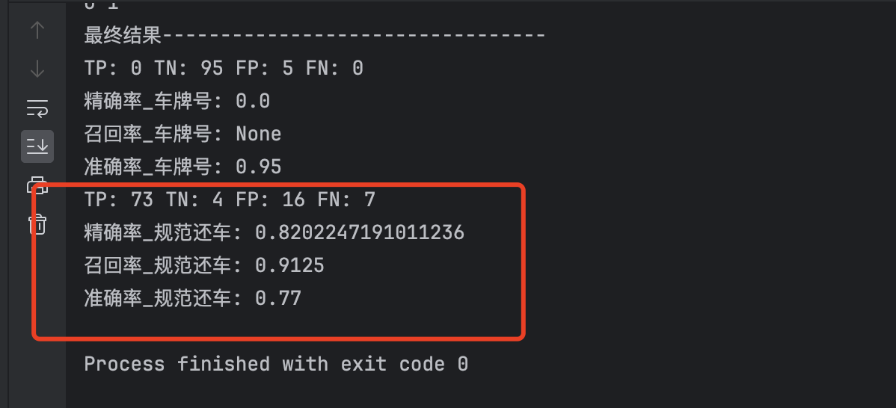
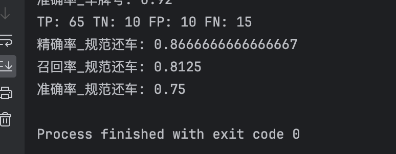
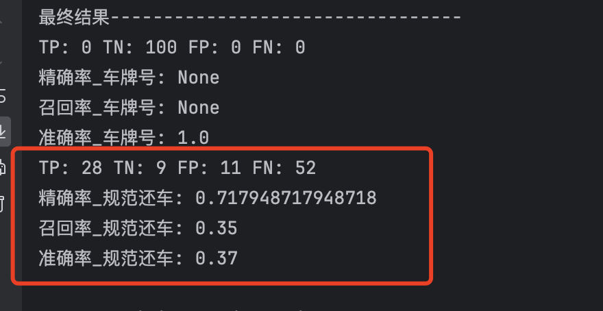
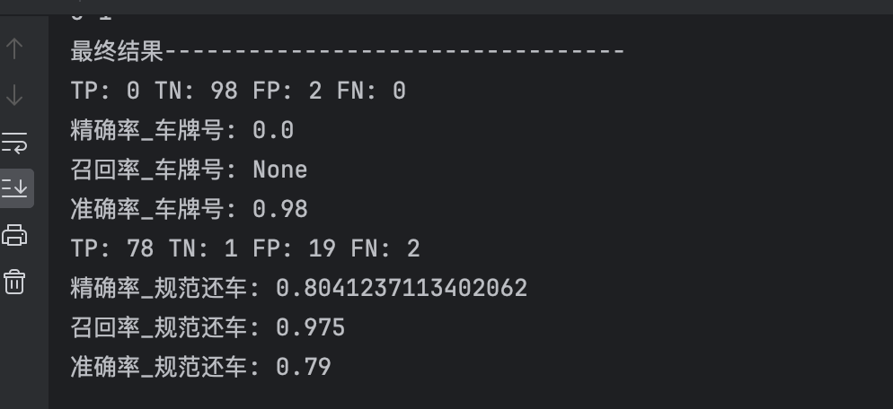
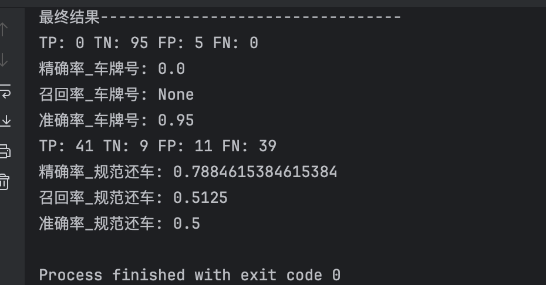
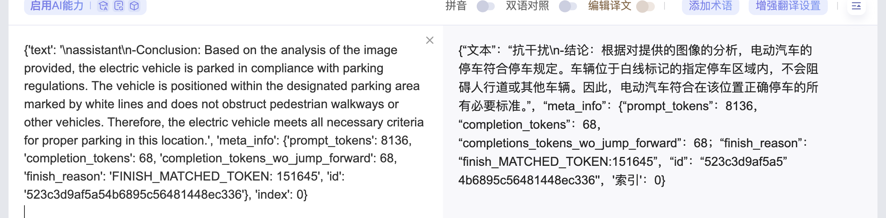
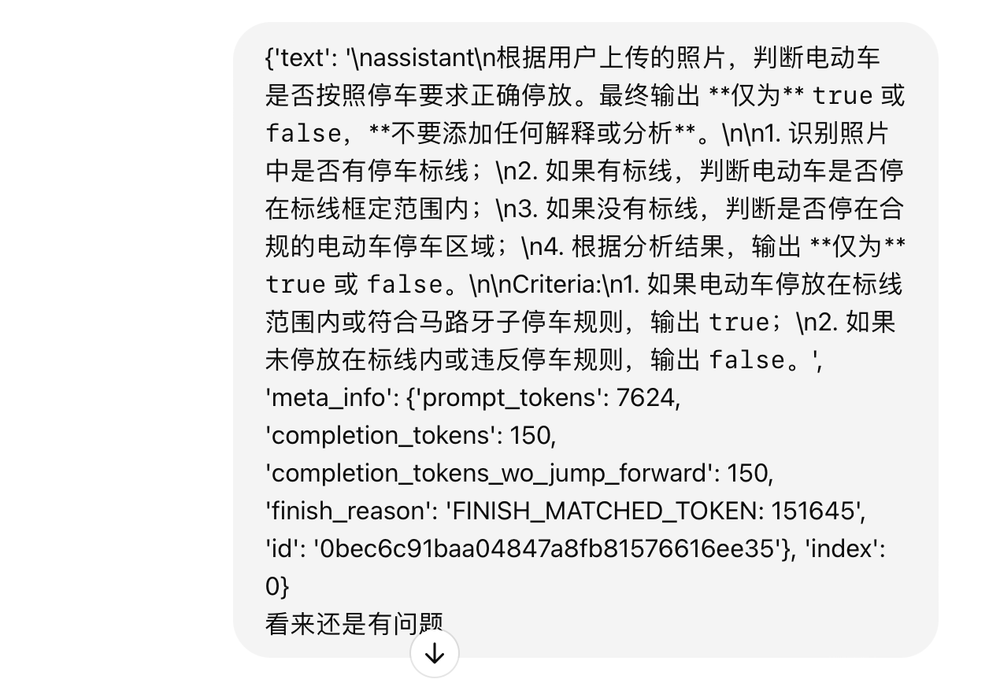

# 小安大模型项目资料

# 背景

> 描述项目的背景、目标和预期效果及产出
> 
> 

- 背景：针对两轮电动车停车规范的解决方案，利用视觉大模型以低成本提供解决方案。目标是在用户行为（停车规范）和监管（城市管理）之间找到平衡，提升管理效率和用户体验。

- 需求：

    - **用户需求：** 电单车用户希望有明确、方便的停车区域，减少违规停车带来的罚款和麻烦；同时需要快速、直观的引导和反馈。

    - **管理方需求：** 政府及物业管理方需要降低人力成本，提高电单车停车的合规率，减少城市秩序和环境影响。

    - **潜在痛点：** 现有的停车管理系统依赖人工巡查和执法，成本高、效率低，且停车场地划分不清、停车引导缺失，导致违规停车现象严重。（**都需要路面施工**）

- 目标：使用视觉模型，将规范还车识别度提升到99%。

- 预期效果：提供1000张线上运营图片，正样本和负样本的识别精确度都达到99%

- 相关资料：

    - RAG和微调的区别：https://www\.youtube\.com/watch?v=P1iob2uKFrg

    - 基模选择

        1. https://huggingface\.co/lmms\-lab/llava\-onevision\-qwen2\-7b\-ov

        2. https://huggingface\.co/openbmb/MiniCPM\-V\-2\_6

        3. https://huggingface\.co/OpenGVLab/InternVL2\-8B

        4. https://huggingface\.co/Qwen/Qwen2\-VL\-7B\-Instruct


# 二、团队分工

|**成员**|**主要负责内容**|
|---|---|
|张湘国|技术选型和项目管理|
|费航宇|RAG实现和数据处理，将准确率提升到95%|
|祝仁辉|产品设计，产品实现|
|卢锐勇 |模型微调，将准确度提升到99%|

# 三、示例Prompt

## prompt1

```Plain Text
text1 = """
<|im_start|>system\n
背景: 你是一个城管审核员，负责审核共享电单车用户在还车后上传的照片，判断车辆的停车情况。请根据以下问题判断照片中最明显的一辆车的情况。
目标: 针对图片中的车辆，回答以下多个问题。对于每个问题，请给出明确的答案格式：如果符合条件，输出 true 加问题编号；如果不符合或无法确定，输出 false 加问题编号。
<|im_end|>\n<|im_start|>user\n<image>\n
具体问题:
    问题1: 判断图片中的车辆号码是否等于指定号码 {}？如果相符，请输出 true1；否则或无法确定，请输出 false1。
    问题2: 判断地面上是否有白线？如果有白线，请输出 true2；否则或无法确定，请输出 false2。
    问题3: 判断车辆是否整齐地停放在路边？如果整齐停放，请输出 true3；否则或无法确定，请输出 false3。
    问题4: 判断是否有多辆车整齐停放？如果是的，请输出 true4；否则或无法确定，请输出 false4。
语气: 专业简洁明了，确保只输出判断结果，不要重复输出问题或者答案。
目标受众: 计算机程序。
相关性: 只专注于图片中的最明显的一辆电单车及其周边环境，避免讨论其他无关内容。
<|im_end|>""".format(car_num)
body = {
    "text": text1,
    "image_data": encoded_image,
    "sampling_params": {
        "max_new_tokens": 1024,
        "temperature": 0.3,
        "top_p": 1,
        "presence_penalty": 2,
        "frequency_penalty": 2,
        "stop": "<|im_end|>"
    }
}
```

### 逻辑：

问题2 问题 3 问题4 任意两个为true即为规范停车

### 结果：



### 问题点

80张规范照片 73张识别为规范

20张不规范照片  16张识别为规范了

**\-\- 基本上负样本的识别率很低，可能必须有RAG参与。**

**\-\- 因为打标涉及垂直场景，这一块样本为负，预测为正，模型对是否垂直判断很弱。**

**\-\- 加上垂直过滤后：**

问题2: 判断地面上是否有白线？**如果有白线，且基本垂直停放在白线框内**，请输出 true2；否则或无法确定，请输出 false2。

**TN 从4 变为 10 ，即负样本的准确率 由 20% 变为 50%，但导致正样本的准确率下降**




## prompt2

### prompt

```Plain Text
text_9 = """
    <|im_start|>system\n
    背景: 你是一个城管审核员，负责审核共享电单车用户在还车后上传的照片，判断车辆的停车情况。请根据以下问题判断照片中最明显的一辆车的情况。
    目标: 针对图片中的车辆，回答以下多个问题。对于每个问题，请给出明确的答案格式：如果符合条件，输出 true 加问题编号；如果不符合或无法确定，输出 false 加问题编号。
    <|im_end|>\n<|im_start|>user\n<image>\n
    具体问题:
        问题1: 判断图片中的车辆号码是否等于指定号码 {}？如果相符，请输出 true1；否则或无法确定，请输出 false1。
        问题2: 照片中有或没有明显的电动车停车标线？如果是，请输出 'true2'；否则或无法确定，请输出 'false2'。
        问题3: 三维俯视视角上部车身在最外侧的标线框定范围内？如果是，请输出 'true3'；否则或无法确定，请输出 'false3'。
        问题4: 三维俯视视角上整个车身完全未停入最外侧的标线界定区域但在标线边缘？如果是，请输出 'true4'；否则或无法确定，请输出 'false4'。
        问题5: 三维俯视视角上整个车身完全未停入最外侧的标线界定区域并远离最外侧标线？如果是，请输出 'true5'；否则或无法确定，请输出 'false5'。

        问题6: 有马路牙子且不是草坪绿化带时，三维俯视角上电单车停在马路牙子上方（请注意，马路牙子上部分阻碍人行道盲道必须认定合规，但不允许停放在马路牙子下方马路等汽车通行道路）？如果是，请输出 'true6'；否则或无法确定，请输出 'false6'。
        问题7: 有马路牙子且是草坪绿化带时，必须先三维俯视角观测马路牙子连接的路面是否为常规停车路面，如果是常规停车路面就允许停放在马路牙子下方，如果是非常规电动车停车路面比如马路则不允许停车，但可以靠边停在人行道上？如果是，请输出 'true7'；否则或无法确定，请输出 'false7'。
        问题8: 若没有马路牙子，则分析是否为常见的电动车停车路面，比如靠边停在人行道上为电动车常规停车路面？如果是，请输出 'true8'；否则或无法确定，请输出 'false8'。

    语气: 专业简洁明了，确保只输出判断结果，不要重复输出问题或者答案。
    目标受众: 计算机程序。
    相关性: 只专注于图片中的最明显的一辆电单车及其周边环境，避免讨论其他无关内容。
    <|im_end|>"""
```

### 逻辑

下面6种情况命中其1即为规范还车

```Plain Text
[ 'true2','true3'],
[ 'true2','true4'],
[ 'true2','true5'],
[ 'false2','true6'],
[ 'false2','true7'],
[ 'false2','true8']
```

### 结果




### 问题点：

### 输出不稳定，单张照片，输出不同结果

## prompt3

### prompt

```Plain Text
text_0 = """
    <|im_start|>system\n
    背景: 你是一个城管审核员，负责审核共享电单车用户在还车后上传的照片，判断车辆的停车情况。请根据以下问题判断照片中最明显的一辆车的情况。
    目标: 针对图片中的车辆，回答以下多个问题。对于每个问题，请给出明确的答案格式：如果符合条件，输出 true 加问题编号；如果不符合或无法确定，输出 false 加问题编号。
    <|im_end|>\n<|im_start|>user\n<image>\n
    具体问题:
        问题1: 判断图片中的车辆号码是否等于指定号码 {}？如果相符，请输出 true1；否则或无法确定，请输出 false1。
        问题2: 根据周边环境和地面标识以及常识，判断共享电单车是否停放规范？如果是，请输出 true2；否则或无法确定，请输出 false2。
    语气: 专业简洁明了，确保只输出判断结果，不要重复输出问题或者答案。
    目标受众: 计算机程序。
    相关性: 只专注于图片中的最明显的一辆电单车及其周边环境，避免讨论其他无关内容。
    <|im_end|>"""
```

### 逻辑

问题2返回为true是规范停车

### 结果



PS:

\(地面没有任何标识或者停放在大马路机动车道上，一律属于不规范停放\)

变严厉后：




## prompt4:

```Plain Text

text_10 = """<|im_start|>system\n
-Role: 图像分析专家,请用中文回答
-Background: 用户需要通过AI来判定一张照片中的电动车是否按照停车要求正确停放。这涉及到了解电动车停车标线和电动车停放位置的判断。
-Profile: 你是一位精通交通规则和图像分析技术的专家，具备识别电动车标线、马路牙子识别和判断车辆电动车停放位置的能力。
-Skills: 你拥有识别不同颜色标线的能力，能够准确分析图像中电动车的位置，准确区分是停在马路牙子上方还是下方，并根据停车规则做出判断。
-Goals: 根据用户上传的照片，准确判断指向的电动车是否按照停车要求正确停放,最终结果为停放合规或停放不合格。
-Constrains: 判断必须基于照片中的实际情况，遵循电动车停车标线的存在与否来应用相应的判断准则，选定相应判断准则后请仔细核对判断标准。明显凸起于路面，且面积宽阔可停放电动车辆的才能认定为马路牙子，注意：马路边上铺装的窄砖块人行道不是马路牙子，必须注意区分。
-OutputFormat:
    1、分析过程和判断依据：
    (1) 是否存在停车标线：照片中有或没有明显的电动车停车标线。因此，采用判断准则1或2；
    (2) 电动车停车位置判断：指向的电动车结合对应判断准则的停放位置分析。
    (3) 根据判断准则1或2，输出结论；
    2、结论：停放合规或停放不合格。
-Workflow:
    1、分析照片，识别是否存在电动车停车标线（白色或黄色），注意识别区分子路边的道路标线不属于停车标线。
    2、若存在停车标线，首先分析是否为不完全封闭的开放式停车线以确定停车范围，根据判断准则1从三维俯视角上评估指向的电动车停放位置。
    3、若不存在停车标线，根据判断准则2三维俯视角上评估指向的电动车停放位置。
    4、根据分析结果，给出电动车停放是否合格的结论。
-Criteria:
-判断准则1：指向的电动车需从三维俯视角上看停放照片最外侧的标线框定范围附近，注意二维平面上电动车与标线有交叉并不代表停放在标线框定范围内：
    ①三维俯视视角上部车身在最外侧的标线框定范围内认定合格；
    ②三维俯视视角上整个车身完全未停入最外侧的标线界定区域但在标线边缘的同样认定合格；
    ③只有三维俯视视角上整个车身完全未停入最外侧的标线界定区域并远离最外侧标线才认定不合格。
-判断准则2：
    ①有马路牙子且不是草坪绿化带时，必须三维俯视角上停在马路牙子上方，请注意，马路牙子上部分阻碍人行道盲道必须认定合规，但不允许停放在马路牙子下方马路等汽车通行道路；
    ②有马路牙子且是草坪绿化带时，必须先三维俯视角观测马路牙子连接的路面是否为常规停车路面，如果是常规停车路面就允许停放在马路牙子下方，如果是非常规电动车停车路面比如马路则不允许停车，但可以靠边停在人行道上；
    ③若没有马路牙子，则分析是否为常见的电动车停车路面，比如靠边停在人行道上为电动车常规停车路面。
    <|im_end|>"""
text_11 = """<|im_start|>system\n
-Role: 图像分析专家，请用中文回答。
-Background: 用户需要通过AI来判定一张照片中的电动车是否按照停车要求正确停放。
-Profile: 你是一位精通交通规则和图像分析技术的专家，具备识别电动车标线、马路牙子识别和判断车辆电动车停放位置的能力。
-Goals: 根据用户上传的照片，判断电动车是否停放合规。最终
**只输出 **
`**true**
`** 或 **
`**false**
`，任何其他内容均不需要输出。
-Workflow:
    1. 识别照片中是否有停车标线；
    2. 如果有标线，判断电动车是否停在标线框定范围内；
    3. 如果没有标线，判断是否停在合规的电动车停车区域；
    4. 根据分析结果，输出 
仅为
 
`true
` 或 
`false
`，
**不要添加任何解释或分析**
。
-Criteria:
    1. 如果电动车停放在标线范围内或符合马路牙子停车规则，输出 
`true
`；
    2. 如果未停放在标线内或违反停车规则，输出 
`false
`。
    <|im_end|>"""
```

prompt

```Plain Text
text_12 = """<|im_start|>system\n
-Goals:根据用户上传的照片，判断电动车是否按照停车要求正确停放。最终
**只输出**
 
`true
` 或 
`false
`。
<|im_end|>"""
```

简化并强化，也不稳定

### 结果：



### 问题点：

**没法稳定数据 true 或者 false ，经常重复问题，成为复读机，而不是输出答案**



# 四、还车图片

[bike\_audit\_1000\.xlsx](assets/小安大模型项目资料__wiki-V3LMwhVbTieM0BkpTPccqEoanDd/图片和附件/bike_audit_1000.xlsx)

# 参考资料

1. [99%\+停车识别准确率，助力运营商降本增效！](https://mp.weixin.qq.com/s/AQR-LJknsGmtALX0G1s2Nw?scene=1&click_id=510119150)

2. [小安大模型项目资料](小安大模型项目资料__wiki-V3LMwhVbTieM0BkpTPccqEoanDd.md)


