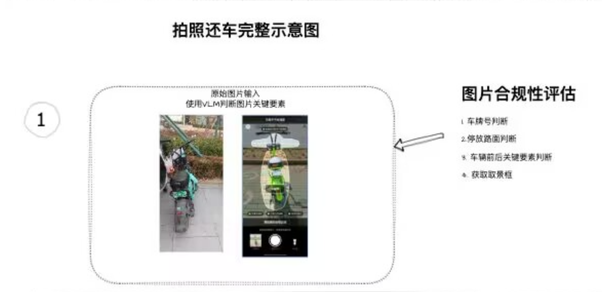
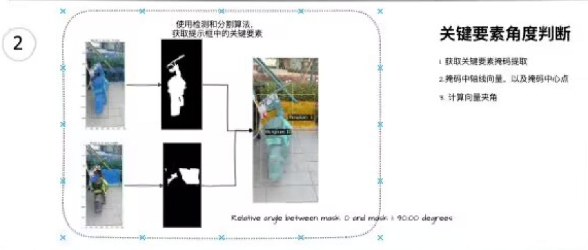
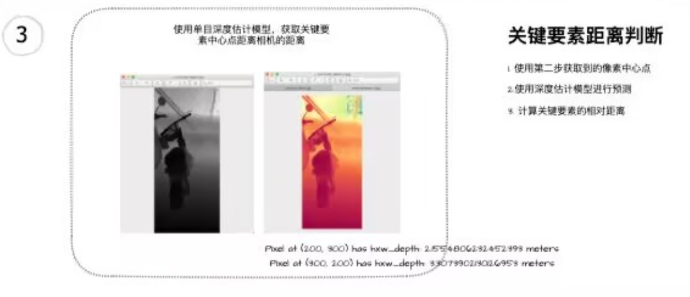
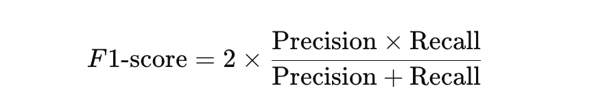

# 小安大模型项目需求

> 修订历史\(Revision History\)
> 
> 

原文引用：[小安大模型项目需求](https://hustdian.feishu.cn/wiki/SUM0wRWQiiLOpLkUtmlc035Xnig?from=from_copylink)

# **项目名称**

共享车辆智能还车关键技术研究

---

# **项目背景**

为了确保共享车辆在还车过程中的正确摆放及满足合规性管理要求，本项目研发基于大模型和机器视觉的智能还车技术。系统将通过拍摄图片判断车辆位置、角度以及与周围环境的关系，确保车辆符合还车要求。

---

# **功能需求**

## **图片合规性评估**

- **功能描述**
确保用户拍摄的图片满足合规性要求，例如构图完整、车辆位置正确等。

- **指标要求**

    - 拍摄图片合规性车辆停放关键要素检测 **F1\-score = 0\.8 \~ 0\.9**（可以误报和漏报）

- **具体需求**

    - 检测图片是否符合指定构图标准（例如：车辆与参考线的相对位置）。

    - 判断图片中车辆是否完整显示，是否符合还车区域要求。

    - 提供实时反馈和拍摄指导提示（例如：提示调整角度或移动设备位置）。

## **关键要素角度判断**

- **功能描述**
确保车辆摆放角度符合规范，避免出现车辆倾倒或占用过多空间的问题。

- **指标要求**

    - 车辆角度识别 **F1\-score ≥ 0\.9 （角度误差 \<= 10度）**

- **具体需求**

    - 提取图片中车辆的主要边缘或轮廓信息。

    - 计算车辆与参考轴线的角度（例如：是否接近 90 度）。

    - 提示用户调整车辆角度以满足规范。

## **关键要素距离判断**

- **功能描述**
确保车辆停放与周围物体（如停车线、其他车辆）保持适当的距离，避免影响其他用户使用。

- **指标要求**

    - 车辆角度识别 **F1\-score ≥ 0\.9 （关键点距离检测误差 ≤ ±5cm）**

- **具体需求**

    - 基于深度图像信息，提取车辆关键点（如车轮、车头）。

    - 计算关键点与参考线的实际距离。

    - 提示用户调整停放位置。

---

# **技术需求**

## **图像处理**

- 使用深度学习模型进行图像分割，提取车辆和参考物体的轮廓。

- 应用图像角度检测算法计算车辆与基准线的相对角度。

- 使用深度信息（如深度相机或手机内置传感器）计算关键距离。

## **系统架构**

- **前端**：用户拍照界面，实时给出指导提示。

- **后端**：图像识别算法，返回检测结果并与规则匹配。

## **硬件支持**

- 支持具备相机和深度感知功能的移动设备。

---

# **项目输出**

1. 用户友好的还车拍照界面。

2. 基于图像识别的车辆位置和角度评估功能。

3. 自动判断还车是否合规并生成提示的完整流程。

# 参考资料

1. [卢锐勇\_小安大模型项目研发工作汇报20241203\.pptx](../attachments/卢锐勇_小安大模型项目研发工作汇报20241203__file-HT8ab0hxTo2hZ4x5ENLcQJREnLh.pptx)

2. [武汉大学电单车停放规则](https://hustdian.feishu.cn/wiki/IpezwcW45iuuBlk2PaTcPGbdnye?from=from_copylink)

# 指标释义

1. 精确率：查准率precision：你认为的该类样本，有多少猜对了（猜的准确率如何） 

2. 召回率：查全率recall：该类样本有多少被找出来（召回了多少）

3. 准确率：accuracy：正类和负类预测准确的比例。 首先明确一下几个表示： 

    1. \-True Positive\(真正, TP\)：将正类预测为正类数\. 

    2. \-True Negative\(真负, TN\)：将负类预测为负类数\. 

    3. \-False Positive\(假正, FP\)：将负类预测为正类数 →→ 误报 \(Type I error\)\. 

    4. \-False Negative\(假负, FN\)：将正类预测为负类数 →→ 漏报 \(Type II error\)\. 

4. 精确率：precision = TP / \(TP \+ FP\) 

5. 召回率：recall = TP / \(TP \+ FN\) 

6. F1\-score:

