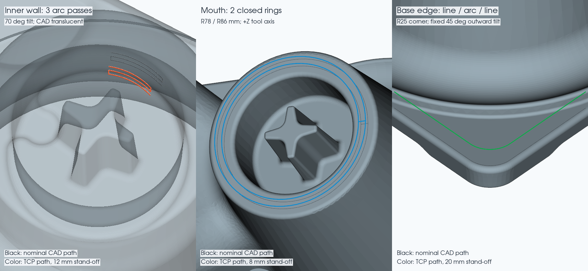
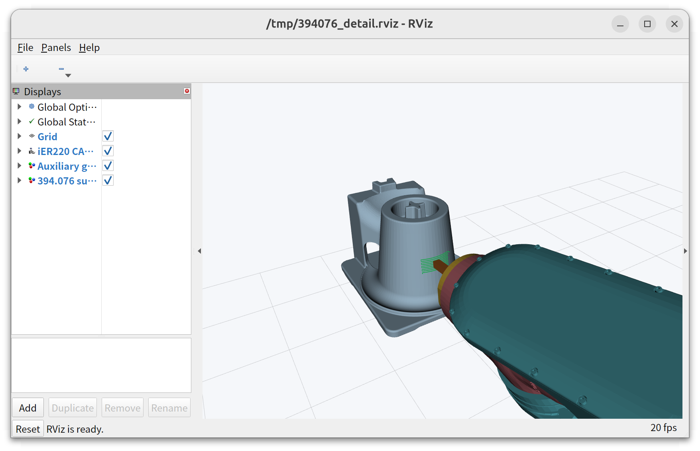
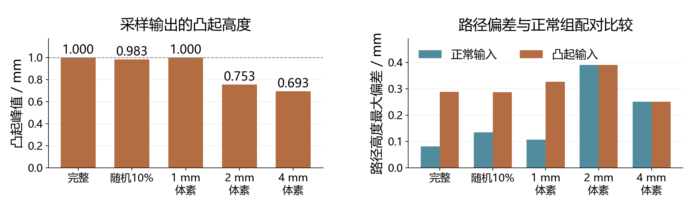

# 工件CAD路径接入与点云下采样验证

吴玥｜2026年11月12日内部组会

## 一 、本周总结

本周继续完善机械臂路径段检查，核对模型与实际设备的对应关系；还补充了下采样细节损失。这周收到易总的一个工件CAD，将工件放入ROS2和MoveIt，分别尝试了外壁、上部内腔、孔口及底板边缘的局部路径。但还没有同一工件的实采点云，因此先用CAD检查几何和运动，再用明确标注的模拟凸起研究采样影响。

|事项|本周做了什么|完成情况与后续|
|---|---|---|
|完善路径段检查|对旧路径补段内目标和进出段，完成顺序回放；再接入企业工件CAD|已完成局部样例；待机到首点、区域间转场及连续扫掠仍需检查|
|使用企业工件模型|检查CAD单位与尺寸，将完整工件加入场景，生成四类区域的局部路径|已完成模型接入|
|补充下采样细节损失|整理已有结果及文献依据，完成正常／模拟凸起两组的14个点云条件对照|本次补报已有数值结果；真实飞边及根部保留仍待实采验证 |

## 二 、将企业工件CAD接入路径验证

使用的是易总提供的394\.076\-05\.021\.10\-01\-V01 STEP，包含一个实体工件模型。实物照片上有毛刺，但现有CAD可能是成品，因此先把它作为本体参照。

本次主要检查了三个问题：工具能否到达路线上的位置，运动时是否偏离目标，以及机械臂本体、工具和工件是否互相碰撞。完整工件都参加碰撞检查，路线则先选四类局部区域。

|区域|本次路径与设置|节点及中点的碰撞检查姿态数|ROS路径位置核对数|
|---|---|---|---|
|外壁|153个近表面目标点，沿法向外移8 mm，另加进出段|9,279|155|
|上部内腔|三条短圆弧，间隙12 mm，相对法向上倾70°|517|65|
|顶部孔口|半径78／86 mm两圈及连接段，间隙8 mm|307|148|
|底板边缘|直线—半径25 mm圆弧—直线，底板基准面上方20 mm，固定外倾45°|249|119|

*图1：左、中、右分别为内腔、孔口和底板边缘。黑线是名义表面或边界路径，彩线是工具工作点的悬空路径；内腔采用半透明显示。*

## 三 、点云下采样对细节和路径的影响

点云下采样减得很稀以后，细小凸起和根部是否还在？已有结果说明，路径能生成、总点数足够或覆盖率较高，都不能单独回答这个问题。还要看采集是否扫到了该处，以及采样后的局部形状是否发生变化。

从CAD的外锥面上选80×40 mm评价区域，输入向四周各扩6 mm，得到92×52 mm范围。按0\.25 mm间隔生成77,121个表面点，再另建副本增加高1 mm、宽1\.5 mm、长24 mm的人工凸起。

然后比较五种采样条件：完整输入、随机保留10%的三个种子，以及1／2／4 mm体素。体素采样就是把空间分成小格子，每格用一个平均位置代表原来的点。每种条件都运行正常和凸起两组，共14个点云条件，来自同一工件局部。

|采样条件|凸起组输出点数|凸起峰值 mm|路径高度最大偏差 mm|路径法向角P95 °|
|---|---|---|---|---|
|完整输入|77,121|1\.000|0\.2878|0\.5102|
|随机保留10%|7,712|0\.983|0\.2863|1\.6806|
|1 mm体素|6,197|1\.000|0\.3262|1\.0704|
|2 mm体素|1,654|0\.753|0\.3901|2\.2841|
|4 mm体素|441|0\.693|0\.2503|3\.0668|

*图2：左图对应表中的凸起峰值，右图比较正常／凸起两组的路径高度偏差*

实验结果总结：在这组实验中，按1 mm网格下采样后，点数从77,121降至6,197，仍保留了1 mm的凸起峰值；网格扩大到4 mm后，只剩441个点，峰值降至约0\.693 mm，路径法向角P95也由完整输入的0\.5102°增至3\.0668°。这说明减少点数会影响细小凸起的形状和路径朝向，需要同时检查细节保留与路径误差。4 mm网格的路径高度偏差虽然比2 mm小，也不能据此认为效果更好；未加凸起的2 mm网格组本身就有约0\.3901 mm最大高度偏差，说明路径偏差还受背景曲面重建影响。

## 四 、目前的结论与下一步

**本周已将****戴屹****工件CAD接入机械臂模型，完成四类局部路径检查，并补充了下采样细节变化的对照结果。** 当前仍采用固定仿真摆放和虚拟工具，真实点云、实际工具与工装、控制器参数尚未对应。

下一步优先推进以下工作：

1. **等待****实际工具和设备参数。** 拿到实际磨具、转换器和工装的尺寸后，先确认机械臂各关节的零位、转动方向、运动范围和联动关系，再核对工具安装位置与工作点。将这些参数补入仿真模型

2. **用同件扫描复查细节保留。** 搭建好工作站后，扫描同件点云并记录点数、局部点距、缺失及重复点，确认飞边根部和附近正常本体是否扫到，再比较完整／下采样输入。

