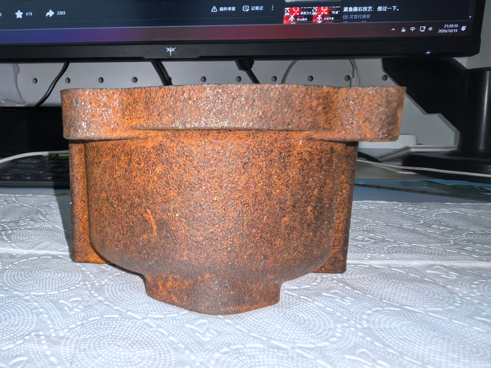
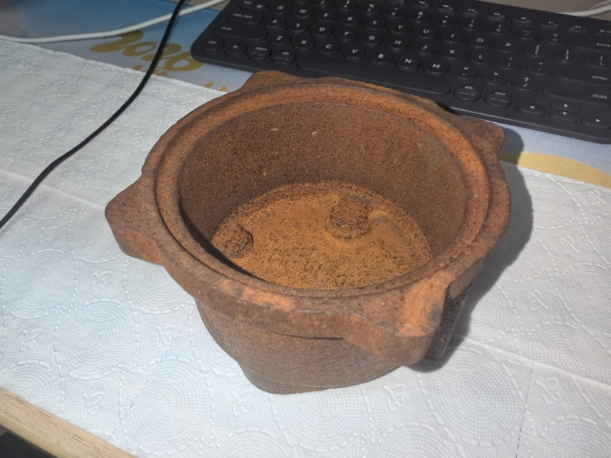
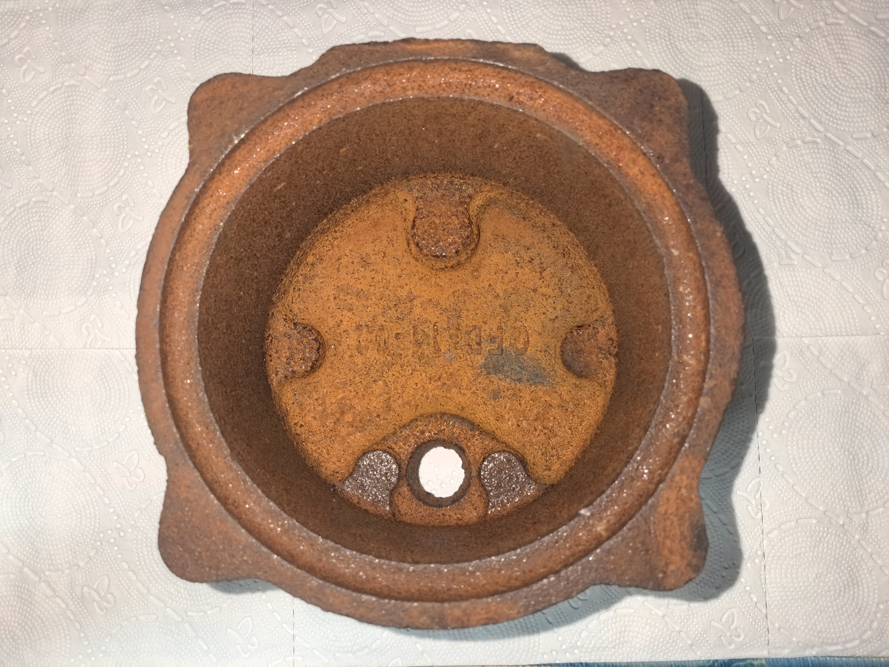
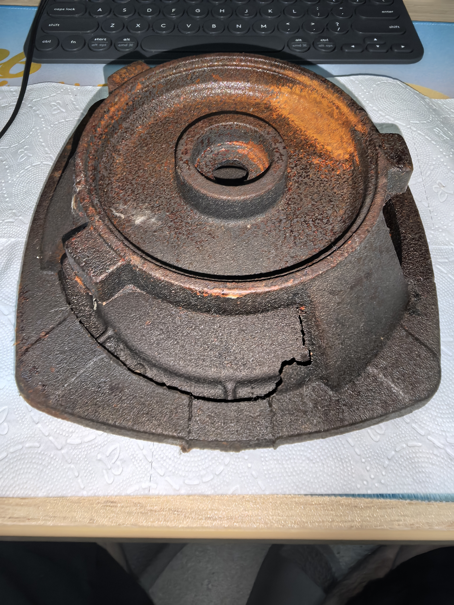
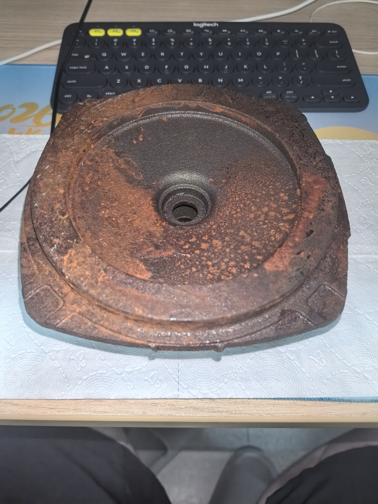
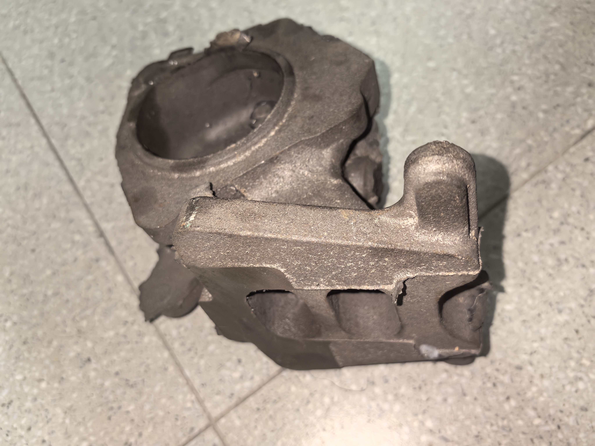
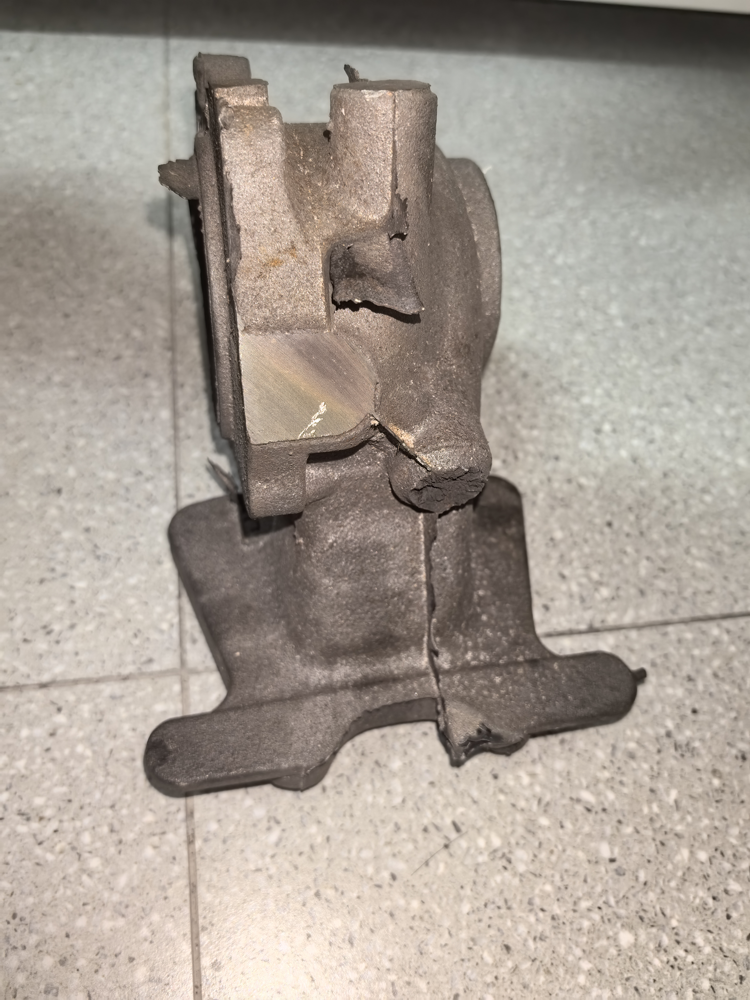
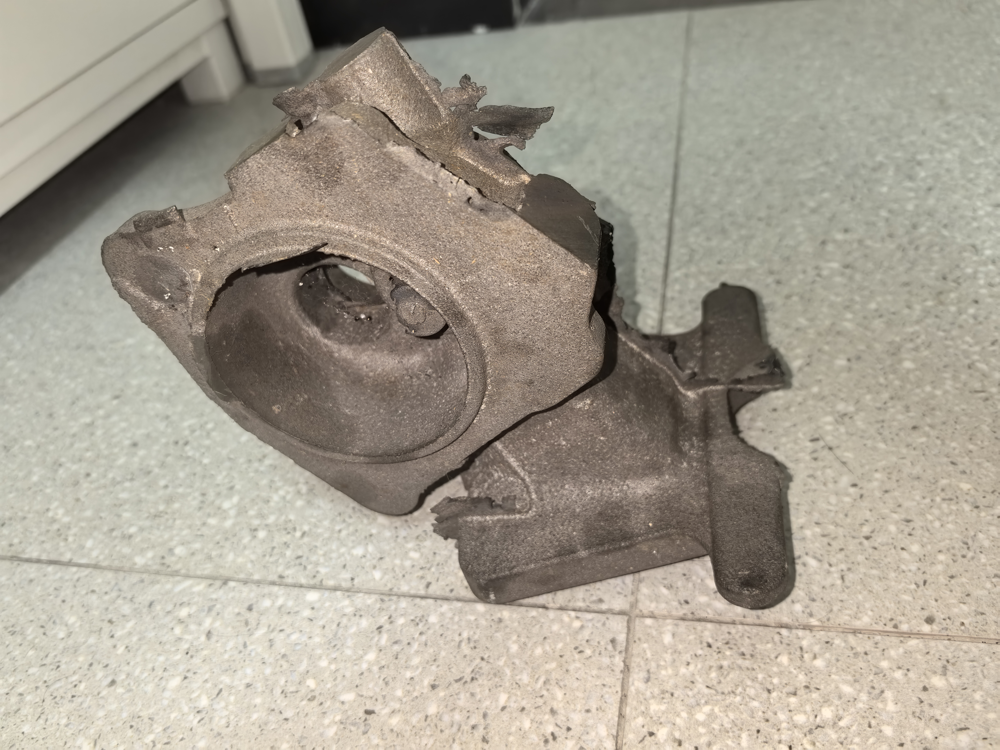
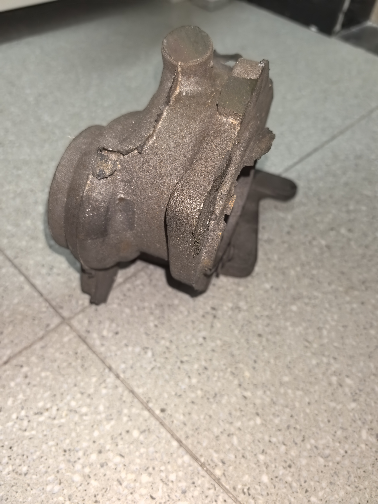
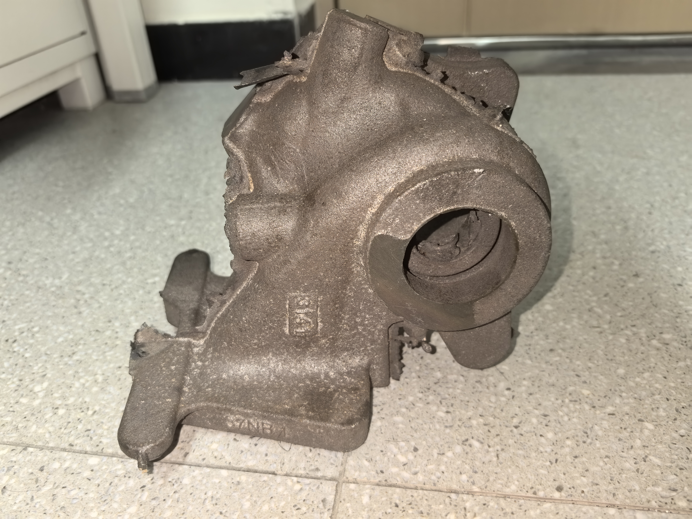

# 工件样品概况

# 工件1

侧面、俯视、斜俯视

尺寸：约直径 120 mm，高 69 mm

杯状壳体或罩盖毛坯，工件明显锈蚀，表面粗糙，口沿及上部外壁接合轮廓存在轻微披缝。无明显毛刺

# 工件2

底面、顶部

尺寸：约175 × 175 × 60 mm

方形或近方形外周、圆形盘状、中心通孔、圆形底座

表面有明显氧化锈蚀，可见环状薄壳或裙边，与相邻表面之间存在暗缝，局部呈断裂、翘起和不规则缺口。外周边缘和底缘有局部凸棱、小尖突及线状痕迹。

# 工件3

底部及外侧结构、侧面切磨痕迹、大腔体、另一侧、侧面圆口

尺寸：约 170 × 150 × 150 mm

可见较大的圆形内腔、另一侧圆形开口、非对称曲面、孔口法兰、外伸的支承状结构及圆柱状凸起

基本无锈蚀。顶部接口附近的叶片状薄片、薄片明显超出主体连续表面，边缘不规则，部分卷曲/破裂；外周有连续延申的薄片和尖突，圆形腔内有小尖突和不规则附着，底部也存在横向和纵向的薄片。

# 关于视觉检测采集方案

工业3D相机型号为 ALSONTECH AT\-S1000\-05C\-S1\-M。它是面扫结构光三维相机，标定距离 450 毫米，工作距离 300 到 600 毫米；在 450 毫米处，标称视野为 435 乘 260 毫米，分辨率为 1936 乘 1464，典型采集时间 0\.6 秒，450 毫米处 Z 向单点重复精度 0\.045 毫米。[AT\-S1000\-05C\-S1\-M\_CN\.pdf](../attachments/AT-S1000-05C-S1-M_CN__file-EC96b88GhoLCfHx5IGLcjR2Fnda.pdf)

目前人眼观测到的一些异常结构是否属于应去除材料、实际根部和去除边界需处理好的实物数据及工艺确认，这对之后的采集和数据标注有影响。

可试做小规模的采集验证。对 3 件工件分别在 300 和 450 毫米两个距离、3 种姿态下采集，共 18 组；此外，工件 3 固定在 450 毫米和同一姿态重复采集 10 次，总计采集 28 次，用于比较距离与姿态对覆盖和薄片成像的影响，并观察同一条件下的重复波动。每次保留相机设置和原始单视角数据，记录有效点数、飞边薄片根部是否可见、局部点云缺失情况及重复测量波动。对工件 3 优先检查薄片根部和侧向薄边；工件 2 检查环向薄边的连续性；工件 1 则作为相对规则表面的采集对照。初步采集完成后，确认原始点云导出与数据链路，验证点云导出、覆盖、薄根可见性和重复性；数据质量确认后，可进行更大规模的采集，再规划标注和训练/验证/测试样本。

# 埃尔森智能科技（ALSONTECH）产品功能

