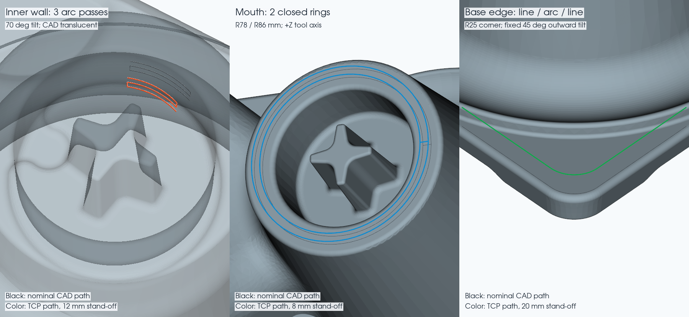
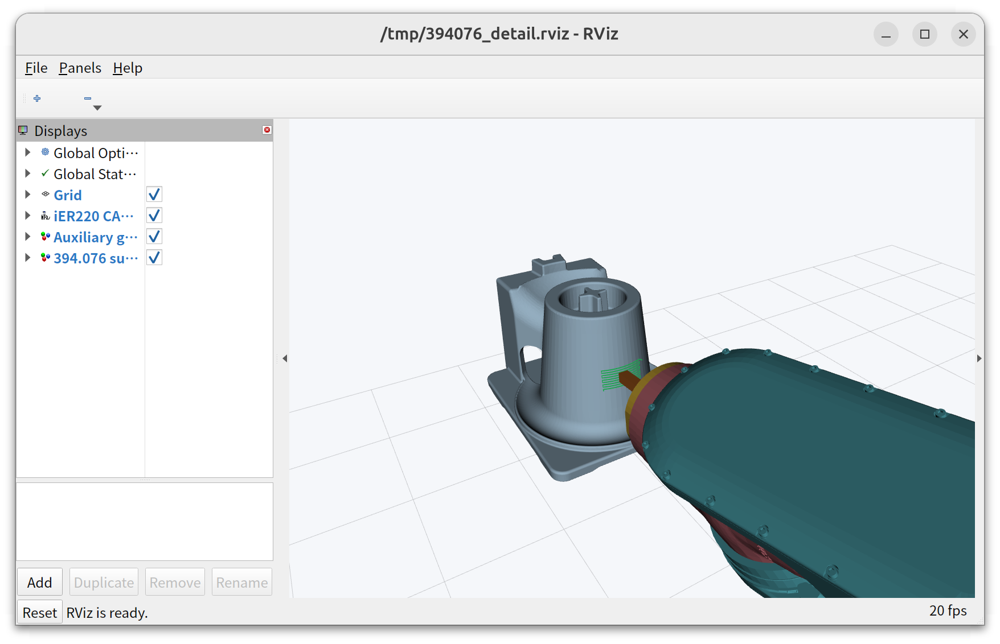

# 工件模型接入与路径验证进展

吴玥｜2026年11月12日会议报告

## 执行摘要

本周收到易总提供的工件CAD，已将它接入iER220\-2700机械臂模型，完成外壁、上部内腔、孔口及底板边缘的局部路径检查，并补充进出段和外壁路径回放。目前能够利用企业工件几何检查路径及干涉，下一步需要拍摄得到的实际点云，补齐工具安装、设备参数和同件扫描。

## 一 、当前输出

本周输入为1个394\.076\-05\.021\.10\-01\-V01工件CAD，整体尺寸约430\.5×370×288\.2 mm。目前先作为形状参照使用。

|工作项|本周输出|
|---|---|
|接入工件 |完整CAD已加入机械臂仿真场景，单位、尺寸及坐标已核对|
|生成局部路径 |完成外壁、上部内腔、顶部孔口、底板边缘四类区域的路径及各自进出段|
|检查路径与干涉|外壁9,279个离散姿态、其他三区1,073个离散姿态分别完成检查；最终样例在现有模型和接触规则下未发现碰撞，已知干涉对照能够检出|
|评价点云下采样影响|完成正常／模拟凸起两组共14个点云条件对照，检查细节和路径的变化；真实毛刺保留能力仍待同件扫描验证|

本轮使用Windows 11进行本机处理，在Ubuntu 24\.04\.5、ROS2 Jazzy、MoveIt 2\.12\.4、FCL 0\.7\.0环境中完成原生检查。

## 二 、需要补齐的输入

|所需资料或确认|用途|
|---|---|
|带毛刺实际工件的CAD模型或点云 |对照加工前的形状与成品，做机械臂运动打磨仿真 |
|实际磨具、前端转换器、夹具及转台的CAD或尺寸、安装关系，以及与现场一致的机械臂和工具参数|替换虚拟工具，重查路径与干涉，并核对模型与设备的对应关系|

## 三 、下一步与协调事项

下一步待相机获取实际点云，以及待工作站搭建后接入真实工具及现场参数，再用同件扫描和实物测量做对照。

