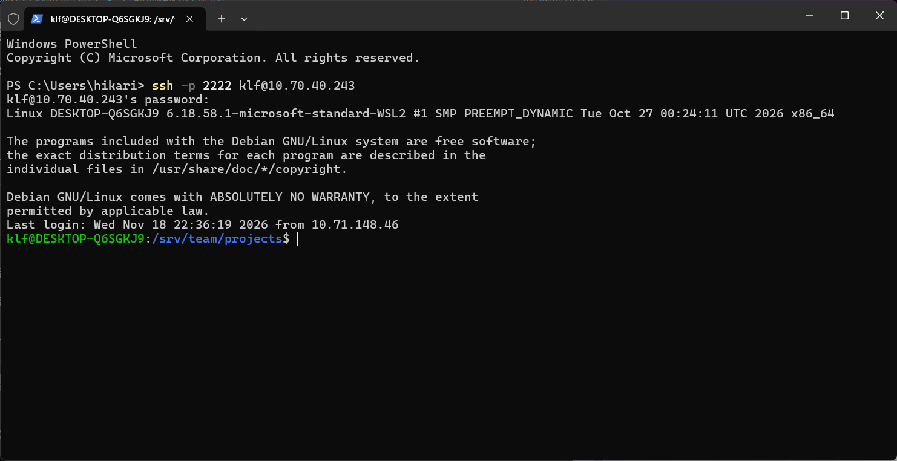

# 工作站远程共享使用指南

提供了2种远程使用工作站的方法，适用于不同的使用需求和场景。

# CloudPlayPlus远程串流

通过远程串流软件直接在个人电脑上操控工作站远程桌面，成功连接后可以像使用个人电脑一样使用工作站，方便直接在工作站上使用仅支持Windows的软件。

**使用方法**

1. 下载CloudPlayPlushttps://www\.cloudplayplus\.com/

2. 安装后并打开登录账号 2496061952@qq\.com 密码 de123456

3. 进入主界面选择**戴屹工作站**


4. 选择连接设置，显示方式可选**使用物理屏**和**独占虚拟屏**，网络连接方式选择**直连**（同处于华科校园网环境可通过ipv6转发串流流量，支持直连且串流效果好，若不能直连则选择中转，可能产生费用，或者可使用网易uu远程）

5. 点击开始串流，进入远程桌面即可开始使用工作站


**注意事项**

此方法仅支持轮流使用，无法同时多人连接远程桌面，使用时需要确认工作站是否空闲（但是可以与方法2共存）

# SSH远程连接

在Windows上通过WSL部署Debian环境，提供linux开发环境，并支持ssh远程连接与多人共享。

团队成员可通过 SSH 登录工作站上的 Debian 环境，用各自的账号运行命令和 GPU 任务。

**使用方法**

1. 登录工作站

已为组内5位同学分别创建了Debian账号，用户名为名字拼音首字母，初始密码为dy123456

在 Mac 或 Linux 的终端、Windows 的 PowerShell 中运行以下命令。例如

```LaTeX
ssh -p 2222 klf@10.70.40.243
```

首次连接会显示服务器指纹。核对表中的指纹后输入 yes。输入密码时终端通常不会显示字符。拿到初始密码后，可以登录并运行 passwd，设为自己独有的密码。



2. 项目文件和数据存放规范

|Debian 路径|用途|工作站上的实际位置|
|---|---|---|
|`/srv/team/projects`|团队项目、数据集、模型和项目依赖环境|`E:\TeamProjects`|
|`/home/你的用户名`|个人配置、SSH 文件和默认用户缓存|C 盘的 Debian 虚拟磁盘|
|`/tmp`|短期临时文件|当前用内存，Debian 重启后清空|
|`/var/tmp`|可跨重启保留的临时文件|C 盘的 Debian 虚拟磁盘|
|`/srv/team/projects/outputs`|输出结果（可选）|`E:\TeamProjects\outputs`|

新开的交互式 SSH 和 SFTP 会话默认进入 `/srv/team/projects`。组内成员可以共同读写共享目录。使用清楚的项目名和结果目录名，避免覆盖别人的文件。例如可以把项目文件放在 `/srv/team/projects/账号/实验名`。在工作站本机使用 Windows 文件资源管理器打开 `E:\TeamProjects`，看到的是同一份文件。

3. 上传与下载文件

在**自己的电脑**上运行 SFTP 命令

```LaTeX
sftp -P 2222 your_username@10.70.40.243
```

示例

```LaTeX
pwd
ls
put dataset.zip
get outputs/your_username/exp01/result.json
exit
```

`put` 从本地上传，`get` 把远程文件下载到本地。使用图形化 SFTP 客户端时，选择 **SFTP** 协议，填入表中的服务器、端口和自己的账号。

4. 运行GPU任务

工作站有一张 NVIDIA RTX A5000，显存约 24 GB。已实测两个不同的 Debian 账号同时运行 CUDA 任务。

并发任务共用这张卡的显存。启动前用 `nvidia-smi` 看空闲显存。

```LaTeX
/usr/lib/wsl/lib/nvidia-smi
```

如果出现CUDA显存不足，降低批大小或等其他任务释放显存。跑长任务前确认任务能在SSH断开后继续运行，并将日志写到E盘。Windows或Debian重启会中断正在运行的任务。

5. Python环境

Debian 已安装 Python 3\.13\.5 和 `venv`。虚拟环境建在专用目录 `/srv/team/python-envs`。这个目录启用了创建虚拟环境所需的 Linux 文件权限，对应 Windows 的 `E:\TeamPython`，环境和依赖占用 E 盘空间。

```Bash
cd /srv/team/projects/your_project
mkdir -p -m 700 "/srv/team/python-envs/$USER"
python3 -m venv --copies "/srv/team/python-envs/$USER/your_project"source "/srv/team/python-envs/$USER/your_project/bin/activate"
python --version
python -m pip --version
python -m pip install --no-cache-dir -r requirements.txt
```

将 `your_project` 换成已有项目目录。有 `requirements.txt` 时，用最后一条命令安装项目依赖。环境只需创建一次，之后每次登录进入项目，再执行 `source` 那一行即可。代码和任务输出仍放在 `E:\TeamProjects`，软件自动下载的大型模型和数据集也应将缓存指定到 E 盘。


使用中如遇见问题可随时向@孔凌峰反馈


**其他问题**

配置wsl时发现本工作站Windows实际可用内存仅约31\.4GB，查看BIOS中确实识别到安装了32GB\*4共128GB DDR5内存，但是处于Memory Available状态的内存仅32464MB（约32G），怀疑有3个内存槽位暂时无法正常使用，尝试自检和简单调整设置修复后没有效果。这会很大程度上影响Debian环境实际可用内存，目前仅分配了16GB，可能无法满足部分训练任务。显卡可以正常使用。


