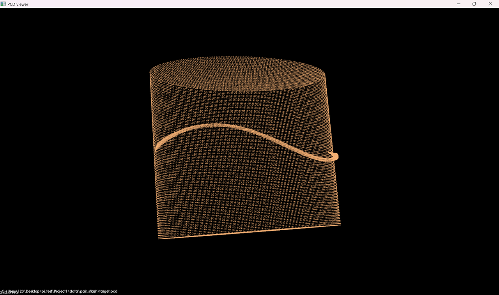
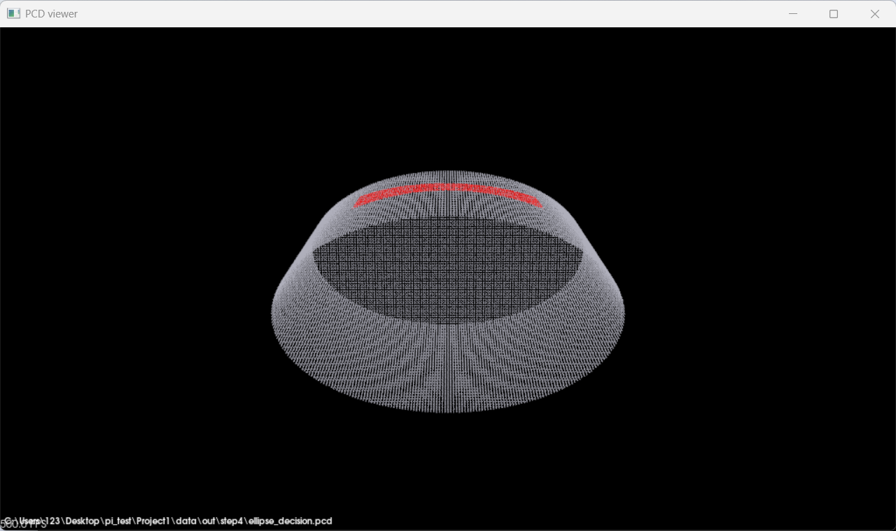

# 差异分割与配准对无标注铸件打磨路径精度的影响

> 修订历史\(Revision History\)
> 
> 

原文引用：[铸件飞边打磨几何方法复现实现](铸件飞边打磨几何方法复现实现__wiki-Nq92wWaaviCPt9kvvTLcwZEHnbf.md)

# 实验目的

本实验旨在完整复现"铸件飞边打磨几何方法"的处理流程，回答以下核心研发问题：**在只有铸件标准件点云与待磨件（含模拟飞边）点云、且没有标注训练数据的情况下，能否通过纯几何方法自动完成飞边识别与打磨路径生成，并达到可用的精度。**

围绕该核心问题，本实验具体验证三个子目标：

1. 两片处于各自坐标系、错位明显的点云，能否通过"粗配准＋精配准"的两段式配准稳定对齐到亚毫米级（残差低于 0\.1 毫米）；

2. 不依赖语义分割网络，仅凭"目标件与标准件求差"的差异式分割，能否准确、完整地分离出飞边区域点云；

3. 由内边缘点拟合打磨平面、再从本体表面投影生成的打磨路径点，能否满足打磨作业对路径间距、拟合精度、弓高误差与到真值偏差的要求。

# 实验原理

本实验的完整算法链路为：**数据准备 → 体素降采样 → 点云配准 → 飞边分割 → 飞边点云滤波 → 内边缘提取****（****与打磨平面拟合****）**** → 提取打磨路径点**。各环节原理如下。

## 体素降采样

原始点云动辄几十万到上百万个点，且密度分布不均（离扫描仪近处密、远处疏）。直接拿去配准或做邻域搜索，最近邻搜索量级随点数增长，速度慢；基于邻域的算法（法向估计、局部平面拟合）在不同密度区域表现不一致，同一套参数在此处好用、在彼处失效。因此，把三维空间按固定边长切成规则立方体网格（体素），丢弃不含任何点的空网格，再对每个非空网格内全部点坐标求平均值，以该质心代表网格内全部点——**在大幅压缩点数的同时保持工件整体几何形状，并让点密度趋于均匀**。

## 点云配准

标准件与目标件各自处于自己的坐标系，两片点云不重合，必须先对齐才能进行后续操作。本实验采用"粗配准＋精配准"两段式框架：

- **FPFH 特征**：**对每个点估计法向（最近 20 个邻居做平面拟合取法向），再在半径 6 毫米球内统计邻域点法向之间的角度关系做成直方图，得到 33 维向量，作为该点周围局部形状的"指纹"。**指纹只与局部形状有关、与整体位姿无关，因此两片点云错开十几毫米也能找到对应关系。

- **SAC\-IA 粗配准**：两片点云先各自降采样到 2 毫米；从标准件随机抽几个点，按指纹在目标件中找形状相似的候选点，挑出三对计算一个刚体变换，套上后统计能对上的点数；重复 800 次，取对上最多的变换作为粗配准结果。

- **多尺度 ICP 精配准**：迭代最近点——**每轮把标准件每个点在目标件中找最近点作为对应点，求使对应点对距离平方和最小的刚体变换（有闭式解），套用后重复直至收敛**。ICP 配的是"最近点"，要求两片点云已大致对齐，否则会锁死在错误位置；因此把允许搜索距离从大到小逐级收紧（10 毫米 → 5 毫米 → 2\.5 毫米 → 1 毫米），让 ICP 逐层收敛到正确位置。

- **收尾**：把累计变换作用到完整（未降采样）点云上，再做一次小范围 ICP，最终配准残差 0\.068 毫米。

- **配准精度衡量方法（平均最近邻距离）：**做法是先在目标点云上建一棵 K\-D 树，然后把配准后标准件的每个点拿去查最近的那个点，量出距离，最后把所有距离取平均，得到的数就表示两片点云平均差多远。用 K\-D 树是因为在四万多个点里逐个比较是线性时间，四万个点各查一次根本跑不动，K\-D 树能把它降到对数级；实际统计时只抽五千个点，因为这里只是看一个统计量，五千个点已经足够，和全量算的结果几乎一样。这个方法的好处是不需要真值、也不需要事先知道哪个点对应哪个点，任意两片点云都能算，所以拿它当日常的配准质量指标最方便。

## 飞边分割（差异式）

对配准后的待磨件点云逐点处理：**用 K\-D 树在标准模型点云中快速检索最近点并计算距离，把距离超过设定容差的点判为飞边点或几何偏差点**；遍历完成后收集所有飞边点，即得原始飞边点云。为克服点云稀疏导致的最近点距离失真，参照 ZHY 的做法在最近点周围取一小片邻域（6 个点），用最小二乘拟合局部平面，再算点到平面的距离作为判定量。

## 内边缘提取与打磨平面拟合

- **边缘检测**：先做法线估计边缘检测，找出边缘点。

- **内外边缘区分**：对每个边缘点**用 K\-D 树在本体点云中做最近邻搜索，距离小于阈值的判为内边缘**（飞边与本体交界的根部线），否则为外边缘（自由外沿，形态多样、可能卷边，不能作为打磨平面基准）。

- **打磨平面拟合**：对全部内边缘点做最小二乘拟合——算质心和协方差矩阵，特征分解后取最小特征值对应特征向量作为平面法向；**在所有候选平面中，使全部内边缘点到它的距离平方和最小的那个即为打磨平面**（总偏差最小）。

## 打磨路径点生成

### A：飞边位于同一平面

路径点从本体表面获取：对每个本体点算它到最近飞边点的距离（K\-D 树最近邻搜索），**挑出紧挨飞边的本体表面点**；**把这些点投影到打磨平面上**；**用"体素质心点的最近邻点"做一次下采样**（保证点都来自原始点云同时减少需处理的点云数）；沿弧线排序串成一条线，**按每四个留一个分成拟合集与评价集**（评价集不参与拟合，专用于精度检验，解决企业真实数据无真值时的精度判断问题）；**用三次 B 样条逼近拟合****，****找总体偏差最小的曲线**；然后**按等弧长重采样，同时输出弓高误差以判断步长是否过大**；**最后把每个路径点吸附回本体表面（找最近的本体点），便于提取该处表面法向作为工具姿态**。

**B：飞边不在同一平面（S 型飞边）**

做法是**截面质心法**：在飞边内边缘的每一点处**用一个垂直于局部走向的截面去切这条带子，截面内的点取质心，质心天然落在带子中间也就是中线上**；而局部走向由**局部 PCA** 自动给出。具体对每个点取半径 R 球内的邻近点做 PCA，最大特征值方向就是这一小段的走向，**把邻近点投影到垂直于该走向的平面上求质心，记录质心位置**。然后把这些质心用 K\-D 树最近邻在三维里串接排序，进行拟合三次 B 样条，等弧长重采样，最后逐点吸附到本体表面，可以取吸附后的点的法向当工具姿态。

- **评价集拟合精度：**把下采样后剩下的点分成两份，大约四分之三当作拟合集，其余四分之一当评价集藏起来、不参与拟合，只用拟合集去拟合 B 样条曲线；拟合完把曲线稠密采样成四千个点，这样相邻采样点之间只隔 0\.019 毫米，于是"点到曲线的距离"就可以直接近似成"点到最近那个采样点的距离"，近似误差不超过0\.01 毫米，比要测的量还小一个量级；最后拿评价集里的每个点去量它到最近采样点的距离，统计出来平均 0\.031 毫米、均方根 0\.040 毫米、最大 0\.15 毫米。

- **等弧长重采样与弓高误差：**拟合完得到的是一条连续曲线，而机器人只能执行一串离散的点，所以要在曲线上取点。取点的规则是等弧长：按弧长等间隔取，相邻两点永远隔同样远，机器人按固定进给速度走，磨削量均匀。步长取多大由弓高误差决定：机器人两个路径点之间走的是直线，而理论轨迹是曲线，直线会切进曲线里，这个最大偏离就是弓高误差，约等于步长的平方乘该处曲率再除以八。这个数必须远小于打磨公差，实测路径上最大曲率是每毫米 0\.0735，步长取 2 毫米算出来弓高误差 0\.037 毫米，比公差小得多；反过来如果公差是 0\.05 毫米，步长最大只能取到 2\.3 毫米。点也不能一味取密，太密会让文件变大、控制器在每个点附近减速过弯、节拍变慢，所以步长是精度和节拍之间的平衡，弓高误差就是衡量这个平衡的那个数。

# 实验环境

|项目|说明|
|---|---|
|实验数据|标准件：自造的椭圆形铸件点云；目标件：在标准件上叠加模拟飞边后的点云；目标件相对标准件施加了已知刚体变换（旋转约 15 度、平移约 30 毫米，平均错位 13\.5 毫米）|
|核心算法库|PCL 点云库（体素网格、法向估计、FPFH 特征、SAC\-IA、ICP、K\-D 树最近邻、最小二乘平面拟合、三次 B 样条）|
|可视化工具|PCD viewer（用于点云显示与结果检查）|
|关键参数|粗配准降采样 2 毫米；法向估计 20 邻居；FPFH 半径 6 毫米（33 维直方图）；SAC\-IA 迭代 800 次；ICP 搜索距离 10/5/2\.5/1 毫米四级收紧；飞边判定局部平面邻域 6 点；路径拟合每 4 点留 1 作评价集|

注：操作系统与具体硬件以实际复现环境为准，不影响算法流程复现。

# 实验内容

实验内容按指导书 7 个步骤依次展开，每步给出目的、操作方法及与参考论文的对应关系。

## 第 1 步：数据准备

构造实验数据：标准件为自造的椭圆形铸件；目标件在标准件上分别叠加位于同平面飞边和 S 型飞边。且目标件相对标准件带有已知刚体变换，并记录飞边的分型线真值，后续可进行误差估计。

> 注：三个点云文件都是人为创造的较为理想的点云数据，并不是真实的铸件通过 3D 相机扫描得到的点云数据。
> 
> 

## 第 2 步：体素降采样

### 目的

在压缩点数的同时保持工件整体几何形状，并让点密度趋于均匀，为配准与邻域搜索提供稳定输入。

### 操作

按固定边长把三维空间切为规则立方体网格（体素），丢弃空网格；对每个非空网格求内部全部点的质心，以质心代表该网格内全部点，无论网格内原有多少点，输出只保留一个质心点。

### 参考的论文方式

体素网格降采样来自 ZHY 的论文，他在配准前完成此步，取每个非空体素的重心代表体素内的点，理由同样是"在减数据量的同时保住几何特征"，与本实验操作完全一致。周海陶采用改进版：不用体素重心，而取体素重心的最近邻点代替体素内的点，保证选出的点都来自原始点云、不引入虚拟位置；但他将该方法用于打磨路径点选取阶段（3\.4\.2 节），而非配准前。

## 第 3 步：点云配准

### 目的

把标准件点云变换到目标件坐标系中，使两片点云对齐，为后续飞边分割提供前提。

### 方法

输入为两片降采样点云（标准件已被施加已知刚体变换）。估计各点法向并计算 FPFH 特征；用 SAC\-IA 做粗配准；再做多尺度 ICP 精配准（搜索距离 10 → 5 → 2\.5 → 1 毫米逐级收紧）；最后把累计变换作用到完整点云上，再做一次小范围 ICP 收尾，最终配准残差 0\.068 毫米。

### 参考的论文方式

"粗配准＋精配准"两段式框架来自 ZHY 的论文（two\-stage registration）。原文未给出特征与算法细节，本实验采用 PCL 标准组合：FPFH 特征＋SAC\-IA 粗配准＋多尺度 ICP。SAC\-IA 用指纹配对而非最近点配对，因为指纹只与局部形状有关、与整体位姿无关，两片点云错开十几毫米也能找到对应关系；ICP 对初始位姿敏感，必须从大到小逐级收紧搜索距离才能收敛到正确位置。

## 第 4 步：飞边分割

### 目的

从目标件点云中把属于飞边的点挑出来，剩余为本体。

### 方法

采用**差异式**分割：对配准后的待磨件点云逐点处理，用 K\-D 树在标准模型点云中快速检索最近点并计算距离，把距离超过设定容差的点判为飞边点；遍历完成后收集所有飞边点，得到原始飞边点云，作为后续高度量化与路径生成的对象。

### 参考的论文方式

差异式路线来自 ZHY 的论文（配准后分割飞边区域）。他特别强调：点到表面的距离不能直接用最近点距离代替（点云稀疏时不准），应在最近点周围取一小片邻域（6 个点）用最小二乘拟合局部平面，再算点到平面的距离；本实验即采用该做法。周海陶走的是分割式路线：用 DGCNN 做语义分割，直接让网络判断每个点属于飞边还是本体，不需要标准件，但需要先有训练数据。两条路线差别清楚：差异式吃配准精度、不吃数据量；分割式吃数据量、不吃配准。本实验数据量不够，选择差异式。

## 第 5 步：飞边点云滤波

本步参考 ZHY 论文的第五步。由于自造点云基本没有噪声和离群点，本实验中先跳过此步。

## 第 6 步：内边缘提取与打磨平面拟合

### 目的

找到飞边与本体交界的根部线（内边缘），并确定打磨平面。内边缘可作为确定打磨平面的基准；外边缘为自由外沿、形态多样、可能有卷边，不能作为基准。此方法适用于飞边在同一平面的情况，若分型线不在同一平面则不适用。确定打磨平面是为了把本体上紧挨飞边的点云投影到该平面上，投影点即大致轨迹。

### 方法

先做**法线估计边缘检测**找到边缘点；再**区分内外边缘**：对每个边缘点用 K\-D 树在本体点云中做最近邻搜索，距离小于阈值判为内边缘，否则为外边缘；最后**确定打磨平面**：对全部内边缘点做最小二乘拟合，算质心和协方差矩阵，特征分解后取最小特征值对应特征向量作为平面法向，使全部内边缘点到它的距离平方和最小的平面即打磨平面。

### 参考的论文方式

框架来自周海陶论文：3\.3\.1 节用法向估计做边缘检测，3\.3\.2 节用 KD 树半径搜索区分内外边缘。原论文仅根据内边缘点云的高度均值确定打磨平面高度，只适用于水平分型面的铸件；本实验采用拟合打磨平面的方法，**不要求分型面水平**，但要求分型面确实是平面而非曲面，且不能只通过高度确定平面（该平面可能是倾斜的）。

## 第 7 步：提取打磨路径点

### A：飞边位于同一平面内

#### 目的

从飞边内边缘与打磨平面得到最终的打磨路径点。

#### 方法

路径点从本体表面获取：对每个本体点算它到最近飞边点的距离（K\-D 树最近邻搜索），得到紧挨飞边的本体表面点；投影到第 6 步拟合的打磨平面上；用体素质心点的最近邻点做一次下采样；沿弧线排序串成一条线，每四个留一个分成拟合集与评价集（评价集不参与拟合、专门算精度，企业真实数据无真值时也能判断拟合质量）；用三次 B 样条逼近拟合（总体偏差最小，噪声被平均掉）；按等弧长重采样，根据采样步长同时输出弓高误差，判断步长是否过大并调整；最后把每个路径点吸附回本体表面（找最近的本体点），便于提取该处表面法向作为工具姿态。

#### 参考的论文方式

与两篇论文的关键不同：两篇论文都是把本体点云投影到分型面、提外轮廓、再拟合成整圈路径；本实验把路径来源换成本体侧贴近飞边的点，而非整圈外轮廓，天然只覆盖有飞边的那一段，不用打磨没有飞边的地方，也可少做一段 2D 视觉检测。下采样、拟合集＋评价集、三次 B 样条三样沿用两篇做法（下采样用周海陶改进版，保证点来自原始点云）；拟合由插值改为逼近，因为 ZHY 用插值公式、曲线穿过每个拟合点，点云有噪声时会把噪声留在路径上；等弧长重采样＋弓高误差校验来自周海陶的插补方法（他考虑插补步长、弓高误差与曲率的关系，本实验简化为固定步长加重采样后校验）；姿态环节原文只给出动静坐标系变换矩阵框架、未交代旋转矩阵具体算法，本实验改用该处本体表面法向，由吸附一步顺带得到。

### B：飞边不在同一平面内（S 型飞边）

#### 目的

分型面是曲面的情况下（飞边不共面），需要完全不依赖平面的路线，直接从三维点云里把根部中线提出来。

#### 方法

做法是**截面质心法**：在飞边内边缘的每一点处**用一个垂直于局部走向的截面去切这条带子，截面内的点取质心，质心天然落在带子中间也就是中线上**；而局部走向由**局部 PCA** 自动给出。具体对每个点取半径 R 球内的邻近点做 PCA，最大特征值方向就是这一小段的走向，**把邻近点投影到垂直于该走向的平面上求质心，记录质心位置**。然后把这些质心用 K\-D 树最近邻在三维里串接排序，进行拟合三次 B 样条，等弧长重采样，最后逐点吸附到本体表面，可以取吸附后的点的法向当工具姿态（第 7 步 A 方法里都有所涉及）。最后 S 型飞边铸件到真值分型线的偏差为 0\.051 mm。

> 局部 PCA：在某个点周围取一小撮邻居点（比如半径 3 到 5 毫米球内的点），算出这撮点的中心，再看它们相对中心在各个方向上铺得有多开，最后得到三个互相垂直的方向，按"铺得开"的程度从大到小排。对一小片平坦的表面来说，最大的方向就是表面往哪延伸，而最小的方向是表面几乎不铺开的方向，也就是表面朝哪边，即法向。所以局部 PCA 一次给出两样东西：最大方向当"走向"，最小方向当"法向"。我们流程里估法向、定截面、算工具姿态、做吸附，用的都是它。
> 
> 

#### 参考的论文方式

一份直接对口的专利：《一种基于三维点云的焊缝打磨轨迹规划方法》，公告号 CN117226855A，已授权 CN117226855B，专利权人是泉州华中科技大学智能制造研究院，2023 年 11 月申请、2024 年 3 月授权。它的做法和这一步几乎一样：先沿焊缝长度方向把点云等间隔切成若干小段，每段算点云质心，连起来就是初步轨迹；再用工件基准面的点云去修正质心高度，把质心的 Z 换成基准面上最近若干个点的平均高度，其实就是我们这里的吸附；然后剔除离前后点都偏远的异常质心，用三次 B 样条拟合出打磨轨迹，最后逐点定姿态（当前点到下一点为 X 方向，垂直于基准面向上为 Z 方向，右手法则定 Y）。它说明书里明确写：既支持直线焊缝，也支持非直线焊缝，而且"对焊缝的基准面的要求也较低，同时支持基准面为平面、曲面的焊缝提取"。和它比，该实验里方法的不同：它沿长度方向等间隔分段，我们改成垂直于局部走向取半径 R 的邻域，走向由局部 PCA 自动求出，不用先知道弧长方向。

> 这一步在两篇铸件飞边论文里都没有对应做法，是从另一个领域引进的：点云曲线骨架提取，也叫中心线提取，它的任务正是把一条带状或管状点云压成一条居中的曲线。同类方法中，截面质心法是先找大致走向、再沿走向切横截面、每段取质心；L1 中值骨架用迭代把点往局部中值拉，抗噪声最强但输出是无序点集、还得另写连接代码，代表是 Huang 等 2013 年发在 SIGGRAPH 上的 L1\-Medial Skeleton of Point Cloud；主曲线靠迭代"投影、再用条件均值重算曲线"，定义本身就保证居中，出自 Hastie 和 Stuetzle 1989 年；此外还有拉普拉斯收缩和距离场脊线等方法。我们选截面质心法，是因为它参数少、直接给出有序曲线不用再写连接代码，而且我们第 6 步本来就在做局部 PCA，工具是现成的。
> 
> 还要说明一点：原来的"投影到打磨平面"其实就是截面质心法的一个退化版本，把平面法向当成永远正确的局部走向，等于用一个超大截面一次性取质心。所以这一步的实质是把"全局的居中"换成"逐点的局部居中"，从而摆脱对平面的依赖。
> 
> 

# 实验结果

实验完整跑通"数据准备 → 体素降采样 → 点云配准 → 飞边分割 → 内边缘提取与打磨平面拟合 → 打磨路径生成"全流程，关键量化结果如下。

|指标|数值|说明|
|---|---|---|
|配准残差|0\.068 毫米|多尺度 ICP 精配准后，作用于完整点云收尾所得，达到亚毫米级|
|路径点数量|39 个|倾斜 15 度的椭圆铸件实测结果|
|路径点间距|2\.000 毫米|等弧长重采样后的均匀间距|
|评价集拟合精度|0\.031 毫米|评价集不参与拟合，用于独立检验 B 样条逼近质量|
|弓高误差|0\.037 毫米|重采样步长对应的弓高误差，用于校验步长是否过大|
|路径点平均偏差（同平面飞边）|0\.023 毫米|路径点到真值分型线的平均偏差|
|路径点平均偏差（S 型飞边）|0\.051 毫米|路径点到真值分型线的平均偏差|

**结论：**纯几何方法在无训练数据条件下对理想工件进行处理可完成飞边识别与打磨路径生成，所有精度指标均达到亚毫米/毫米级可用水平。但在复杂的实际工件处理上仍有待探索。

# 思考问题

1. 体素降采样为什么能同时提升配准的**速度**与**稳定性**？如果用体素重心代替原始点，会引入什么类型的误差？周海陶改用"体素重心的最近邻点"解决了什么？

2. SAC\-IA 粗配准为什么用 FPFH 指纹配对而不是直接找最近点？指纹的"旋转不变性"体现在哪里？

3. ICP 精配准为什么必须多尺度（搜索距离从 10 毫米逐级收紧到 1 毫米）？如果直接用 1 毫米搜索会发生什么？

4. 飞边分割有差异式与分割式两条路线，各自的前提条件是什么？在数据量不足时为什么只能选差异式？差异式对配准精度有何依赖？

5. 为什么打磨平面用**内边缘**拟合而不用外边缘？该方法对分型面形状有什么限制（同一平面、平面而非曲面）？

6. 拟合集与评价集按"每四个留一个"划分的意义是什么？在无真值数据的实际生产中，评价集如何帮助判断拟合质量？

7. 为什么 B 样条用"逼近"而非"插值"？路径点最后吸附回本体表面的目的是什么？

8. 点云分割中采用视觉网络和几何法对比？

> 点云分割一般分两条路线：一条是几何法，用明确的几何判据来分，比如和标准模型求差、找法向或曲率的突变、区域生长、聚类；另一条是深度学习语义分割，用网络直接从点的局部几何学出每个点属于哪一类。两者在精度上并没有谁一定更高，因为最终都受点云自身的分辨率和噪声限制，谁更合适取决于场景。几何法的好处是判据明确、可解释、能自检，阈值和残差都能查、出了问题能定位，而且不需要训练数据，只要场景里有明确的几何关系比如有标准模型可以求差、缺陷有明显的高度或法向突变就非常好用；缺点是遇到没法用简单几何量描述的复杂特征就无能为力，而且往往带前提条件，比如必须有标准件、或者必须先把两片点云配准。网络的好处是不需要人工定义判据，能学到难以显式描述的复杂特征，也不依赖标准件；缺点是依赖大量高质量标注数据，标注既贵又主观，泛化到新零件或新工况有风险，而且是个黑箱，输出一个类别却说不清依据，精度还被标注质量卡住。所以工程上的常见做法是先看有没有明确的几何判据，有就用几何法，简单、可靠、又能自检；只有在几何判据不可用或不够用时才上网络，或者让两者互为交叉验证。
> 
> 

# 经验分享

## 正面经验

- **几何方法复现成本低**：全程无需训练数据与算力，仅靠标准件点云即可完成飞边检测与路径规划，适合工程现场快速落地；差异式分割"吃配准精度、不吃数据量"的路线选择是数据受限场景下的正确取舍。

- **两段式配准框架稳健**：FPFH 指纹配对先解决十几毫米的大错位，多尺度 ICP 再逐级精配到亚毫米级，最终残差 0\.068 毫米，证明"粗配准＋精配准"的组合成熟可靠。

- **评价集设计巧妙**：每四个留一个的评价集不参与拟合，在企业真实数据没有真值的情况下仍能量化拟合精度，是数据无标注场景下可复用的校验思路。

## 反面经验与改进方向

- **体素重心会引入虚拟点**：重心可能不在原始点云上，周海陶的改进（取重心最近邻点）更严谨，后续实现应优先采用。

- **插值会把噪声留在路径上**：ZHY 用插值公式让曲线穿过每个拟合点，点云有噪声时路径会携带噪声；改为 B 样条逼近（总体偏差最小）后噪声被平均掉，拟合精度 0\.031 毫米即为佐证。

- **ICP 对初始位姿敏感**：若跳过粗配准直接精配准，ICP 会把错误位置的点当对应点锁死在错误位置；多尺度收紧搜索距离是必须的，不是可选项。

# 参考资料

1. [ZHY Casting 文章方法操作说明](ZHY_Casting_文章方法操作说明__wiki-C0T5wJdJYiPjcVkbcJ2c241gnae.md)（体素降采样、两段式配准、差异式飞边分割、B 样条拟合的操作说明）

2. [周海陶论文方法操作说明](周海陶论文方法操作说明__wiki-JuGow4ocxi79VWklHKYcaUqYnYh.md)（法向估计边缘检测、KD 树区分内外边缘、体素重心最近邻下采样、等弧长重采样与弓高误差）

3. [铸件飞边打磨几何方法复现实现（实验指导书）](铸件飞边打磨几何方法复现实现__wiki-Nq92wWaaviCPt9kvvTLcwZEHnbf.md)

4. [实验报告参考模板](实验报告参考模板__wiki-AtS4wukSmiiluAkNLy6cotudnof.md)

> （注：部分内容由豆包工作 AI 生成）
