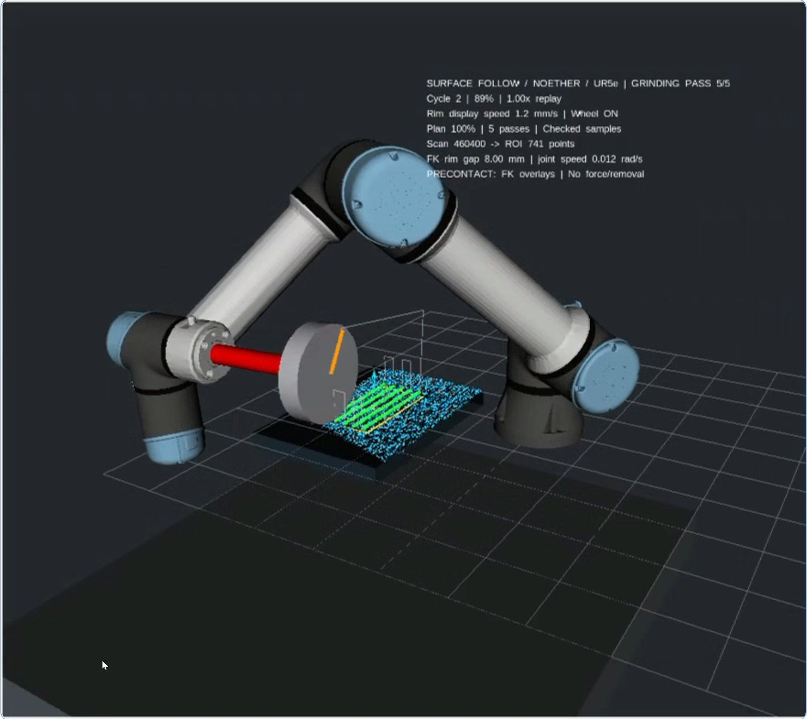
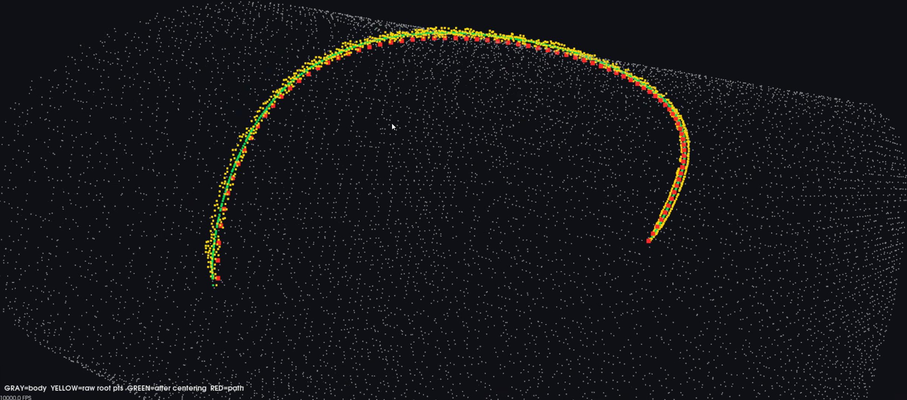
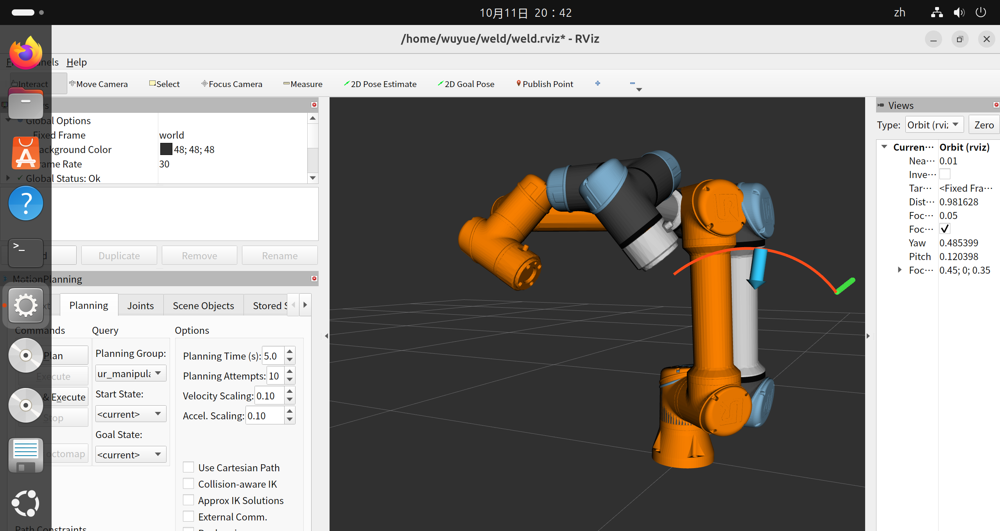

# 智能纪要：10\-13 \| 具身打磨项目会 2026年10月13日

> 会议主题：10\-13 \| 具身打磨项目会
> 
> 会议时间：2026年10月13日（周二） 10:31 \- 11:56 （GMT\+08）
> 
> 参会人：@黑晓军@洪天阳@孔凌峰@宋建建@王睿秋@王释钰@吴添一@吴玥@徐柯帅@薛力源@杨国翱@岳康@张成伟 @邓念皓 @王文轩 @Yichang @用户637744
> 
> 

> 智能会议纪要由 AI 生成，可能不准确，请谨慎甄别后使用
> 
> 

# 总结

本次具身打磨项目周会由各成员汇报近期研究进展，评审各模块实验成果，明确后续推进安排，内容如下：

- **各模块研究进展汇报**

    - **Simple3D 三维异常检测论文研读与复现**

        - 论文基本信息：该成果为近年新研究，去年年底挂至arXiv，今年被趣格AI接收，提出高分辨率三维异常检测数据集与对应方法。

        - 传统方法缺陷：现有三维异常检测方法经降采样得到千级点集，插值生成异常图时易丢失细粒度细节，小缺陷易被遗漏。

        - 核心技术方案：包含多尺度邻域描述子、局部特征空间聚合两项技术，兼顾局部细节与全局结构感知，可有效降低噪声干扰。

        - 复现实验结果：针对飞边类缺陷单独训练后，模型对该类异常的区分与定位能力优异，对应AUROC指标分别达0\.81、0\.839。

    - **视觉检测模块算力开销估算**

        - 估算前提假设：基于500万\-1000万点云规模、飞边毛刺高度为工件尺寸0\.05%的设定，覆盖三类主流三维分割网络。

        - 基础硬件需求：推荐采用单张24G显存4090显卡作为核心硬件，配套64G内存、200G存储，显存占用可通过batch size灵活调整。

        - 算力开销测算：PointNet\+\+训练耗时最短、显存占用最低，PTV3训练耗时约为前者3倍，推理阶段算力需求远低于训练阶段。

        - 落地实施建议：优先采用PointNet\+\+完成初始链路验证，后续可通过点云降采样等方式进一步压缩算力开销。

    - **视觉引导打磨接触前轨迹仿真验证**

        - 实验核心目标：在真机调试前验证打磨轨迹符合六轴机器人运动约束，预留缺陷识别接口，为后续控制器接入提供标准化数据契约。

        - 全链路验证流程：完成点云表面建模、工具路径规划、运动安全全链路验证，覆盖关节限位、碰撞、速度约束等多项检查项。

        - 当前实验结果：当前规划软件链路已具备接入控制器基础，仿真轨迹各项约束均通过验证，暂未接入真实力控与材料去除模型。

        - 后续优化要求：需补充实验参考文献，在实验目的模块补充与项目的关联说明，后续接入真机前完成机器人模型替换。

    - **曲面飞边打磨几何方法复现**

        - 原有方案局限：传统飞边提取方法依赖全局平面拟合，仅适用于飞边处于同一平面的场景，无法适配曲面分形面的工业需求。

        - 新方案设计思路：采用截面质心法直接从三维点云提取飞边根部中线，无需依赖平面拟合，可适配任意曲面分形面的飞边提取。

        - 仿真精度表现：仿真环境下提取结果与真值的平均偏差为0\.051毫米，精度表现优异，后续需在实际工件上验证落地效果。

        - 专利相关建议：需进一步对比该方案与现有专利的优劣差异，评估专利申请、学术论文发表的可行性。

    - **圆管焊缝打磨轨迹仿真复现**

        - 实验核心目标：在仿真环境跑通从合成点云到机械臂轨迹执行的全链路，降低真机调试风险，后续仅需替换点云输入即可适配真实场景。

        - 核心技术优势：采用数据驱动方式提取焊缝中心线，无隐藏坐标系假设，工件任意位姿摆放均可正常计算，轨迹分段规划无跳变风险。

        - 当前实验结果：全链路仿真跑通，焊缝中心线提取与解析解偏差仅0\.039毫米，轨迹规划成功率100%，各项运动约束均符合要求。

        - 待对齐工作项：需与王释钰的仿真环境做版本适配，统一ROS2版本，后续完成手眼标定、真实点云接入相关工作。

- **项目推进共识与安排**

    - **文档管理规范**

        - 统一文档模板：所有实验文档统一采用问题导向的参考模板，便于团队快速理解核心问题与研究结论，提升信息传递效率。

        - 版本迭代规则：实验文档迭代更新直接在原有页面操作，无需新建独立页面，避免出现多版本文档难以对齐的问题。

        - 知识库汇总：所有实验文档统一汇总至项目共享知识库，便于团队成员互相学习、借鉴已有研究成果，减少重复工作。

    - **资源协调安排**

        - 算力资源协调：由薛力源牵头协调组内同学梳理算力需求，戴屹协调现有24G显存GPU服务器供项目组使用，同步推进新服务器采购配置梳理。

        - 实验场地推进：军山校区具身打磨实验场地设计文档，后续由易总补充设备摆放、占地等相关信息后，提交学院申请落地。

        - 工件对接安排：戴屹将寄送带毛刺的工件供项目组测试，由孔凌峰负责对接接收，为后续实际工件的算法验证提供实物支撑。

    - **技术路线对齐**

        - 仿真环境统一：吴玥与王释钰需加强沟通，统一ROS2仿真环境的技术路线与版本，避免后续联调出现环境不兼容的问题。

        - 开题报告编制：后续在宋建建老师的指导下完成项目开题报告，明确系统输入输出的精度、格式要求，对齐项目交付标准。

        - 现场对接安排：近期统筹安排项目组前往东风相关产线参观交流，对接产线实际需求，同步确认真机打磨的防护方案，保障操作安全。

# 待办

* [ ] 粘贴论文链接：将Simple3D论文的页面链接贴到会议纪要页面中，便于相关人员查阅参考（来自黑晓军） @薛力源

* [ ] 发送论文模板：将论文泛读/精读参考模板的页面链接发到项目群中，供大家参考使用 @黑晓军

* [ ] 收集算力需求：协调组内同学收集汇总项目所需的算力需求，整理形成服务器配置建议页面（来自黑晓军） @薛力源

* [ ] 发送场地文档：将军山实验场地介绍的页面链接发到项目群中，供相关人员查看讨论可行性 @黑晓军

* [ ] 补充参考文献：在仿真实验页面中增加参考文献部分，将相关项目、论文等资料信息整理放入（来自黑晓军） @王释钰

* [ ] 完善实验目的：在仿真实验页面的实验目的部分补充内容，说明实验与打磨项目的关联和开展动机（来自黑晓军） @王释钰

* [ ] 更新实验文档：在现有实验报告页面中更新飞边不在同一平面场景下的最新实验内容，同步到项目知识库（来自黑晓军） @杨国翱

* [ ] 加强技术沟通：王释钰与吴玥加强交流，共同梳理出可共享的ROS2仿真实验技术路线，支撑后续联调（来自黑晓军） @王释钰 @吴玥

* [ ] 完善输入输出文档：参考宋建建提供的项目文档体系，整理生成面向项目的戴屹侧输入输出要求文档（来自宋建建） @黑晓军

* [ ] 确认场地文档：黑晓军更新军山实验场地设计页面后，易总对接修改完善页面内容，补充设备摆放相关图纸 @黑晓军

* [ ] 确定参观时间：对接东风相关负责人，确定前往现场参观交流的具体时间并同步给项目组

* [ ] 对接接收样件：孔凌峰对接Yichang，接收带有毛刺的工件样件，供项目组开展相关测试使用（来自黑晓军） @孔凌峰

# 会议中的金句时刻

# 相关链接

- 会中共享的文档：[圆管焊缝打磨轨迹仿真复现与验证](圆管焊缝打磨轨迹仿真复现与验证__docx-RsqsdemsyoraEmx1BzbctNkZnKd.md)

- 妙记：[10\-13 \| 具身打磨项目会](https://hustdian.feishu.cn/minutes/obcnldrdys93x8js32ny66wa?from=ai_minutes)

- 文字记录

    - [10\-13 \| 具身打磨项目会 2026年10月13日](文字记录：10-13_具身打磨项目会_2026年10月13日__docx-FgiJdZzM2oD9NkxS3Z6cAKf8nme.md)

