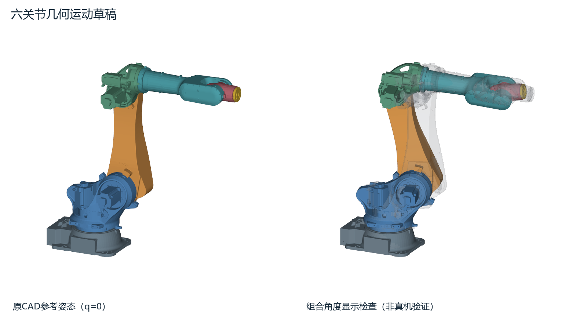

# 机械臂仿真接入进展

吴玥｜2026年11月5日会议报告

## 摘要

本周利用公司提供的iER220\-2700数字模型，完成六关节几何模型接入、运动资料梳理、目标姿态与本体碰撞检查，并将一条已有路径接入模型复测。下一步重点是完善整段路径验证，补齐现场参数、工具资料和真实工件点云，逐步验证实际任务的可行性。

## 一 、当前输出

本周完成了从公司装配模型到路径接入的以下工作：

|工作项|本周输出|
|---|---|
|建立机械臂仿真模型|完成装配还原和六关节几何运动模型接入，能够显示各连杆及按几何假设随动的辅助机构，已有实际运行与显示记录|
|梳理设备参数|已核对该型号各轴运动范围、最高速度及原点资料，列清模型与现场设备对应时仍需确认的参数|
|检查目标姿态|可将目标位置和朝向转换为模型关节姿态；151个目标位姿的回代检查通过，为后续路径选取姿态提供基础|
|完善本体碰撞检查|原16组测试工况中的两处外形误报已消除，故意设置的碰撞和虚拟障碍仍能检出，提高了仿真检查的有效性|
|接入已有路径并复测|一条38点路径已接入；38个端点及116个中间采样点，共154个姿态，均完成实际运行数据和本体碰撞核对，结果与独立计算一致|

目前已具备用公司机械臂模型检查路径姿态及本体碰撞的仿真基础，后续可在此基础上接入真实工件和实际工具。

当前采用仿真摆放和虚拟工具，验证范围为有限采样姿态。实际工具、工件及整段运动尚需继续验证，暂不能据此判断加工精度、去除效果或生产节拍是否达标。

## 二 、需要补齐的输入

|所需资料|用途|
|---|---|
|建议先提供1个代表性工件、1处连续待磨区域的原始点云，附尺寸单位、工件照片及毛边位置、长宽高说明|用真实数据检查路径生成，明确当前能处理的区域及数据缺口|
|与现场配置一致的关节参数、法兰坐标，以及实际工具尺寸、安装关系和TCP资料|将现有仿真模型与实际设备对应，检查真实工具下的路径可行性|

## 三 、下一步与协调事项

下周优先完善整段路径的仿真验证；上述资料到位后，再开展现场参数对应和首份真实点云接入。

