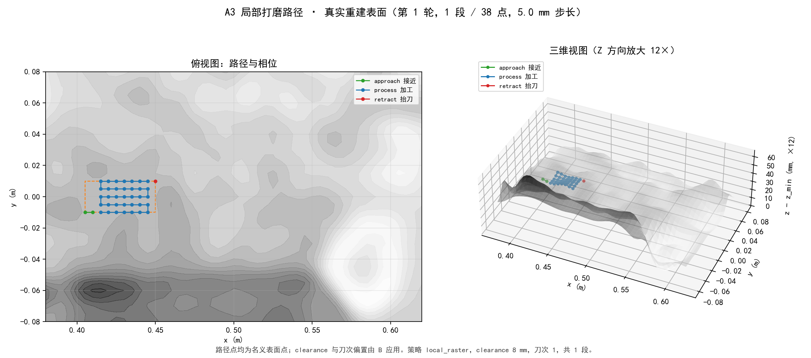

# 检测结果适配与工艺路径闭环验证

# 检测结果适配与工艺路径闭环验证

**吴玥 · 轨迹规划方向 · 组会汇报（2026\-10\-20）**

## 一、本周总结

上次组会提出，我和王释钰是两条并行路线，ROS 2 版本不同，需要统一技术路线

所以本周不再继续对齐文档，而是直接把接口和代码冻结：A 负责把检测结果生成打磨计划，B 负责把计划变成机器人运动，双方通过固定文件格式交换数据。

本周已经把任务 A 的软件链路串起来了：检测结果可以变成局部打磨路径，路径可以交给 B 侧做规划验证，执行结果和复扫结果又能反过来决定是否补磨。

但真实工件、相机实物、公司机械臂参数还没有到位，当前结论仍然是仿真和接口级验证。

## 二、现在的工作方式

整个闭环分成四步：

```Plaintext
检测结果
  → A：校验、坐标转换、生成局部路径
  → B：IK、碰撞检查、假控制器执行
  → 回执 + 复扫结果
  → A：判断接受还是补磨
```

具体例子：

- 检测模块说：这个位置有一处 3 mm 高的毛刺，中心在工件坐标系的 `(0.43, 0, 0.22)`，法向朝上；

- A 会在真实高度场上生成一段往复路径，告诉 B 哪些点开始接近、哪些点加工、哪些点抬刀；

- B 回传“哪些段真正执行成功”；

- A 再看下一次扫描里的残余高度，决定接受、补磨，还是停止。

这里的“真实高度场”目前还是 V4\.0 扫描表面，不是本次目标铸件的真实点云。

## 三、本周工作

### 1\. Humble 环境复现

在虚拟机里把王释钰的两个 Humble 容器恢复起来，V4\.0 的点云、表面、Noether、MoveIt 和回放都跑通了。

|指标|王释钰报告|本次复现|
|---|---|---|
|Noether 路径|5 段 / 110 位姿|5 段 / 110 位姿|
|规划完整率|1\.0|1\.0|
|关节采样 / 中点|584 / 583|584 / 583|
|加密碰撞点|1905|1905|
|表面残差|5\.253596 mm|5\.253596 mm|
|最大法向倾角|8\.69189°|8\.69189°|

结论：Humble 和 Jazzy 的版本差异不会挡住 A/B 联调。

### 2\. A 侧已经能从检测结果生成路径

现在支持：

- 严格检查检测结果里的单位、坐标系、法向、边界和追溯信息；

- 从高度场插值出每个路径点的高度和法向，不再假设表面是水平面；

- 从缺陷边界裁剪路径。L 形缺陷不会把整个外接框都磨掉；

- 支持多缺陷、噪声、遮挡空洞和强曲面；

- 工艺参数集中在 `robot_profile.json`，后续换材料或刀具不用改代码。

一个当前样例计划是 1 段、38 个点，路径长度约 185 mm，名义间隙 8 mm。



### 3\. A 侧闭环决策已打通

上一轮计划、B 的执行回执和下一次复扫结果可以一起读进来，输出五种结果：

- 接受；

- 补磨；

- 达到最大轮次，停止；

- 连续改善不足，停止；

- 执行失败或复扫不可用，停止。

最重要的一条规则是：**没有真正执行的段，不能算作已经去除**。即使复扫里暂时看不到这个缺陷，也把它放进下一轮补磨清单。

现在已经能自动完成下面这个过程：

```Plaintext
生成第 1 轮计划
  → B 只执行一部分
  → 判定 regrind
  → 自动生成第 2 轮计划
```

第 2 轮只补没有完成的缺陷，不会把已经完成的段重新磨一遍。

### 4\. 给 B 的单段预检已经跑过

在参考 ROI `(0.50, 0.02)` 上做了一次预检：

- 规划完整率 1\.0；

- 72 个轨迹点；

- 0 个无效状态；

- 229 个加密插值碰撞点；

- 结果通过。

这说明 A 的计划格式和 B 的桥接接口能接上。但它还不能证明真实缺陷中心也能跑，因为预检用的是当前桥接脚本里已经能通过的参考位置。

### 5\. 测试和归档已整理

当前测试合计 **97 项**：

|测试套件|数量|
|---|---|
|契约校验|31|
|局部路径规划|29|
|闭环决策|22|
|点云转表面场|10|
|手眼求解器|5|

测试在 Python 3\.9、3\.10、3\.12、3\.14 上都通过；A 分支也在 Humble 容器和虚拟机里复跑通过。


## 四、上次组会待办状态

|待办|状态|说明|
|---|---|---|
|5\. 统一 ROS 2 技术路线|完成|已形成统一基线、A/B 分工和接口文件|
|11\. Humble 容器适配测试|完成|V4\.0 全链路复现，关键数值一致|
|12\. 真实点云 \+ 手眼标定|部分完成|接口、方案和求解器已完成，缺实物相机、标定板和真实工件|

## 五、下一步

### A/B 联调

下一步和B侧做联合测试：先在已验证的位置跑通流程，再换到样例缺陷所在的位置，检查工具姿态是否合适、机械臂能否沿路径运动。

### 真实数据

工件到位后，用已有的点云转表面场程序生成真实 `surface_field.json`，再做真实点云回归。

相机到位后，把实测手眼矩阵接入 A2，完成实测精度矩阵。


