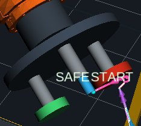

# 自动修正策略对机械臂打磨仿真轨迹一次通过率的影响

> 修订历史\(Revision History\)
> 
> 

|**版本**|**时间**|**作者**|**修订内容**|**状态**|
|---|---|---|---|---|
|1\.0|2026\-11\-05|王释钰|阶段进展汇报原始记录：军山场地 ROS 仿真场景、指定区域生成路径的运动规划原型、修正手段与失败原因、三项近期需求|已记录|
|1\.1|2026\-11\-08|黑晓军|按实验报告模板改写为飞书页面：拟定实验标题，补齐实验目的、原理、环境、结果口径与思考问题，原文三张内嵌表格改为页面原生表格，新增点评与修改建议、参考资料|已发布|

原文引用：[阶段进展汇报](阶段进展汇报11.5__wiki-AMLswD7tVinrP4kqeCzcLo5On4c.md)

说明：本文按原作者王释钰 2026\-11\-05 的阶段进展汇报整理。流程描述、十种修正手段、五类失败原因、六项已实现功能、三项下一步计划与一项资料需求均取自原文；原文用三张内嵌电子表格承载功能清单、修正手段与失败原因，本文改为页面内原生表格，未改动任何条目内容。原文未给出轨迹段数、通过率与生成耗时，本文在"实验结果"一节如实标注量化缺口，不代填数值。原文另附一段 2026\-11\-04 的仿真录制视频（约 428 MB），本页未复制以控制体积，需要时请查看原文页面。

# 实验概述

这一轮要回答的不是"打磨效果好不好"，而是"任意待打磨工件指定的加工区域，能不能自动变成机械臂可执行、且不撞的轨迹"。做法是在 ROS 场景里拉一条链路：网页端选工件或用点云 → 读加工区域 → 生成工件表面路径 → 求逆解并安排进退刀与转场 → 碰撞检查 → 失败后自动修正 → RViz 回放通过的轨迹。

结论是链路通了，但成功率还不理想。已实现的功能覆盖点云输入、工件路径规划、工具配置、机械臂规划、自动修正与可视化追溯六项；规划失败时系统会按十种手段自行重试（换磨具候选、正反法向、换逆解初值、绕工具轴旋转、反向进入、调整进退刀距离、加密采样、关节空间绕行、增加预接触退让、拆分加工段），超预算后转人工。

瓶颈有两处。一是通过率低：十多段轨迹里只有约 1 段修正通过。二是几何资料不全：机械臂前端的转换器与铣刀、钢刷、磨轮三种工具的 CAD 尚未到手，仿真中按概念模型处理，因此"磨具与工件干涉"一类失败里包含模型不准造成的误判。本页定位是流程贯通与失败归因，不是性能达标。

# 实验目的

本轮要回答四个问题：

1. 军山场地与机械臂参数能否在 ROS 中复现到可用于安全验证的程度；

2. 给定加工区域自动生成轨迹"这条路能否在无人干预下走通；

3. 规划失败主要集中在哪些类型，其中哪些属于算法问题、哪些属于资料缺口；

4. 确认下一步该先优化修正模块、先提生成速度，还是先补工具数据。

# 实验原理

1. 局部曲面分块与扫描线：待加工区域先划分为局部曲面块，块内生成连续扫描线作为加工段；遇到点云断开或表面方向突变时进一步分段，避免一段跨过几何断口，导致接触姿态剧烈变化。

2. 逆运动学与动作编排：每个路径点先求末端位姿对应的关节解，再按"接近—加工—撤离—返回"编排动作；相邻位姿之间要求关节连续，不允许跳变，否则真机执行时会超速或抖动。

3. 碰撞检查：用机械臂、工具、工件、夹具与工作台的几何体做干涉查询；除"是否相交"，还检查设定的安全间隙，因为贴得过近在真机上同样不可接受。

4. 自动修正与预算控制：某段规划失败后，按候选策略重试；每次尝试计入时间预算，超预算即转人工。只有通过验证的加工段才会被执行，避免把不可行轨迹带到下游。

5. 仿真与回放：通过的轨迹在 RViz 中回放，网页端反馈状态并保存规划记录与修正报告，使每一次失败都能追到具体原因，而不是只知道"没跑出来"。

# 实验环境

|**项目**|**本轮设置**|
|---|---|
|仿真平台|采用 Docker 29\.8\.2，容器运行 Ubuntu 22\.04\.5 LTS、ROS 2 Humble、RViz 2 11\.2\.28 和 Python 3\.10\.12|
|场景来源|依据《军山校区具身打磨实验场地设计》与《戴屹机械臂资料》修改仿真，机械臂型号 iER 220\-2700|
|工件与点云|接入 Real3D\-AD 真实扫描数据，支持多类工件选择与外部点云上传|
|工具与夹具|三磨具（铣刀、钢刷、磨轮）配转盘切换的概念模型，支持简单规则选具；转换器与三种工具的 CAD 未到位|
|运行硬件|个人PC，RTX 3050 Ti Laptop GPU（4 GB 显存）；Docker 可用逻辑处理器 16 个、内存约 7\.57 GiB，内存16G。|
|未对齐项|工具安装参数、TCP 位置、夹具实际尺寸均未标定，仿真按概念模型处理，碰撞与干涉结论受此限制|

# 实验内容

## 把军山场地与机械臂复现进仿真

依据场地设计与企业方提供的机械臂资料，对仿真场景做了进一步修改，目的是支撑后续的安全验证：机械臂置于加工工位，场地内的操作台、立柱与顶部加工设备按设计图摆放，让路径规划在接近真实的几何环境中做碰撞判断。


工件的点云数据可以通过网页上传，再由系统读取加工区域。在计算完成后，仿真里会输出相应的打磨轨迹。


## 从加工区域到加工段的路径生成

系统先把待加工区域划分为局部曲面块，在块内生成连续扫描线作为加工段；遇到点云断开或表面方向突变时进一步分段。每段都带上法向与预接触参考路径，用于确定工具接近表面的方向，并支持按需要安排多遍加工。

分段的意义在于把"整面一次规划"拆成"多段分别规划"：一段失败只影响这一段的局部几何，不会让整件工件的规划一起失败；但分段也带来代价——段越多，接缝处的覆盖与重叠越需要额外约定，也会使复打磨的流程规划更加繁琐。

## 运动规划与碰撞修正的主流程

```Plain Text
网页端选择工件或上传点云
          ↓
读取加工区域
数据集标签／人工指定 ROI／确认整表面
          ↓
工件表面路径规划
生成加工线、法向，安排磨具和加工遍数
          ↓
机械臂运动规划
求逆解，生成进退刀、加工及转场轨迹
          ↓
碰撞检查与自动修正
失败后调整候选；超预算转人工
          ↓
RViz 回放通过的轨迹
网页反馈状态，保存规划与修正报告
```

逐段检查的内容包括：机械臂能否完成接近、加工、撤离与返回四个动作，逆解是否存在，相邻位姿的关节是否连续，以及工具、手臂、支架与工件、夹具、工作台之间是否碰撞。失败后系统自动调整候选或拆分重试，只执行通过验证的加工段。

## 已实现的六项功能

|**方面**|**已完成的工作**|
|---|---|
|点云输入|接入 Real3D\-AD 真实扫描数据，支持多类工件选择和外部点云上传|
|工件路径规划|根据目标区域生成局部表面路径、法向和预接触参考路径，支持安排多遍加工|
|工具配置|采用三磨具及转盘切换的概念模型，支持简单规则选具|
|机械臂规划|将工件路径转换为机器人关节轨迹，检查逆解、运动跟踪及碰撞情况|
|自动修正|规划失败后自动尝试调整姿态、进退刀、转场和分段策略，超预算后转人工|
|可视化与追溯|通过网页选择任务，在 RViz 展示工件、路径及机器人运动，保存规划与失败记录|

## 轨迹修正采用的十种手段

|**修正方法**|**具体做什么**|
|---|---|
|更换磨具候选|自动模式下尝试允许的其他磨具|
|尝试法向方向|分别求解正、反法向候选，仍需满足接触要求|
|更换逆解初值或分支|尝试另一种机械臂关节配置|
|绕工具轴旋转|尝试 0°、90°、180°、270° 等候选姿态|
|反向进入|从加工段另一端开始|
|调整进退刀距离|尝试不同的接近和撤离距离|
|加密采样|减小路径采样步长，改善连续逆解和跟踪检查|
|关节空间绕行|为进出加工区域寻找避障转场路径|
|增加预接触退让|额外退让 2、4、8 mm，仅用于非接触仿真|
|拆分加工段|将长段拆开分别规划，全部子段通过才算原段通过|

## 五类失败原因及其通俗解释

|**问题**|**通俗解释**|
|---|---|
|姿态达不到|磨头能靠近目标，但机械臂没找到合适的角度对准它|
|机械臂或支架碰撞|磨头对准了，但手臂、工具盘或支架撞到了工件、夹具或工作台|
|磨具与工件干涉|砂轮可能太大、接触位置不合适，也可能是仿真模型不够准确|
|安全距离不够|虽然没撞上，但离得太近，没有达到设定的安全间隙|
|尝试时间用完|系统试了多种调整，规定时间内仍没找到方案，不代表一定做不到|

## 近期需求

|**希望获得的支持**|**对应预期结果**|
|---|---|
|打磨工具和转换器的尺寸或者 CAD|接入到仿真系统中，补足几何不通过的阶段|




# 实验结果


流程跑通、可根据不同器件和缺陷生成相应轨迹、可回放并通过碰撞检查

|**观察项**|**本轮结果**|
|---|---|
|流程贯通|已贯通：选工件或上传点云 → 读加工区域 → 生成表面路径 → 运动规划 → 碰撞修正 → RViz 回放|
|轨迹一次通过率|约 1/10：十多段轨迹中约 1 段经自动修正后通过|
|轨迹生成耗时|偏长，未量化（作者描述为"步骤复杂、速度偏慢"）|
|主要失败类型|五类：姿态达不到、机械臂或支架碰撞、磨具与工件干涉、安全距离不够、尝试时间用完（分布未统计）|
|资料缺口影响|转换器与三种工具 CAD 未到位，几何不通过中含模型不准导致的误判|

1. 约 1/10 的通过率里，有多少是姿态或碰撞真的不可行，有多少是工具模型不准导致的误判？不把两者拆开，优化方向只能靠猜。

2. 十种修正手段是按固定顺序依次试，还是按失败类型选择？若是顺序试，时间预算大量花在无效手段上，这恰好能解释"生成慢"。

3. 分段阈值（点云断开、法向突变）具体取多少、由谁定？阈值过严会把一段正常曲面切碎，规划次数与接缝问题随之增加。

4. RViz 通过是否等于真机可行？TCP 与工具安装参数未标定，仿真通过只说明在给定几何下关节可达、不干涉。

5. 整件工件的加工顺序（分区域先后、粗磨与精磨的遍数分配）尚未定义；逐段独立规划时，接缝处的覆盖与重叠如何处理？

# 经验分享

## 正面经验

- 先把链路拉通，再谈成功率：从点云输入到 RViz 回放全部接通，失败也有五类明确原因可追，后续优化有落点。

- 失败可解释、可追溯：每次规划与修正都保存记录，能回答"这一段为什么没通过"，而不是只留下一个失败结果。

- 需求写得具体：把缺的转换器与三种工具 CAD、以及"补足几何不通过阶段"的预期结果列成两列表，企业方一看就知道给什么。

## 反面经验与改进方向

- 没有统计：全文没有段数、通过率、耗时三项数字，"成功率低"只停在口头描述，对外无法判断严重程度。

- 修正手段缺策略：十种手段并列列出，但未说明触发顺序、单次代价与优先级，读者无法判断哪一项真正有效。

- 几何依赖外部资料：工具模型缺席时碰撞与干涉结论不可信，应先把"结论受模型限制"写成前提，再谈通过率。

- 演示与结论混在一起：进刀、退刀、转场因参数未确认只属演示，需要与已验证部分分开标注。

# 点评与修改建议

本节依据三处材料：一是 2026\-11\-05 项目组预沟通会与企业方同步会上导师、企业方提出的意见，二是 11\-05 组会针对本篇汇报的待办（第 11、12 项），三是本页对原文的核对结果。

## 会议意见对本页的八条要求

|**会议意见**|**提出人与场合**|**对本页的落地动作**|**现状**|
|---|---|---|---|
|开头加总结、核心结论前置；讲清输入是什么、输出结果如何，用可量化的描述|黑晓军，11\-05 项目组预沟通会|设"实验概述"承结论，实验目的写明输入（加工区域与点云）与输出（通过的加工段与失败原因）；通过率与耗时仍缺量化|部分落实|
|指标用中文表述，另写指标定义说明页面并贴链接|黑晓军，预沟通会（待办 9）|本页把"一次通过率"定义为"无需人工介入、一次规划即通过验证的加工段占全部加工段的比例"，并回链定义页|部分落实|
|重要结果表配示意图，精确数值仍保留在表格里|黑晓军，预沟通会（待办 10）|后续把"段数—通过／失败"与失败类型分布做成示意图，原表保留|待落实|
|数字模型写明具体型号、仿真器写清名称与版本|黑晓军，预沟通会|环境表已写 iER 220\-2700 与 ROS 2 \+ RViz；发行版、求解器版本仍缺|部分落实|
|每人对外汇报 8—10 分钟，聚焦核心结果|黑晓军，预沟通会|对外版本压成"流程—通过率—资料需求"三段，按待办 11 重梳理|待落实|
|仿真结果必须回到物理世界实测对标，先给测试用例|黑晓军、易昌，11\-05 企业同步会|补一段"仿真通过≠真机可行"的说明，并列出真机对标所需的测试用例与测量项|待补充|
|实验环境必须标注操作系统、软件与版本|黑晓军，企业同步会（待办 6）|环境表补 OS、ROS 发行版、规划与碰撞求解器版本、显卡与驱动|待补充|
|AI 生成的代码、报告与仿真必须人工校验，出错是自身责任|黑晓军，预沟通会|注明哪些模块由 AI 辅助生成，并说明逐项复核的方式与结论|未体现|

## 值得保留的优点

- 流程写成可复现的链路：从网页入口到 RViz 回放，每一步都交代了输入与产物，读者能据此复刻或定位断点。

- 失败原因用人话解释：五类问题的"通俗解释"把技术原因翻成工程语言，对外沟通时不必再解释术语。

- 修正手段列得全：十种手段覆盖磨具、法向、逆解、采样、退让与分段，是后续做策略优化的完整候选池。

- 需求与预期结果成对：转换器与工具 CAD 的需求直接对应"补足几何不通过阶段"，企业方容易响应。

## 需要修改的问题

- 缺三个数：段数、一次通过率、单段生成耗时都没有，结论无法被外部验证，也无法与后续版本对比进步。

- "一次通过率"没有定义：分母是全部加工段还是仅指有解可求的段，是否包含人工介入后的通过，不同口径可差出数倍。

- 修正手段没有策略与代价：未写触发顺序、每种手段的尝试次数与耗时、拆分后子段数量上限，无法判断瓶颈在算法还是预算。

- 失败原因只有分类没有分布：五类各占多少、哪些在补 CAD 后会消失，读者无从判断优先级。

- 环境影响结论：工具与夹具按概念模型处理，TCP 未标定，"磨具与工件干涉"类失败可能是模型误差，报告未把这一点写成结论前提。

- 演示与已验证混排：进刀、退刀、转场属演示性质，与已验证的路径生成放在同一层级叙述，容易误读为已完成。

- 环境信息不全：只写 ROS 与 RViz，缺发行版、求解器、硬件与驱动版本，不满足"每人标注环境"的要求。

## 具体修改建议

### 内容与实验

1. 补一张按段统计的表：总段数、一次通过、修正后通过、转人工、未通过，并写明统计口径与统计脚本。

2. 给修正手段加三列：触发条件、单次尝试代价（秒）、成功率贡献；按"贡献大且代价低"排序，作为下一步优化顺序。

3. 把失败类型的分布画出来，并标注哪些在补齐工具 CAD 后预计会消失，形成"算法待改 / 资料待补"两列清单。

4. 为"演示"与"已验证"设不同标记：进刀、退刀、转场在参数确认前明确标为演示，不进入结论段。

### 指标与口径

1. 在正文给出"一次通过率"的定义式与分母口径，并与"修正后通过率""人工介入率"并列，避免一个词承担三种含义。

2. 补耗时指标：单段生成时间、单件（多段）总时间、超预算转人工的比例，作为"生成慢"的定量依据。

3. 与真机对标前先约定测量项：TCP 实际轨迹偏差、可达姿态余量、最小安全间隙，形成一张真机测试用例清单。

### 呈现与汇报

1. 结论前置：首页给三句话——链路已贯通、约 1/10 段一次通过、瓶颈一半在工具模型。

2. 把主流程做成示意图（现状用代码块呈现），并标出失败分支与转人工出口，便于 8—10 分钟内讲清。

3. 图注补齐来源与拍摄时间；原文视频改为关键帧截图，避免 400 MB 级文件影响阅读。

### 环境与资料

1. 注明 AI 辅助环节（代码生成、报告起草）与人工复核方式，与"AI 生成内容须校验"的要求对应。

2. 工具 CAD 到位后重跑同一批加工段，给出"补资料前后"的通过率对比，把资料缺口的影响量化。

上述会议意见的来源：[20261105\_具身打磨项目组会纪要](20261105_具身打磨项目组会纪要__wiki-FFSxwFiOCiPizXkjOpjcE6zznnb.md)[20261105\_具身打磨工作会议纪要](20261105_具身打磨工作会议纪要__wiki-JkYDwX7tPiuM5kkfxtFc21Uvnhd.md)。

# 参考资料

1. 军山校区具身打磨实验场地设计\[EB/OL\]\. 华中科技大学 Dian 团队飞书知识库, \[2026\-11\-05\]\. https://hustdian\.feishu\.cn/wiki/V2qpw4mVniSwBYkT90cccR19nRU\.

2. 戴屹机械臂资料\[EB/OL\]\. 华中科技大学 Dian 团队飞书知识库, \[2026\-11\-05\]\. https://hustdian\.feishu\.cn/wiki/IYQ6w9Dc1i0rrPkzUjMcaPtbn4b\.

3. 打磨仿真代码结构与功能说明\[EB/OL\]\. 华中科技大学 Dian 团队飞书知识库, \[2026\-11\-05\]\. https://hustdian\.feishu\.cn/wiki/PhBcwsse4iDOlokbVw1ccdr4n7c\.

4. 数据集使用说明\[EB/OL\]\. 华中科技大学 Dian 团队飞书知识库, \[2026\-11\-05\]\. https://hustdian\.feishu\.cn/wiki/L6C6wo1wliCOFQkEzhLcWKaZnbb\.

5. J\. Liu, G\. Xie, R\. Chen, X\. Li, J\. Wang, Y\. Liu, C\. Wang, and F\. Zheng, "Real3D\-AD: A dataset of point cloud anomaly detection," in Advances in Neural Information Processing Systems 36 \(NeurIPS 2023\), Datasets and Benchmarks Track, 2023\.


> （注：部分内容由豆包工作 AI 生成）
