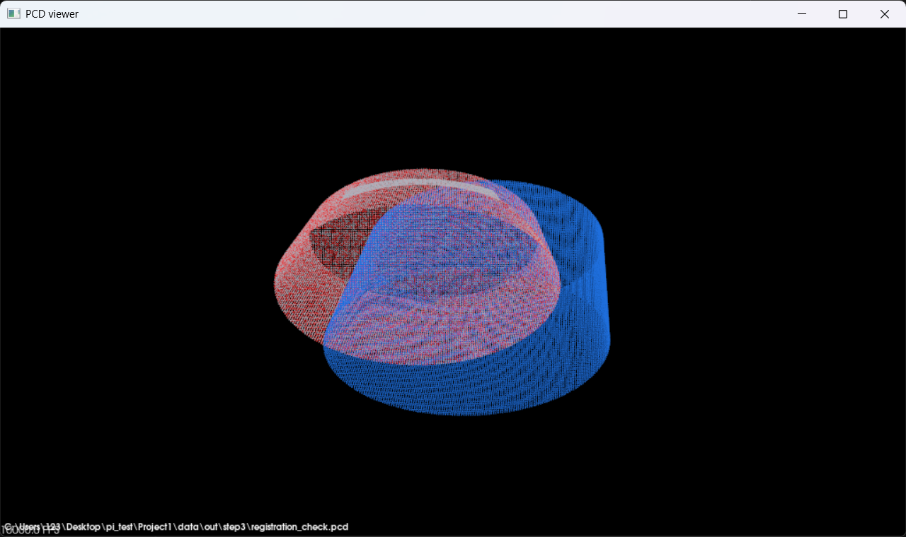

# 铸件飞边打磨几何方法复现实现

---

> 参考文章：Flash Extraction and Grinding Path Fitting Based on Point Cloud of Casting Parts——ZHY Casting，2026\-05\-10
> 网址：https://www\.zhycasting\.com/flash\-extraction\-and\-grinding\-path\-fitting\-based\-on\-point\-cloud\-of\-casting\-parts/
> 
> 

## 第 1 步：数据准备

标准件：自己造的椭圆形铸件
目标件：在标准件上加上模拟飞边

---

## 第 2 步：体素降采样

### 目的

原始点云动辄几十万到上百万个点，而且密度分布不均，离扫描仪近的地方点密、远的地方点疏。这样的点云直接拿去配准、做邻域搜索，既慢又不稳定：慢是因为最近邻搜索的量级直接由点数决定，不稳定是因为基于邻域的算法（法向估计、局部平面拟合）在不同密度区域的表现会不一致，同一套参数在一处好用、到另一处就失效。所以降采样的目的是**在大幅压缩点数的同时保持工件整体的几何形状，并让点密度趋于均匀。**

### 操作

把三维空间按固定边长切成规则立方体网格，也就是体素，先丢弃内部不含任何点的空网格，再对每个非空网格统计其内部所有点的坐标并求平均值，用这个平均值即质心，代表该网格内的全部点。无论一个网格里原先有多少个点，输出时只保留这一个质心点。

### 参考的论文方式

体素网格降采样本身来自 ZHY 那篇。他在配准之前就做了这一步，取每个非空体素的重心代表该体素内的点，理由同样是"在减数据量的同时保住几何特征"，与我们的操作完全一致。

周海陶用的是一种改进版：不用体素重心，而是取体素重心的最近邻点来代替该体素内的点，目的是保证选出来的点都来自原始点云，避免引入不在点云上的虚拟位置。不过他把这个方法用在打磨路径点选取阶段，也就是 3\.4\.2 节，不是配准前。

---

## 第 3 步：点云配准

### 目的

标准件和目标件各自处于自己的坐标系里，两片点云并不重合。**必须先将他们对齐才能进行后续操作**。所以这一步要把标准件变换到目标件的坐标系里。

### 方法

输入是两片降采样点云，其中标准件已经在第 1 步被施加了一个已知的刚体变换（旋转约 15 度、平移约 30 毫米，平均错位 13\.5 毫米）。估计各个点云法向并计算 FPFH 特征（周围区域的形状特征）；然后用 SAC\-IA 做粗配准；接着做多尺度 ICP 精配准；最后把这个累计变换作用到完整点云上，再做一次小范围 ICP 收尾，最终配准残差 0\.068 毫米。

### 参考的论文方式

"粗配准加精配准"这个两段式框架来自 ZHY 那篇，他的方法基础就是把待打磨铸件的点云与标准模型点云配准，然后分割出飞边区域，原文只写了 two\-stage registration 这个说法，没有给出特征和算法的细节，所以实现上我们采用 PCL 里的标准组合，即 FPFH 特征加 SAC\-IA 粗配准、再加多尺度 ICP。

> SAC\-IA 粗配准：先把两片点云各自降采样到 2 毫米，然后对每个点算两样东西。一是法向，用最近 20 个邻居做平面拟合，取这个平面的法向代表该点的表面朝向；二是 FPFH 特征，在半径 6 毫米的球内统计邻域点法向之间的角度关系并做成直方图，得到一个 33 维向量，相当于这一点周围形状的指纹。有了指纹之后用SAC\-IA 反复试：从标准件里随机抽几个点，按指纹在目标件里找形状相似的候选点，挑出三对算出一个刚体变换，把变换套上去数有多少点能对上，重复八百次，取对上最多的那个变换作为结果。之所以用指纹配对而不是找最近点，是因为指纹只跟局部形状有关、跟整体位姿无关，所以两片点云错开十几毫米也能找到对应关系，不需要事先摆得差不多。
> 
> ICP 精配准，也就是迭代最近点，做法是一个循环：先把标准件的每个点，在目标件里找最近的一个点当对应点；再求一个刚体变换，让这些对应点对的距离平方和最小，这一步有闭式解可以直接算出来；然后把变换套上去，重复这个过程，每一轮配对都会比上一轮更准，距离越来越小，直到收敛。这里有一个必须注意的地方：ICP 配的是"最近点"，所以它要求两片点云本来就已经大致对齐，如果当前还差着几毫米，它会把错误地方的点当成对应点，一步就锁死在错误位置出不来；为了解决这个问题，我们把允许的搜索距离从大到小逐级收紧，先允许 10 毫米，再 5 毫米、2\.5 毫米，最后 1 毫米，让 ICP 一层层往正确位置收敛，这样才能走得出来。最后把这个累计变换作用到完整点云上，再做一次小范围 ICP 收尾，配准残差降到 0\.068 毫米。
> 
> 

---

## 第 4 步：飞边分割

### 目的

从目标件点云里把属于飞边的点挑出来，剩下的就是本体。做法上有两条路，一条是差异式，把目标件与标准件求差，多出来的那部分就是飞边；另一条是分割式，训练一个语义分割网络，直接让网络判断每个点属于飞边还是本体。这里采用差异式，因为手上没有训练数据和算力。

### 方法

对配准后的待磨件点云逐点处理——用 K\-D 树在标准模型点云中快速检索该点的最近点并计算两点距离，把距离超过设定容差的点判为飞边点或几何偏差点；遍历完成后，把所有判定为飞边的点收集起来，即得到原始飞边点云，作为后续高度量化与路径生成的对象。参考[ZHY Casting 文章方法操作说明](ZHY_Casting_文章方法操作说明__wiki-C0T5wJdJYiPjcVkbcJ2c241gnae.md)的第四步

### 参考的论文方式

差异式这条路来自 ZHY 那篇，他的方法基础就是把待打磨铸件的点云与标准模型点云配准，然后分割出飞边区域。他还特别强调了一个细节：点到表面的距离不能直接用最近点距离代替，因为点云稀疏时会不准，应该在最近点周围取一小片邻域（他取 6 个点），用最小二乘拟合一个局部平面，再算点到这个平面的距离，我们第 4 步用的就是这个做法。他用同一个距离量还算了飞边的高度分布，作为打磨深度的依据。

周海陶那篇走的是另一条路，他用 DGCNN 做语义分割，让网络直接判断每个点属于飞边还是本体，不需要标准件，但要先有训练数据。所以两条路线的差别很清楚：差异式吃配准精度、不吃数据量，分割式吃数据量、不吃配准；我们数据量不够，只能走差异式。

[sflash\_decision\.pcd](assets/铸件飞边打磨几何方法复现实现__wiki-Nq92wWaaviCPt9kvvTLcwZEHnbf/图片和附件/sflash_decision.pcd)

---

## 第 5 步：飞边点云滤波

**参考**[ZHY Casting 文章方法操作说明](ZHY_Casting_文章方法操作说明__wiki-C0T5wJdJYiPjcVkbcJ2c241gnae.md)**的第五步**

自己造的点云基本没有噪声和离群点，先跳过这一步。

---

## 第 6 步：内边缘提取与打磨平面拟合

### 目的

找到飞边与本体交界的根部线，并确定打磨平面。内边缘就是飞边和本体相连的根部，可以当作确定这个打磨平面的基准。外边缘就是自由外沿，形态多样，可能会有卷边的情况，不能作为确定打磨平面的基准。所以这一步要先把内外边缘分开，只保留内边缘。但只适用于飞边在同一平面的情况，如果分型线不在同一平面则不使用这种方法。找打磨平面是为了后续将铸件本体上紧挨着飞边的点云投影到这个打磨平面上，投影点就是大致的轨迹。

### 方法

先做**法线估计边缘检测**，找到边缘点。可以参考[周海陶论文方法操作说明](周海陶论文方法操作说明__wiki-JuGow4ocxi79VWklHKYcaUqYnYh.md)里的第四步。然后**区分内外边缘**，**对每个边缘点用 K\-D 树在本体点云里做最近邻搜索、找最近的那一个点，距离小于阈值判为内边缘，否则为外边缘。**参考[周海陶论文方法操作说明](周海陶论文方法操作说明__wiki-JuGow4ocxi79VWklHKYcaUqYnYh.md)里的第五步。确定打磨平面的方法：对全部内边缘点做最小二乘拟合，算它们的质心和协方差矩阵，特征分解后取最小特征值对应的特征向量作为平面法向。最后的打磨平面要满足的要求是：在所有的平面里，挑出使全部内边缘点到它的距离平方和最小的那一个，也就是总偏差最小的那个平面。

### 参考的论文方式

框架来自周海陶：3\.3\.1 节用法向估计做边缘检测，3\.3\.2 节用 KD 树半径搜索区分内外边缘。原论文中只是根据内边缘点云的高度均值来确定打磨平面的高度，只适用于分型面是水平分型面的铸件，水平分型面的铸件只需要确定打磨高度就行。这里采用的是**找拟合打磨平面的方法，不需要分型面是水平的**，但是需要分型面确实是一个平面而不是曲面，不能只通过高度来确定这个打磨平面，这个平面可能是倾斜的。

[sflash\_decision\_edges\.pcd](assets/铸件飞边打磨几何方法复现实现__wiki-Nq92wWaaviCPt9kvvTLcwZEHnbf/图片和附件/sflash_decision_edges.pcd)

---

## 第 7 步：通过拟合打磨平面来提取打磨路径点

### 目的

从飞边内边缘和提取到的打磨平面得到最终的打磨路径点。

### 方法

路径点需要从本体的表面上来找：对每个本体点算它到最近飞边点的距离，使用K\-D 树最近邻搜索**紧挨着飞边的本体表面点**。**把这些点投影到第 6 步拟合出的打磨平面上**，用**体素质心点的最近邻点做一次下采样**，参考[周海陶论文方法操作说明](周海陶论文方法操作说明__wiki-JuGow4ocxi79VWklHKYcaUqYnYh.md)的第九步，再沿弧线排序串成一条线，再按每四个留一个分成拟合集和评价集，评价集不参与拟合、专门用来算精度，这样企业真实数据没有真值时也能判断拟合得好不好。曲线用三次 B 样条逼近拟合，参考[ZHY Casting 文章方法操作说明](ZHY_Casting_文章方法操作说明__wiki-C0T5wJdJYiPjcVkbcJ2c241gnae.md)的第九步，逼近是找一条总体偏差最小的曲线，噪声被平均掉。拟合完按**等弧长重采样**，根据采样步长同时输出弓高误差，用来判断步长是否过大进而调整步长。最后**把每个路径点吸附回本体表面**，就是找距离每个路径点最近的本体上的点，这样方便提取到该处表面的法向当工具姿态。实测在倾斜 15 度的椭圆铸件上给出 39 个路径点，间距 2\.000 毫米，评价集拟合精度 0\.031 毫米，弓高误差 0\.037 毫米，路径点到真值分型线的平均偏差 0\.023 毫米。

### 参考的论文方式

**不同之处：两篇论文都是把本体点云投影到分型面、提外轮廓，再拟合成整圈路径，而这里是把路径的来源换成本体侧贴近飞边的点，而不是整圈外轮廓，这样天然只覆盖有飞边的那一段，不用磨没有飞边的地方，也可以少做一段 2D 视觉检测。**下采样、拟合集加评价集、三次 B 样条这三样沿用两篇的做法，其中下采样用周海陶的改进版，也就是取体素质心点的最近邻点、保证选出来的点都来自原始点云；拟合集和评价集的分法两篇都有。把拟合从插值改成逼近，因为 ZHY 用的是插值公式、曲线要穿过每一个拟合点，点云有噪声时会把噪声留在路径上。等弧长重采样加弓高误差校验来自周海陶的插补方法，他考虑了插补步长、弓高误差和曲率的关系，我们简化成固定步长加重采样后校验。姿态这一环他写得很简，只给了动静坐标系变换矩阵的框架、没交代旋转矩阵具体怎么算，我们改用该处本体表面的法向，正好由吸附那一步顺带得到。

---

## 第 8 步：不依赖拟合打磨平面的根部中线提取

### 目的

第 6、7 步要先拟合一个全局打磨平面、再把点投影到平面上处理，这就要求飞边落在一个平面里。分型面一旦是曲面（飞边不共面），这条路就走不通。这一步换一条完全不依赖平面的路线，直接从三维点云里把根部中线提出来。

### 方法

做法是**截面质心法**：在飞边内边缘的每一点处**用一个垂直于局部走向的截面去切这条带子，截面内的点取质心，质心天然落在带子中间也就是中线上**；而局部走向由**局部 PCA** 自动给出。具体对每个点取半径 R 球内的邻近点做 PCA，最大特征值方向就是这一小段的走向，**把邻近点投影到垂直于该走向的平面上求质心，记录质心位置**。然后把这些质心用 K\-D 树最近邻在三维里串接排序，进行拟合三次 B 样条，等弧长重采样，最后逐点吸附到本体表面，可以取吸附后的点的法向当工具姿态（第 7 步里都有所涉及）。最后 S 型飞边铸件到真值分型线的偏差为 0\.051 mm。

> 局部 PCA：在某个点周围取一小撮邻居点（比如半径 3 到 5 毫米球内的点），算出这撮点的中心，再看它们相对中心在各个方向上铺得有多开，最后得到三个互相垂直的方向，按"铺得开"的程度从大到小排。对一小片平坦的表面来说，最大的方向就是表面往哪延伸，而最小的方向是表面几乎不铺开的方向，也就是表面朝哪边，即法向。所以局部 PCA 一次给出两样东西：最大方向当"走向"，最小方向当"法向"。我们流程里估法向、定截面、算工具姿态、做吸附，用的都是它。
> 
> 

### 参考的论文方式

一份直接对口的专利：《一种基于三维点云的焊缝打磨轨迹规划方法》，公告号 CN117226855A，已授权 CN117226855B，专利权人是泉州华中科技大学智能制造研究院，2023 年 11 月申请、2024 年 3 月授权。它的做法和这一步几乎一样：先沿焊缝长度方向把点云等间隔切成若干小段，每段算点云质心，连起来就是初步轨迹；再用工件基准面的点云去修正质心高度，把质心的 Z 换成基准面上最近若干个点的平均高度，其实就是我们这里的吸附；然后剔除离前后点都偏远的异常质心，用三次 B 样条拟合出打磨轨迹，最后逐点定姿态（当前点到下一点为 X 方向，垂直于基准面向上为 Z 方向，右手法则定 Y）。它说明书里明确写：既支持直线焊缝，也支持非直线焊缝，而且"对焊缝的基准面的要求也较低，同时支持基准面为平面、曲面的焊缝提取"。和它比，该实验里方法的不同：它沿长度方向等间隔分段，我们改成垂直于局部走向取半径 R 的邻域，走向由局部 PCA 自动求出，不用先知道弧长方向。

> 这一步在两篇铸件飞边论文里都没有对应做法，是从另一个领域引进的：点云曲线骨架提取，也叫中心线提取，它的任务正是把一条带状或管状点云压成一条居中的曲线。同类方法中，截面质心法是先找大致走向、再沿走向切横截面、每段取质心；L1 中值骨架用迭代把点往局部中值拉，抗噪声最强但输出是无序点集、还得另写连接代码，代表是 Huang 等 2013 年发在 SIGGRAPH 上的 L1\-Medial Skeleton of Point Cloud；主曲线靠迭代"投影、再用条件均值重算曲线"，定义本身就保证居中，出自 Hastie 和 Stuetzle 1989 年；此外还有拉普拉斯收缩和距离场脊线等方法。我们选截面质心法，是因为它参数少、直接给出有序曲线不用再写连接代码，而且我们第 6 步本来就在做局部 PCA，工具是现成的。
> 
> 还要说明一点：原来的"投影到打磨平面"其实就是截面质心法的一个退化版本，把平面法向当成永远正确的局部走向，等于用一个超大截面一次性取质心。所以这一步的实质是把"全局的居中"换成"逐点的局部居中"，从而摆脱对平面的依赖。
> 
> 

[sflash\_path\.pcd](assets/铸件飞边打磨几何方法复现实现__wiki-Nq92wWaaviCPt9kvvTLcwZEHnbf/图片和附件/sflash_path.pcd)

