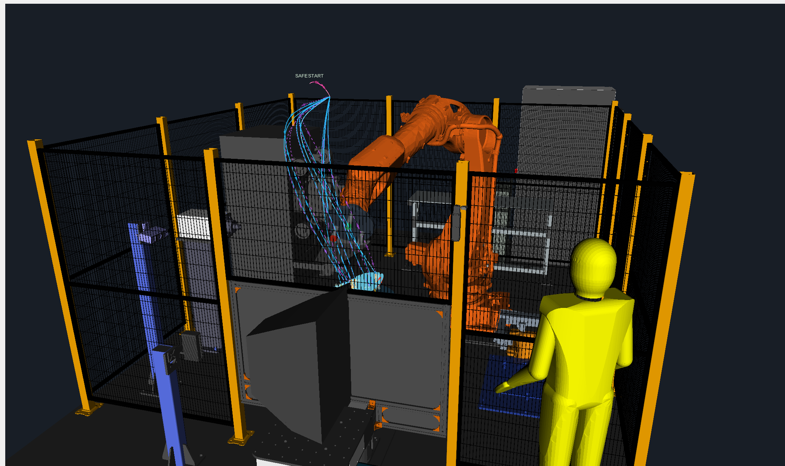

# 阶段进展汇报11\.19

## 一、阶段进展

### 1\.1 实验进展：

将仿真环境进一步修改，对自动修改轨迹模块进行简单的适配，接入机器人底座打磨定位工装和抓手。对415等器件进行测试。测试4种工件、共75个路径段，11段完整通过仿真验收，完整通过率为14\.7%，另有19段实现部分覆盖。自动修正帮助4段完整通过，但整体通过率仍偏低，受碰撞干涉和搜索超时限制。

### 1\.2 实验环境：

|**项目**|**本轮设置**|
|---|---|
|仿真平台|采用 Docker 29\.8\.2，容器运行 Ubuntu 22\.04\.5 LTS、ROS 2 Humble、RViz 2 11\.2\.28 和 Python 3\.10\.12|
|工件与点云|接入 Real3D\-AD 真实扫描数据，支持多类工件选择与外部点云上传|
|工具与夹具|公司的相关CAD|
|运行硬件|个人PC，RTX 3050 Ti Laptop GPU（4 GB 显存）；Docker 可用逻辑处理器 16 个、内存约 7\.57 GiB，内存16G。|

### 1\.3 实验结果：

1\.环境调整

根据公司提供的CAD进行调整

2\.测试结果

对415等四种器件进行测试

总结：

本次测试4种工件、共75个路径段，11段完整通过仿真验收，完整通过率为14\.7%，另有19段实现部分覆盖。轨迹生成时间也增加了（以415型工件为例，时间增长238s），自动修正帮助4段完整通过，但整体通过率仍偏低。主要原因为仿真环境调整以及新工件的加入，限制机械臂的展开。

3\.新工件的加入

[20261118\-1558\-19\.2075716\.mp4](assets/阶段进展汇报11.19__wiki-FCaxwgXVui5vZQky5CPceyAsnYg/图片和附件/20261118-1558-19.2075716.mp4)

出现碰撞等安全问题会有明显的提示

## 二、下一步计划

下一步计划为：

1\.把原有仿真的成果向新的仿真环境进一步适配

2\.打磨方式调整，在仿真中计算出合适的工件的具体布置位置

3\.继续对部分打磨的情况探索打磨策略

## 三、近期需求

|希望解决的问题|对应预期结果|
|---|---|
|新发来的工件是用机械臂抓住工件在固定砂带加工的，与原先的打磨方法有出入。 |探讨合适方案接入到仿真系统中|

相关文档：

[实验场景CAD](实验场景CAD__wiki-DcSTwrDfMiZI1xkN19hctDyUnfd.md)

