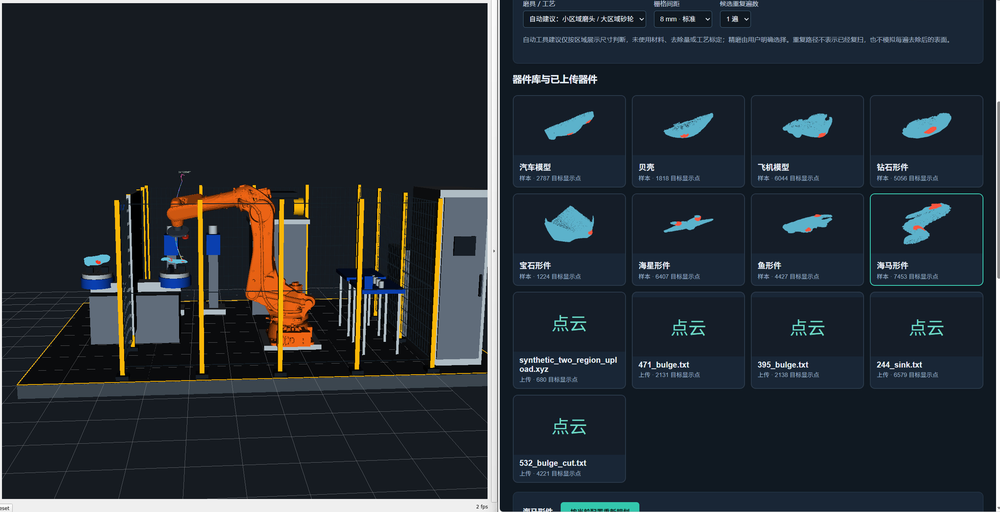

# 阶段进展汇报11\.5

## 一、阶段进展

1\.根据[军山校区具身打磨实验场地设计](军山校区具身打磨实验场地设计__wiki-V2qpw4mVniSwBYkT90cccR19nRU.md)和[戴屹机械臂资料](戴屹机械臂资料__wiki-IYQ6w9Dc1i0rrPkzUjMcaPtbn4b.md)，进一步修改仿真。有利于后续的安全验证。


2\. 搭建了一个根据指定加工区域生成路径、进行机械臂运动规划，并在碰撞检查后回放的打磨仿真原型，初步贯通了从点云输入到机器人运动展示的流程。

系统先将待加工区域划分为局部曲面块，生成连续扫描线作为加工段；遇到点云断开或表面方向突变时进一步分段。随后逐段检查机械臂能否完成接近、加工、撤离和返回，并验证逆解、运动连续性及碰撞。失败后自动调整或拆分重试，只执行通过验证的加工段。

仿真架构：

```Plain Text
网页端选择工件或上传点云
          ↓
读取加工区域
数据集标签／人工指定 ROI／确认整表面
          ↓
工件表面路径规划
生成加工线、法向，安排磨具和加工遍数
          ↓
机械臂运动规划
求逆解，生成进退刀、加工及转场轨迹
          ↓
碰撞检查与自动修正
失败后调整候选；超预算转人工
          ↓
RViz 回放通过的轨迹
网页反馈状态，保存规划与修正报告
```

目前实现的功能有：

轨迹修正采用的方法：

效果展示




[20261104\-1346\-15\.8326399\.mp4](assets/阶段进展汇报11.5__wiki-AMLswD7tVinrP4kqeCzcLo5On4c/图片和附件/20261104-1346-15.8326399.mp4)


实验不足：


## 二、下一步计划


1\.优化轨迹自动修正模块，并接入仿真中

2\.优化轨迹生成的步骤，加快生成速度

3\.接入打磨工具和转换器的相关数据


## 三、近期需求


|希望获得的支持|对应预期结果|
|---|---|
|打磨工具和转换器的尺寸或者CAD<br><br>|接入到仿真系统中，补足几何不通过的阶段|


### 参考文献

1. [军山校区具身打磨实验场地设计](军山校区具身打磨实验场地设计__wiki-V2qpw4mVniSwBYkT90cccR19nRU.md)

2. [戴屹机械臂资料](戴屹机械臂资料__wiki-IYQ6w9Dc1i0rrPkzUjMcaPtbn4b.md)

3. [打磨仿真代码结构与功能说明](打磨仿真代码结构与功能说明__wiki-PhBcwsse4iDOlokbVw1ccdr4n7c.md)

4. [数据集使用说明](数据集使用说明__wiki-L6C6wo1wliCOFQkEzhLcWKaZnbb.md)


