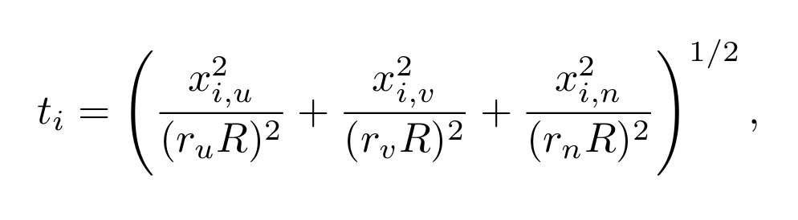

# 飞边异常数据合成

痛点：目前网络上没有找到任何开源的针对于飞边异常的数据集，企业的点云数据数量应该也会是有限的，不足以支撑后续对视觉网络的训练；如果用 CAD 手动生成飞边将会非常耗时耗力，所有需要一种更省时省力的简单的方法生成飞边异常。

## *Anomaly Factory 3D: A Modular Framework for Diverse Pseudo\-Anomaly Synthesis in Unsupervised 3D Anomaly Detection*

这篇论文提出的是一个"在正常点云上造伪缺陷"的通用框架——用一个中心点、一个局部坐标系、一个椭球形衰减核，就能造出十几种不同形态的凸起、凹坑、脊、沟、错位，用来给缺陷检测网络造训练数据。

> ## 论文信息
> 
> 论文标题是 *Anomaly Factory 3D: A Modular Framework for Diverse Pseudo\-Anomaly Synthesis in Unsupervised 3D Anomaly Detection*，简称 **AF3AD**，投稿 ECCV 2026，作者是 Ali Balapour 和 Faraz Hach。代码开源在 github\.com/vpc\-ccg/AF3AD，采用 MIT 许可，只依赖 numpy。
> 
> 

## 它要解决什么问题

工业上做三维缺陷检测，缺陷样本太少是其一大困难：一个正常批次的零件几乎没有缺陷，而缺陷的形态又千变万化。AF3AD 的目标就是把"造缺陷"这件事抽出来，做成一个和检测算法无关的独立模块：输入正常点云，输出带缺陷的点云和对应的标注掩膜，任何检测算法都能拿来用。

## 核心方法

先随机挑一个中心点，在它周围用一个椭球圈出影响范围。然后用中心点周围的一些近邻点做一次局部 PCA，得到三个互相垂直的方向：两个沿表面的切向和一个法向，相当于给这个局部位置建了一套坐标轴。

接着把这个椭球范围内的每个点都换算到这套坐标轴下，算出它在三个方向上离中心多远，三个方向各自除以自己的半轴长度，合成一个归一化距离 t：t 越小表示离中心越近。最后把这个 t 代进核函数，得到一个 0 到 1 之间的权重：中心的点权重接近 1，到椭球边界的点权重降到 0，边界以外就是 0，完全不动。然后让最大幅度和代表方向的正负作用于权重来决定这个点凸起或者凹陷的程度。

> 整篇论文的方法可以压缩成一个公式。对点云里的每个点，位移量等于"符号 × 最大幅度 × 空间权重 × 方向"：
> 
> 
> 
> 其中** s** 是正负号，正号表示往外凸、负号表示往里凹。**B** 是最大位移幅度。**K\(t\)** 是核函数，可以取余弦、高斯或多项式，控制从中心到边界的衰减快慢，不同核函数可以改变凸起或者凹陷的形态。**g** 是门控系数，可以把变形限制在半个空间里，这样就能造出单侧凸起而不是对称的鼓包。**d** 是方向单位向量，可以取局部坐标系的法向、切向或副切向，分别对应"顶起来"、"横向错动"两类缺陷。
> 
> 公式里的 t 是一个"归一化距离"，它决定了每个点的权重有多大。先选中一个中心点记为 c，在该点周围用PCA 来算出一个局部坐标系，三个轴分别是两个切向 u、v 和法向 n。把每个点换算到这个局部坐标系里，得到它在三个方向上的偏移量 x\_u、x\_v、x\_n，再用三个"半轴长度"分别去除它：
> 
> 
> 
> R 是一个基准半径，ru、rv、rn 是三个无量纲的比例。三个半轴长度不一样，等值面就是一个椭球：把 ru 调大、rv 调小，椭球就变成一根细长的条，造出来的缺陷就是脊或沟，而不是圆鼓包。
> 
> 

## 结果

在数据集的正常样本上生成伪异常作为训练集，分别训练偏移预测型（PO3AD 改造）与重建型（R3D\-AD）两类不同范式的检测网络，再在数据集自带的真实缺陷测试集上评估。在 AnomalyShapeNet 上物体级/点级 AUROC 达 91\.5% / 92\.5%。

> AUROC ：设有二分类任务，样本 x 的真实标签 y ∈ \{\+1, \-1\}（\+1 为异常，\-1 为正常），检测器输出一个实值评分函数 s\(x\) ∈ ℝ，评分越高表示越可能为异常。
> 
> 

## 启发和改进

我们做的是铸件飞边，不是通用的凸起凹坑，所以不能直接套用，需要改造。

改进的第一处是原点。原论文以"一个中心点"为原点，缺陷的大小和形态都由以这个点为中心的椭球来决定。但飞边是要沿着分型线延伸的，无法用一个中心点来决定，硬要用就得沿线串联很多个中心点，结果每个中心点造出一个鼓包，接起来容易得到锯齿。我的改进做法是把原点换成"分型线上的垂足"——每个表面点各自去找分型线上离它最近的那个点，这样沿走向就没有中心点的概念了。

第二处是距离 t 的计算。原论文的距离 t 是由点云从三个垂直方向到中心点云的距离来决定的，而沿着分型线方向的距离在飞边的场景里是多余的：既然每个点都找垂足，垂足条件本身就保证了沿走向的偏移为零，所以只剩"竖直"和"法向"两项。沿走向的形状也可由参数进行控制，用来模拟飞边会有不规则的起伏，且不再有锯齿。

$t(\mathbf{p}) = \sqrt{
     \left( \frac{d_v(\mathbf{p})}{v_h(s)} \right)^{2}
     +
     \left( \frac{d_n(\mathbf{p})}{n_{\mathrm{half}}} \right)^{2}
   }$

其中：d\_v、d\_n 是点相对分型线垂足在局部 v 轴、法向上的偏移，vh\(s\) 是沿走向变化的厚度半值，n\_half 是法向容差

第三是关于飞边的分型线，可以使用 CloudCompare 来对工件点云进行可视化操作，可以通过自己选点来确定分型线的位置也可以通过裁剪框选来快速确定分型线。

## 飞边数据集的多样性

生成器的参数可以随机变化，随机性能给飞边带来真实性。并且造出来的形状分布足够宽，比如厚度从零点几毫米到接近两毫米、外伸从几乎为零到六毫米、有的地方连续有的地方断开。在改进的方法里都可通过修改参数来实现生成飞边的高度和厚度的变化范围。然后是分型线的形状要覆盖直线、平面圆弧、斜线、S 形曲面、整圈闭合，以及只占一小段的局部飞边。可以通过自己手动指定分型线点云来实现。

### 飞边形态可调参数

|参数|默认值|含义|
|---|---|---|
|`--bmin`|0\.3|外伸高度的下限|
|`--bmax`|5\.0|外伸高度的上限；约四分之一的控制点会再抬到该值的 1\.0 至 1\.4 倍，模拟浇口、镶块附近的厚飞边|
|`--vhlo`|0\.3|厚度半值的下限；厚度等于该值的两倍|
|`--vhhi`|0\.8|厚度半值的上限；例如 0\.15 与 0\.30 对应成品厚度 0\.3 至 0\.6 毫米|
|`--vstep`|0\.06|厚度方向的层间距；飞边越薄要越小，否则每列只有两三层点|
|`--kvec`|auto|分型面法向，即模具开合方向；auto 表示由分型线点做主成分分析自动估计，也可写 `z`、`y`、`x` 或 `0,0,1`|

### 扰动

|参数|默认值|含义|
|---|---|---|
|`--ju`|0\.20|沿走向切向的高斯扰动标准差，用于打散“一列列”的规则网格|
|`--jv`|0\.025|沿厚度方向（分型面法向）的扰动标准差，用于打散“一层层”，三个扰动中最见效|
|`--jn`|0\.04|沿推出方向的扰动标准差，用于打破表面的平整感|

## 需要明确的问题

企业可以给出一些样例点云数据

分型线的位置和形态：分型面在零件的大致什么高度、什么方向。

飞边的实际尺寸范围：厚度大概多少（0\.3mm 到 3mm 差异极大）、外伸宽度多少、沿分型线的连续情况如何，是一整圈都在，还是常常一段一段断开。

