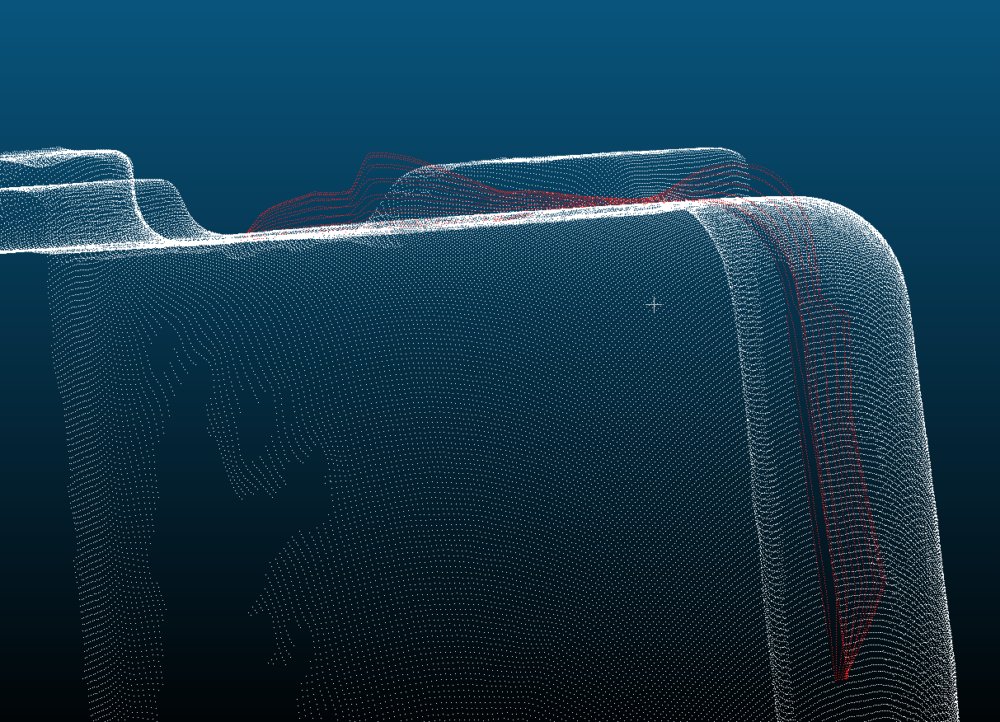

# 飞边缺陷合成

### **目标：**通过仿造飞边缺陷来解决数据集缺少的问题

### **以往工作**：[飞边异常数据合成](飞边异常数据合成__docx-BsOsdBM5collgPxMkdAcaywfnZf.md)

### **参考论文：**

#### *Anomaly Factory 3D: A Modular Framework for Diverse Pseudo\-Anomaly Synthesis in Unsupervised 3D Anomaly Detection*

这篇论文提出的是一个"在正常点云上造伪缺陷"的通用框架——用一个中心点、一个局部坐标系、一个椭球形衰减核，就能造出十几种不同形态的凸起、凹坑、脊、沟、错位，用来给缺陷检测网络造训练数据。

> #### 论文信息
> 
> 论文标题是 *Anomaly Factory 3D: A Modular Framework for Diverse Pseudo\-Anomaly Synthesis in Unsupervised 3D Anomaly Detection*，简称 **AF3AD**，投稿 ECCV 2026，作者是 Ali Balapour 和 Faraz Hach。代码开源在 github\.com/vpc\-ccg/AF3AD，采用 MIT 许可，只依赖 numpy。
> 
> 

### **核心方法：**

以实测工件点云和人工选取的分型线点为输入，先对分型线进行平滑拟合，并按等弧长重新采样，使采样点沿曲线均匀分布。在以这条分型线为中心的形状可以控制的带状区域里的点云沿该处的表面法向向外抬升。抬升量沿分型线方向随机变化，在厚度方向由中心向两侧逐渐减小，并在边缘处收敛到零。抬升量随厚度方向的衰减可采用余弦形式或高斯函数的形式的平滑曲线，使飞边顶部呈圆顶、侧面呈柔和曲面，并与本体在根部自然衔接，更好地模拟采集到的真实飞边的情况。

### **改进：**

现在有了真实的扫描的工件及其飞边点云，能更好的模仿真实的飞边点云情况。因为将分型线附近的点云抬升为飞边点云的过程中会让点云变得很稀疏，所以加入了加密操作，先将以分型线为中心的带状区域的点进行加密，然后再抬升为飞边点云。整体上向真实扫描出来的飞边点云更加靠近。

### **飞边数据集的多样性：**

生成器的参数可以随机变化，随机性能给飞边带来真实性。并且造出来的形状分布足够宽，比如厚度从零点几毫米到接近两毫米、外伸从几乎为零到六毫米、有的地方连续有的地方断开。在该方法里都可通过修改参数来实现生成飞边的高度和厚度的变化范围。然后是分型线的形状要覆盖直线、平面圆弧、斜线、S 形曲面、整圈闭合，以及只占一小段的局部飞边。可以通过自己手动指定分型线点云来实现。      

### 需求：

根据搜集到的论文推测需要 15\~20 种零件 × 50\~80 变体 来进行网络训练

因为我们现有的零件数量有限，公司可以提供10种左右不同种类零件的点云，飞边零件点云可以提供一些参考样本后由我们自己通过合成飞边缺陷的方式扩充变体，或者有充足的真实点云数据更好。

